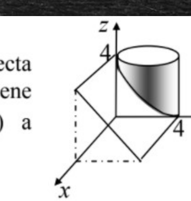

# Repaso para el 2.º Parcial

Análisis Matemático II — UTN-FRBA.

Ejercicios de las diapositivas de repaso de la cátedra:

- [Repaso-Segundo-Parcial-Enunciados.pdf](../aula-virtual/Parciales/Segundo-Parcial/Repaso-Segundo-Parcial-Enunciados.pdf): sólo los enunciados.
- [Repaso-Segundo-Parcial-Resuelto.pdf](../aula-virtual/Parciales/Segundo-Parcial/Repaso-Segundo-Parcial-Resuelto.pdf): resueltos en el pizarrón.

La numeración salta del 7 al 9 en el original (no hay ejercicio 8 numerado). Algunas diapositivas resuelven ejercicios de la guía que ya están en este repositorio:

- TP12 – 6d y TP12 – 12 ([Unidad 12](../Unidad%2012%20-%20Ecuaciones%20Diferenciales%20II/practica.md));
- TP9 – 12a y 12b ([Unidad 9](../Unidad%2009%20-%20Integrales%20Multiples/practica.md));
- TP11 – 14 ([Unidad 11](../Unidad%2011%20-%20Teoremas%20Integrales/practica.md)).

Cada ejercicio tiene un botón **Solución**. Al abrirlo aparece la respuesta y, arriba de ella, un segundo botón **Solución paso a paso** con el desarrollo completo.

---

### Pizarrón) Área de un trozo de cilindro

*Ejercicio resuelto en el pizarrón (enunciado tomado de la diapositiva):* Calcular el área de $x^2 + z^2 = 5$ con $0 \le y \le x$, $x \le 1$.

<b>Solución</b>

Solución paso a paso

**Paso 1 — Parametrización** de la mitad $z \ge 0$: $\vec T(u,v) = (u,\ v,\ \sqrt{5 - u^2})$.

$$\vec T'_u\times\vec T'_v = \left(\frac{u}{\sqrt{5 - u^2}},\ 0,\ 1\right), \qquad \lVert\vec T'_u\times\vec T'_v\rVert = \sqrt{\frac{u^2}{5 - u^2} + 1} = \frac{\sqrt5}{\sqrt{5 - u^2}}$$

**Paso 2 — Región.** $0 \le v \le u \le 1$.

**Paso 3 — Área de una mitad.**

$$\int_0^1\negthinspace\negthinspace\int_0^u\frac{\sqrt5}{\sqrt{5 - u^2}}\thinspace dv\thinspace du = \sqrt5\int_0^1\frac{u}{\sqrt{5 - u^2}}\thinspace du = \sqrt5\left[-\sqrt{5 - u^2}\right]_0^1 = \sqrt5(\sqrt5 - 2) = 5 - 2\sqrt5$$

**Paso 4 — Total.** La superficie $x^2 + z^2 = 5$ tiene dos mitades ($z \ge 0$ y $z \le 0$), y el pizarrón multiplica por 2:

$$A = 2(5 - 2\sqrt5) = 10 - 4\sqrt5 \approx 1{,}06$$

**Respuesta:** $A = 10 - 4\sqrt5$ (cada mitad, $z \ge 0$ o $z \le 0$, aporta $5 - 2\sqrt5$).

---

### Ejercicio 1) Flujo igual al volumen

Sea $\vec f(x,y,z) = (x + g'(x),\ y\thinspace g'(x),\ -2z\thinspace g(x))$ con $\vec f \in C^1(\Re^3)$ y $\vec f(0,0,1) = (2,0,0)$. **Halle** $g(x)$ de manera que el flujo de $\vec f$ a través de la superficie frontera de un cuerpo esférico de radio $R > 0$ resulte numéricamente igual al volumen del cuerpo. **Indique** gráficamente cómo decidió orientar a la superficie.

<b>Solución</b>

Solución paso a paso

**Paso 1 — Condición.** Por el teorema de la divergencia (normal saliente), $\oint\negthinspace\negthinspace\oint = \iiint\mathop{\mathrm{div}}\vec f\thinspace dV$. Para que sea igual al volumen para **toda** esfera, alcanza con $\mathop{\mathrm{div}}\vec f = 1$.

**Paso 2 — Divergencia.**

$$\mathop{\mathrm{div}}\vec f = (1 + g'') + g' - 2g = 1 \ \Rightarrow\ g'' + g' - 2g = 0$$

**Paso 3 — Resolver.** $r^2 + r - 2 = 0 \Rightarrow r = 1,\ -2$ ⇒ $g = C_1e^x + C_2e^{-2x}$.

**Paso 4 — Condiciones.** $\vec f(0,0,1) = (g'(0),\ 0,\ -2g(0)) = (2, 0, 0)$:

- $g(0) = C_1 + C_2 = 0$;
- $g'(0) = C_1 - 2C_2 = 2$.

Entonces $C_2 = -\frac23$ y $C_1 = \frac23$.

**Respuesta:** $g(x) = \dfrac23\left(e^x - e^{-2x}\right)$, con la superficie esférica orientada con normal saliente.

---

### Ejercicio 2) Flujo a través de un casquete esférico

Dada la superficie abierta $\Sigma$ de ecuación $x^2 + y^2 + z^2 = 5$ con $z \ge 1$ y el campo vectorial $\vec f \in C^1(\Re^3)$ tal que $\vec f(x,y,z) = (2x + g(yz),\ 3y + xz,\ 5z)$, **calcule** el flujo de $\vec f$ a través de $\Sigma$ orientada hacia $z^+$.

<b>Solución</b>

Solución paso a paso

**Paso 1 — Divergencia.** $2 + 3 + 5 = 10$, porque $g(yz)$ no depende de $x$.

**Paso 2 — Cerrar con la tapa** $T$: $z = 1$, $x^2 + y^2 \le 4$. Con normal saliente, $\Sigma$ apunta hacia $z^+$ (lo pedido) y $T$ hacia $z^-$.

**Paso 3 — Integral triple.** El volumen del casquete es $\frac{2\pi(5\sqrt5 - 7)}{3}$ (ver el 2.º parcial del 18/06/2019, P3):

$$\iiint 10\thinspace dV = \frac{20\pi(5\sqrt5 - 7)}{3}$$

**Paso 4 — Tapa.** $\vec f\cdot(0,0,-1) = -5z = -5$ ⇒ $\Phi_T = -5\cdot4\pi = -20\pi$.

**Paso 5 — Resultado.**

$$\Phi_\Sigma = \frac{20\pi(5\sqrt5 - 7)}{3} + 20\pi = \frac{20\pi(5\sqrt5 - 4)}{3} \approx 150{,}6$$

(En el pizarrón quedó escrito "falta restar el flujo por $z = 1$"; este es ese paso.)

**Respuesta:** $\dfrac{20\pi(5\sqrt5 - 4)}{3}$.

---

### Ejercicio 3) Volumen entre un cono y un paraboloide

**Calcule** el volumen del cuerpo definido por $z \ge \sqrt{x^2 + y^2}$, $z \le 2 - x^2 - y^2$.

<b>Solución</b>

Solución paso a paso

**Paso 1 — Intersección.** $r = 2 - r^2 \Rightarrow r = 1$, es decir $z = 1$ y $x^2 + y^2 = 1$.

**Paso 2 — Integral en cilíndricas.**

$$V = \int_0^{2\pi}\negthinspace\negthinspace\int_0^1\negthinspace\negthinspace\int_r^{2 - r^2}r\thinspace dz\thinspace dr\thinspace d\varphi = 2\pi\int_0^1(2r - r^3 - r^2)\thinspace dr = 2\pi\left(1 - \frac14 - \frac13\right) = \frac{5\pi}{6}$$

**Respuesta:** $V = \dfrac{5\pi}{6}$.

---

### Pizarrón) Circulación sobre una curva cerrada

*Ejercicio del pizarrón:* $\vec f(x,y,z) = (2x;\ z;\ y)$, calcular $\oint_C\vec f\cdot d\vec s$ si $C: \begin{cases} z - x = 2 \cr x^2 + y^2 + z^2 = 4z \end{cases}$ (sentido antihorario).

<b>Solución</b>

Solución paso a paso

$\vec f = \nabla(x^2 + yz)$ es un campo de gradientes en $\Re^3$ (también: $\mathop{\mathrm{rot}}\vec f = (1 - 1,\ 0,\ 0) = \vec 0$). $C$ es una curva **cerrada**, la intersección de un plano con una esfera ⇒ la circulación es 0, para cualquier sentido de recorrido.

**Respuesta:** $0$.

---

### Ejercicio 4) Flujo a través de un cilindro parabólico

Dado $\vec f(x,y,z) = (x^2,\ yz,\ 2xz)$, **calcule** el flujo de $\vec f$ a través de la superficie $\Sigma$ de ecuación $z = 16 - x^2$ con $y \le x$ en el 1° octante; **indique** gráficamente cómo ha decidido orientar a $\Sigma$.

<b>Solución</b>

Solución paso a paso

**Paso 1 — Parametrización.** $\vec T(u,v) = (u,\ v,\ 16 - u^2)$, con $\vec T'_u\times\vec T'_v = (2u,\ 0,\ 1)$ (hacia arriba).

**Paso 2 — Región.** 1.er octante e $y \le x$, con $z \ge 0 \Rightarrow u \le 4$: $0 \le v \le u \le 4$.

**Paso 3 — Integrando.**

$$\vec f\cdot\vec N = 2u\cdot u^2 + 2u(16 - u^2) = 32u$$

**Paso 4 — Integral.**

$$\int_0^4\negthinspace\negthinspace\int_0^u 32u\thinspace dv\thinspace du = \int_0^4 32u^2\thinspace du = \frac{2048}{3}$$

**Respuesta:** $\dfrac{2048}{3}$, con $\Sigma$ orientada hacia $z^+$.

---

### Ejercicio 5) Circulación con Green

Dado $\vec f(x,y) = (x^2,\ xy)$, **calcule** la circulación en sentido positivo de $\vec f$ a lo largo de la curva frontera de la región plana definida por: $x^2 + y^2 \ge 1$, $x^2 + y^2 \le 2x$, $y \ge 0$.

<b>Solución</b>

Solución paso a paso

**Paso 1 — Green.** $Q'_x - P'_y = y - 0 = y$.

**Paso 2 — Región en polares.** $1 \le r \le 2\cos\varphi$. Las circunferencias se cortan donde $2\cos\varphi = 1$, es decir $\varphi = \frac\pi3$; con $y \ge 0$ queda $\varphi\in[0, \frac\pi3]$.

**Paso 3 — Integral.**

$$\int_0^{\pi/3}\negthinspace\negthinspace\int_1^{2\cos\varphi}r\mathop{\mathrm{sen}}\varphi\thinspace r\thinspace dr\thinspace d\varphi = \int_0^{\pi/3}\left(\frac83\cos^3\varphi - \frac13\right)\mathop{\mathrm{sen}}\varphi\thinspace d\varphi$$

**Paso 4 — Calcular.**

- Primer término: $\dfrac83\left[-\dfrac{\cos^4\varphi}{4}\right]_0^{\pi/3} = \dfrac23\left(1 - \dfrac{1}{16}\right) = \dfrac58$.
- Segundo término: $\dfrac13\left[\cos\varphi\right]_0^{\pi/3} = \dfrac13\left(\dfrac12 - 1\right) = -\dfrac16$.

$$\oint = \frac58 - \frac16 = \frac{11}{24}$$

> En el pizarrón el resultado quedó $\frac18$, por un error de signo al evaluar $-\frac13\cos\varphi$ entre los límites. El valor correcto es $\frac{11}{24}$.

**Respuesta:** $\dfrac{11}{24}$.

---

### Ejercicio 6) Flujo a través de un triángulo

Sea $\Sigma$ el trozo de plano sombreado en la figura: el triángulo de vértices $(2,0,0)$, $(0,2,0)$ y $(0,0,3)$, con el versor normal $\breve n$ apuntando hacia afuera del origen. **Calcule** el flujo de $\vec f$ a través de $\Sigma$ orientado según el $\breve n$ que se indica, sabiendo que $\vec f(x,y,z) = (2y,\ 2x,\ 2z)$.

<b>Solución</b>

Solución paso a paso

**Paso 1 — Plano.** $3x + 3y + 2z = 6 \Rightarrow z = \dfrac{6 - 3u - 3v}{2}$, con $\vec N = \left(\frac32, \frac32, 1\right)$, que apunta hacia afuera del origen.

**Paso 2 — Integrando.**

$$\vec f\cdot\vec N = 3v + 3u + (6 - 3u - 3v) = 6$$

**Paso 3 — Integral.** La región $D$ ($u, v \ge 0$, $u + v \le 2$) tiene área 2 ⇒ $\Phi = 6\cdot2 = 12$.

**Respuesta:** $12$.

---

### Ejercicio 7) Circulación sobre un arco

Dado $\vec f(x,y,z) = (xy,\ -y^2,\ z^2)$, **calcule** la circulación de $\vec f$ a lo largo de la curva intersección de las superficies de ecuaciones $z = 9 - x^2$ y $z = y$ desde $\bar A = (3,0,0)$ hasta $\bar B = (0,9,9)$ con $x,y,z \in \Re_0^+$.

<b>Solución</b>

Solución paso a paso

**Paso 1 — ¿Conservativo?** $P'_y = x \ne Q'_x = 0$ ⇒ no. Hay que parametrizar.

**Paso 2 — Parametrización.** $\vec\gamma(t) = (t,\ 9 - t^2,\ 9 - t^2)$, con $t$ de 3 a 0 (sentido de $A$ a $B$), y $\vec\gamma' = (1,\ -2t,\ -2t)$.

**Paso 3 — Integrando.**

$$\vec f\cdot\vec\gamma' = t(9 - t^2) + 2t(9 - t^2)^2 - 2t(9 - t^2)^2 = t(9 - t^2)$$

**Paso 4 — Integral.**

$$\int_3^0 t(9 - t^2)\thinspace dt = -\left[\frac{9t^2}{2} - \frac{t^4}{4}\right]_0^3 = -\frac{81}{4}$$

**Respuesta:** $-\dfrac{81}{4}$.

---

### Pizarrón) Volumen de un tronco de cono

*Diapositiva sin número (entre los ejercicios 7 y 9):* calcular el volumen del cuerpo $\sqrt{x^2 + y^2} \le z \le 4$, $z \ge 1$.

<b>Solución</b>

Solución paso a paso

A altura $z$, la sección es el disco $r \le z$, de área $\pi z^2$:

$$V = \int_1^4\pi z^2\thinspace dz = \pi\thinspace\frac{64 - 1}{3} = 21\pi$$

Es el volumen del cono hasta $z = 4$ menos el del cono hasta $z = 1$, que es la descomposición que se dibuja en el pizarrón.

**Respuesta:** $V = 21\pi$.

---

### Ejercicio 9) Longitud de una línea de campo

Dado $\vec f(x,y) = (y,\ -x)$, **calcule** la longitud de la línea de campo que pasa por el punto $(3,4)$.

<b>Solución</b>

Solución paso a paso

**Paso 1 — Líneas de campo.** $y' = \dfrac{-x}{y} \Rightarrow y\thinspace dy = -x\thinspace dx \Rightarrow x^2 + y^2 = C$: circunferencias centradas en el origen.

**Paso 2 — La que pasa por $(3,4)$:** $x^2 + y^2 = 25$, de radio 5.

**Paso 3 — Longitud.** $2\pi\cdot5 = 10\pi$.

**Respuesta:** $10\pi$.

---

### Ejercicio 10) Área de un trozo de cono

**Calcule** el área del trozo de superficie cónica de ecuación $z = \sqrt{4x^2 + 4y^2}$ con $z \le 4$ en el 1° octante.

<b>Solución</b>

Solución paso a paso

**Paso 1 — Elemento de área.** $z = 2\sqrt{x^2+y^2}$ ⇒ $\lVert\vec N\rVert = \sqrt{1 + 4} = \sqrt5$.

**Paso 2 — Región.** $z \le 4 \Rightarrow r \le 2$; en el 1.er octante es un cuarto de disco, de área $\pi$.

**Paso 3 — Área.** $A = \sqrt5\cdot\pi$.

**Respuesta:** $\sqrt5\thinspace\pi$.

---

### Ejercicio 11) Flujo a través de un casquete esférico

Sea $\vec f \in C^1$ tal que $\vec f(x,y,z) = (x\thinspace\varphi(xy),\ y - y\thinspace\varphi(xy),\ 3z^2 - z)$, **calcule** el flujo de $\vec f$ a través del trozo de superficie esférica de ecuación $x^2 + y^2 + z^2 = 5$ con $z \ge 1$. **Indique** gráficamente cómo orientó la superficie.

<b>Solución</b>

Solución paso a paso

**Paso 1 — Divergencia.**

$$(\varphi + xy\varphi') + (1 - \varphi - xy\varphi') + (6z - 1) = 6z$$

**Paso 2 — Integral triple sobre el casquete** $H$: $1 \le z \le \sqrt5$, por secciones de área $\pi(5 - z^2)$:

$$\iiint_H 6z\thinspace dV = 6\pi\int_1^{\sqrt5}z(5 - z^2)\thinspace dz = 6\pi\left[\frac{5z^2}{2} - \frac{z^4}{4}\right]_1^{\sqrt5} = 6\pi\left(\frac{25}{4} - \frac94\right) = 24\pi$$

**Paso 3 — Tapa** $z = 1$, $r \le 2$, con normal saliente $(0,0,-1)$: $\vec f\cdot\breve n = -(3 - 1) = -2$ ⇒ $\Phi_T = -2\cdot4\pi = -8\pi$.

**Paso 4 — Resultado** (casquete con normal saliente, hacia arriba):

$$\Phi_S = 24\pi - (-8\pi) = 32\pi$$

> En el pizarrón la integral triple dio $36\pi$ (y el resultado final $44\pi$) porque al evaluar $3rz^2$ entre $z = 1$ y $z = \sqrt{5 - r^2}$ quedó $3r(5 - r^2)$ en lugar de $3r(5 - r^2 - 1)$. El valor correcto es $24\pi$, y el flujo es $32\pi$.

**Respuesta:** $32\pi$, con la superficie orientada hacia afuera de la esfera ($\breve n\cdot\breve k > 0$).

---

### Ejercicio 12) Flujo a través de un trozo de cilindro

Sea $S$ en el primer octante el trozo sombreado de superficie cilíndrica circular recta de la figura, cuyos puntos están por encima del plano paralelo al eje $x$ que contiene a los puntos $(0,4,0)$ y $(0,0,4)$. **Calcule** el flujo de $\vec f(x,y,z) = (5 - 2y,\ 2x,\ 3z)$ a través de $S$ orientada hacia $x^+$.

<b>Solución</b>

Solución paso a paso

**Paso 1 — Interpretar la figura.**

- El cilindro tiene eje vertical, altura 4 y su base pasa por el origen y por $(0,4,0)$: es $x^2 + (y - 2)^2 = 4$, con $0 \le z \le 4$.
- El plano que contiene al eje $x$ (dirección) y a los puntos $(0,4,0)$ y $(0,0,4)$ es $y + z = 4$.
- $S$ es la mitad con $x \ge 0$ (1.er octante) y $z \ge 4 - y$.

**Paso 2 — Parametrización.** $x = 2\cos\theta$, $y = 2 + 2\mathop{\mathrm{sen}}\theta$, con $\theta\in[-\frac\pi2, \frac\pi2]$. La normal saliente, que tiene componente $x \ge 0$, es $\breve n = (\cos\theta,\ \mathop{\mathrm{sen}}\theta,\ 0)$, y $d\sigma = 2\thinspace d\theta\thinspace dz$.

**Paso 3 — Integrando.**

$$\vec f\cdot\breve n = (5 - 4 - 4\mathop{\mathrm{sen}}\theta)\cos\theta + 4\cos\theta\mathop{\mathrm{sen}}\theta = \cos\theta$$

**Paso 4 — Límites en $z$.** De $4 - y = 2 - 2\mathop{\mathrm{sen}}\theta$ hasta $4$: longitud $2 + 2\mathop{\mathrm{sen}}\theta$.

**Paso 5 — Integral.**

$$\Phi = \int_{-\pi/2}^{\pi/2}\cos\theta\thinspace(2 + 2\mathop{\mathrm{sen}}\theta)\cdot2\thinspace d\theta = 4\int_{-\pi/2}^{\pi/2}\cos\theta\thinspace d\theta + 4\int_{-\pi/2}^{\pi/2}\cos\theta\mathop{\mathrm{sen}}\theta\thinspace d\theta = 8 + 0 = 8$$

**Respuesta:** $8$ (este ejercicio no está resuelto en el PDF; la interpretación de la figura está explicada en el paso a paso).

---

### Pizarrón) Circulación de $\vec g + \nabla h$

*Diapositiva final:* Sea $\vec g(x,y,z) = (y,\ xy,\ z)$, $h(x,y,z) = z^2\thinspace w(x) - 2z\thinspace w(y)$, $w \in C^1$. Calcular la circulación de $\vec f(x,y,z) = (\vec g + \nabla h)(x,y,z)$ a través del arco $C: \begin{cases} x^2 + y^2 + z^2 = 8 \cr y = \sqrt{x^2 + z^2} \end{cases}$

<b>Solución</b>

Solución paso a paso

**Paso 1 — Curva.** $2y^2 = 8 \Rightarrow y = 2$, con $x^2 + z^2 = 4$: una circunferencia en el plano $y = 2$ (curva cerrada).

**Paso 2 — Rotor.** $\nabla h$ aporta circulación 0 (TP11 19c: $\mathop{\mathrm{rot}}\nabla h = \vec 0$), así que $\mathop{\mathrm{rot}}\vec f = \mathop{\mathrm{rot}}\vec g = (0,\ 0,\ y - 1)$.

**Paso 3 — Stokes** con el disco $y = 2$, $x^2 + z^2 \le 4$, de normal $(0, \pm1, 0)$:

$$\mathop{\mathrm{rot}}\vec f\cdot\breve n = 0 \ \Rightarrow\ \oint_C\vec f\cdot d\vec s = 0$$

**Respuesta:** $0$.

---

[← Volver al menú principal](../README.md)
