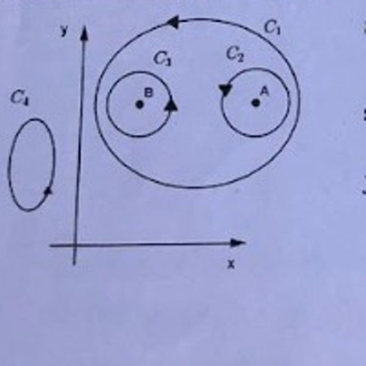

# 2.º Parcial (01/12/2012) — Curso Z2155

Análisis Matemático II — UTN-FRBA.

Enunciado (foto, sin resolución oficial): [Parcial2-2012-12-01-Z2155.jpeg](../aula-virtual/Parciales/Segundo-Parcial/fotos/Parcial2-2012-12-01-Z2155.jpeg).

Las resoluciones son propias (no hay solución de la cátedra). Cada ejercicio tiene un botón **Solución**. Al abrirlo aparece la respuesta y, arriba de ella, un segundo botón **Solución paso a paso** con el desarrollo completo.

---

## Ejercicios prácticos

### P1) Volumen entre un paraboloide y un cono

Plantear las integrales que permiten calcular el volumen del macizo M definido por $z \le 6 - x^2 - y^2$ ; $z \ge \sqrt{x^2 + y^2}$

<b>Solución</b>

Solución paso a paso

**Paso 1 — Intersección.** En cilíndricas ($x = r\cos\theta$, $y = r\mathop{\mathrm{sen}}\theta$, $z = z$, jacobiano $r$) las superficies son $z = 6 - r^2$ y $z = r$. Se cortan cuando $6 - r^2 = r \Rightarrow r^2 + r - 6 = 0 \Rightarrow r = 2$ (la raíz $r = -3$ no sirve).

**Paso 2 — Límites.** Para $0 \le r \le 2$ el cono queda debajo del paraboloide ($r \le 6 - r^2$), así que $r \le z \le 6 - r^2$, con $0 \le \theta \le 2\pi$.

**Paso 3 — Planteo.**

$$V = \int_0^{2\pi}\negthinspace\negthinspace\int_0^2\negthinspace\negthinspace\int_r^{6 - r^2} r\thinspace dz\thinspace dr\thinspace d\theta$$

**Paso 4 — (Opcional) Calcular.**

$$V = 2\pi\int_0^2(6r - r^3 - r^2)\thinspace dr = 2\pi\left(12 - 4 - \frac{8}{3}\right) = \frac{32\pi}{3}$$

**Respuesta:** $V = \displaystyle\int_0^{2\pi}\negthinspace\negthinspace\int_0^2\negthinspace\negthinspace\int_r^{6 - r^2} r\thinspace dz\thinspace dr\thinspace d\theta = \frac{32\pi}{3}$.

---

### P2) Integral de línea por dos caminos

a) Calcular $\int_C \vec f\thinspace d\vec s$ siendo $\vec f(x,y,z) = (x, z, y)$, si C es la curva parametrizada por $\vec g(t) = (t, t, t^2)$ con $1 \le t \le 2$.

b) Si es posible verifique el resultado anterior utilizando otro procedimiento.

<b>Solución</b>

Solución paso a paso

**a) Paso 1 — Derivada.** $\vec g'(t) = (1, 1, 2t)$ y $\vec f(\vec g(t)) = (t,\ t^2,\ t)$.

**Paso 2 — Integrar.**

$$\int_C\vec f\cdot d\vec s = \int_1^2(t + t^2 + 2t^2)\thinspace dt = \left[\frac{t^2}{2} + t^3\right]_1^2 = \frac{3}{2} + 7 = \frac{17}{2}$$

**b) Paso 1 — ¿Es conservativo?** $\nabla\times\vec f = (R'_y - Q'_z,\ P'_z - R'_x,\ Q'_x - P'_y) = (1 - 1,\ 0,\ 0) = \vec 0$ en $\mathbb{R}^3$, que es simplemente conexo ⇒ $\vec f$ es un campo de gradientes.

**Paso 2 — Potencial.** $\varphi = \frac{x^2}{2} + yz$ cumple $\nabla\varphi = (x, z, y)$.

**Paso 3 — Independencia del camino.** $\vec g(1) = (1,1,1)$, $\vec g(2) = (2,2,4)$:

$$\int_C\vec f\cdot d\vec s = \varphi(2,2,4) - \varphi(1,1,1) = (2 + 8) - \left(\tfrac12 + 1\right) = \frac{17}{2}\ ✓$$

**Respuesta:** a) $\dfrac{17}{2}$. b) Sí: $\vec f = \nabla\left(\frac{x^2}{2} + yz\right)$, y $\varphi(2,2,4) - \varphi(1,1,1) = \dfrac{17}{2}$.

---

### P3) Flujo a través de un plano

Calcular el flujo del campo $\vec f(x,y,z) = (e^{xy} + x;\ y + x^2;\ z^2 - y)$ a través de la porción de superficie $y + z = 3$ con $x^2 + z^2 \le 9$. Indique cómo ha decidido orientar la superficie.

<b>Solución</b>

Solución paso a paso

**Paso 1 — Parametrización.** Despejando $y = 3 - z$: $\vec T(x,z) = (x,\ 3 - z,\ z)$, con $D: x^2 + z^2 \le 9$.

**Paso 2 — Normal.** $\vec T'_x = (1,0,0)$, $\vec T'_z = (0,-1,1)$, $\vec T'_x\times\vec T'_z = (0,-1,-1)$. Se elige la opuesta, $\vec n = (0, 1, 1)$ (componente $z$ positiva: normal "hacia arriba").

**Paso 3 — Producto escalar.**

$$\vec f\cdot\vec n = (y + x^2) + (z^2 - y) = x^2 + z^2$$

El término $e^{xy}$ desaparece porque la normal no tiene componente $x$.

**Paso 4 — Polares en el plano $xz$.**

$$\Phi = \iint_D(x^2 + z^2)\thinspace dx\thinspace dz = \int_0^{2\pi}\negthinspace\negthinspace\int_0^3 r^3\thinspace dr\thinspace d\theta = 2\pi\cdot\frac{81}{4} = \frac{81\pi}{2}$$

**Respuesta:** Con la normal $\vec n = (0,1,1)$ (hacia $z$ positivo), $\Phi = \dfrac{81\pi}{2}$ (con la normal opuesta, $-\dfrac{81\pi}{2}$).

---

### P4) Circulación con Green en un sector circular

Sea $\vec f(x,y) = \left(-\dfrac{y^3}{3} + h(x);\ g(y) + \dfrac13 x^3\right)$ definido en $R^2$ con h y g de clase $C^1$, calcular la circulación de $\vec f$, a lo largo de la curva frontera de la región de $R^2$ definida por $x^2 + y^2 \le 9$ ; $|x| \le y$ Indique la orientación elegida para la curva.

<b>Solución</b>

Solución paso a paso

**Paso 1 — Green.** $\vec f \in C^1(\mathbb{R}^2)$ y la frontera es cerrada, simple y suave a trozos. Orientándola en sentido positivo (antihorario):

$$Q'_x - P'_y = x^2 - (-y^2) = x^2 + y^2$$

Las funciones $h(x)$ y $g(y)$ no aportan ($h$ no depende de $y$ y $g$ no depende de $x$).

**Paso 2 — Región.** $|x| \le y$ es el sector entre las rectas $y = x$ e $y = -x$ por encima del origen: en polares $\frac{\pi}{4} \le \theta \le \frac{3\pi}{4}$, $0 \le r \le 3$.

**Paso 3 — Calcular.**

$$\oint_C\vec f\cdot d\vec s = \int_{\pi/4}^{3\pi/4}\negthinspace\negthinspace\int_0^3 r^2\cdot r\thinspace dr\thinspace d\theta = \frac{\pi}{2}\cdot\frac{81}{4} = \frac{81\pi}{8}$$

**Respuesta:** En sentido antihorario, $\oint_C\vec f\cdot d\vec s = \dfrac{81\pi}{8}$.

---

## Ejercicios teóricos

### T1) Teorema de la divergencia con una tapa

a) Enunciar el teorema de la divergencia.

b) Calcule el flujo del campo $\vec f(x,y,z)$ a través de la porción de superficie $z = \sqrt{4 - x^2 - y^2}$, si se sabe que $div(\vec f) = 2$ y $\vec f(x,y,0) = (y^2 + x;\ y + x^2;\ 1)$

<b>Solución</b>

Solución paso a paso

**a) Enunciado:** sea $H \subset \mathbb{R}^3$ un sólido acotado cuya frontera $\partial H$ es una superficie cerrada, suave a trozos, orientada con la normal exterior, y sea $\vec f$ un campo $C^1$ en un abierto que contiene a $H$. Entonces

$$\iint_{\partial H}\vec f\cdot\vec n\thinspace dS = \iiint_H \operatorname{div}\vec f\thinspace dV$$

**b) Paso 1 — Cerrar la superficie.** $S$ es la semiesfera superior de radio 2. Se agrega la tapa $S_1$: $z = 0$, $x^2 + y^2 \le 4$. $S \cup S_1$ encierra la semibola $H$.

**Paso 2 — Gauss.** Con normal exterior:

$$\Phi_S + \Phi_{S_1} = \iiint_H 2\thinspace dV = 2\cdot\frac{1}{2}\cdot\frac{4}{3}\pi\thinspace 2^3 = \frac{32\pi}{3}$$

**Paso 3 — Flujo por la tapa.** En $S_1$ la normal exterior es $(0,0,-1)$ y se conoce $\vec f(x,y,0)$:

$$\Phi_{S_1} = \iint_{x^2 + y^2 \le 4}(y^2 + x,\ y + x^2,\ 1)\cdot(0,0,-1)\thinspace dA = -\text{Área} = -4\pi$$

**Paso 4 — Despejar.**

$$\Phi_S = \frac{32\pi}{3} + 4\pi = \frac{44\pi}{3}$$

**Respuesta:** Con la normal exterior de la semiesfera (hacia arriba), $\Phi = \dfrac{44\pi}{3}$.

---

### T2) Circulación alrededor de dos singularidades

Sea $\vec f: D \to R^2$ con $D = R^2 - \{A, B\}$ / $\vec f(x;y) = (P(x;y); Q(x;y))$ un campo vectorial con matriz jacobiana continua y simétrica en D.

Si se sabe que $\oint_{C_2}\vec f\cdot d\vec s = 2$ y $\oint_{C_3}\vec f\cdot d\vec s = 4$, según el sentido dado por el dibujo a) calcule $\oint_{C_1}\vec f\cdot d\vec s$ y $\oint_{C_4}\vec f\cdot d\vec s$.

Justifique claramente el método de cálculo empleado.

b) Determine si $\vec f$ admite función potencial

<b>Solución</b>

Solución paso a paso

**Lectura del dibujo:** $C_1$ encierra a $A$ y a $B$; $C_2$ rodea solo a $A$ y $C_3$ solo a $B$; $C_4$ no encierra ningún punto singular. Las flechas indican que $C_1$, $C_2$ y $C_3$ se recorren en sentido antihorario.

**Jacobiana simétrica** significa $P'_y = Q'_x$ en $D$, es decir, $Q'_x - P'_y = 0$.

**a) Paso 1 — $C_4$.** $C_4$ y su interior están contenidos en $D$ (no rodea a $A$ ni a $B$). Por Green: $\oint_{C_4}\vec f\cdot d\vec s = \pm\iint(Q'_x - P'_y)\thinspace dA = 0$.

**Paso 2 — $C_1$.** Se aplica Green a la región $R$ comprendida entre $C_1$ y las dos circunferencias $C_2$, $C_3$ (región múltiplemente conexa, sin singularidades). La frontera orientada positivamente es $C_1$ antihoraria y $C_2$, $C_3$ horarias:

$$\oint_{C_1}\vec f\cdot d\vec s - \oint_{C_2}\vec f\cdot d\vec s - \oint_{C_3}\vec f\cdot d\vec s = \iint_R(Q'_x - P'_y)\thinspace dA = 0$$

$$\oint_{C_1}\vec f\cdot d\vec s = 2 + 4 = 6$$

**b) Potencial.** Si $\vec f$ tuviera función potencial en $D$, su circulación sobre toda curva cerrada contenida en $D$ sería 0. Como $\oint_{C_2}\vec f\cdot d\vec s = 2 \ne 0$, **no** admite función potencial en $D$ (la simetría de la jacobiana es solo condición necesaria; $D$ no es simplemente conexo).

**Respuesta:** a) $\oint_{C_1}\vec f\cdot d\vec s = 6$ y $\oint_{C_4}\vec f\cdot d\vec s = 0$. b) No admite función potencial en $D$, porque su circulación sobre $C_2$ no es nula.

---

[Volver al menú principal](../README.md)
