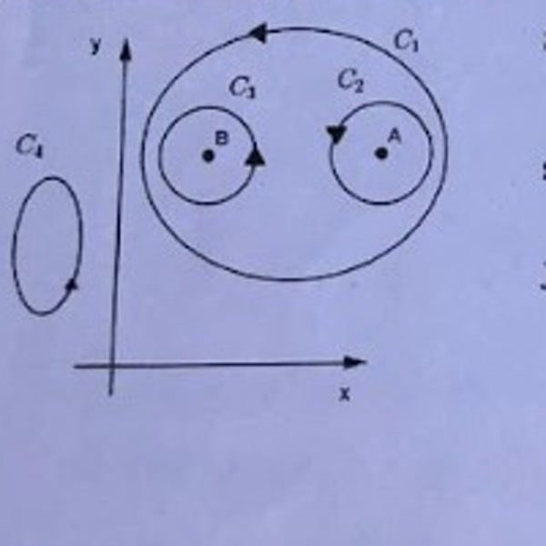

# Teoría y guía de ejercicios para el 2.º Parcial (Unidades 8 a 12)

Esta guía explica la teoría que se evalúa y muestra, **tipo por tipo**, cómo resolver cada ejercicio que puede aparecer en un 2.º parcial. Cada tipo tiene la misma estructura: cómo reconocerlo, el método paso a paso y un ejercicio resuelto en el que se explica por qué se hace cada cosa.

Los ejemplos salen de parciales reales, recuperatorios y del repaso de la cátedra. Cuando un tema no aparece en ellos, el ejemplo viene de las prácticas de esta carpeta. El detalle de cada tema está en el `teoria.md` de cada unidad y las fórmulas, en el [resumen de fórmulas](../FORMULAS.md).

**Formato habitual del examen:** 2 ejercicios teóricos + 4 prácticos. Para aprobar los TP hacen falta al menos dos prácticos bien (los teóricos no cuentan), lo que equivale a un 6. Para aspirar a promoción hacen falta cuatro ejercicios bien, con al menos un teórico (8D).

## Si el enunciado pide…

| Pedido | Ir a |
|---|---|
| Trabajo o circulación sobre un arco, campo no conservativo | [Tipo 1](#tipo-1-circulación-parametrizando-la-curva), [Tipo 19](#tipo-19-green-sobre-una-curva-cerrada) |
| Longitud de una curva, masa de un alambre | [Tipo 2](#tipo-2-longitud-de-una-curva-y-masa-de-un-alambre) |
| ¿Es conservativo? Hallar potencial | [Tipo 3](#tipo-3-es-conservativo-hallar-el-potencial) |
| Circulación con campo conservativo | [Tipo 4](#tipo-4-circulación-de-un-campo-conservativo) |
| Hallar $g$ o parámetros para que sea conservativo | [Tipo 5](#tipo-5-hallar-una-función-o-parámetros-para-que-sea-conservativo) |
| Integral doble, polares, área de una región | [Tipo 6](#tipo-6-integral-doble-en-polares), [Tipo 7](#tipo-7-cambio-de-variables), [Tipo 8](#tipo-8-elegir-o-cambiar-el-orden-de-integración) |
| Volumen de un sólido | [Tipo 9](#tipo-9-volumen-entre-dos-superficies-de-revolución), [Tipo 10](#tipo-10-volumen-sobre-un-disco-corrido), [Tipo 11](#tipo-11-volumen-con-planos-y-cilindros-en-cartesianas), [Tipo 13](#tipo-13-volumen-en-esféricas) |
| Masa de un sólido | [Tipo 12](#tipo-12-masa-de-un-sólido-con-eje-de-simetría-distinto-de-z) |
| Área de una superficie | [Tipo 14](#tipo-14-área-de-un-gráfico), [Tipo 15](#tipo-15-área-de-un-cilindro) |
| Masa de una chapa | [Tipo 16](#tipo-16-masa-de-una-chapa) |
| Flujo por una superficie abierta | [Tipo 17](#tipo-17-flujo-directo-por-un-gráfico), [Tipo 18](#tipo-18-flujo-por-un-cono-o-un-cilindro), [Tipo 28](#tipo-28-flujo-por-una-superficie-abierta-cerrando-con-una-tapa) |
| Circulación sobre una curva cerrada plana | [Tipo 19](#tipo-19-green-sobre-una-curva-cerrada) |
| Circulación sobre un arco plano | [Tipo 20](#tipo-20-green-sobre-un-arco-plano) |
| Área con integrales de línea | [Tipo 21](#tipo-21-área-con-integrales-de-línea) |
| "La circulación vale $k$ veces el área" | [Tipo 22](#tipo-22-la-circulación-vale-k-veces-el-área) |
| Campo $=$ gradiente $+$ otro campo | [Tipo 23](#tipo-23-campo-conservativo-más-otro-campo) |
| Campo singular en un punto | [Tipo 24](#tipo-24-campo-con-una-singularidad), [Tipo 25](#tipo-25-campo-con-varias-singularidades), [Tipo 26](#tipo-26-campo-singular-que-sí-es-conservativo) |
| Flujo por la frontera de un sólido | [Tipo 27](#tipo-27-gauss-en-la-frontera-de-un-sólido) |
| Datos: divergencia, o $g$ con condición sobre la divergencia | [Tipo 28](#tipo-28-flujo-por-una-superficie-abierta-cerrando-con-una-tapa), [Tipo 29](#tipo-29-hallar-una-función-a-partir-de-la-divergencia) |
| Circulación sobre una curva en el espacio | [Tipo 30](#tipo-30-stokes-sobre-una-curva-cerrada-en-el-espacio), [Tipo 31](#tipo-31-stokes-sobre-el-borde-de-una-superficie-dada) |
| Flujo de un rotor | [Tipo 32](#tipo-32-flujo-de-un-rotor) |
| Líneas de campo | [Tipo 33](#tipo-33-líneas-de-campo) |
| EDO lineal | [Tipo 34](#tipo-34-edo-lineal-con-condiciones-iniciales), [Tipo 35](#tipo-35-edo-con-resonancia) |
| Hallar coeficientes o la EDO desde sus soluciones | [Tipo 36](#tipo-36-hallar-coeficientes-y-usar-la-recta-tangente), [Tipo 37](#tipo-37-armar-la-edo-desde-sus-soluciones) |
| "Defina…", "Enuncie…", "Demuestre…" | [Tipo 38](#tipo-38-definiciones-enunciados-y-demostraciones) |

## Índice

- **[Unidad 8: Curvas, integrales de línea y campos conservativos](#unidad-8-curvas-integrales-de-línea-y-campos-conservativos)**
  - [Tipo 1: Circulación parametrizando la curva](#tipo-1-circulación-parametrizando-la-curva)
  - [Tipo 2: Longitud de una curva y masa de un alambre](#tipo-2-longitud-de-una-curva-y-masa-de-un-alambre)
  - [Tipo 3: ¿Es conservativo? Hallar el potencial](#tipo-3-es-conservativo-hallar-el-potencial)
  - [Tipo 4: Circulación de un campo conservativo](#tipo-4-circulación-de-un-campo-conservativo)
  - [Tipo 5: Hallar una función o parámetros para que sea conservativo](#tipo-5-hallar-una-función-o-parámetros-para-que-sea-conservativo)
- **[Unidad 9: Integrales múltiples](#unidad-9-integrales-múltiples)**
  - [Tipo 6: Integral doble en polares](#tipo-6-integral-doble-en-polares)
  - [Tipo 7: Cambio de variables](#tipo-7-cambio-de-variables)
  - [Tipo 8: Elegir o cambiar el orden de integración](#tipo-8-elegir-o-cambiar-el-orden-de-integración)
  - [Tipo 9: Volumen entre dos superficies de revolución](#tipo-9-volumen-entre-dos-superficies-de-revolución)
  - [Tipo 10: Volumen sobre un disco corrido](#tipo-10-volumen-sobre-un-disco-corrido)
  - [Tipo 11: Volumen con planos y cilindros, en cartesianas](#tipo-11-volumen-con-planos-y-cilindros-en-cartesianas)
  - [Tipo 12: Masa de un sólido con eje de simetría distinto de $z$](#tipo-12-masa-de-un-sólido-con-eje-de-simetría-distinto-de-z)
  - [Tipo 13: Volumen en esféricas](#tipo-13-volumen-en-esféricas)
- **[Unidad 10: Superficies, área, masa y flujo](#unidad-10-superficies-área-masa-y-flujo)**
  - [Tipo 14: Área de un gráfico](#tipo-14-área-de-un-gráfico)
  - [Tipo 15: Área de un cilindro](#tipo-15-área-de-un-cilindro)
  - [Tipo 16: Masa de una chapa](#tipo-16-masa-de-una-chapa)
  - [Tipo 17: Flujo directo por un gráfico](#tipo-17-flujo-directo-por-un-gráfico)
  - [Tipo 18: Flujo por un cono o un cilindro](#tipo-18-flujo-por-un-cono-o-un-cilindro)
- **[Unidad 11: Divergencia, rotor y teoremas integrales](#unidad-11-divergencia-rotor-y-teoremas-integrales)**
  - [Tipo 19: Green sobre una curva cerrada](#tipo-19-green-sobre-una-curva-cerrada)
  - [Tipo 20: Green sobre un arco plano](#tipo-20-green-sobre-un-arco-plano)
  - [Tipo 21: Área con integrales de línea](#tipo-21-área-con-integrales-de-línea)
  - [Tipo 22: "La circulación vale $k$ veces el área"](#tipo-22-la-circulación-vale-k-veces-el-área)
  - [Tipo 23: Campo conservativo más otro campo](#tipo-23-campo-conservativo-más-otro-campo)
  - [Tipo 24: Campo con una singularidad](#tipo-24-campo-con-una-singularidad)
  - [Tipo 25: Campo con varias singularidades](#tipo-25-campo-con-varias-singularidades)
  - [Tipo 26: Campo singular que sí es conservativo](#tipo-26-campo-singular-que-sí-es-conservativo)
  - [Tipo 27: Gauss en la frontera de un sólido](#tipo-27-gauss-en-la-frontera-de-un-sólido)
  - [Tipo 28: Flujo por una superficie abierta, cerrando con una tapa](#tipo-28-flujo-por-una-superficie-abierta-cerrando-con-una-tapa)
  - [Tipo 29: Hallar una función a partir de la divergencia](#tipo-29-hallar-una-función-a-partir-de-la-divergencia)
  - [Tipo 30: Stokes sobre una curva cerrada en el espacio](#tipo-30-stokes-sobre-una-curva-cerrada-en-el-espacio)
  - [Tipo 31: Stokes sobre el borde de una superficie dada](#tipo-31-stokes-sobre-el-borde-de-una-superficie-dada)
  - [Tipo 32: Flujo de un rotor](#tipo-32-flujo-de-un-rotor)
- **[Unidad 12: Ecuaciones diferenciales (2.ª parte)](#unidad-12-ecuaciones-diferenciales-2ª-parte)**
  - [Tipo 33: Líneas de campo](#tipo-33-líneas-de-campo)
  - [Tipo 34: EDO lineal con condiciones iniciales](#tipo-34-edo-lineal-con-condiciones-iniciales)
  - [Tipo 35: EDO con resonancia](#tipo-35-edo-con-resonancia)
  - [Tipo 36: Hallar coeficientes y usar la recta tangente](#tipo-36-hallar-coeficientes-y-usar-la-recta-tangente)
  - [Tipo 37: Armar la EDO desde sus soluciones](#tipo-37-armar-la-edo-desde-sus-soluciones)
- **[Ejercicios teóricos (todas las unidades)](#ejercicios-teóricos-todas-las-unidades)**
  - [Tipo 38: Definiciones, enunciados y demostraciones](#tipo-38-definiciones-enunciados-y-demostraciones)
- **[Errores frecuentes](#errores-frecuentes)**

---

## Unidad 8: Curvas, integrales de línea y campos conservativos

Teoría completa de la unidad: [Unidad 08 - Curvas e Integrales de Linea/teoria.md](../Unidad%2008%20-%20Curvas%20e%20Integrales%20de%20Linea/teoria.md).

### Teoría: curvas e integrales de línea

**Curva:** imagen de una función $\vec g: [a,b] \to \mathbb{R}^n$ continua. Es **suave** si $\vec g \in C^1$ y $\vec g' \ne \vec 0$; **simple** si no se corta a sí misma; **cerrada** si $\vec g(a) = \vec g(b)$.

| Curva | Parametrización |
|---|---|
| Segmento de $A$ a $B$ | $\vec g(t) = A + t(B - A)$, $0 \le t \le 1$ |
| Circunferencia $(x - a)^2 + (y - b)^2 = R^2$ | $(a + R\cos t,\ b + R\mathop{\mathrm{sen}} t)$ |
| Elipse $\frac{x^2}{a^2} + \frac{y^2}{b^2} = 1$ | $(a\cos t,\ b\mathop{\mathrm{sen}} t)$ |
| Gráfico $y = f(x)$ | $(x,\ f(x))$ |
| Cilindro $x^2 + y^2 = R^2$ cortado por $z = h(x,y)$ | $(R\cos t,\ R\mathop{\mathrm{sen}} t,\ h(R\cos t, R\mathop{\mathrm{sen}} t))$ |
| Plano cortando una cuádrica | Reemplazar el plano en la cuádrica para hallar la proyección y despejar la coordenada restante |

El sentido de recorrido es el de $t$ creciente. Si se pide el otro, se integra de $t_1$ a $t_0$.

| Qué | Fórmula |
|---|---|
| Longitud | $L = \int_a^b\Vert\vec g'(t)\Vert\thinspace dt$ |
| Campo escalar (masa de un alambre) | $\int_C f\thinspace ds = \int_a^b f(\vec g(t))\thinspace \Vert\vec g'(t)\Vert\thinspace dt$ |
| Campo vectorial (trabajo, circulación) | $\int_C\vec f\cdot d\vec s = \int_a^b\vec f(\vec g(t))\cdot\vec g'(t)\thinspace dt$ |

La integral de un campo escalar **no** depende del sentido. La de un campo vectorial **cambia de signo** al invertirlo.

### Tipo 1: Circulación parametrizando la curva

**Cómo se reconoce.** Un arco, con un campo que no es conservativo y sin una curva cerrada a la que aplicar un teorema. **Antes de parametrizar, siempre** comprobar si el campo es conservativo ([Tipo 4](#tipo-4-circulación-de-un-campo-conservativo)).

**Método.**

1. Comprobar que el campo no es conservativo.
2. Parametrizar. En una intersección, elegir como parámetro la variable que permite despejar las otras dos.
3. Fijar los valores de $t$ en los extremos, respetando el sentido.
4. Calcular $\vec f(\vec g(t))\cdot\vec g'(t)$ e integrar.

**Ejemplo** ([2.º Parcial 19/11/2024, Z2004 Tema 1, P3](segundo-parcial-2024-11-19.md)).

> Calcule la integral de línea de $\vec F = (2xy;\ 8x^2 + 2xy;\ 2xz)$ sobre la curva del primer octante $x + y = 2$, $z = 4 - x^2$, orientada de $(2,0,0)$ a $(0,2,4)$.

*Paso 1 — ¿Conservativo?* $P'_y = 2x$ y $Q'_x = 16x + 2y$ son distintas. No lo es.

*Paso 2 — Parametrizar.* Las dos ecuaciones permiten despejar todo en función de $x$: con $x = t$, $\vec g(t) = (t,\ 2 - t,\ 4 - t^2)$ y $\vec g' = (1,\ -1,\ -2t)$.

*Paso 3 — Extremos.* $(2,0,0)$ corresponde a $t = 2$ y $(0,2,4)$ a $t = 0$. **Se integra de 2 a 0.**

*Paso 4 — Integrando.*

$$\vec F\cdot\vec g' = 2t(2 - t) - 8t^2 - 2t(2 - t) - 4t^2(4 - t^2) = 4t^4 - 24t^2$$

*Paso 5 — Integrar.*

$$\int_2^0(4t^4 - 24t^2)\thinspace dt = -\left[\frac{4t^5}{5} - 8t^3\right]_0^2 = -\frac{128}{5} + 64$$

**Resultado:** $\dfrac{192}{5}$.

### Tipo 2: Longitud de una curva y masa de un alambre

**Método.**

1. Parametrizar y calcular $\Vert\vec g'\Vert$. Conviene elegir la parametrización que la simplifique.
2. Longitud: integrar $\Vert\vec g'\Vert$. Masa: integrar $\delta(\vec g(t))\thinspace \Vert\vec g'\Vert$.

**Ejemplo 1** ([Recuperatorio 06/12/2021, P3 a](recuperatorio-segundo-parcial-2021-12-06.md)).

> Calcule la longitud de la curva intersección de $x^2 + 2y^2 = 8$ e $y + z = 2$.

*Paso 1 — Parametrizar.* La primera es una elipse: $\dfrac{x^2}{8} + \dfrac{y^2}{4} = 1$. Con $x = 2\sqrt2\cos t$, $y = 2\mathop{\mathrm{sen}} t$, y del plano $z = 2 - 2\mathop{\mathrm{sen}} t$.

*Paso 2 — Norma.* $\vec g' = (-2\sqrt2\mathop{\mathrm{sen}} t,\ 2\cos t,\ -2\cos t)$, y

$$\Vert\vec g'\Vert^2 = 8\mathop{\mathrm{sen}}\nolimits^2t + 4\cos^2t + 4\cos^2t = 8$$

*Paso 3 — Integrar.* $L = \displaystyle\int_0^{2\pi}2\sqrt2\thinspace dt$.

**Resultado:** $L = 4\sqrt2\thinspace \pi$.

**Ejemplo 2** ([Práctica 05, P4](practica-segundo-parcial-05.md)).

> Masa de la hélice $\vec\alpha(t) = (\cos t,\ \mathop{\mathrm{sen}} t,\ t)$, $t\in[0, 2\pi]$, con densidad igual a la distancia al plano $xy$.

$\delta = |z| = t$ y $\Vert\vec\alpha'\Vert = \sqrt2$. Entonces $M = \displaystyle\int_0^{2\pi}t\sqrt2\thinspace dt$.

**Resultado:** $M = 2\sqrt2\thinspace \pi^2$.

### Teoría: campos conservativos

$\vec f$ es **conservativo** (campo de gradientes) en un abierto $D$ si existe $\varphi: D \to \mathbb{R}$ diferenciable con $\nabla\varphi = \vec f$. La función $\varphi$ es una **función potencial**.

**Condición necesaria y suficiente.** Si $\vec f$ es continuo en un abierto conexo $D$, son equivalentes:

1. $\vec f$ admite función potencial en $D$.
2. $\int_C\vec f\cdot d\vec s$ depende sólo de los extremos de $C$, para toda curva suave a trozos en $D$.
3. $\oint_C\vec f\cdot d\vec s = 0$ para toda curva cerrada suave a trozos en $D$.

En ese caso, $\int_C\vec f\cdot d\vec s = \varphi(B) - \varphi(A)$ (**teorema fundamental de las integrales de línea**).

**Condición necesaria:** si $\vec f \in C^1$ es conservativo, su **jacobiana es simétrica**: en $\mathbb{R}^2$, $P'_y = Q'_x$; en $\mathbb{R}^3$, $\nabla\times\vec f = \vec 0$.

**Condición suficiente:** jacobiana simétrica **en un dominio simplemente conexo** implica conservativo.

Lo que más se evalúa es la diferencia entre esas dos condiciones: en un dominio con agujeros, la simetría no alcanza.

### Tipo 3: ¿Es conservativo? Hallar el potencial

**Método.**

1. Identificar el dominio. Si es $\mathbb{R}^n$ (o simplemente conexo), la simetría alcanza.
2. Verificar la simetría.
3. $\varphi = \int P\thinspace dx + D(y,z)$.
4. Derivar respecto de $y$, igualar a $Q$, despejar $D'_y$ e integrar. Repetir con $z$.
5. Comprobar $\nabla\varphi = \vec f$.

**Ejemplo** ([2.º Parcial 11/11/2019, T1](segundo-parcial-2019-11-11.md)).

> Defina campo conservativo y función potencial. Determine si $\vec f(x,y) = (2xy + \cos x,\ x^2 + 3y^2)$ es conservativo y, en caso afirmativo, encuentre un potencial.

Las definiciones son las de arriba.

*Paso 1 — Dominio.* $\mathbb{R}^2$, simplemente conexo, y $\vec f \in C^1$.

*Paso 2 — Simetría.* $P'_y = 2x = Q'_x$. Por lo tanto es conservativo.

*Paso 3 — Integrar $P$.* $\varphi = x^2y + \mathop{\mathrm{sen}} x + D(y)$.

*Paso 4 — Comparar con $Q$.* $\varphi'_y = x^2 + D'(y) = x^2 + 3y^2$, entonces $D = y^3 + k$.

**Resultado:** $\varphi = x^2y + \mathop{\mathrm{sen}} x + y^3 + k$.

### Tipo 4: Circulación de un campo conservativo

**Cómo se reconoce.** La curva tiene una parametrización horrible, por ejemplo $(t\mathop{\mathrm{sen}}(\pi t),\ 1 - 2t^2)$. Es la señal de que **no hay que parametrizar**.

**Método.**

1. Probar que el campo es conservativo y hallar $\varphi$.
2. Calcular los extremos de la curva. Si es cerrada, el resultado es 0.
3. Resultado: $\varphi(B) - \varphi(A)$.

**Ejemplo** ([2.º Parcial 15/11/2022, P3](segundo-parcial-2022-11-15.md)).

> Sea $\vec f(x,y) = (-3x^2\cos y + 2x;\ x^3\mathop{\mathrm{sen}} y - 4)$. Calcule la circulación a lo largo de $\vec\gamma(t) = (t\mathop{\mathrm{sen}}(\pi t);\ 1 - 2t^2)$, $0 \le t \le 1$.

*Paso 1 — Simetría.* $P'_y = 3x^2\mathop{\mathrm{sen}} y = Q'_x$, en $\mathbb{R}^2$.

*Paso 2 — Potencial.* $\varphi = -x^3\cos y + x^2 + D(y)$. Derivando: $x^3\mathop{\mathrm{sen}} y + D' = x^3\mathop{\mathrm{sen}} y - 4$, así que $D = -4y$.

*Paso 3 — Extremos.* $\vec\gamma(0) = (0, 1)$ y $\vec\gamma(1) = (0, -1)$.

*Paso 4 — Diferencia.* $\varphi(0,-1) - \varphi(0,1) = 4 - (-4)$.

**Resultado:** $8$.

### Tipo 5: Hallar una función o parámetros para que sea conservativo

**Método.**

1. Imponer la simetría. Con función incógnita, sale una EDO (Unidad 12). Con parámetros, se igualan coeficientes.
2. Resolver usando las condiciones dadas.
3. Con el campo ya definido, hallar el potencial y calcular lo que se pida.

**Ejemplo** ([2.º Parcial 27/11/2020, P1](segundo-parcial-2020-11-27.md)).

> Sea $\vec f(x,y) = (yg''(x) + x^2 - x;\ \cos y + g(x) + x)$. Halle $g$ tal que $g(0) = 1$, $g'(0) = 0$ y $\vec f$ sea conservativo. Calcule la circulación a lo largo de $\vec\alpha(t) = (t\cos t - \pi;\ t^3\mathop{\mathrm{sen}}(2t))$, $t\in[0, 2\pi]$.

*Paso 1 — Simetría.* $P'_y = g''$ y $Q'_x = g' + 1$, así que $g'' - g' = 1$.

*Paso 2 — EDO.* Característica: $r^2 - r = 0$, con raíces 0 y 1: $g_h = C_1 + C_2e^x$. El 0 es raíz, por lo que un término constante daría resonancia: se propone $g_p = Ax$. Entonces $-A = 1$.

*Paso 3 — Condiciones.* $g = C_1 + C_2e^x - x$. $g'(0) = C_2 - 1 = 0$ da $C_2 = 1$, y $g(0) = C_1 + C_2 = 1$ da $C_1 = 0$. Entonces $g = e^x - x$.

*Paso 4 — Potencial.* Ahora $P = ye^x + x^2 - x$ y $Q = \cos y + e^x$. Integrando $P$: $\varphi = ye^x + \dfrac{x^3}{3} - \dfrac{x^2}{2} + D(y)$. Comparando con $Q$: $D = \mathop{\mathrm{sen}} y$.

*Paso 5 — Extremos.* $\vec\alpha(0) = (-\pi, 0)$ y $\vec\alpha(2\pi) = (\pi, 0)$.

$$\varphi(\pi,0) - \varphi(-\pi,0) = \frac{\pi^3}{3} - \frac{\pi^2}{2} + \frac{\pi^3}{3} + \frac{\pi^2}{2}$$

**Resultado:** $g = e^x - x$; circulación $\dfrac{2\pi^3}{3}$.

Con parámetros: en [Práctica 02, P2](practica-segundo-parcial-02.md), $(axy + z,\ x^2 + bz,\ x + 3y)$ pide $ax = 2x$ y $b = 3$, es decir $a = 2$, $b = 3$.

---

## Unidad 9: Integrales múltiples

Teoría completa de la unidad: [Unidad 09 - Integrales Multiples/teoria.md](../Unidad%2009%20-%20Integrales%20Multiples/teoria.md).

### Teoría

**Fubini:** en una región elemental, $\iint_Df\thinspace dA = \int_a^b\int_{\varphi_1(x)}^{\varphi_2(x)}f\thinspace dy\thinspace dx$, o en el otro orden.

**Cambio de variables:** si $\vec T: D^* \to D$, $(u,v) \mapsto (x,y)$, es $C^1$, biyectiva salvo en un conjunto de área nula y con jacobiano no nulo,

$$\iint_Df(x,y)\thinspace dx\thinspace dy = \iint_{D^*}f(\vec T(u,v))\left|\frac{\partial(x,y)}{\partial(u,v)}\right|du\thinspace dv$$

| Coordenadas | Transformación | $\lvert J\rvert$ |
|---|---|---|
| Polares | $x = r\cos\theta$, $y = r\mathop{\mathrm{sen}}\theta$ | $r$ |
| Polares desplazadas (centro $(a,b)$) | $x = a + r\cos\theta$, $y = b + r\mathop{\mathrm{sen}}\theta$ | $r$ |
| Polares elípticas | $x = a\thinspace r\cos\theta$, $y = b\thinspace r\mathop{\mathrm{sen}}\theta$ | $ab\thinspace r$ |
| Cilíndricas | $(r\cos\theta,\ r\mathop{\mathrm{sen}}\theta,\ z)$ | $r$ |
| Cilíndricas con eje $y$ | $x = r\cos\theta$, $z = r\mathop{\mathrm{sen}}\theta$, $y = y$ | $r$ |
| Esféricas | $x = \rho\mathop{\mathrm{sen}}\varphi\cos\theta$, $y = \rho\mathop{\mathrm{sen}}\varphi\mathop{\mathrm{sen}}\theta$, $z = \rho\cos\varphi$ | $\rho^2\mathop{\mathrm{sen}}\varphi$ |
| Lineal $u = ax + by$, $v = cx + dy$ | | $\dfrac{1}{\lvert ad - bc\rvert}$ |

**Aplicaciones:** área $\iint_DdA$; volumen $\iiint_HdV$ o $\iint_D(z_{sup} - z_{inf})\thinspace dA$; masa $\iiint\delta\thinspace dV$; centro de masa $\bar x = \frac1M\iiint x\delta\thinspace dV$; momento de inercia respecto de un eje $\iiint d^2\delta\thinspace dV$.

**"Densidad proporcional a la distancia a…":** al eje $z$, $k\sqrt{x^2 + y^2}$; al eje $y$, $k\sqrt{x^2 + z^2}$; al origen, $k\sqrt{x^2 + y^2 + z^2}$; al plano $xy$, $k|z|$.

**Atajos por simetría:** la integral de una función impar sobre una región simétrica es 0, e $\iint_Dx\thinspace dA = \bar x\cdot\text{Área}$, con $\bar x$ el centroide.

### Tipo 6: Integral doble en polares

**Cómo se reconoce.** Aparece $x^2 + y^2$ en el integrando, o la región es un sector o un disco.

**Método.**

1. Dibujar la región.
2. Ángulo: rectas por el origen. Radio: desde dónde hasta dónde, a ángulo fijo.
3. Reemplazar, **multiplicando por $r$**.

**Ejemplo** ([2.º Parcial 15/11/2022, T1](segundo-parcial-2022-11-15.md)).

> Calcule $\displaystyle\iint_D\frac{x + 2y}{x^2 + y^2}\thinspace dA$, con $D$: $y \ge |x|$, $x + 2y \le 4$.

*Paso 1 — Ángulo.* $y \ge |x|$ es el sector entre las rectas $y = x$ e $y = -x$, hacia arriba: $\theta\in\left[\tfrac\pi4, \tfrac{3\pi}{4}\right]$.

*Paso 2 — Radio.* La recta en polares es $r(\cos\theta + 2\mathop{\mathrm{sen}}\theta) = 4$, entonces $0 \le r \le \dfrac{4}{\cos\theta + 2\mathop{\mathrm{sen}}\theta}$.

*Paso 3 — Integrando.* $\dfrac{r(\cos\theta + 2\mathop{\mathrm{sen}}\theta)}{r^2}\cdot r = \cos\theta + 2\mathop{\mathrm{sen}}\theta$. La $r$ se fue.

*Paso 4 — Integrar en $r$.* Queda $(\cos\theta + 2\mathop{\mathrm{sen}}\theta)\cdot\dfrac{4}{\cos\theta + 2\mathop{\mathrm{sen}}\theta} = 4$.

*Paso 5 — Integrar en $\theta$.* $\displaystyle\int_{\pi/4}^{3\pi/4}4\thinspace d\theta$.

**Resultado:** $2\pi$.

**Variante: área de un dominio** ([2.º Parcial sin fecha C, 4](segundo-parcial-sin-fecha-c.md)). El dominio de $f = \sqrt{-x^2 + 2x - y^2}\thinspace \ln(x - y)$ es el disco $(x - 1)^2 + y^2 \le 1$ con $y < x$. La recta $y = x$ corta el borde en $(0,0)$ y $(1,1)$, y esa cuerda subtiende un ángulo de $\frac\pi2$ desde el centro. Se le resta al disco el segmento circular: $A = \pi - \left(\frac\pi4 - \frac12\right) = \frac{3\pi}{4} + \frac12$.

### Tipo 7: Cambio de variables

**Cómo se reconoce.** La región está limitada por dos familias de curvas, como $xy = c$ e $y = cx$.

**Método.**

1. Elegir $u$, $v$ tales que las curvas de borde sean $u = \text{cte.}$, $v = \text{cte.}$
2. Calcular $\dfrac{\partial(u,v)}{\partial(x,y)}$ e **invertirlo**.
3. Integrar en el rectángulo.

**Ejemplo** ([Práctica 06, P3](practica-segundo-parcial-06.md)).

> Calcule el área de la región del primer cuadrante limitada por $xy = 1$, $xy = 4$, $y = x$ e $y = 4x$.

*Paso 1 — Variables.* $u = xy$, $v = \dfrac yx$: la región es $1 \le u \le 4$, $1 \le v \le 4$.

*Paso 2 — Jacobiano.*

$$\frac{\partial(u,v)}{\partial(x,y)} = \begin{vmatrix} y & x \cr -\frac{y}{x^2} & \frac1x \end{vmatrix} = \frac yx + \frac yx = 2v \ \Rightarrow\ \left|\frac{\partial(x,y)}{\partial(u,v)}\right| = \frac{1}{2v}$$

*Paso 3 — Integrar.* $A = \displaystyle\int_1^4\int_1^4\frac{1}{2v}\thinspace du\thinspace dv = 3\cdot\frac{\ln4}{2}$.

**Resultado:** $A = 3\ln2$.

### Tipo 8: Elegir o cambiar el orden de integración

**Cómo se reconoce.** Una función sin primitiva elemental en una de las variables, como $e^{y^2}$ o $\mathop{\mathrm{sen}}(x^2)$.

**Método.** Dibujar la región desde los límites y describirla en el orden que integre primero la variable fácil.

**Ejemplo** ([Práctica 14, P3](practica-segundo-parcial-14.md)).

> Calcule la masa de la chapa $0 \le x \le y \le 1$ con densidad $\delta = e^{y^2}$.

$e^{y^2}$ no se puede integrar en $y$, así que se integra primero en $x$:

$$M = \int_0^1\int_0^ye^{y^2}\thinspace dx\thinspace dy = \int_0^1ye^{y^2}\thinspace dy = \left[\frac{e^{y^2}}{2}\right]_0^1$$

**Resultado:** $M = \dfrac{e - 1}{2}$.

### Tipo 9: Volumen entre dos superficies de revolución

**Método.**

1. Identificar las superficies: $z = \sqrt{x^2 + y^2}$ cono, $z = a - x^2 - y^2$ paraboloide, $x^2 + y^2 + z^2 = R^2$ esfera.
2. Igualarlas para encontrar la intersección: da el radio de la proyección.
3. Decidir cuál está arriba, probando un punto.
4. Integrar en cilíndricas: $V = \iint(z_{sup} - z_{inf})\thinspace r\thinspace dr\thinspace d\theta$.

**Ejemplo** ([2.º Parcial 01/12/2012, P1](segundo-parcial-2012-12-01.md)).

> Plantee las integrales que permiten calcular el volumen del macizo $z \le 6 - x^2 - y^2$; $z \ge \sqrt{x^2 + y^2}$.

*Paso 1 — Intersección.* $r = 6 - r^2$ da $r^2 + r - 6 = 0$, con $r = 2$.

*Paso 2 — Quién está arriba.* El enunciado ya lo dice: el cono abajo y el paraboloide arriba.

*Paso 3 — Integral.*

$$V = \int_0^{2\pi}\int_0^2\int_r^{6 - r^2}r\thinspace dz\thinspace dr\thinspace d\theta = 2\pi\left[3r^2 - \frac{r^4}{4} - \frac{r^3}{3}\right]_0^2 = 2\pi\left(12 - 4 - \frac83\right)$$

**Resultado:** $V = \dfrac{32\pi}{3}$.

**Variante con parámetro** ([Recuperatorio 01/12/2023, 4](recuperatorio-segundo-parcial-2023-12-01.md)): para $z = r$ y $z = ar^2$, la intersección es $r = \tfrac1a$ y $V = 2\pi\displaystyle\int_0^{1/a}r(r - ar^2)\thinspace dr = \frac{\pi}{6a^3}$. Igualando a $\frac\pi6$: $a = 1$.

### Tipo 10: Volumen sobre un disco corrido

**Método.** Si el integrando es lineal, conviene usar el centroide en lugar de polares.

**Ejemplo** ([2.º Parcial 24/11/2020, P2 a](segundo-parcial-2020-11-24.md)).

> Determine el volumen del sólido $x^2 + y^2 \le 4y$; $y \le z \le 4$.

*Paso 1 — Proyección.* $x^2 + (y - 2)^2 \le 4$: disco de centro $(0,2)$ y radio 2.

*Paso 2 — Integrar la altura.* $V = \iint_D(4 - y)\thinspace dA = 4\cdot\text{Área} - \iint_Dy\thinspace dA$.

*Paso 3 — Centroide.* Área $= 4\pi$ y $\bar y = 2$, entonces $\iint_Dy\thinspace dA = 8\pi$.

**Resultado:** $V = 16\pi - 8\pi = 8\pi$.

### Tipo 11: Volumen con planos y cilindros, en cartesianas

**Cómo se reconoce.** Las condiciones son rectas o parábolas y no hay simetría circular.

**Método.**

1. Proyectar sobre el plano que da una región simple.
2. Elegir el orden para no partir la región.
3. Integrar la altura.

**Ejemplo** ([2.º Parcial 19/11/2024, Z2004 Tema 1, P2](segundo-parcial-2024-11-19.md)).

> Calcule el volumen del sólido del primer octante $z \le 4 - y^2$; $y \ge x$; $y - 2x \le 0$.

*Paso 1 — Proyección.* En el plano $xy$: $\dfrac y2 \le x \le y$. El techo $z = 4 - y^2$ corta a $z = 0$ en $y = 2$, así que $0 \le y \le 2$.

*Paso 2 — Orden.* Con $x$ primero, la región queda en una sola pieza; con $y$ primero habría que partirla.

*Paso 3 — Integrar.*

$$V = \int_0^2\int_{y/2}^y(4 - y^2)\thinspace dx\thinspace dy = \int_0^2\frac y2(4 - y^2)\thinspace dy = \left[y^2 - \frac{y^4}{8}\right]_0^2 = 4 - 2$$

**Resultado:** $V = 2$.

### Tipo 12: Masa de un sólido con eje de simetría distinto de $z$

**Método.** Tomar el eje de simetría como eje de las cilíndricas. Si la simetría es alrededor de $y$: $x = r\cos\theta$, $z = r\mathop{\mathrm{sen}}\theta$, $|J| = r$.

**Ejemplo** ([2.º Parcial 16/11/2021, Tema 1, P1](segundo-parcial-2021-11-16.md)).

> Calcule la masa de $\sqrt{x^2 + z^2} \le y \le 3$, $z \ge 0$, con densidad $\delta = x^2 + z^2$.

*Paso 1 — Reconocer.* Es un cono de eje $y$, con vértice en el origen y tapa en $y = 3$. La condición $z \ge 0$ deja la mitad.

*Paso 2 — Coordenadas.* $\delta = r^2$, $\theta\in[0, \pi]$ (porque $z = r\mathop{\mathrm{sen}}\theta \ge 0$), $0 \le r \le 3$, $r \le y \le 3$.

*Paso 3 — Integrar.*

$$M = \int_0^\pi\int_0^3\int_r^3r^2\cdot r\thinspace dy\thinspace dr\thinspace d\theta = \pi\int_0^3r^3(3 - r)\thinspace dr = \pi\left(\frac{243}{4} - \frac{243}{5}\right)$$

**Resultado:** $M = \dfrac{243\pi}{20}$.

### Tipo 13: Volumen en esféricas

**Cómo se reconoce.** Esferas y conos con vértice en el origen, a veces con una esfera que pasa por él.

**Método.** Escribir cada superficie en esféricas y usar $\rho^2\mathop{\mathrm{sen}}\varphi$.

**Ejemplo** ([Práctica 13, P1](practica-segundo-parcial-13.md)).

> Calcule el volumen interior a $x^2 + y^2 + z^2 = 4z$ y por encima de $z = \sqrt{x^2 + y^2}$.

*Paso 1 — Esfera.* $\rho^2 = 4\rho\cos\varphi$, entonces $\rho = 4\cos\varphi$.

*Paso 2 — Cono.* $\varphi = \tfrac\pi4$. La región es $0 \le \varphi \le \tfrac\pi4$.

*Paso 3 — Integrar.*

$$V = \int_0^{2\pi}\int_0^{\pi/4}\int_0^{4\cos\varphi}\rho^2\mathop{\mathrm{sen}}\varphi\thinspace d\rho\thinspace d\varphi\thinspace d\theta = 2\pi\cdot\frac{64}{3}\cdot\frac14\left(1 - \frac14\right)$$

**Resultado:** $V = 8\pi$.

---

## Unidad 10: Superficies, área, masa y flujo

Teoría completa de la unidad: [Unidad 10 - Integrales de Superficie/teoria.md](../Unidad%2010%20-%20Integrales%20de%20Superficie/teoria.md).

### Teoría

**Superficie paramétrica:** $\vec\Sigma: D \subset \mathbb{R}^2 \to \mathbb{R}^3$, con vector normal $\vec n = \vec\Sigma'_u\times\vec\Sigma'_v$. Es **suave** si $\vec n \ne \vec 0$ y **orientable** si se puede elegir una normal unitaria que varíe con continuidad.

| Superficie | Parametrización | Normal |
|---|---|---|
| Gráfico $z = f(x,y)$ | $(x,\ y,\ f(x,y))$ | $(-f'_x,\ -f'_y,\ 1)$ (hacia arriba) |
| Gráfico $y = f(x,z)$ | $(x,\ f(x,z),\ z)$ | $\pm(-f'_x,\ 1,\ -f'_z)$ |
| Cono $z = \sqrt{x^2 + y^2}$ | $(x,\ y,\ \sqrt{x^2 + y^2})$ | $\Vert\vec n\Vert = \sqrt2$ |
| Cilindro $x^2 + y^2 = R^2$ | $(R\cos\theta,\ R\mathop{\mathrm{sen}}\theta,\ z)$ | $(R\cos\theta,\ R\mathop{\mathrm{sen}}\theta,\ 0)$ (exterior) |
| Esfera de radio $R$ | $(R\mathop{\mathrm{sen}}\varphi\cos\theta,\ R\mathop{\mathrm{sen}}\varphi\mathop{\mathrm{sen}}\theta,\ R\cos\varphi)$ | $\Vert\vec n\Vert = R^2\mathop{\mathrm{sen}}\varphi$ (exterior) |
| Plano $z = a + bx + cy$ | $(x,\ y,\ a + bx + cy)$ | $(-b,\ -c,\ 1)$ |

| Qué | Fórmula |
|---|---|
| Área | $A = \iint_D\Vert\vec n\Vert\thinspace du\thinspace dv$; para $z = f(x,y)$: $\iint_D\sqrt{1 + f'^2_x + f'^2_y}\thinspace dx\thinspace dy$ |
| Masa de una chapa | $M = \iint_D\delta(\vec\Sigma)\thinspace \Vert\vec n\Vert\thinspace du\thinspace dv$ |
| Flujo | $\Phi = \iint_S\vec f\cdot\breve n\thinspace dS = \iint_D\vec f(\vec\Sigma)\cdot\vec n\thinspace du\thinspace dv$ |

**La diferencia que más errores causa:** en el área y la masa va $\Vert\vec n\Vert$. En el flujo va el **vector** $\vec n$, sin dividir por su norma.

**Orientación.** Cuando se pide indicarla, hay que decir con palabras qué normal se usó ("normal hacia arriba", "normal exterior", "$\vec n = (2x, 1, 0)$") y aclarar que con la opuesta el flujo cambia de signo.

### Tipo 14: Área de un gráfico

**Método.**

1. Calcular $\Vert\vec n\Vert$.
2. Proyectar: pasar las condiciones sobre $z$ a condiciones sobre $(x,y)$.
3. Integrar, en polares si la proyección es circular.

**Ejemplo** ([2.º Parcial 27/11/2020, P4](segundo-parcial-2020-11-27.md)).

> Calcule el área de $z = 6 - x^2 - y^2$, $2 \le z \le 5$, $x \ge 0$, $y \ge 0$.

*Paso 1 — Norma.* $\Vert\vec n\Vert = \sqrt{1 + 4x^2 + 4y^2} = \sqrt{1 + 4r^2}$.

*Paso 2 — Proyección.* $2 \le 6 - r^2 \le 5$ da $1 \le r \le 2$. El primer cuadrante da $\theta\in\left[0, \tfrac\pi2\right]$.

*Paso 3 — Integrar.*

$$A = \frac\pi2\int_1^2r\sqrt{1 + 4r^2}\thinspace dr = \frac\pi2\left[\frac{(1 + 4r^2)^{3/2}}{12}\right]_1^2$$

**Resultado:** $A = \dfrac{\pi}{24}\left(17\sqrt{17} - 5\sqrt5\right)$.

**Atajo:** en un cono o un plano, $\Vert\vec n\Vert$ es constante, y el área es $\Vert\vec n\Vert$ por el área de la proyección. En [2020, P4](segundo-parcial-2020-11-24.md): $z = 7 - r$, $4 \le z \le 6$, primer cuadrante; proyección de área $\frac14\pi(9 - 1) = 2\pi$ y $\Vert\vec n\Vert = \sqrt2$, así que $A = 2\sqrt2\thinspace \pi$.

### Tipo 15: Área de un cilindro

**Método.** Parametrizar con el ángulo y la altura: un elemento de área mide $R\thinspace d\theta\thinspace dz$. Para cada $\theta$, la altura va desde $z_{inf}(\theta)$ hasta $z_{sup}(\theta)$.

**Ejemplo** ([2.º Parcial 19/11/2024, z2051 Tema 1, P2](segundo-parcial-2024-11-19.md)).

> Calcule el área de $x^2 + y^2 = 2y$ limitada por $z = 0$ y $z + y = 2$.

*Paso 1 — Parametrizar.* $x^2 + (y - 1)^2 = 1$, con $R = 1$: $x = \cos\theta$, $y = 1 + \mathop{\mathrm{sen}}\theta$.

*Paso 2 — Altura.* $0 \le z \le 2 - y = 1 - \mathop{\mathrm{sen}}\theta$, que es no negativa.

*Paso 3 — Integrar.* $A = \displaystyle\int_0^{2\pi}(1 - \mathop{\mathrm{sen}}\theta)\thinspace d\theta$.

**Resultado:** $A = 2\pi$.

### Tipo 16: Masa de una chapa

**Método.** Calcular $\Vert\vec n\Vert$, escribir $\delta$ en los parámetros y multiplicar. Si $\delta$ trae una raíz rara, suele simplificarse con $\Vert\vec n\Vert$.

**Ejemplo** ([2.º Parcial 11/11/2019, P1](segundo-parcial-2019-11-11.md)).

> Calcule la masa de $S$: $z = x^2 + y^2$, $1 \le z \le 4$, con densidad $\delta = \dfrac{z}{\sqrt{1 + 4x^2 + 4y^2}}$.

*Paso 1 — Simplificar.* $\Vert\vec n\Vert = \sqrt{1 + 4x^2 + 4y^2}$, que se cancela con el denominador. Queda $\delta\thinspace \Vert\vec n\Vert = z = r^2$.

*Paso 2 — Región.* $1 \le r^2 \le 4$, entonces $1 \le r \le 2$.

*Paso 3 — Integrar.* $M = \displaystyle\int_0^{2\pi}\int_1^2r^2\cdot r\thinspace dr\thinspace d\theta = 2\pi\cdot\frac{15}{4}$.

**Resultado:** $M = \dfrac{15\pi}{2}$.

**Variante con eje $y$** ([2019, P1](segundo-parcial-2019-06-18.md)): $y = \sqrt{x^2 + z^2}$, $1 \le y \le 3$, densidad proporcional a la distancia al plano $xz$. Es $\delta = ky$, $\Vert\vec n\Vert = \sqrt2$, y $M = \sqrt2\thinspace k\cdot2\pi\displaystyle\int_1^3r^2\thinspace dr = \frac{52\sqrt2\thinspace k\pi}{3}$.

### Tipo 17: Flujo directo por un gráfico

**Cómo se reconoce.** Una superficie abierta, sin una tapa que simplifique y con un campo que no invita a usar Gauss. Muchas veces al hacer $\vec f\cdot\vec n$ se cancelan términos: **no integrar antes de simplificar**.

**Método.**

1. Parametrizar como gráfico y escribir $\vec n$, **indicando la orientación**.
2. Reemplazar la superficie en $\vec f$ y hacer $\vec f\cdot\vec n$.
3. Hallar la proyección igualando las superficies.
4. Integrar.

**Ejemplo** ([2.º Parcial 16/11/2021, Tema 1, P2](segundo-parcial-2021-11-16.md)).

> Calcule el flujo de $\vec f = (2y - 6;\ -2x;\ -z + 2y)$ a través de $z = 9 - x^2 - (y - 3)^2$ con $z \ge 2y$. Indique la orientación.

*Paso 1 — Normal.* Se elige hacia arriba: $\vec n = (2x,\ 2(y - 3),\ 1)$.

*Paso 2 — Producto escalar.* Los dos primeros términos se cancelan:

$$\vec f\cdot\vec n = 2x(2y - 6) - 2x(2y - 6) + (-z + 2y) = 2y - z$$

*Paso 3 — Reemplazar $z$.* $2y - 9 + x^2 + (y - 3)^2 = x^2 + y^2 - 4y$.

*Paso 4 — Proyección.* $z \ge 2y$ equivale a $x^2 + y^2 - 4y \le 0$: disco $x^2 + (y - 2)^2 \le 4$. En polares desplazadas, el integrando es $r^2 - 4$.

*Paso 5 — Integrar.*

$$\Phi = \int_0^{2\pi}\int_0^2(r^2 - 4)\thinspace r\thinspace dr\thinspace d\theta = 2\pi(4 - 8)$$

**Resultado:** $\Phi = -8\pi$ con normal hacia arriba ($8\pi$ con la opuesta).

**Variante: gráfico sobre otro plano** ([2012, P3](segundo-parcial-2012-12-01.md)). Para $y + z = 3$ con $x^2 + z^2 \le 9$ y $\vec f = (e^{xy} + x;\ y + x^2;\ z^2 - y)$, se parametriza $(x,\ 3 - z,\ z)$, con $\vec n = (0, 1, 1)$. Entonces $\vec f\cdot\vec n = x^2 + z^2$, sobre un disco en el plano $xz$, y $\Phi = \frac{81\pi}{2}$.

### Tipo 18: Flujo por un cono o un cilindro

**Método.** Igual que el anterior; lo que cambia es la normal. En un cilindro conviene parametrizar con ángulo y altura. En un cono, con $(x, y)$ o $(r, \theta)$.

**Ejemplo** ([2.º Parcial 19/11/2024, Z2004 Tema 1, P1](segundo-parcial-2024-11-19.md)).

> Sea $S$: $z^2 = x^2 + y^2$, $-2 \le z \le -1$. Calcule el flujo de $\vec F = (-zx,\ -zy,\ z^2)$, indicando la orientación.

*Paso 1 — Parametrizar.* Como $z < 0$: $z = -\sqrt{x^2 + y^2} = -r$, con $1 \le r \le 2$.

*Paso 2 — Normal.* Se elige la de componente $z$ positiva: $(-z'_x, -z'_y, 1) = \left(\dfrac xr,\ \dfrac yr,\ 1\right)$.

*Paso 3 — Producto escalar.*

$$\vec F\cdot\vec n = \frac{-z(x^2 + y^2)}{r} + z^2 = -zr + z^2 = r^2 + r^2 = 2r^2$$

*Paso 4 — Integrar.*

$$\Phi = \int_0^{2\pi}\int_1^22r^2\cdot r\thinspace dr\thinspace d\theta = 2\pi\left[\frac{r^4}{2}\right]_1^2$$

**Resultado:** $\Phi = 15\pi$ con $\breve n\cdot(0,0,1) > 0$ ($-15\pi$ con la opuesta).

Con cilindro: [Repaso, Ejercicio 12](repaso-segundo-parcial.md), y cilindro parabólico: [Repaso, Ejercicio 4](repaso-segundo-parcial.md).

---

## Unidad 11: Divergencia, rotor y teoremas integrales

Teoría completa de la unidad: [Unidad 11 - Teoremas Integrales/teoria.md](../Unidad%2011%20-%20Teoremas%20Integrales/teoria.md).

### Teoría

Para $\vec f = (P, Q, R)$:

$$\operatorname{div}\vec f = P'_x + Q'_y + R'_z, \qquad \operatorname{rot}\vec f = \nabla\times\vec f = (R'_y - Q'_z,\ P'_z - R'_x,\ Q'_x - P'_y)$$

**Propiedades** (funciones $C^2$): $\nabla\times(\nabla\varphi) = \vec 0$; $\operatorname{div}(\nabla\times\vec f) = 0$, por lo que el flujo de un rotor por una superficie cerrada es 0; $\operatorname{div}(\nabla\varphi) = \Delta\varphi$. **Solenoidal:** $\operatorname{div}\vec f = 0$. **Irrotacional:** $\nabla\times\vec f = \vec 0$.

**Truco:** una función desconocida como $h(z)$ en la primera componente, o $\mu(x)$ en la tercera, **no aporta a la divergencia**, porque no depende de la variable que se deriva. En el rotor, $g(x)$ en $P$, $g(y)$ en $Q$ o $g(z)$ en $R$ tampoco aportan. Si el enunciado trae una función incógnita, casi seguro desaparece.

**Teorema de Green.** Sea $D \subset \mathbb{R}^2$ una región acotada cuya frontera $C = \partial D$ es una curva cerrada, simple, suave a trozos y orientada positivamente (dejando $D$ a la izquierda), y sea $\vec f = (P, Q)$ de clase $C^1$ en un abierto que contiene a $D$. Entonces

$$\oint_CP\thinspace dx + Q\thinspace dy = \iint_D(Q'_x - P'_y)\thinspace dx\thinspace dy$$

Vale también para regiones con agujeros, con la frontera exterior antihoraria y las interiores horarias.

**Teorema de la divergencia (Gauss).** Sea $H \subset \mathbb{R}^3$ un sólido acotado cuya frontera $\partial H$ es una superficie cerrada, suave a trozos, orientada con la **normal exterior**, y sea $\vec f$ de clase $C^1$ en un abierto que contiene a $H$. Entonces

$$\iint_{\partial H}\vec f\cdot\breve n\thinspace dS = \iiint_H\operatorname{div}\vec f\thinspace dV$$

**Teorema del rotor (Stokes).** Sea $S$ una superficie orientable, suave a trozos, con normal $\breve n$, cuyo borde $\partial S$ es una curva cerrada simple, suave a trozos, **orientada de forma coherente con $\breve n$** (caminando por el borde con la cabeza hacia $\breve n$, la superficie queda a la izquierda). Si $\vec f$ es $C^1$ en un abierto que contiene a $S$,

$$\oint_{\partial S}\vec f\cdot d\vec s = \iint_S(\nabla\times\vec f)\cdot\breve n\thinspace dS$$

Dos superficies con el mismo borde y orientación coherente tienen el mismo flujo del rotor.

### Tipo 19: Green sobre una curva cerrada

**Método.**

1. Calcular $Q'_x - P'_y$, que suele simplificarse mucho.
2. Describir la región.
3. Integrar, usando centroides o polares si conviene.
4. Si la curva es **horaria**, el resultado lleva signo menos.

**Ejemplo** ([2.º Parcial 15/11/2022, P2](segundo-parcial-2022-11-15.md)).

> Calcule la circulación de $\vec f = (2xe^y - 1;\ x^2e^y + yx)$ sobre la frontera de $x + y \ge 4$; $x + 2y \le 8$; $y \ge 0$, en sentido positivo.

*Paso 1 — Green.* $Q'_x - P'_y = 2xe^y + y - 2xe^y = y$. Las exponenciales se cancelan.

*Paso 2 — Región.* Es el triángulo de vértices $(4,0)$, $(8,0)$ y $(0,4)$, con área $\tfrac12\cdot4\cdot4 = 8$.

*Paso 3 — Centroide.* $\bar y = \dfrac{0 + 0 + 4}{3} = \dfrac43$, entonces $\iint y\thinspace dA = \dfrac43\cdot8$.

**Resultado:** $\dfrac{32}{3}$.

**Variante horaria** ([2024, Tema 1, P4](segundo-parcial-2024-11-19.md)): con $\vec G = (x - y^2,\ 3x + y)$ sobre $x^2 + \frac{(y - 1)^2}{4} = 1$, $Q'_x - P'_y = 3 + 2y$. La elipse tiene área $2\pi$ y $\bar y = 1$, así que la integral doble vale $3\cdot2\pi + 2\cdot1\cdot2\pi = 10\pi$. Como es horaria: $-10\pi$.

### Tipo 20: Green sobre un arco plano

**Cómo se reconoce.** La curva no es cerrada y parametrizar es incómodo, o hay una función incógnita.

**Método.**

1. Cerrar la curva con un segmento, sobre un eje si es posible.
2. Fijar el sentido de la curva cerrada resultante.
3. Aplicar Green.
4. Calcular la integral sobre el segmento y restarla.

**Ejemplo** ([2.º Parcial 16/11/2021, Tema 1, P4](segundo-parcial-2021-11-16.md)).

> Sea $\vec f = (y + x;\ 5x + \varphi(y))$. Calcule la circulación desde $(0,0)$ hasta $(2,0)$ a lo largo de $x^2 + y^2 = 2x$ con $y \ge 0$.

*Paso 1 — Cerrar.* Se agrega el segmento $T$ de $(2,0)$ a $(0,0)$.

*Paso 2 — Sentido.* La semicircunferencia va por arriba de izquierda a derecha, y el segmento vuelve por abajo: la curva cerrada es **horaria**.

*Paso 3 — Green.* $Q'_x - P'_y = 5 - 1 = 4$. El medio disco tiene área $\frac\pi2$. Por ser horaria:

$$\int_C + \int_T = -4\cdot\frac\pi2 = -2\pi$$

*Paso 4 — Segmento.* Sobre $T$, $y = 0$ y $dy = 0$, y por lo tanto $\varphi$ no aparece:

$$\int_T\vec f\cdot d\vec s = \int_2^0x\thinspace dx = -2$$

*Paso 5 — Despejar.* $\int_C = -2\pi - (-2)$.

**Resultado:** $2 - 2\pi$.

### Tipo 21: Área con integrales de línea

**Teoría.** Con un campo tal que $Q'_x - P'_y = 1$, Green da el área:

$$\text{Área}(D) = \oint_Cx\thinspace dy = -\oint_Cy\thinspace dx = \frac12\oint_C(x\thinspace dy - y\thinspace dx)$$

Si sale negativo, la parametrización recorría la curva en sentido horario: el área es el valor absoluto.

**Ejemplo** ([2.º Parcial 11/11/2019, T2](segundo-parcial-2019-11-11.md)).

> Enuncie Green y úselo para calcular el área encerrada por $\vec\alpha(t) = (t^3 - 4t,\ 16 - t^4)$, $-2 \le t \le 2$.

*Paso 1 — Comprobar que es cerrada.* $\vec\alpha(-2) = (0, 0) = \vec\alpha(2)$.

*Paso 2 — Campo.* $\vec f = (0, x)$, con $Q'_x - P'_y = 1$. Sobre la curva, $dy = -4t^3\thinspace dt$.

*Paso 3 — Integrar.*

$$\oint x\thinspace dy = \int_{-2}^2(t^3 - 4t)(-4t^3)\thinspace dt = 2\int_0^2(-4t^6 + 16t^4)\thinspace dt = 2\left(-\frac{512}{7} + \frac{512}{5}\right)$$

**Resultado:** $\text{Área} = \dfrac{2048}{35}$. Es positivo: la curva se recorre en sentido antihorario.

### Tipo 22: "La circulación vale $k$ veces el área"

**Método.** Por Green, la circulación es $\iint(Q'_x - P'_y)\thinspace dA$. Que valga $k\cdot$Área **para toda curva** exige $Q'_x - P'_y = k$ en todo punto.

**Ejemplo** ([2.º Parcial 24/11/2020, P1](segundo-parcial-2020-11-24.md)).

> Sea $\vec f(x,y) = (3x^7 + 4yg(x);\ 2g'(x) + 3y + 5x)$. Halle $g$ tal que $\vec f(0,1) = (8,\ 3 - 4\sqrt2)$ y la circulación sobre toda curva simple, suave y cerrada con orientación positiva valga 5 veces el área encerrada.

*Paso 1 — Condición.* $Q'_x - P'_y = 2g'' + 5 - 4g = 5$, entonces $g'' - 2g = 0$.

*Paso 2 — EDO.* $r^2 = 2$: $g = C_1e^{\sqrt2x} + C_2e^{-\sqrt2x}$.

*Paso 3 — Condiciones.* $\vec f(0,1) = (4g(0),\ 2g'(0) + 3)$, de donde $g(0) = 2$ y $g'(0) = -2\sqrt2$. Entonces $C_1 + C_2 = 2$ y $C_1 - C_2 = -2$.

**Resultado:** $g(x) = 2e^{-\sqrt2x}$.

### Tipo 23: Campo conservativo más otro campo

**Cómo se reconoce.** $\vec h = \vec f + \vec g$, con $\vec f$ "conservativo" sin fórmula, o $\vec f = \nabla h + \vec g$. También sirve cuando una parte del campo es un gradiente visible.

**Método.** La circulación de la parte gradiente es 0 sobre una curva cerrada y $\varphi(B) - \varphi(A)$ sobre un arco. Sólo se calcula la del otro campo.

**Qué es Green.** Es un teorema que convierte la circulación sobre una curva **cerrada** del plano en una integral doble sobre la región $D$ que esa curva encierra. Si $C$ es cerrada, simple, suave a trozos y recorrida en sentido antihorario (dejando $D$ a la izquierda), y $\vec g = (P, Q)$ es $C^1$ en un abierto que contiene a $D$:

$$\oint_CP\thinspace dx + Q\thinspace dy = \iint_D(Q'_x - P'_y)\thinspace dA$$

- **Qué significa.** $Q'_x - P'_y$ mide cuánto tiende a hacer girar el campo alrededor de cada punto. Al sumar ese giro en toda $D$, los giros de zonas vecinas se cancelan entre sí en el interior y sólo sobrevive lo que ocurre en el borde: la circulación sobre $C$.
- **Orientación.** Si $C$ se recorre en sentido horario, el resultado cambia de signo.
- **Cuándo conviene.** Cuando la curva es cerrada y parametrizarla lleva a una integral difícil, pero $Q'_x - P'_y$ es simple.
- **Relación con los conservativos.** Si el campo es conservativo y $C^1$ en un abierto que contiene a $D$, entonces $Q'_x = P'_y$: el integrando es 0 y la circulación también.
- **Cuándo no se aplica directamente.** Si la curva no es cerrada, ver el [Tipo 20](#tipo-20-green-sobre-un-arco-plano); si el campo no es $C^1$ en algún punto de $D$, ver el [Tipo 24](#tipo-24-campo-con-una-singularidad). El enunciado formal está en la [teoría de la Unidad 11](#unidad-11-divergencia-rotor-y-teoremas-integrales).

**Ejemplo** ([2.º Parcial 18/06/2019, P2](segundo-parcial-2019-06-18.md)).

> Sean $\vec f$ un campo $C^1$ conservativo, $\vec g(x,y) = (xy,\ \mathop{\mathrm{sen}}(y^4))$ y $\vec h = \vec f + \vec g$. Calcule la circulación de $\vec h$ sobre $C$: $x^2 + y^2 = 6x$, indicando la orientación.

*Paso 1 — Separar.* $C$ es cerrada: $\oint\vec f\cdot d\vec s = 0$, y queda $\oint\vec g\cdot d\vec s$.

*Paso 2 — Green,* en sentido antihorario. Parametrizar $C$ obligaría a integrar el término $\mathop{\mathrm{sen}}(y^4)\thinspace dy$, que es muy incómodo. En cambio, $\vec g$ es $C^1$ en todo $\mathbb{R}^2$, con $P = xy$ y $Q = \mathop{\mathrm{sen}}(y^4)$. Como $Q$ no depende de $x$, $Q'_x = 0$; además, $P'_y = x$. Entonces $Q'_x - P'_y = 0 - x = -x$, y el término incómodo desaparece.

*Paso 3 — Región.* Completando cuadrados, $x^2 - 6x + y^2 = 0$ es $(x - 3)^2 + y^2 = 9$: la circunferencia de centro $(3, 0)$ y radio 3, así que $D$ es un disco de área $9\pi$. Como $\iint_Dx\thinspace dA = \bar x\cdot\text{Área}$ con centroide $\bar x = 3$:

$$\oint\vec g\cdot d\vec s = -\iint_Dx\thinspace dA = -3\cdot9\pi$$

**Resultado:** $-27\pi$ en sentido antihorario ($27\pi$ en sentido horario).

### Tipo 24: Campo con una singularidad

Aparece en casi todos los parciales.

$$\vec f(x,y) = \left(\frac{-y}{x^2 + y^2},\ \frac{x}{x^2 + y^2}\right), \qquad D = \mathbb{R}^2 - \lbrace\vec 0\rbrace$$

**Qué hay que saber.** La jacobiana es simétrica en $D$, pero $D$ **no** es simplemente conexo, así que la condición suficiente no se aplica. Sobre la circunferencia unitaria antihoraria, $\oint\vec f\cdot d\vec s = 2\pi \ne 0$: no es conservativo en $D$. Sí lo es en un dominio simplemente conexo sin el origen, con potencial $\varphi = \theta$.

**Método.**

1. Verificar la simetría en el dominio.
2. Notar que el dominio no es simplemente conexo.
3. Calcular la circulación sobre la curva que hace **constante al denominador**. Si no da 0, no hay potencial en $D$.
4. Para una curva cualquiera que rodee la singularidad, aplicar Green en la región entre esa curva y una curva chica.

**Ejemplo** ([2.º Parcial 16/11/2021, Tema 1, T2](segundo-parcial-2021-11-16.md)).

> Dado $\vec f(x,y) = \left(-\dfrac{y}{4x^2 + y^2};\ \dfrac{x}{4x^2 + y^2}\right)$: a) determine si admite potencial en su dominio; b) ¿es posible conocer $\int_C\vec f\cdot d\vec s$ siendo $C$ cualquier curva cerrada que encierra al origen?

**a)** *Simetría,* con $D = 4x^2 + y^2$:

$$P'_y = \frac{-D + 2y^2}{D^2} = \frac{y^2 - 4x^2}{D^2}, \qquad Q'_x = \frac{D - 8x^2}{D^2} = \frac{y^2 - 4x^2}{D^2}$$

Son iguales, pero el dominio $\mathbb{R}^2 - \lbrace\vec 0\rbrace$ tiene un agujero, así que todavía no se concluye nada.

*Curva conveniente:* sobre la elipse $4x^2 + y^2 = 1$ el denominador vale 1. Con $x = \tfrac12\cos t$, $y = \mathop{\mathrm{sen}} t$:

$$\oint\vec f\cdot d\vec s = \int_0^{2\pi}\left(\mathop{\mathrm{sen}} t\cdot\tfrac12\mathop{\mathrm{sen}} t + \tfrac12\cos t\cdot\cos t\right)dt = \int_0^{2\pi}\tfrac12\thinspace dt = \pi$$

Como hay una curva cerrada con circulación no nula, **no admite potencial** en su dominio.

**b)** Sea $C$ cerrada simple, antihoraria, que encierra al origen, y sea $E$ una elipse chica $4x^2 + y^2 = \varepsilon^2$ dentro de $C$. En la región entre ambas el campo es $C^1$ y $Q'_x - P'_y = 0$. Por Green, con $E$ recorrida en sentido horario como parte del borde:

$$\oint_C\vec f\cdot d\vec s - \oint_E\vec f\cdot d\vec s = 0$$

La misma cuenta del punto a muestra que la circulación sobre $E$ vale $\pi$ para cualquier $\varepsilon$.

**Resultado:** a) no admite potencial. b) Sí: vale $\pi$ en sentido positivo y $-\pi$ en sentido negativo.

**Regla general:** $\dfrac{(-y, x)}{ax^2 + by^2}$ da $\dfrac{2\pi}{\sqrt{ab}}$, y un factor $k$ multiplica el resultado. Si la singularidad está corrida, como en $\dfrac{(1 - y,\ x)}{x^2 + (y - 1)^2}$ ([2024, T2](segundo-parcial-2024-11-19.md)), se razona igual alrededor de $(0,1)$.

### Tipo 25: Campo con varias singularidades

**Método.** Si la jacobiana es simétrica fuera de los puntos singulares, la circulación sólo depende de **qué singularidades rodea la curva**.

**Ejemplo** ([2.º Parcial 01/12/2012, T2](segundo-parcial-2012-12-01.md)).

> $\vec f = (P, Q)$ tiene jacobiana continua y simétrica en $D = \mathbb{R}^2 - \lbrace A, B\rbrace$. Se sabe que $\oint_{C_2} = 2$ (rodea sólo a $A$) y $\oint_{C_3} = 4$ (rodea sólo a $B$). Calcule la circulación sobre $C_1$ (rodea a ambos) y sobre $C_4$ (no rodea a ninguno). ¿Admite potencial?

*Curva* $C_4$: $C_4$ y su interior están en $D$. Por Green, $\oint_{C_4} = \pm\iint(Q'_x - P'_y)\thinspace dA = 0$.

*Curva* $C_1$: se aplica Green en la región entre $C_1$ y las curvas $C_2$, $C_3$. Su frontera positiva es $C_1$ antihoraria y $C_2$, $C_3$ horarias:

$$\oint_{C_1} - \oint_{C_2} - \oint_{C_3} = \iint(Q'_x - P'_y)\thinspace dA = 0$$

*Potencial:* $\oint_{C_2} = 2 \ne 0$, así que no es conservativo en $D$.

**Resultado:** $\oint_{C_1} = 6$, $\oint_{C_4} = 0$, y no admite potencial en $D$.

### Tipo 26: Campo singular que sí es conservativo

**Cómo se reconoce.** Se parece al campo del Tipo 24, pero las componentes son $(x, y)$ sobre el denominador, en vez de $(-y, x)$. Conviene buscar el potencial.

**Ejemplo** ([Recuperatorio 01/12/2023, T2](recuperatorio-segundo-parcial-2023-12-01.md)).

> Calcule la circulación de $\vec f(x,y) = \left(\dfrac{2x}{x^2 + y^2};\ \dfrac{2y}{x^2 + y^2}\right)$ a lo largo de $x^2 + 4y^2 = 4$, con $x \le 1$.

*Paso 1 — Potencial.* $\vec f = \nabla\ln(x^2 + y^2)$. El potencial está definido en **todo** el dominio $\mathbb{R}^2 - \lbrace\vec 0\rbrace$, a pesar de que tiene un agujero. Por lo tanto el campo es conservativo.

*Paso 2 — Extremos.* $x = 1$ da $4y^2 = 3$: los extremos son $\left(1, \pm\tfrac{\sqrt3}{2}\right)$.

*Paso 3 — Diferencia.* Los dos puntos están a la misma distancia del origen, así que $\varphi(B) - \varphi(A) = 0$.

**Resultado:** $0$, en cualquier sentido.

### Tipo 27: Gauss en la frontera de un sólido

**Método.**

1. Calcular la divergencia. Las funciones incógnita suelen desaparecer.
2. Si es constante, $\Phi = \operatorname{div}\vec f\cdot V$.
3. Calcular el volumen o la integral triple.
4. Indicar: **normal exterior**.

**Ejemplo** ([2.º Parcial 15/11/2022, P4](segundo-parcial-2022-11-15.md)).

> Dado $\vec f = (\varphi(z,y);\ y + 1;\ \varphi(y,x))$ con $\vec f \in C^1$, calcule el flujo por la frontera de $H$: $z \ge \sqrt{x^2 + y^2}$; $0 \le y \le x$; $z \le 4$.

*Paso 1 — Divergencia.* $\varphi(z,y)$ no depende de $x$, y $\varphi(y,x)$ no depende de $z$. Sólo queda $Q'_y = 1$.

*Paso 2 — Región.* $0 \le y \le x$ es el sector $\theta\in\left[0, \tfrac\pi4\right]$. Además, $r \le z \le 4$.

*Paso 3 — Volumen.*

$$V = \int_0^{\pi/4}\int_0^4\int_r^4r\thinspace dz\thinspace dr\thinspace d\theta = \frac\pi4\int_0^4r(4 - r)\thinspace dr = \frac\pi4\cdot\frac{32}{3}$$

**Resultado:** $\Phi = \dfrac{8\pi}{3}$ con normal exterior.

### Tipo 28: Flujo por una superficie abierta, cerrando con una tapa

**Cómo se reconoce.** Una semiesfera, paraboloide o casquete con un campo complicado, cuya divergencia es simple.

**Método.**

1. Calcular la divergencia.
2. Agregar una **tapa** plana $T$ con normal exterior al sólido.
3. Verificar que la superficie dada queda orientada como se pide.
4. Aplicar Gauss: $\Phi_S + \Phi_T = \iiint\operatorname{div}\vec f\thinspace dV$.
5. Calcular $\Phi_T$ y restarlo.

**Ejemplo** ([2.º Parcial 18/06/2019, P3](segundo-parcial-2019-06-18.md)).

> Sea $\vec f = (x^2 + z^3,\ x^4 - 2xy,\ z)$. Calcule el flujo a través de $S$: $x^2 + y^2 + z^2 = 5$, $z \ge 1$, indicando la orientación.

*Paso 1 — Divergencia.* $2x - 2x + 1 = 1$. El flujo directo sería muy largo.

*Paso 2 — Tapa.* $T$: $z = 1$, con $x^2 + y^2 \le 4$ y normal $(0, 0, -1)$, porque el sólido queda arriba. $S$ queda con normal hacia afuera de la esfera.

*Paso 3 — Volumen.* Por secciones de área $\pi(5 - z^2)$:

$$V = \int_1^{\sqrt5}\pi(5 - z^2)\thinspace dz = \frac{2\pi(5\sqrt5 - 7)}{3}$$

*Paso 4 — Flujo por la tapa.* $\vec f\cdot(0,0,-1) = -z = -1$, sobre un disco de área $4\pi$: $\Phi_T = -4\pi$.

*Paso 5 — Despejar.* $\Phi_S = V - \Phi_T$.

**Resultado:** $\Phi_S = \dfrac{2\pi(5\sqrt5 - 7)}{3} + 4\pi$ con normal hacia afuera de la esfera.

**Variante con datos incompletos** ([2012, T1](segundo-parcial-2012-12-01.md)): con $\operatorname{div}\vec f = 2$ y $\vec f(x,y,0) = (y^2 + x;\ y + x^2;\ 1)$, sobre la semiesfera $z = \sqrt{4 - x^2 - y^2}$. El campo sólo se conoce sobre la tapa, y es justamente lo que hace falta: $\iiint 2\thinspace dV = \frac{32\pi}{3}$, $\Phi_T = -1\cdot4\pi$, y $\Phi_S = \frac{44\pi}{3}$.

### Tipo 29: Hallar una función a partir de la divergencia

**Método.** Calcular la divergencia, imponer la condición, resolver la EDO y usar los datos para las constantes.

**Ejemplo** ([2.º Parcial 11/11/2019, P3](segundo-parcial-2019-11-11.md)).

> Sea $\vec f = (g'(x),\ 4yg(x),\ 8xz + 3)$. a) Halle $g$ tal que $\operatorname{div}\vec f = 4$ y $\vec f(0,1,1) = (4, 4, 3)$. b) Calcule el flujo a través de $S$: $z = 4 - x^2 - y^2$, $z \ge 0$, con tercera componente de la normal positiva.

**a)** $\operatorname{div}\vec f = g'' + 4g + 8x = 4$, es decir $g'' + 4g = 4 - 8x$.

- Homogénea: $r = \pm2i$, $g_h = C_1\cos2x + C_2\mathop{\mathrm{sen}}2x$.
- Particular: $g_p = Ax + B$. Entonces $4Ax + 4B = 4 - 8x$, con $A = -2$, $B = 1$.
- Datos: $g'(0) = 4$ y $4g(0) = 4$. De $g(0) = C_1 + 1 = 1$ sale $C_1 = 0$. De $g'(0) = 2C_2 - 2 = 4$ sale $C_2 = 3$.

**b)** Se cierra con la tapa $z = 0$, $r \le 2$, normal $(0,0,-1)$.

- Volumen: $\displaystyle\int_0^{2\pi}\int_0^2r(4 - r^2)\thinspace dr\thinspace d\theta = 8\pi$, así que $\iiint4\thinspace dV = 32\pi$.
- Tapa: $\vec f\cdot(0,0,-1) = -(8x\cdot0 + 3) = -3$, entonces $\Phi_T = -3\cdot4\pi = -12\pi$.
- $\Phi_S = 32\pi + 12\pi$.

**Resultado:** $g(x) = 3\mathop{\mathrm{sen}}(2x) - 2x + 1$ y $\Phi = 44\pi$.

### Tipo 30: Stokes sobre una curva cerrada en el espacio

**Cómo se reconoce.** Curva intersección de un plano con una cuádrica, o borde de una superficie.

**Método.**

1. **Separar la parte gradiente**, si se ve. Términos que forman $\nabla(\text{algo})$ no aportan.
2. Calcular el rotor de lo que queda.
3. Elegir como $S$ la superficie **más simple** con ese borde (casi siempre, un trozo de plano).
4. Fijar la normal y decir el sentido inducido en la curva.
5. Hallar la proyección e integrar $\operatorname{rot}\vec f\cdot\vec n$.

**Ejemplo** ([2.º Parcial sin fecha C, 2](segundo-parcial-sin-fecha-c.md)).

> Calcule la circulación de $\vec f = (3x^2y^2z^4 - y;\ 2x^3yz^4;\ 4x^3y^2z^3)$ sobre la intersección de $x^2 + z^2 + 2y^2 = 4z$ y $x + z = 2$. Indique la orientación.

*Paso 1 — Separar.* Los términos con potencias forman el gradiente de $x^3y^2z^4$. Queda $\vec g = (-y, 0, 0)$.

*Paso 2 — Rotor.* $\nabla\times\vec g = (0, 0, 1)$.

*Paso 3 — Superficie.* El trozo del plano $z = 2 - x$ limitado por la curva. Normal hacia arriba: $\vec n = (1, 0, 1)$. El sentido inducido es antihorario visto desde arriba.

*Paso 4 — Proyección.* Reemplazando $z = 2 - x$ en la cuádrica:

$$x^2 + (2 - x)^2 + 2y^2 = 4(2 - x) \ \Rightarrow\ 2x^2 + 2y^2 = 4 \ \Rightarrow\ x^2 + y^2 = 2$$

*Paso 5 — Integrar.* $\operatorname{rot}\vec g\cdot\vec n = 1$, sobre un disco de área $2\pi$.

**Resultado:** $2\pi$ en sentido antihorario visto desde arriba ($-2\pi$ en el contrario).

**Variante con disco horizontal** ([2024, z2051 Tema 1, P1](segundo-parcial-2024-11-19.md)): si la curva está en un plano $z = c$, sólo importa $Q'_x - P'_y$. Para $\vec G = (yz + \operatorname{arctg}z,\ e^zy + \mathop{\mathrm{sen}} z,\ z^3)$ sobre el cono y el cilindro $r = 1$, $z = 1$: $Q'_x - P'_y = -z = -1$, y la circulación antihoraria es $-\pi$.

### Tipo 31: Stokes sobre el borde de una superficie dada

**Método.** Cuando la superficie ya está definida, hay que respetar el sentido del borde. Para determinarlo, se recorren los vértices y se compara con la normal: el producto vectorial de dos lados consecutivos indica hacia dónde apunta la normal coherente.

**Ejemplo** ([2.º Parcial 24/11/2020, P3](segundo-parcial-2020-11-24.md)).

> Calcule la circulación de $\vec f = (x^5 + y + 5,\ z + \mathop{\mathrm{sen}}(y^2),\ z^{10} - 3x + 3)$ a lo largo del borde de $S$, en el primer octante: $y = 4 - x^2$, $0 \le z \le 4$. Indique la orientación.

*Paso 1 — Rotor.* $(R'_y - Q'_z,\ P'_z - R'_x,\ Q'_x - P'_y) = (-1,\ 3,\ -1)$. Los términos $x^5$, $\mathop{\mathrm{sen}}(y^2)$ y $z^{10}$ no aportan.

*Paso 2 — Parametrizar.* $\vec\Sigma(x,z) = (x,\ 4 - x^2,\ z)$, con $0 \le x \le 2$, $0 \le z \le 4$. Se elige la normal $\vec n = (2x, 1, 0)$, hacia afuera del cilindro.

*Paso 3 — Integrar.*

$$\int_0^4\int_0^2(-2x + 3)\thinspace dx\thinspace dz = 4\cdot(-4 + 6)$$

**Resultado:** $8$ con normal $(2x, 1, 0)$ ($-8$ con la opuesta).

**Variante: verdadero o falso** ([2019, T2](segundo-parcial-2019-06-18.md)). Con $\operatorname{rot}\vec f = (2, -2, 3)$ y el borde de $x + y + z = 4$ en el primer octante, recorrido $(4,0,0) \to (0,0,4) \to (0,4,0) \to (4,0,0)$. Con normal $(1,1,1)$, $\operatorname{rot}\vec f\cdot\vec n = 3$, y la proyección tiene área 8: daría 24. Pero la normal $(1,1,1)$ induce el recorrido $(4,0,0) \to (0,4,0) \to (0,0,4)$, que es el **contrario** al del enunciado. La circulación vale $-24$: la afirmación es falsa.

### Tipo 32: Flujo de un rotor

**Método.** Por Stokes se reemplaza la superficie por **el disco con el mismo borde**. En un disco horizontal sólo hace falta la componente $z$ del rotor. Si la superficie es **cerrada**, el resultado es 0.

**Ejemplo** ([2.º Parcial sin fecha A, T1](segundo-parcial-sin-fecha-a.md)).

> Calcule el flujo del rotor de $\vec f = (x + y,\ y - x + z,\ -2x^2 + \mu(x,y,z))$, con $\mu \in C^2$, a través de $S$: $z = 5 - \sqrt{x^2 + y^2}$, $z \ge 1$.

*Paso 1 — Borde.* $z = 1$ da $r = 4$: la circunferencia de radio 4 en el plano $z = 1$.

*Paso 2 — Superficie alternativa.* El disco $z = 1$, $r \le 4$, con normal $(0,0,1)$, coherente con la normal hacia arriba de $S$.

*Paso 3 — Componente $z$ del rotor.* $Q'_x - P'_y = -1 - 1 = -2$. La función $\mu$ sólo aparece en $R$, y no interviene.

*Paso 4 — Integrar.* $-2\cdot16\pi$.

**Resultado:** $-32\pi$ con normal hacia arriba ($32\pi$ con la opuesta).

---

## Unidad 12: Ecuaciones diferenciales (2.ª parte)

Teoría completa de la unidad: [Unidad 12 - Ecuaciones Diferenciales II/teoria.md](../Unidad%2012%20-%20Ecuaciones%20Diferenciales%20II/teoria.md).

### Teoría

**Estructura:** para $y^{(n)} + a_{n-1}y^{(n-1)} + \dots + a_0y = q(x)$ con coeficientes constantes, $y = y_h + y_p$, con $y_h$ la solución general de la homogénea ($n$ constantes) e $y_p$ una solución particular.

**Ecuación característica:** $r^n + a_{n-1}r^{n-1} + \dots + a_0 = 0$.

| Raíces | Aporte a $y_h$ |
|---|---|
| Real simple $r$ | $Ce^{rx}$ |
| Real doble $r$ | $(C_1 + C_2x)e^{rx}$ |
| Real de multiplicidad $m$ | $(C_1 + C_2x + \dots + C_mx^{m-1})e^{rx}$ |
| Complejas $\alpha \pm \beta i$ | $e^{\alpha x}(C_1\cos\beta x + C_2\mathop{\mathrm{sen}}\beta x)$ |

| $q(x)$ | Proponer $y_p$ |
|---|---|
| Polinomio de grado $k$ | Polinomio completo de grado $k$ |
| $Ae^{ax}$ | $Be^{ax}$ |
| $P_k(x)e^{ax}$ | $Q_k(x)e^{ax}$, con $Q_k$ polinomio completo |
| $A\cos bx + B\mathop{\mathrm{sen}} bx$ | $C\cos bx + D\mathop{\mathrm{sen}} bx$, siempre los dos |

**Resonancia:** si la propuesta (o parte de ella) ya es solución de la homogénea, se multiplica por $x^m$, con $m$ la multiplicidad de la raíz: $a$ para $e^{ax}$, $0$ para polinomios, $bi$ para senos y cosenos.

### Tipo 33: Líneas de campo

**Teoría.** Las líneas de campo de $\vec f$ son las curvas cuyo vector tangente en cada punto es paralelo a $\vec f$. En $\mathbb{R}^2$ eso da $\dfrac{dy}{dx} = \dfrac{Q}{P}$; en $\mathbb{R}^3$, $\dfrac{dx}{P} = \dfrac{dy}{Q} = \dfrac{dz}{R}$.

**Método.**

1. Plantear la EDO $y' = Q/P$ y resolverla (suele ser separable).
2. Calcular la constante con el punto.
3. Usar la curva para lo que se pida: longitud, área o trabajo.

**Ejemplo 1** ([2.º Parcial 18/06/2019, P4 b](segundo-parcial-2019-06-18.md)).

> Halle la línea de campo de $\vec f(x,y) = (x,\ 2y)$ que pasa por $(3,-4)$.

$y' = \dfrac{2y}{x}$, entonces $\dfrac{dy}{y} = \dfrac{2\thinspace dx}{x}$ e $y = Cx^2$. En el punto: $-4 = 9C$.

**Resultado:** $y = -\dfrac49x^2$.

**Ejemplo 2: el área que encierra** ([2.º Parcial sin fecha B, P3](segundo-parcial-sin-fecha-b.md)).

> Determine, con integrales dobles, el área de la región limitada por la línea de campo de $\vec f(x,y) = \left(\dfrac{y}{x^2 + y^2};\ \dfrac{-9x}{x^2 + y^2}\right)$ que pasa por $(1,0)$.

*Paso 1 — Línea.* $y' = \dfrac{-9x}{y}$ (el denominador común se cancela), entonces $y\thinspace dy = -9x\thinspace dx$ y $9x^2 + y^2 = C$. En $(1,0)$: $C = 9$.

*Paso 2 — Área.* Es la elipse $x^2 + \dfrac{y^2}{9} = 1$. Con polares elípticas, $x = r\cos\theta$, $y = 3r\mathop{\mathrm{sen}}\theta$, $|J| = 3r$:

$$A = \int_0^{2\pi}\int_0^13r\thinspace dr\thinspace d\theta$$

**Resultado:** $A = 3\pi$.

### Tipo 34: EDO lineal con condiciones iniciales

**Método.**

1. Ecuación característica y $y_h$.
2. Proponer $y_p$, revisando resonancia.
3. Reemplazar e igualar coeficientes.
4. Escribir $y = y_h + y_p$ y **recién ahí** aplicar las condiciones.

**Ejemplo** ([2.º Parcial 18/06/2019, P4 a](segundo-parcial-2019-06-18.md)).

> Halle la solución de $y'' + 4y' = -10e^x$ con $y(0) = 3$, $y'(0) = -2$.

*Paso 1 — Homogénea.* $r(r + 4) = 0$: $y_h = C_1 + C_2e^{-4x}$.

*Paso 2 — Particular.* $y_p = Ae^x$, sin resonancia porque 1 no es raíz. $A + 4A = -10$, así que $A = -2$.

*Paso 3 — Condiciones.* $y = C_1 + C_2e^{-4x} - 2e^x$. $y'(0) = -4C_2 - 2 = -2$ da $C_2 = 0$. $y(0) = C_1 - 2 = 3$ da $C_1 = 5$.

**Resultado:** $y = 5 - 2e^x$.

### Tipo 35: EDO con resonancia

**Cómo se reconoce.** El segundo miembro se parece a un término de $y_h$. El caso más común: polinomio y $r = 0$ raíz.

**Ejemplo** ([Recuperatorio 01/12/2023, 3](recuperatorio-segundo-parcial-2023-12-01.md)).

> Halle las soluciones de $y''' + 4y'' + 5y' = 4x$.

*Paso 1 — Homogénea.* $r(r^2 + 4r + 5) = 0$, con raíces $0$ y $-2 \pm i$:

$$y_h = C_1 + e^{-2x}(C_2\cos x + C_3\mathop{\mathrm{sen}} x)$$

*Paso 2 — Propuesta.* Un polinomio de grado 1 sería $Ax + B$, pero $r = 0$ es raíz simple: se multiplica por $x$, y queda $y_p = Ax^2 + Bx$.

*Paso 3 — Reemplazar.* $y' = 2Ax + B$, $y'' = 2A$, $y''' = 0$:

$$8A + 10Ax + 5B = 4x$$

De ahí $10A = 4$, es decir $A = \tfrac25$; y $8A + 5B = 0$, es decir $B = -\tfrac{16}{25}$.

**Resultado:** $y = C_1 + e^{-2x}(C_2\cos x + C_3\mathop{\mathrm{sen}} x) + \dfrac25x^2 - \dfrac{16}{25}x$.

**Forma de $y_p$ sin calcular** ([Práctica 10, T2](practica-segundo-parcial-10.md)). Para $y'' - 4y' + 4y = f$, con $r = 2$ doble: si $f = e^{2x}$, $y_p = Ax^2e^{2x}$; si $f = x$, $y_p = Ax + B$; si $f = \mathop{\mathrm{sen}} x$, $y_p = A\cos x + B\mathop{\mathrm{sen}} x$.

### Tipo 36: Hallar coeficientes y usar la recta tangente

**Método.**

1. Cada solución dada indica una raíz. $xe^{rx}$ indica que $r$ es **doble**.
2. Armar el polinomio característico y leer los coeficientes.
3. Resolver la no homogénea.
4. La recta tangente $y = mx + c$ en $x = 0$ da **$y(0) = c$ e $y'(0) = m$**.

**Ejemplo** ([2.º Parcial 16/11/2021, Tema 1, T1](segundo-parcial-2021-11-16.md)).

> Dada $y'' + ay' + by = 3e^x$: a) halle $a$ y $b$ si $y_1 = xe^{2x}$ es solución de la homogénea; b) halle la solución con recta tangente $y = 2x + 3$ en $(0, y_0)$.

**a)** $xe^{2x}$ indica $r = 2$ doble: $(r - 2)^2 = r^2 - 4r + 4$. Entonces $a = -4$, $b = 4$.

**b)** *Particular:* $y_p = Ae^x$. $A - 4A + 4A = 3$, así que $A = 3$.

*General:* $y = (C_1 + C_2x)e^{2x} + 3e^x$.

*Condiciones:* $y(0) = 3$ e $y'(0) = 2$.

- $y(0) = C_1 + 3 = 3$ da $C_1 = 0$.
- $y'(0) = 2C_1 + C_2 + 3 = 2$ da $C_2 = -1$.

**Resultado:** $a = -4$, $b = 4$ e $y = -xe^{2x} + 3e^x$.

**Variante: hallar el término independiente** ([2024, T2](segundo-parcial-2024-11-19.md)). Si $y = x^2$ es solución de $y'' + 4y' + 5y = f(x)$, se reemplaza: $f = 2 + 8x + 5x^2$. Con $r = -2 \pm i$ y la recta $y = 2x$ en $(0, y_0)$: $y(0) = 0$, $y'(0) = 2$, y resulta $y = 2e^{-2x}\mathop{\mathrm{sen}} x + x^2$.

### Tipo 37: Armar la EDO desde sus soluciones

**Método.** Traducir cada solución a raíces, multiplicar los factores y leer los coeficientes.

| Solución | Raíces |
|---|---|
| $e^{rx}$ | $r$ |
| $xe^{rx}$ | $r$ doble |
| $x$ | $0$ doble (junto con la constante 1) |
| $x^2$ | $0$ triple |
| $\cos bx$ o $\mathop{\mathrm{sen}} bx$ | $\pm bi$ |

**Ejemplo** ([2.º Parcial 15/11/2022, T2 a](segundo-parcial-2022-11-15.md)).

> Halle la EDO homogénea de menor orden posible que tenga como soluciones a $e^x$, $x$ y $e^{-x}$.

*Paso 1 — Raíces.* $e^x$ da $r = 1$; $e^{-x}$ da $r = -1$; $x$ da $r = 0$ **doble**, porque para que aparezca $x$ tiene que estar el factor $r^2$.

*Paso 2 — Polinomio.* $r^2(r - 1)(r + 1) = r^4 - r^2$.

**Resultado:** $y^{(4)} - y'' = 0$.

---

## Ejercicios teóricos (todas las unidades)

### Tipo 38: Definiciones, enunciados y demostraciones

**Cómo encararlos.** Los enunciados de Green, Gauss, Stokes y la condición necesaria y suficiente se piden tal como están en la teoría de las Unidades 8 y 11, **con todas las hipótesis**. Casi siempre vienen acompañados de un cálculo corto. Si dice "enuncie los teoremas que utilice", hay que escribirlos aunque la cuenta sea trivial.

**Demostración 1: conservativo implica jacobiana simétrica** ([2.º Parcial 18/06/2019, T1](segundo-parcial-2019-06-18.md)).

> Sea $\vec f = (P, Q) \in C^1$ en un abierto. Si $\vec f$ es conservativo, entonces $Q'_x = P'_y$.

1. Por ser conservativo, existe $\varphi$ con $\varphi'_x = P$ y $\varphi'_y = Q$.
2. Como $P, Q \in C^1$, resulta $\varphi \in C^2$.
3. Por el teorema de Schwarz, $\varphi''_ {xy} = \varphi''_ {yx}$, es decir, $P'_ y = Q'_ x$. $\blacksquare$

**Demostración 2: propiedades del rotor.** $\nabla\times(\nabla\varphi) = \vec 0$: cada componente del rotor es una diferencia de derivadas cruzadas, nula por Schwarz. Análogamente, $\operatorname{div}(\nabla\times\vec f) = 0$. Y por eso el flujo de un rotor por una superficie cerrada es 0: por Gauss, es la integral triple de $\operatorname{div}(\nabla\times\vec f) = 0$.

**Demostración 3: volumen con Gauss** ([2024, Z2004, T1](segundo-parcial-2024-11-19.md)).

> Muestre que el volumen de un sólido $V$ se calcula con $\dfrac13\iint_{\partial V}\vec F\cdot\breve n\thinspace d\sigma$, siendo $\vec F = (x, y, z)$.

$\vec F$ es $C^1$ en $\mathbb{R}^3$ y $\operatorname{div}\vec F = 3$. Por el teorema de la divergencia, $\iint_{\partial V}\vec F\cdot\breve n\thinspace d\sigma = \iiint_V3\thinspace dV = 3\operatorname{Vol}(V)$. Dividiendo por 3 se obtiene el volumen. $\blacksquare$

**Ejemplo con Green** ([2024, z2051, T1](segundo-parcial-2024-11-19.md)).

> Sea $C$ el borde de un rectángulo de base $b$ y altura $h$. Muestre que $\int_Cxy^2\thinspace dx + (x^2y + 2x)\thinspace dy$ no depende de la ubicación del rectángulo.

El campo es polinómico. Por Green, $Q'_x - P'_y = 2xy + 2 - 2xy = 2$, entonces $\oint_C = \iint_D2\thinspace dA = 2bh$ en sentido positivo, que sólo depende de $b$ y $h$. $\blacksquare$

**Coordenadas polares** ([2022, T1](segundo-parcial-2022-11-15.md)). Definición: $\vec T(r, \theta) = (r\cos\theta,\ r\mathop{\mathrm{sen}}\theta)$, con $r \ge 0$ y $\theta\in[0, 2\pi)$. Su jacobiano es $r$. El cálculo está en el [Tipo 6](#tipo-6-integral-doble-en-polares).

---

## Errores frecuentes

- **No indicar la orientación** cuando se pide: se pierde el ejercicio aunque la cuenta esté bien.
- **Aplicar Green o Gauss con una singularidad dentro** de la región.
- **Concluir que es conservativo sólo porque la jacobiana es simétrica**, sin revisar que el dominio sea simplemente conexo.
- **Olvidar la tapa** al cerrar una superficie, o restarla con la normal equivocada. La normal de la tapa debe ser exterior al sólido.
- **Olvidar el jacobiano** ($r$, $\rho^2\mathop{\mathrm{sen}}\varphi$, $ab\thinspace r$).
- **Normalizar la normal en el flujo**, o no usar su norma en el área.
- **Sentido del borde en Stokes** incoherente con la normal elegida.
- **Parametrizar una curva fea** sin revisar antes si el campo es conservativo.
- **No aplicar resonancia**, o proponer sólo $\cos$ sin $\mathop{\mathrm{sen}}$.
- **Aplicar las condiciones iniciales a $y_h$** en lugar de a $y = y_h + y_p$.
- En "recta tangente $y = mx + c$ en $x = 0$", **confundir $y(0) = c$ con $y'(0) = m$**.

---

[Volver al menú principal](../README.md)
