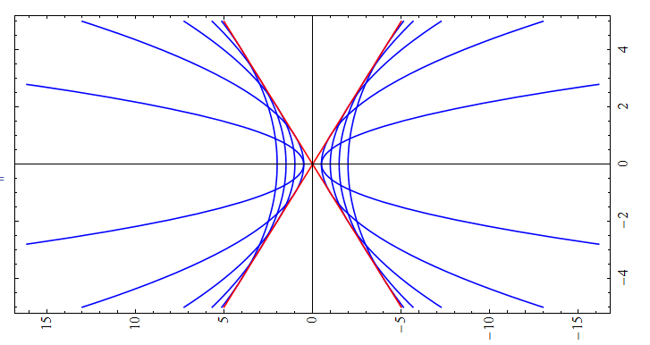
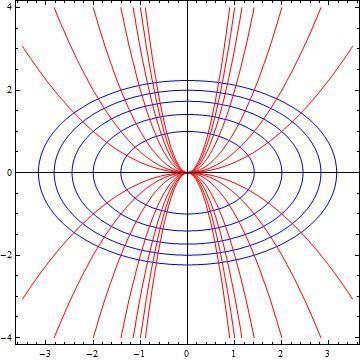

# Unidad 1 — Ecuaciones diferenciales ordinarias (1.ª parte)

Resumen del material teórico de la unidad ([U01-Teoria-Ecuaciones-Diferenciales-1.pdf](../aula-virtual/01-Ecuaciones-Diferenciales-1/U01-Teoria-Ecuaciones-Diferenciales-1.pdf)) y de los pizarrones de clase sobre ecuaciones diferenciales de primer orden (variables separables, lineales y homogéneas), complementado con el [resumen de UTNianos](../UTNianos/Resumen%20AM2.pdf).

**Objetivos de la unidad:**

1. Comprender la noción de ecuación diferencial ordinaria de primer orden y su interpretación geométrica.
2. Distinguir los distintos tipos de soluciones de una EDO.
3. Determinar una familia de curvas ortogonal a otra familia dada.

---

## 1. ¿Qué es una ecuación diferencial?

En ciencias e ingeniería muchos fenómenos se describen con relaciones entre **variaciones** de cantidades. Por ejemplo:

- "El cambio en la concentración de un producto es proporcional a la cantidad presente" ⇒ $p'(t) = k\,p(t)$.
- "La velocidad de un pistón disminuye proporcionalmente al cuadrado de la velocidad" ⇒ $v'(t) = -K\,v^2(t)$.
- Modelo de Malthus: "la población varía con velocidad proporcional a la población existente" ⇒ $P'(t) = k\,P(t)$.
- Movimiento rectilíneo uniformemente acelerado ⇒ $x''(t) = a$.

**Definición (EDO).** Una **ecuación diferencial ordinaria** es una ecuación que involucra a una función incógnita de **una sola** variable independiente, a sus derivadas y, eventualmente, a la variable independiente:

$$F\big(x,\ y(x),\ y'(x),\ \dots,\ y^{(n)}(x)\big) = 0$$

Si la función incógnita depende de varias variables, las derivadas son parciales y se habla de **ecuaciones en derivadas parciales (EDP)**, que no se estudian en esta materia.

---

## 2. Orden, grado y linealidad

- **Orden:** el mayor orden de derivación con que aparece la función incógnita.
- **Grado:** si la ecuación tiene **forma polinómica** en $y, y', \dots, y^{(n)}$ (sólo sumas, productos y potencias naturales), el grado es el **exponente de la derivada de mayor orden**. Si aparece una función trascendente de $y$ o de sus derivadas (por ejemplo $\operatorname{sen}(y')$), **no se define grado**.
- **Lineal:** la EDO es lineal si $y, y', \dots, y^{(n)}$ aparecen todas a la **primera potencia**, sin multiplicarse entre sí y sin estar dentro de otras funciones. Su forma general es:

$$a_n(x)\,y^{(n)} + a_{n-1}(x)\,y^{(n-1)} + \dots + a_1(x)\,y' + a_0(x)\,y = f(x)$$

**Ejemplos (del material):**

| Ecuación | Orden | Grado | Comentario |
|---|---|---|---|
| $p'(t) - 2p(t) = 0$ | 1 | 1 | Lineal |
| $4x^2y'' + 4xy' + (4x^2-1)y = 0$ | 2 | 1 | Lineal |
| $[z^{(5)}]^2 + (t^2+1)[z'']^4 + t^2 = 0$ | 5 | 2 | No tiene solución: el primer término es $\ge 0$ y el resto $\le 0$ (y no se anulan juntos) |
| $[y''']^4 + \operatorname{sen}(y) = 1$ | 3 | — | No es polinómica: no tiene grado |

---

## 3. Soluciones de una EDO

**Solución en un intervalo $I$:** toda función $\varphi(x)$, derivable al menos hasta el orden de la ecuación, que reemplazada en la EDO la verifica **idénticamente** para todo $x \in I$.

Hay tres tipos de solución:

- **Solución general (S.G.):** depende de $n$ **constantes arbitrarias esenciales** ($n$ = orden). Es una familia $n$-paramétrica de curvas: $\varphi(x, C_1, \dots, C_n)$.
- **Solución particular (S.P.):** se obtiene de la S.G. dándole valores a las constantes, usando $n$ condiciones (por ejemplo, condiciones iniciales).
- **Solución singular (S.S.):** es una solución que **no** se puede obtener de la S.G. para ningún valor de las constantes. Suele ser la **envolvente** de la familia de la S.G.

> El número de constantes coincide con el orden porque resolver una EDO de orden $n$ requiere, en el fondo, $n$ integraciones, y cada una aporta una constante.

**Problema de valores iniciales (PVI):**

$$\begin{cases} F(x, y, y') = 0 \\ y(x_0) = y_0 \end{cases}$$

**Ejemplo 1.8.** $p(t) = C e^{2t}$ es la S.G. de $p' - 2p = 0$. La condición $p(0) = 10$ da la S.P. $p(t) = 10e^{2t}$. Las curvas de la familia no se cortan: por cada punto del plano pasa **una única** solución.

**Ejemplo 1.9 (solución singular).** La ecuación $y\,[(y')^2 + 1] - 2xy' = 0$ tiene S.G. $y^2 + c^2 = 2cx$ (familia de parábolas). Las rectas $y = x$ e $y = -x$ también son soluciones, pero no salen de la familia para ningún $c$: son **soluciones singulares**, y en el gráfico se ve que **envuelven** a las parábolas.

En este ejemplo **no hay unicidad**: por el punto $(1,1)$ pasan la S.P. $y^2 + 1 = 2x$ y la S.S. $y = x$.

> **Existencia y unicidad.** Existe un teorema (que no se demuestra en el curso) que garantiza que el PVI $y' = F(x,y)$, $y(x_0)=y_0$ tiene solución única cerca de $x_0$ si $F$ y $\partial F/\partial y$ son continuas en un entorno de $(x_0, y_0)$.

---

## 4. Ecuaciones de variables separables

**Forma:**

$$f(y)\,y' + g(x) = 0 \qquad (f, g \text{ continuas})$$

o, equivalentemente, $y' = h(x)\,k(y)$.

**Método:**

1. Pasar todo lo que depende de $y$ (incluido $y'$) a un miembro y lo que depende de $x$ al otro: $f(y)\,y' = -g(x)$.
2. Integrar respecto de $x$ y usar que $y'\,dx = dy$:

$$\int f(y)\,dy = -\int g(x)\,dx + C$$

3. Si se puede, despejar $y$ (si no, la solución queda **implícita**).

**Cuidados importantes:**

- Al dividir por una expresión en $y$ (por ejemplo, por $y$ o por $y-1$) hay que revisar aparte si los valores que la anulan son solución. **Ejemplo:** en $p' = 2p$, al dividir por $p$ se pierde $p \equiv 0$, que sí es solución. Al final se recupera permitiendo $C = 0$.
- Cuando aparece $\ln|y| = \dots + K$, al exponenciar queda $|y| = e^K e^{\dots}$. Como $e^K > 0$ es arbitraria y el signo puede ser cualquiera, se escribe $y = C e^{\dots}$ con $C \in \mathbb{R}$.
- **Puntos singulares:** si $y'$ está multiplicada por un factor $p(x)$, los valores donde $p(x)=0$ son puntos singulares. La solución se busca en cada intervalo que ellos determinan.

**Ejemplo 1.11.** $(x^2-4)\,y' - xy - \dfrac{x}{y} = 0$. Puntos singulares: $x = \pm 2$. Separando:

$$\frac{y\,y'}{y^2+1} = \frac{x}{x^2-4} \ \Rightarrow\ \tfrac12\ln(y^2+1) = \tfrac12\ln|x^2-4| + C \ \Rightarrow\ y^2 + 1 = A\,|x^2-4|,\ A>0$$

En $|x| > 2$ son hipérbolas y en $|x| < 2$ son elipses: la solución no se puede extender a toda la recta.

---

## 5. Ecuaciones lineales de primer orden

**Forma:**

$$p(x)\,y' + q(x)\,y = f(x) \qquad (p, q, f \text{ continuas en un intervalo } I)$$

**Ecuación homogénea asociada:** $p(x)\,y' + q(x)\,y = 0$. Es de variables separables y su S.G. (S.G.H.) es:

$$y_H(x) = K\,e^{-\int \frac{q(x)}{p(x)}\,dx}, \qquad K \in \mathbb{R}$$

**Dos propiedades clave:**

1. Una combinación lineal de soluciones de la homogénea es solución de la homogénea: las soluciones forman un **subespacio vectorial** de dimensión 1. Por eso se llaman "lineales".
2. La diferencia de dos soluciones de la no homogénea es solución de la homogénea.

**Consecuencia:**

$$\boxed{\,y = y_H + y_P\,}$$

(S.G. de la no homogénea = S.G. de la homogénea + **una** solución particular de la no homogénea).

### Método de variación de parámetros (de la constante)

1. Resolver la homogénea: $y_H = K\,\varphi(x)$ con $\varphi(x) = e^{-\int q/p\,dx}$.
2. Proponer $y_P = K(x)\,\varphi(x)$, o sea, dejar que la constante "varíe".
3. Reemplazar en la ecuación. Los términos con $K(x)$ **siempre se cancelan** (porque $\varphi$ es solución de la homogénea) y queda:

$$p(x)\,K'(x)\,\varphi(x) = f(x) \ \Rightarrow\ K(x) = \int \frac{f(x)}{p(x)\,\varphi(x)}\,dx$$

4. Basta una primitiva: $y = y_H + y_P$.

**Fórmula equivalente (factor integrante).** Si la ecuación está en forma normal $y' + P(x)\,y = Q(x)$:

$$y = e^{-\int P\,dx}\left[\int Q(x)\,e^{\int P\,dx}\,dx + C\right]$$

**Ejemplo 1.12.** $\dfrac{y'}{x} + 2y = x e^{-x^2}$, $y(0) = 2$.

- Homogénea: $y' = -2xy \Rightarrow y_H = K e^{-x^2}$.
- Variación: $y_P = K(x)\,e^{-x^2}$ ⇒ $\dfrac{K'(x)\,e^{-x^2}}{x} = x e^{-x^2}$ ⇒ $K' = x^2$ ⇒ $K = \dfrac{x^3}{3}$.
- S.G.: $y = K e^{-x^2} + \dfrac{x^3}{3}e^{-x^2}$. Con $y(0)=2$: $K = 2$, así que $y = \left(2 + \dfrac{x^3}{3}\right)e^{-x^2}$.

### Ecuación de Bernoulli (actividad 1.9)

$y' + q(x)\,y = y^n f(x)$. Para $n = 0$ o $n = 1$ es lineal. Si $n \ne 0, 1$, el cambio $z = y^{1-n}$ la convierte en una ecuación **lineal en $z$**.

---

## 6. Ecuaciones homogéneas de primer orden (pizarrón)

**Función homogénea de grado $k$:** $f(\lambda x, \lambda y) = \lambda^k f(x,y)$. Si $k = 0$, $f(\lambda x, \lambda y) = f(x,y)$ y $f$ depende sólo del cociente $y/x$.

**EDO homogénea:** $y' = f(x, y)$ con $f$ homogénea de grado 0, es decir, $y' = g\!\left(\dfrac{y}{x}\right)$.

**Resolución:** se sustituye $z = \dfrac{y}{x}$, es decir, $y = z\,x$ e $y' = z'\,x + z$. Queda:

$$z'\,x + z = g(z) \ \Rightarrow\ \frac{z'}{g(z) - z} = \frac{1}{x}$$

que es de **variables separables** en $z$ y $x$. Al final se vuelve a $y = z\,x$.

---

## 7. Reducción de orden

Si en una EDO de orden 2 o superior **no aparece $y$** (sólo sus derivadas), se puede bajar el orden con la sustitución $w = y'$ (o $w = y''$ si tampoco aparece $y'$). Así se obtiene una EDO de primer orden en $w$. Después se integra para volver a $y$, y cada integración agrega una constante.

**Ejemplo:** $x\,y'' - 2y' = 0$. Con $w = y'$ queda $x\,w' = 2w$, que es separable: $w = C x^2$. Luego $y = \dfrac{C}{3}x^3 + D$.

---

## 8. Familias de curvas y su ecuación diferencial

**Problema inverso:** dada una familia de curvas con $n$ parámetros, hallar la EDO (de orden $n$) cuya S.G. es esa familia.

**Método:**

1. Derivar la ecuación de la familia tantas veces como parámetros tenga.
2. Eliminar los parámetros entre las ecuaciones obtenidas (despejarlos y reemplazar, dividir miembro a miembro, etc.).

**Ejemplo 1.13.** $y = k(x^2 - x)$ ⇒ $y' = k(2x - 1)$. Despejando $k = \dfrac{y}{x^2-x}$:

$$(x^2 - x)\,y' + (1 - 2x)\,y = 0$$

**Ejemplo 1.14.** $y = \cos(kx + c)$ (2 parámetros) ⇒ $y'' = -k^2 y$ y $y^2 + (y'/k)^2 = 1$. Eliminando $k$:

$$(1 - y^2)\,y'' + y\,(y')^2 = 0$$

### Problemas geométricos con la recta tangente o normal

En un punto genérico $(x, y)$ de la curva, con pendiente $y'$:

| Recta | Ecuación | Ordenada al origen ($X=0$) | Abscisa al origen ($Y=0$) |
|---|---|---|---|
| Tangente | $Y - y = y'\,(X - x)$ | $y - x\,y'$ | $x - \dfrac{y}{y'}$ |
| Normal | $Y - y = -\dfrac{1}{y'}\,(X - x)$ | $y + \dfrac{x}{y'}$ | $x + y\,y'$ |

Se traduce la condición geométrica del enunciado a una igualdad con estas expresiones y se obtiene una EDO.

---

## 9. Familias ortogonales (trayectorias ortogonales)

**Definición:** dos familias $F_1$ y $F_2$ son **ortogonales** si cada curva de una corta a las de la otra con **rectas tangentes perpendiculares** en los puntos de intersección.

Como dos rectas perpendiculares tienen pendientes $m_1\,m_2 = -1$:

**Procedimiento:**

1. Hallar la EDO de la familia dada: $G(x, y, y') = 0$, eliminando el parámetro.
2. Reemplazar $y'$ por $-\dfrac{1}{y'}$: $\ G\!\left(x, y, -\dfrac{1}{y'}\right) = 0$ es la EDO de la familia ortogonal.
3. Resolver esa EDO.

**Ejemplo 1.16.** Circunferencias $x^2 + y^2 = c^2$ ⇒ $x + y\,y' = 0$. Cambiando $y'$ por $-1/y'$: $x - \dfrac{y}{y'} = 0$ ⇒ $\dfrac{y'}{y} = \dfrac{1}{x}$ ⇒ $y = Kx$. La familia ortogonal son las rectas por el origen.

Al conjunto de una familia y su ortogonal se lo llama **red ortogonal** (por ejemplo, líneas de campo y curvas equipotenciales en Física).

---

## 10. Complementos: solución general, solución singular y ecuaciones en derivadas parciales

**Ecuación en derivadas parciales (EDP):** si la función buscada depende de más de una variable, las derivadas son parciales. Ejemplo de 2.º orden: $\dfrac{\partial^2 z}{\partial x^2} + \dfrac{\partial^2 z}{\partial y^2} = 0$ (ecuación de Laplace). En esta materia sólo se resuelven ecuaciones **ordinarias**.

**Grado (otro ejemplo):** $(y''')^5 - (y'')^4\,x = e^x$ es de orden 3 y grado 5; en cambio $2y'' + \sqrt{y'''} = 0$ no tiene grado, porque no es polinómica en las derivadas.

**Condiciones que definen la S.G. de una EDO de 1.er orden.** Una familia $y = f(x, C)$ es la S.G. si:

1. para todo $C$, $f(x, C)$ satisface la ecuación;
2. dada una condición inicial $y(x_0) = y_0$ (en la región donde vale el teorema de existencia), se puede hallar $C_0$ tal que $y = f(x, C_0)$ la cumple.

Esa $y = f(x, C_0)$ es una **S.P.** Para orden $n$ hacen falta $n$ constantes **independientes** (que no se puedan reducir a menos).

### Ejemplo de solución singular: ecuación de Clairaut

$y = x\,y' - (y')^2$. Se sustituye $y' = u$:

$$y = x\,u - u^2 \quad (*) \ \Rightarrow\ y' = u + x\,u' - 2u\,u'$$

Igualando con $y' = u$: $u'\,(x - 2u) = 0$.

- $u' = 0 \Rightarrow u = C$, y en $(*)$: $y = Cx - C^2$ (**S.G.**, una familia de rectas).
- $x = 2u \Rightarrow u = \dfrac x2$, y en $(*)$: $y = \dfrac{x^2}{2} - \dfrac{x^2}{4} = \dfrac{x^2}{4}$ (**S.S.**, la envolvente de las rectas).

---

## 11. Sustitución de Lagrange para la ecuación lineal

Otra forma de resolver $y' + P(x)\,y = Q(x)$ (equivalente a variación de parámetros):

1. Se busca $u(x)$, solución de la homogénea $u' + P\,u = 0$: $\ u = e^{-\int P\,dx}$.
2. Se propone $y = u\cdot v$, con $y' = u'v + uv'$. Reemplazando:

$$u\,v' + v\,\underbrace{(u' + P\,u)}_{=\,0} = Q \ \Rightarrow\ v' = \frac{Q}{u} = Q\,e^{\int P\,dx}$$

3. Integrando: $v = \int Q\,e^{\int P\,dx}\,dx + C$, y entonces:

$$y = e^{-\int P\,dx}\left[\int Q(x)\,e^{\int P\,dx}\,dx + C\right]$$

**Ejemplo:** $y' + 2y = 4x$. Con $u = e^{-2x}$: $v' = 4x\,e^{2x} \Rightarrow v = (2x - 1)e^{2x} + C$, así que $y = C\,e^{-2x} + 2x - 1$.

### Ecuación homogénea: fórmula cerrada

Con $y = zx$, la ecuación $y' = G(y/x)$ queda $x\,z' = G(z) - z$, y entonces:

$$\ln|x| = \int\frac{dz}{G(z) - z} + C$$

> Los valores de $z$ con $G(z) - z = 0$ pueden dar **soluciones singulares** (rectas $y = z_0x$).

**Ejemplo:** $x\,y\,y' = x^2 + y^2$, es decir $y' = \dfrac xy + \dfrac yx$. Con $y = zx$: $z + x\,z' = \dfrac1z + z$, o sea $x\,z' = \dfrac1z$. Separando, $z\,dz = \dfrac{dx}{x}$, de donde $\dfrac{z^2}{2} = \ln|Cx|$ y, volviendo a $y = zx$:

$$y^2 = 2x^2\ln|Cx|$$

---

## 12. Interpretación geométrica: campo de direcciones e isoclinas

La ecuación $y' = f(x, y)$ asigna a cada punto del plano una **pendiente**. El campo vectorial

$$\vec t(x,y) = (1,\ f(x,y))$$

es el **campo de direcciones**: en cada punto es tangente a la curva de la S.G. que pasa por ese punto.

**Isoclinas** ("igual inclinación"): son las curvas $f(x, y) = k$. Unen los puntos donde las soluciones tienen **tangentes paralelas** (pendiente $k$).

**Ejemplos:**

- $y' = 2x$: S.G. $y = x^2 + C$; isoclinas $x = k/2$ (rectas verticales: todas las parábolas tienen la misma pendiente sobre una misma vertical).
- $x^2y' + y^2 = 0$: $y' = -\dfrac{y^2}{x^2}$, S.G. $y = \dfrac{x}{1 + Cx}$; isoclinas $-\dfrac{y^2}{x^2} = k$, es decir $y^2 = -k\,x^2$ (pares de rectas por el origen).

---

## 13. Trayectorias ortogonales: definiciones y coordenadas polares

**Definiciones:**

1. Una curva es **ortogonal** a otra si la corta y, en el punto de intersección, sus rectas tangentes son perpendiculares.
2. Una curva es **trayectoria ortogonal** a una familia si es ortogonal a **todas** las curvas de la familia.
3. Dos familias son **trayectorias ortogonales** una de la otra si cada curva de una es ortogonal a cada curva de la otra (ejemplo: las circunferencias de centro $O$ y las rectas por $O$).

### En coordenadas polares

Si la familia viene dada como $\rho = \rho(\varphi)$, cada curva es la imagen de $\vec x(\varphi) = (\rho\cos\varphi,\ \rho\operatorname{sen}\varphi)$, con vector tangente

$$\vec x\,'(\varphi) = (\rho'\cos\varphi - \rho\operatorname{sen}\varphi,\ \rho'\operatorname{sen}\varphi + \rho\cos\varphi)$$

Para una curva $\rho_1(\varphi)$ ortogonal, en el punto de corte ($\rho_1 = \rho$) el producto escalar de los tangentes es 0. Desarrollando:

$$\rho'\,\rho_1' + \rho^2 = 0 \ \Rightarrow\ \boxed{\rho_1' = -\frac{\rho^2}{\rho'}}$$

Es decir: en la EDO de la familia (en polares) se reemplaza $\dfrac{d\rho}{d\varphi}$ por $-\dfrac{\rho^2}{d\rho/d\varphi}$.

Para aplicarlo, primero se escribe $\dfrac{\rho'}{\rho}$ de la familia **sin el parámetro**; la familia ortogonal cumple $\dfrac{\rho_1'}{\rho_1} = -\dfrac{\rho}{\rho'}$.

**Ejemplo:** cardioides $\rho = a(1 + \cos\varphi)$. Derivando, $\dfrac{\rho'}{\rho} = \dfrac{-\operatorname{sen}\varphi}{1 + \cos\varphi}$ (ya sin $a$). La ortogonal cumple:

$$\frac{\rho_1'}{\rho_1} = \frac{1 + \cos\varphi}{\operatorname{sen}\varphi} = \cot\frac{\varphi}{2} \ \Rightarrow\ \ln\rho_1 = 2\ln\left|\operatorname{sen}\frac{\varphi}{2}\right| + c \ \Rightarrow\ \rho_1 = b\,(1 - \cos\varphi)$$

La familia ortogonal son las cardioides "opuestas".

---

## 14. Estrategia para resolver los ejercicios

1. **Identificar el tipo de EDO**, en este orden:
   - ¿Es de variables separables? Es la más fácil.
   - ¿Es lineal en $y$ ($p\,y' + q\,y = f$)? Usar variación de parámetros.
   - ¿Es homogénea ($y' = g(y/x)$)? Usar $y = zx$.
   - ¿Falta $y$ en una de orden superior? Reducir el orden con $w = y'$.
2. **Cuidar las divisiones:** al dividir por algo que depende de $y$, verificar aparte las soluciones constantes que se pierden (posibles soluciones singulares).
3. **Condiciones iniciales:** primero hallar la S.G. y recién al final reemplazar la condición para obtener la constante.
4. **Problemas geométricos:** escribir la recta tangente o normal en un punto genérico, traducir la condición y obtener la EDO.
5. **Familias ortogonales:** EDO de la familia → cambiar $y' \to -1/y'$ → resolver.
6. **Verificar:** reemplazar la solución en la ecuación.

---

## 15. Resumen de fórmulas

| Tema | Fórmula |
|---|---|
| Variables separables | $f(y)\,y' = g(x) \Rightarrow \int f(y)\,dy = \int g(x)\,dx + C$ |
| Lineal: S.G. | $y = y_H + y_P$ |
| Lineal homogénea | $y_H = K\,e^{-\int q/p\,dx}$ |
| Variación de parámetros | $y_P = K(x)\,\varphi(x)$, con $p\,K'\,\varphi = f$ |
| Factor integrante ($y' + P y = Q$) | $y = e^{-\int P}\left[\int Q\,e^{\int P}\,dx + C\right]$ |
| Homogénea ($y' = g(y/x)$) | $y = z\,x$, $\ y' = z'x + z$ |
| Bernoulli ($y' + q y = f y^n$) | $z = y^{1-n}$ |
| Reducción de orden | $w = y'$ si no aparece $y$ |
| Familia ortogonal | $y' \to -1/y'$ |
| Tangente en $(x,y)$ | $Y - y = y'(X - x)$ |
| Normal en $(x,y)$ | $Y - y = -\frac{1}{y'}(X - x)$ |

---

[← Volver al menú principal](../README.md)
