# Unidad 2 — Práctica: Nociones de topología y funciones

Ejercicios del **T.P. N.º 2 de la Guía de Trabajos Prácticos** ([TP02-Topologia-Funciones.pdf](../aula-virtual/02-Topologia-Funciones/TP02-Topologia-Funciones.pdf)). Las respuestas se controlaron con las [respuestas oficiales de la guía](../aula-virtual/00-Guia-TP/Guia-TP-2016-Respuestas.pdf) y con la [fe de erratas](../aula-virtual/00-Guia-TP/Guia-TP-2016-Fe-de-Erratas-2018-07-31.pdf).

Cada ejercicio tiene un botón **Solución**. Al abrirlo aparece la respuesta y, arriba de ella, un segundo botón **Solución paso a paso** con el desarrollo completo.

> **Convención de los gráficos:** la zona sombreada es el conjunto; una línea **llena** indica que el borde está incluido, una línea **punteada** que no lo está; un punto **lleno** pertenece al conjunto y un punto **hueco** no.

---

### 01) Clasificación de puntos en $\Re$

Sea $f : D \subset \Re \to \Re \ /\ f(x) = \dfrac{\sqrt{x\thinspace(x + 2)^4}}{x - 1}$ donde $D$ es el dominio natural de $f$.

En el siguiente gráfico se indican los puntos $P_1, P_2, P_3 \in D$ y $P_4, P_5 \notin D$. Para cada uno de esos puntos indique si es punto interior, exterior o frontera de $D$; también indique si es punto aislado de $D$ y si es punto de acumulación de $D$.

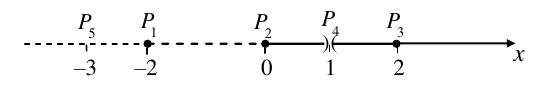

Nota: Observe que $D = \lbrace x \in \Re \ /\ x = -2 \ \vee\ 0 \le x < 1 \ \vee\ x > 1\rbrace$.

<b>Solución</b>

Solución paso a paso

**Paso 1 — Por qué el dominio es ese.**

- La raíz exige $x\thinspace(x+2)^4 \ge 0$. Como $(x+2)^4 \ge 0$ siempre, esto pasa si $x \ge 0$ **o** si $(x+2)^4 = 0$, es decir, $x = -2$.
- El denominador exige $x \ne 1$.
- Resultado: $D = \lbrace-2\rbrace \cup [0, 1) \cup (1, +\infty)$.

**Paso 2 — Analizar cada punto con entornos $(a - r, a + r)$.**

- **$P_5 = -3$:** con $r = 0{,}5$, el entorno $(-3{,}5;\ -2{,}5)$ no tiene puntos de $D$ ⇒ **exterior**. No es aislado (no pertenece a $D$) ni de acumulación.
- **$P_1 = -2$:** pertenece a $D$, pero el entorno $(-2{,}5;\ -1{,}5)$ sólo contiene a $-2$ de $D$ ⇒ **aislado**. Todo entorno contiene un punto de $D$ (él mismo) y puntos fuera de $D$ ⇒ **frontera**. No es de acumulación, porque el entorno reducido no tiene puntos de $D$.
- **$P_2 = 0$:** todo entorno $(-r, r)$ contiene puntos de $D$ (los $x \in [0, r)$) y puntos fuera de $D$ (los negativos) ⇒ **frontera**. Además el entorno reducido contiene infinitos puntos de $D$ ⇒ **de acumulación**.
- **$P_4 = 1$:** no pertenece a $D$, pero todo entorno de $1$ contiene puntos de $D$ (a ambos lados) y a $1 \notin D$ ⇒ **frontera** y **de acumulación**.
- **$P_3 = 2$:** el entorno $(1{,}5;\ 2{,}5) \subset D$ ⇒ **interior**, y por lo tanto también **de acumulación**.

**Respuesta:**

| | interior | exterior | frontera | aislado | acumulación |
|---|---|---|---|---|---|
| $P_1$ | | | X | X | |
| $P_2$ | | | X | | X |
| $P_3$ | X | | | | X |
| $P_4$ | | | X | | X |
| $P_5$ | | X | | | |

---

### 02) Análisis de un conjunto con un punto aislado

Sea $S = \lbrace(x, y) \in \Re^2 \ /\ 0 < x^2 + y^2 < 4 \ \vee\ (x - 2)^2 + (y - 2)^2 = 0\rbrace$ el conjunto que se representa sombreado en la figura de la derecha. Observe que el punto $(0,0) \notin S$, mientras que $A = (2,2)$ es un punto aislado de $S$.

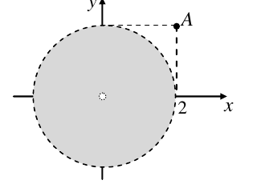

- a) Halle la frontera ($\partial S$) de $S$.
- b) Halle el conjunto $\overset{\circ}{S}$ de puntos interiores de $S$.
- c) Halle el conjunto $S'$ de los puntos de acumulación de $S$, denominado *conjunto derivado* de $S$.
- d) Analice si $S$ es cerrado, abierto, acotado.
- e) Halle el conjunto $Cl(S) = S \cup S'$ que se denomina *clausura* o *adherencia* de $S$.

<b>Solución</b>

Solución paso a paso

**Descripción:** $S$ es el disco abierto de radio 2 **sin el centro** (la condición $(x-2)^2 + (y-2)^2 = 0$ sólo se cumple en $(2,2)$), más el punto $A = (2,2)$.

**a) Frontera.** Buscamos los puntos donde todo entorno toca a $S$ y a su complemento:

- Los puntos de la circunferencia $x^2 + y^2 = 4$: cualquier disquito centrado en ellos tiene puntos de adentro (de $S$) y de afuera.
- El origen $(0,0)$: no pertenece a $S$ pero está rodeado de puntos de $S$.
- El punto aislado $A$: su entorno contiene a $A \in S$ y a puntos que no son de $S$.

**b) Interior.** Son los puntos de $S$ que tienen un disquito contenido en $S$: todos los del disco reducido, es decir, $0 < x^2 + y^2 < 4$. $A$ no es interior.

**c) Puntos de acumulación.** Son los puntos donde todo entorno reducido tiene puntos de $S$:

- Todo el disco cerrado $x^2+y^2 \le 4$, incluidos el origen y la circunferencia.
- $A$ **no** es de acumulación, porque es aislado.

**d)**

- **No es cerrado:** los puntos de la circunferencia y el origen son frontera pero no pertenecen a $S$.
- **No es abierto:** $A \in S$ y no es interior.
- **Es acotado:** $S \subset B(\vec 0, 3)$, porque $|A| = 2\sqrt2 < 3$.

**e) Clausura.** $Cl(S) = S \cup S' = \lbrace x^2 + y^2 \le 4\rbrace \cup \lbrace(2,2)\rbrace$.

**Respuesta:**

- a) $\partial S = \lbrace(x,y) \in \Re^2 / x^2 + y^2 = 4\rbrace \cup \lbrace(0,0)\rbrace \cup \lbrace(2,2)\rbrace$.
- b) $\overset{\circ}{S} = \lbrace(x,y) \in \Re^2 / 0 < x^2 + y^2 < 4\rbrace$.
- c) $S' = \lbrace(x,y) \in \Re^2 / x^2 + y^2 \le 4\rbrace$.
- d) No es cerrado, no es abierto, es acotado.
- e) $Cl(S) = \lbrace(x,y) \in \Re^2 / x^2 + y^2 \le 4\rbrace \cup \lbrace(2,2)\rbrace$.

---

### 03) Análisis topológico de conjuntos

Represente geométricamente los siguientes conjuntos de puntos. En cada caso indique cuáles son sus puntos interiores, frontera y exteriores, analice si el conjunto es cerrado, abierto, acotado, compacto, conexo.

- a) $\lbrace(x, y) \in \Re^2 \ /\ x^2 + y^2 - 4 \le 0,\ x + y \ge 1\rbrace$.
- b) $\lbrace(x, y) \in \Re^2 \ /\ 4x^2 + 7y^2 \le 2,\ x \ge 0\rbrace$.
- c) $\lbrace(x, y) \in \Re^2 \ /\ x^2 - y^2 \le 3,\ x + y \ge 2\rbrace$.
- d) $\lbrace(x, y, z) \in \Re^3 \ /\ x^2 + y^2 = a^2 \ \wedge\ x^2 + z^2 = a^2 \ \wedge\ a > 0 \ \wedge\ x, y, z \in \Re_0^+\rbrace$.
- e) $\lbrace(x, y, z) \in \Re^3 \ /\ x^2 + y^2 < z^2 \ \wedge\ x^2 + y^2 + z^2 < 9\rbrace$.

<b>Solución</b>

Solución paso a paso

**Herramienta:** las desigualdades **no estrictas** ($\le$, $\ge$) entre funciones continuas definen conjuntos **cerrados**, y las **estrictas** ($<$, $>$) definen conjuntos **abiertos**. La intersección de cerrados es cerrada y la de abiertos es abierta.

**a)** Es el disco de radio 2 ($x^2+y^2 \le 4$) intersecado con el semiplano por encima de la recta $x + y = 1$: un **segmento circular**.

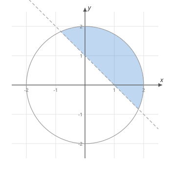

- **Interior:** lo mismo con desigualdades estrictas: $x^2 + y^2 < 4$, $x + y > 1$.
- **Frontera:** el arco de circunferencia ($x^2+y^2 = 4$ con $x + y \ge 1$) más la cuerda ($x + y = 1$ con $x^2 + y^2 < 4$).
- **Exterior:** $x^2 + y^2 > 4$, o bien $x + y < 1$.
- **Cerrado** (contiene toda su frontera) y **no abierto**.
- **Acotado** (está dentro del disco de radio 2) ⇒ **compacto**.
- **Conexo**: de hecho es convexo, porque es la intersección de dos convexos.

**b)** $4x^2 + 7y^2 \le 2 \iff \dfrac{x^2}{1/2} + \dfrac{y^2}{2/7} \le 1$ es una elipse rellena de semiejes $\frac{1}{\sqrt2}$ y $\sqrt{2/7}$. Con $x \ge 0$ queda la **media elipse derecha**.

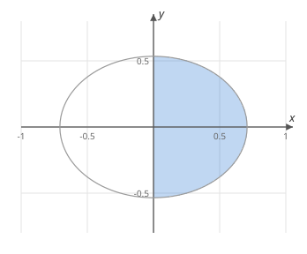

- **Interior:** $4x^2 + 7y^2 < 2$, $x > 0$.
- **Frontera:** el arco ($4x^2 + 7y^2 = 2$, $x \ge 0$) y el segmento vertical ($x = 0$, $4x^2 + 7y^2 < 2$).
- **Exterior:** $4x^2 + 7y^2 > 2$, o bien $x < 0$.
- **Cerrado**, no abierto, **acotado** ⇒ **compacto**, **conexo**.

**c)** $x^2 - y^2 \le 3$ es la región **entre** las dos ramas de la hipérbola $x^2 - y^2 = 3$, la que contiene al eje $y$. Con $x + y \ge 2$ nos quedamos con la parte por encima de esa recta.

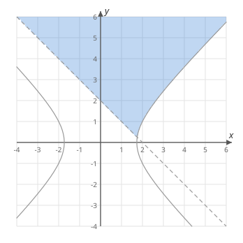

- **Interior:** $x^2 - y^2 < 3$, $x + y > 2$.
- **Frontera:** el arco de hipérbola ($x^2-y^2 = 3$, $x + y \ge 2$) y el segmento ($x + y = 2$, $x^2-y^2 < 3$).
- **Exterior:** $\Re^2 -$ interior $-$ frontera.
- **Cerrado** y no abierto.
- **No acotado**: contiene, por ejemplo, todos los puntos $(0, y)$ con $y \ge 2$ ⇒ **no compacto**.
- **Conexo**.

**d)** Restamos las dos ecuaciones: $(x^2 + y^2) - (x^2 + z^2) = 0 \Rightarrow y^2 = z^2 \Rightarrow y = z$, porque ambas son $\ge 0$.

Así que el conjunto es la curva formada por los puntos de la circunferencia $x^2 + y^2 = a^2$ con $z = y$, en el primer octante. Parametrizada:

$$\vec X(t) = (a\cos t,\ a\mathop{\mathrm{sen}}t,\ a\mathop{\mathrm{sen}}t), \quad 0 \le t \le \pi/2$$

- **Interior:** $\emptyset$, porque una curva no contiene ninguna bolita de $\Re^3$.
- **Frontera:** la curva misma.
- **Exterior:** $\Re^3 -$ curva.
- **Cerrado**, porque es intersección de conjuntos de la forma $\lbrace g = c\rbrace$ y $\lbrace g \ge 0\rbrace$ con $g$ continua.
- **Acotado** ⇒ **compacto**.
- **Conexo**, porque es la imagen continua del intervalo $[0, \pi/2]$.

**e)** $x^2 + y^2 < z^2$ es el **interior del cono** de eje $z$, formado por dos "copas", una con $z > 0$ y otra con $z < 0$. El origen no está, porque haría falta $0 < 0$. $x^2+y^2+z^2 < 9$ es el interior de la esfera de radio 3.

- **Interior:** el conjunto mismo, porque es abierto (desigualdades estrictas).
- **Frontera:** la superficie cónica dentro de la esfera ($x^2 + y^2 = z^2$, $x^2+y^2+z^2 \le 9$) más los dos "casquetes" de la esfera dentro del cono ($x^2 + y^2 < z^2$, $x^2+y^2+z^2 = 9$).
- **Exterior:** $\Re^3 -$ interior $-$ frontera.
- **Abierto**, no cerrado.
- **Acotado**, pero no compacto porque no es cerrado.
- **Desconexo**: son dos "conos de helado", uno arriba y otro abajo, que no se tocan porque el origen no pertenece al conjunto.

**Respuesta:**

- a) interior $= \lbrace x^2 + y^2 < 4,\ x + y > 1\rbrace$; frontera $= \lbrace x^2 + y^2 = 4,\ x + y \ge 1\rbrace \cup \lbrace x^2 + y^2 < 4,\ x + y = 1\rbrace$; exterior $= \lbrace x^2 + y^2 > 4\rbrace \cup \lbrace x + y < 1\rbrace$. Es cerrado, no es abierto, es compacto, es conexo.
- b) interior $= \lbrace4x^2 + 7y^2 < 2,\ x > 0\rbrace$; frontera $= \lbrace4x^2 + 7y^2 = 2,\ x \ge 0\rbrace \cup \lbrace4x^2 + 7y^2 < 2,\ x = 0\rbrace$; exterior $= \lbrace4x^2 + 7y^2 > 2\rbrace \cup \lbrace x < 0\rbrace$. Es cerrado, no es abierto, es compacto, es conexo.
- c) interior $= \lbrace x^2 - y^2 < 3,\ x + y > 2\rbrace$; frontera $= \lbrace x^2 - y^2 = 3,\ x + y \ge 2\rbrace \cup \lbrace x^2 - y^2 < 3,\ x + y = 2\rbrace$; exterior $= \Re^2 -$ interior $-$ frontera. Es cerrado, no es abierto, no es compacto, es conexo.
- d) interior $= \emptyset$; frontera $= \lbrace\vec X = (a\cos t,\ a\mathop{\mathrm{sen}}t,\ a\mathop{\mathrm{sen}}t),\ 0 \le t \le \pi/2\rbrace$; exterior $= \Re^3 -$ frontera. Es cerrado, no es abierto, es compacto, es conexo.
- e) interior $= \lbrace x^2 + y^2 < z^2 \wedge x^2+y^2+z^2 < 9\rbrace$; frontera $= \lbrace x^2+y^2 = z^2 \wedge x^2+y^2+z^2 \le 9\rbrace \cup \lbrace x^2+y^2 < z^2 \wedge x^2+y^2+z^2 = 9\rbrace$; exterior $= \Re^3 -$ interior $-$ frontera. No es cerrado, es abierto, es acotado, no es compacto, es desconexo.

---

### 04) Cerrado y conexo pero no convexo

Verifique que $S = \lbrace(x, y) \in \Re^2 \ /\ x\thinspace y \le 4\rbrace$ es cerrado y conexo, pero no es convexo.

<b>Solución</b>

Solución paso a paso

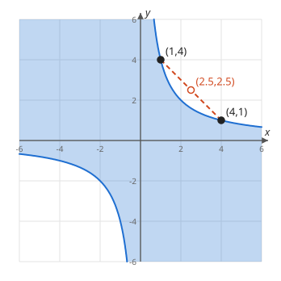

**Cerrado.** El complemento es $S^c = \lbrace xy > 4\rbrace$. Si $(x_0, y_0)$ cumple $x_0y_0 > 4$, como $g(x,y) = xy$ es continua, sigue siendo $xy > 4$ en un disquito alrededor del punto. Entonces $S^c$ es abierto y $S$ es cerrado. Además $S$ contiene a su frontera, la hipérbola $xy = 4$.

**Conexo.** Mostramos que cualquier punto de $S$ se une con el origen por un segmento contenido en $S$. Si $(x, y) \in S$, los puntos del segmento son $t\thinspace(x, y)$ con $t \in [0,1]$, y cumplen $(tx)(ty) = t^2\thinspace xy$:

- Si $xy \ge 0$: $t^2 xy \le xy \le 4$ ✓.
- Si $xy < 0$: $t^2 xy \le 0 \le 4$ ✓.

Entonces todo el segmento está en $S$. Dos puntos cualesquiera se unen pasando por el origen ⇒ $S$ es arco-conexo ⇒ **conexo**.

**No convexo.** Basta un contraejemplo: $P = (4, 1)$ y $Q = (1, 4)$ están en $S$ (ambos dan $xy = 4$), pero el punto medio del segmento $PQ$ es $M = (2{,}5;\ 2{,}5)$, con $xy = 6{,}25 > 4$ ⇒ $M \notin S$.

**Respuesta:** Se verifica observando su representación geométrica: $S$ contiene a su frontera (la hipérbola $xy = 4$), es "de una sola pieza" y el segmento de $(4,1)$ a $(1,4)$ se sale de $S$.

---

### 05) Dominio natural

En los siguientes casos, determine y grafique el dominio natural $D$ de la función.

- a) $f(x, y) = \ln((x + 1)\thinspace(y - 2x))$.
- b) $\vec f(x, y) = (\sqrt{1 - x},\ (x + 1)^{-1/2},\ \ln(y - x))$.
- c) $f(x, y) = \sqrt{1 - (x^2 + y)^2}$.
- d) $f(x, y, z) = \sqrt{\ln(z - x - y)}$.
- e) $f(x, y) = \ln(x\thinspace y)/\sqrt{2 - x - y}$.
- f) $\vec f(x, y) = (x^{-2},\ (x + y)^{-2}\sqrt{y})$.
- g) $f(x, y, z) = (x\thinspace y + z)/\sqrt{1 - y}$.
- h) $f(x, y) = \sqrt{(x^2 + y^2 - x)/(2x - x^2 - y^2)}$.
- i) $f(x, y) = \int_x^y (1 + t^2)^{-1}\thinspace dt$.
- j) $f(x, y) = \mathop{\mathrm{arcsen}}(x/(x + y))$.

> **Fe de erratas (31/07/18):** en la respuesta del ítem 05-h dice $x \le x^2 + y^2 \le 2x$, **debe decir** $x \le x^2 + y^2 < 2x$.

<b>Solución</b>

Solución paso a paso

**Método:** escribir **todas** las restricciones (log ⇒ argumento $> 0$; raíz par ⇒ radicando $\ge 0$; denominador $\ne 0$; arcsen ⇒ argumento en $[-1, 1]$) y, si hay varias componentes, intersecar.

**a)** Necesitamos $(x + 1)(y - 2x) > 0$: el producto es positivo si ambos factores tienen el mismo signo.

- Ambos positivos: $x > -1$ **y** $y > 2x$.
- Ambos negativos: $x < -1$ **y** $y < 2x$.

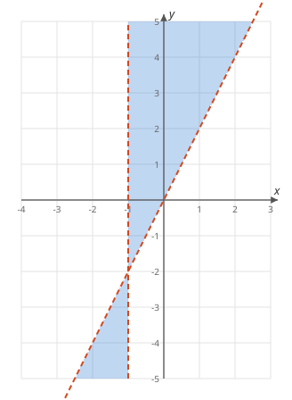

**b)** Una restricción por componente:

- $\sqrt{1-x}$: $x \le 1$.
- $(x+1)^{-1/2} = \dfrac{1}{\sqrt{x+1}}$: $x + 1 > 0 \Rightarrow x > -1$.
- $\ln(y - x)$: $y > x$.

Intersección: $-1 < x \le 1$ e $y > x$.

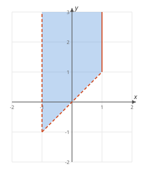

**c)** $1 - (x^2 + y)^2 \ge 0 \iff (x^2+y)^2 \le 1 \iff -1 \le x^2 + y \le 1$. Es la franja entre las parábolas $y = -1 - x^2$ e $y = 1 - x^2$, bordes incluidos.

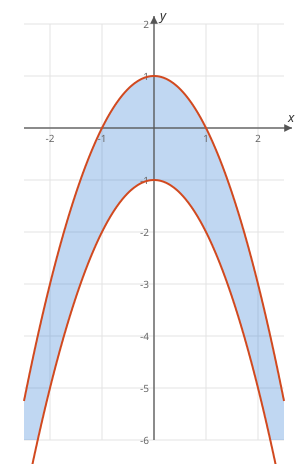

**d)** Hay dos condiciones:

- El logaritmo exige $z - x - y > 0$.
- La raíz exige $\ln(z - x - y) \ge 0 \iff z - x - y \ge 1$.

La segunda implica la primera, así que $D = \lbrace z \ge x + y + 1\rbrace$: el semiespacio por encima del plano $z = x + y + 1$, **incluyendo** al plano, porque ahí $\sqrt{\ln 1} = 0$ está definido. La respuesta oficial escribe "$>$"; con "$\ge$" se incluye además el plano, donde la función vale 0.

**e)** Hay dos condiciones:

- $\ln(xy)$: $xy > 0$, que son el 1.er y el 3.er cuadrante sin los ejes.
- $\sqrt{2 - x - y}$ en el denominador: $2 - x - y > 0 \Rightarrow x + y < 2$.

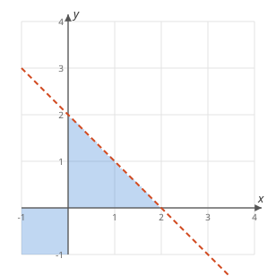

**f)** Hay tres condiciones:

- $x^{-2} = 1/x^2$: $x \ne 0$.
- $(x+y)^{-2}$: $x + y \ne 0$.
- $\sqrt y$: $y \ge 0$.

Resultado: el semiplano $y \ge 0$ sin la recta $y = -x$ y sin el eje $y$.

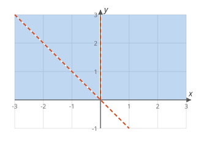

**g)** El numerador no restringe. La raíz en el denominador exige $1 - y > 0 \Rightarrow y < 1$, con $x$ y $z$ libres. Es un semiespacio abierto de $\Re^3$.

**h)** Hay que pedir $\dfrac{x^2+y^2 - x}{2x - x^2 - y^2} \ge 0$, con denominador $\ne 0$. Completando cuadrados:

- Numerador: $x^2 + y^2 - x \ge 0 \iff (x - \tfrac12)^2 + y^2 \ge \tfrac14$, es decir, **fuera o sobre** la circunferencia de centro $(\frac12, 0)$ y radio $\frac12$.
- Denominador: $2x - x^2 - y^2 > 0 \iff (x - 1)^2 + y^2 < 1$, es decir, **dentro** de la circunferencia de centro $(1,0)$ y radio 1.

Casos:

- **Numerador $\ge 0$ y denominador $> 0$:** $x \le x^2 + y^2 < 2x$ ✓.
- **Numerador $\le 0$ y denominador $< 0$:** sería $x^2 + y^2 \le x$ y $x^2 + y^2 > 2x$. Entonces $2x < x$, o sea $x < 0$, pero $x^2 + y^2 \le x < 0$ es imposible. No aporta puntos.

Resultado: $D = \lbrace x \le x^2 + y^2 < 2x\rbrace$, la "medialuna" entre las dos circunferencias, con el borde chico incluido y el grande excluido. El origen queda afuera porque da $0 < 0$.

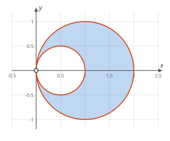

**i)** El integrando $\dfrac{1}{1+t^2}$ es continuo en todo $\Re$, así que la integral existe para cualquier par de límites. De hecho, $f(x,y) = \arctan y - \arctan x$. Resultado: $D = \Re^2$.

**j)** Hace falta $x + y \ne 0$ y $-1 \le \dfrac{x}{x+y} \le 1$. Separamos según el signo de $s = x + y$, porque al multiplicar por $s$ la desigualdad se invierte si $s < 0$.

- **Si $x + y > 0$:** $-(x + y) \le x \le x + y$.
  - La desigualdad derecha da $0 \le y$.
  - La izquierda da $-2x \le y$.
  - Queda $y \ge 0$ e $y \ge -2x$, y en esos puntos $x + y > 0$ salvo en el origen.
- **Si $x + y < 0$:** $-(x+y) \ge x \ge x + y$, que da $y \le 0$ e $y \le -2x$.

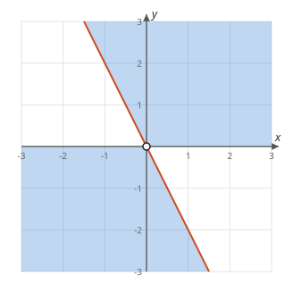

**Respuesta:**

- a) $D = \lbrace(x,y) \in \Re^2 / x > -1 \wedge y > 2x\rbrace \cup \lbrace(x,y) \in \Re^2 / x < -1 \wedge y < 2x\rbrace$.
- b) $D = \lbrace(x,y) \in \Re^2 / y > x \ \wedge\ -1 < x \le 1\rbrace$.
- c) $D = \lbrace(x,y) \in \Re^2 / -1 \le y + x^2 \le 1\rbrace$.
- d) $D = \lbrace(x,y,z) \in \Re^3 / z \ge x + y + 1\rbrace$ (la guía escribe $z > x + y + 1$).
- e) Puntos debajo de la recta $x + y = 2$ en 1.º y 3.º cuadrante, excluidos los ejes coordenados.
- f) Semiplano $y \ge 0$ salvo los puntos de la recta $y = -x$ y los puntos del eje $y$.
- g) $D = \lbrace(x,y,z) \in \Re^3 / y < 1\rbrace$.
- h) $D = \lbrace(x,y) \in \Re^2 / x \le x^2 + y^2 < 2x\rbrace$.
- i) $D = \Re^2$.
- j) $D = \lbrace(x,y) \in \Re^2 / (y \ge -2x \wedge y \ge 0) \vee (y \le -2x \wedge y \le 0)\rbrace - \lbrace(0,0)\rbrace$.

---

### 06) Conjuntos de nivel

Represente geométricamente los conjuntos de nivel de los siguientes campos escalares:

- a) $f(x, y) = x\thinspace y - 2$.
- b) $f(x, y) = e^{x\thinspace y}$.
- c) $f(x, y, z) = x^2 + y^2 - z$.
- d) $f(x, y) = |x| + y$.
- e) $f(x, y, z) = \ln(x^2 + y^2 + z^2)$.
- f) $f(x, y) = x / (x^2 + y^2)$.
- g) $f(x, y, z) = \begin{cases} \dfrac{|z|}{x^2 + y^2} & \text{si } (x, y, z) \neq (0, 0, z) \cr 0 & \text{si } (x, y, z) = (0, 0, 0) \end{cases}$.

<b>Solución</b>

Solución paso a paso

**Método:** plantear $f = k$, ver para qué valores de $k$ tiene solución (dependen de la **imagen**) y reconocer la curva o superficie.

**a)** $xy - 2 = k \iff xy = k + 2$.

- Si $k \ne -2$: son **hipérbolas equiláteras** con asíntotas en los ejes. Están en el 1.º y 3.º cuadrante si $k + 2 > 0$, y en el 2.º y 4.º si $k + 2 < 0$.
- Si $k = -2$: $xy = 0$, que son **los dos ejes** coordenados.

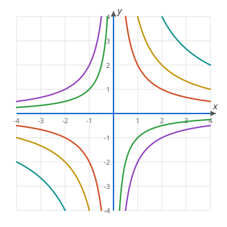

**b)** $e^{xy} = k$. Como la exponencial es positiva, debe ser $k > 0$, y entonces $xy = \ln k$.

- Para $k \ne 1$: hipérbolas equiláteras. Si $0 < k < 1$, $\ln k < 0$ ⇒ 2.º y 4.º cuadrante. Si $k > 1$ ⇒ 1.º y 3.º.
- Para $k = 1$: los ejes.

Es como el ítem a), con $k + 2$ reemplazado por $\ln k$.

**c)** $x^2 + y^2 - z = k \iff z = x^2 + y^2 - k$. Son **paraboloides circulares** de eje $z$, con vértice en $(0,0,-k)$: todos iguales, desplazados verticalmente.

**d)** $|x| + y = k \iff y = k - |x|$. Son "**V invertidas**" con vértice en $(0, k)$ y pendientes $\pm1$.

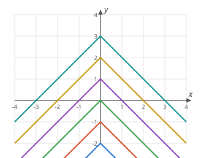

**e)** $\ln(x^2 + y^2 + z^2) = k \iff x^2 + y^2 + z^2 = e^k$, para todo $k \in \Re$. Son **esferas** centradas en el origen de radio $e^{k/2}$.

**f)** $\dfrac{x}{x^2+y^2} = k$, con dominio $\Re^2 - \lbrace(0,0)\rbrace$.

- **$k = 0$:** $x = 0$, el eje $y$ sin el origen.
- **$k \ne 0$:** $x^2 + y^2 = \dfrac{x}{k}$. Completando cuadrados:

$$\left(x - \frac{1}{2k}\right)^2 + y^2 = \frac{1}{4k^2}$$

Son circunferencias de centro $\left(\frac{1}{2k}, 0\right)$ y radio $\frac{1}{2|k|}$, todas tangentes al eje $y$ en el origen, que **se excluye**. Escrito de otra forma: $(x - (2k)^{-1})^2 + y^2 = (2k)^{-2}$.

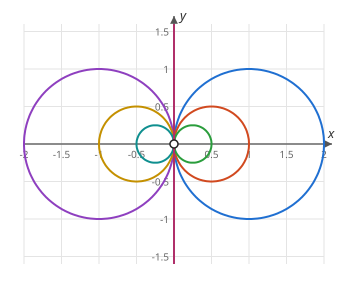

**g)** El dominio es $\Re^3$ sin el eje $z$, salvo el origen, que sí está porque ahí se define $f = 0$. Como $f \ge 0$, debe ser $k \ge 0$.

- **$k = 0$:** $|z| = 0 \Rightarrow z = 0$, que da el plano $xy$ (el origen también tiene $f = 0$).
- **$k > 0$:** $|z| = k\thinspace(x^2 + y^2)$, es decir, $z = k(x^2+y^2)$ o $z = -k(x^2+y^2)$. Son **dos paraboloides** de revolución, uno hacia arriba y otro hacia abajo, **sin** el punto $(0,0,0)$.

**Respuesta:** En todos los casos se describen conjuntos de nivel $k$ para distintos valores posibles de $k$.

- a) Hipérbolas equiláteras de ecuación $xy = k + 2$ con $k \ne -2$ (1.º y 3.º cuadrante si $k > -2$, 2.º y 4.º cuadrante si $k < -2$), incluidos ambos ejes de coordenadas (caso de $k = -2$).
- b) Hipérbolas equiláteras de ecuación $xy = \ln(k)$ con $k > 0 \wedge k \ne 1$ (2.º y 4.º cuadrante si $0 < k < 1$, 1.º y 3.º cuadrante si $k > 1$), incluidos ambos ejes de coordenadas (para $k = 1$).
- c) Paraboloides de ecuación $z = x^2 + y^2 - k$, $k \in \Re$.
- d) Líneas de ecuación $y = k - |x|$, $k \in \Re$.
- e) Puntos del espacio $xyz$ cuya distancia al origen de coordenadas es igual a $e^{k/2}$ con $k \in \Re$; la ecuación es $x^2 + y^2 + z^2 = e^k$.
- f) Para $k \in \Re - \lbrace0\rbrace$: circunferencias de ecuación $(x - (2k)^{-1})^2 + y^2 = (2k)^{-2}$ excluido el origen de coordenadas; para $k = 0$: el eje $y$ salvo el punto $(0,0)$.
- g) Debe ser $k \ge 0$. Para $k = 0$: el plano $xy$. Para $k > 0$: paraboloides de revolución alrededor del eje $z$ de ecuaciones $z = k(x^2 + y^2)$ o $z = -k(x^2 + y^2)$, excluyendo el punto $(0,0,0)$.

---

### 07) Imagen, positividad y gráfica

Para cada uno de los siguientes campos escalares definidos en su dominio natural:

* determine el conjunto imagen,
* halle el conjunto de positividad,
* represente la gráfica en el espacio $xyz$ y analice las intersecciones con los planos coordenados.

- a) $f(x, y) = x^2 + y^2$.
- b) $f(x, y) = \sqrt{x^2 + y^2}$.
- c) $f(x, y) = \sqrt{9 - x^2 - y^2}$.
- d) $f(x, y) = 2 - x - y$.
- e) $f(x, y) = 2 - x^2$.
- f) $f(x, z) = x^2 - 2x + z^2$.

<b>Solución</b>

Solución paso a paso

**Método:**

- **Imagen:** qué valores puede tomar $f$ (analizar mínimos, máximos, signos).
- **Positividad:** $\lbrace f > 0\rbrace$, un subconjunto del dominio.
- **Trazas:** reemplazar $z = 0$, $y = 0$ y $x = 0$ en $z = f(x,y)$.

**a) $z = x^2 + y^2$** — paraboloide circular con vértice en el origen.

- $x^2 + y^2 \ge 0$ y toma cualquier valor $\ge 0$ ⇒ imagen $[0, +\infty)$.
- $f > 0$ salvo en el origen ⇒ positividad $\Re^2 - \lbrace(0,0)\rbrace$.
- Trazas: $z = 0$ da el punto $(0,0)$; $y = 0$ da la parábola $z = x^2$; $x = 0$ da la parábola $z = y^2$.

**b) $z = \sqrt{x^2+y^2}$** — semicono superior.

- Imagen $[0, +\infty)$; positividad $\Re^2 - \lbrace(0,0)\rbrace$.
- Trazas: $z=0$ da $(0,0)$; $y = 0$ da $z = \sqrt{x^2} = |x|$ (dos semirrectas); $x = 0$ da $z = |y|$.

**c) $z = \sqrt{9 - x^2 - y^2}$** — semiesfera superior de radio 3, porque $z \ge 0$ y $x^2 + y^2 + z^2 = 9$.

- Dominio $x^2 + y^2 \le 9$. El radicando va de 0 a 9 ⇒ imagen $[0, 3]$.
- Positividad: $x^2 + y^2 < 9$.
- Trazas: $z = 0$ da la circunferencia $x^2+y^2 = 9$; $y = 0$ da la semicircunferencia $z = \sqrt{9 - x^2}$; $x = 0$ da $z = \sqrt{9 - y^2}$.

**d) $z = 2 - x - y$** — plano $x + y + z = 2$.

- Imagen $\Re$; positividad $x + y < 2$.
- Trazas: rectas $x + y = 2$ (en $z = 0$), $x + z = 2$ (en $y = 0$) e $y + z = 2$ (en $x = 0$).

**e) $z = 2 - x^2$** — cilindro parabólico: falta la $y$, así que la parábola $z = 2 - x^2$ se "extiende" paralela al eje $y$.

- $x^2 \ge 0 \Rightarrow z \le 2$ ⇒ imagen $(-\infty, 2]$.
- Positividad: $x^2 < 2 \iff -\sqrt2 < x < \sqrt2$, una franja vertical.
- Trazas: $z = 0$ da las rectas $x = \pm\sqrt2$; $y = 0$ da la parábola $z = 2 - x^2$; $x = 0$ da la recta $z = 2$.

**f)** Acá $f$ depende de $(x, z)$, así que la gráfica es $y = f(x,z) = x^2 - 2x + z^2$. Completando cuadrados:

$$y = (x - 1)^2 + z^2 - 1$$

Es un **paraboloide circular de eje paralelo al eje $y$**, con vértice $(1, -1, 0)$.

- Imagen $[-1, +\infty)$.
- Positividad: $(x-1)^2 + z^2 > 1$, el exterior del círculo de centro $(1,0)$ y radio 1 en el plano $xz$.
- Trazas: $z = 0$ da la parábola $y = (x-1)^2 - 1$; $y = 0$ da la circunferencia $(x-1)^2 + z^2 = 1$; $x = 0$ da la parábola $y = z^2$.

**Respuesta:**

- a) Conj. imagen: $\lbrace z \in \mathbb{R} / z \ge 0\rbrace$; conj. positiv.: $\mathbb{R}^2 - \lbrace(0,0)\rbrace$. Inter. planos: en $z = 0$: $(0,0)$; en $y = 0$: parábola $z = x^2$; en $x = 0$: parábola $z = y^2$.
- b) Conj. imagen: $\lbrace z \in \mathbb{R} / z \ge 0\rbrace$; conj. positiv.: $\mathbb{R}^2 - \lbrace(0,0)\rbrace$. Inter. planos: en $z = 0$: $(0,0)$; en $y = 0$: semirrectas $z = |x|$; en $x = 0$: semirrectas $z = |y|$.
- c) Conj. imagen: $\lbrace z \in \mathbb{R} / 0 \le z \le 3\rbrace$; conj. positiv.: $\lbrace(x,y) \in \mathbb{R}^2 / x^2 + y^2 < 9\rbrace$. Inter. planos: en $z = 0$: circunferencia $x^2 + y^2 = 9$; en $y = 0$: semicircunferencia $z = \sqrt{9 - x^2}$; en $x = 0$: semicircunferencia $z = \sqrt{9 - y^2}$.
- d) Conj. imagen: $\mathbb{R}$; conj. positiv.: $\lbrace(x,y) \in \mathbb{R}^2 / x + y < 2\rbrace$. Inter. planos: en $z = 0$: recta $x + y = 2$; en $y = 0$: recta $x + z = 2$; en $x = 0$: recta $y + z = 2$.
- e) Conj. imagen: $\lbrace z \in \mathbb{R} / z \le 2\rbrace$; conj. positiv.: $\lbrace(x,y) \in \mathbb{R}^2 / -\sqrt2 < x < \sqrt2\rbrace$. Inter. planos: en $z = 0$: rectas $x = \pm\sqrt2$; en $y = 0$: parábola $z = 2 - x^2$; en $x = 0$: recta $z = 2$.
- f) Conj. imagen: $\lbrace y \in \mathbb{R} / y \ge -1\rbrace$; conj. positiv.: $\lbrace(x,z) \in \mathbb{R}^2 / (x-1)^2 + z^2 > 1\rbrace$. Inter. planos: en $z = 0$: parábola $y = (x-1)^2 - 1$; en $y = 0$: circunferencia $(x-1)^2 + z^2 = 1$; en $x = 0$: parábola $y = z^2$.

---

### 08) Proponer un campo con dominio dado

Proponga un campo cuyo dominio natural $D \subset \mathbb{R}^2$ cumpla con:

- a) $x^2 + y^2 > 1$.
- b) $x^2 + y^2 \le 8 - 2x$.
- c) $-1 \le x + y < 3$.
- d) $(x - 1)^2 + (y - 2)^2 > 0$.

<b>Solución</b>

Solución paso a paso

**Idea:** usar las restricciones "al revés":

- Para una desigualdad **estricta** $A > 0$ sirven $\ln(A)$ o $\dfrac{1}{\sqrt A}$.
- Para una **no estricta** $A \ge 0$ sirve $\sqrt A$.

**a)** Queremos $x^2 + y^2 - 1 > 0$ ⇒ $f(x,y) = \ln(x^2 + y^2 - 1)$.

**b)** $x^2 + y^2 \le 8 - 2x \iff x^2 + 2x + 1 + y^2 \le 9 \iff (x+1)^2 + y^2 \le 9$, el disco cerrado de centro $(-1, 0)$ y radio 3. Queremos $9 - (x+1)^2 - y^2 \ge 0$ ⇒ $f(x,y) = \sqrt{9 - (x+1)^2 - y^2}$.

**c)** Son dos condiciones de distinto tipo:

- $x + y \ge -1 \iff x + y + 1 \ge 0$, que se logra con una raíz.
- $x + y < 3 \iff 3 - x - y > 0$, que se logra con un logaritmo.

Como campo vectorial: $\vec f = (\ln(3 - x - y),\ \sqrt{x + y + 1})$.

**¿Cómo sería con un campo escalar?** Basta combinar ambas expresiones en una sola fórmula, porque el dominio de una suma o producto es la intersección de los dominios. Por ejemplo, $f(x,y) = \ln(3 - x - y) + \sqrt{x + y + 1}$.

**d)** $(x-1)^2 + (y-2)^2 > 0$ es todo el plano salvo el punto $(1, 2)$ ⇒ $f(x,y) = [(x-1)^2 + (y-2)^2]^{-1/2}$. También sirve $\ln[(x-1)^2+(y-2)^2]$.

**Respuesta (por ejemplo):**

- a) $f(x,y) = \ln(x^2 + y^2 - 1)$.
- b) $f(x,y) = \sqrt{9 - (x+1)^2 - y^2}$.
- c) $\vec f(x,y) = (\ln(3 - x - y),\ \sqrt{x + y + 1})$. Con un campo escalar: $f(x,y) = \ln(3 - x - y) + \sqrt{x + y + 1}$.
- d) $f(x,y) = [(x-1)^2 + (y-2)^2]^{-1/2}$.

---

### 09) Superficies

Dibuje los siguientes conjuntos de puntos e indique si tienen algún nombre en especial:

- a) $S = \lbrace(x, y, z) \in \Re^3 \ /\ z = x^2 - 2y^2\rbrace$.
- b) $S = \lbrace(x, y, z) \in \Re^3 \ /\ z^2 - x^2 - 4y^2 = 1\rbrace$.
- c) $S = \lbrace(x, y, z) \in \Re^3 \ /\ \dfrac{x^2}{4} + y^2 + \dfrac{z^2}{9} = 1\rbrace$.
- d) $S = \lbrace(x, y, z) \in \Re^3 \ /\ z = |x|\rbrace$.
- e) $S = \lbrace(x, y, z) \in \Re^3 \ /\ x + y = 4\rbrace$.
- f) $S = \lbrace(x, y, z) \in \Re^3 \ /\ z = \mathop{\mathrm{sen}}(y)\rbrace$.

<b>Solución</b>

Solución paso a paso

**Método:** comparar con las formas canónicas de las cuádricas (ver la tabla en la teoría) y estudiar trazas.

**a) $z = x^2 - 2y^2$.**

- Traza $y = 0$: $z = x^2$, parábola hacia arriba.
- Traza $x = 0$: $z = -2y^2$, parábola hacia abajo.
- Curvas de nivel $z = k$: hipérbolas, y para $k = 0$ las rectas $x = \pm\sqrt2\thinspace y$.

Es un **paraboloide hiperbólico** ("silla de montar").

**b) $z^2 - x^2 - 4y^2 = 1$.**

- Como $z^2 = 1 + x^2 + 4y^2 \ge 1$, no hay puntos con $|z| < 1$: la superficie tiene **dos piezas**, una con $z \ge 1$ y otra con $z \le -1$.
- Las secciones $z = k$ con $|k| > 1$ son elipses $x^2 + 4y^2 = k^2 - 1$.

Es un **hiperboloide de dos hojas**.

**c) $\dfrac{x^2}{4} + y^2 + \dfrac{z^2}{9} = 1$.** Es un **elipsoide** de semiejes 2 (en $x$), 1 (en $y$) y 3 (en $z$).

**d) $z = |x|$.** No depende de $y$: la "V" $z = |x|$ del plano $xz$ se extiende paralela al eje $y$. Son **dos semiplanos** que forman un diedro (una "canaleta"). No tiene un nombre especial; se puede ver como una superficie cilíndrica de directriz $z = |x|$.

**e) $x + y = 4$.** Es un **plano** vertical, paralelo al eje $z$, que corta al plano $xy$ en la recta $x + y = 4$.

**f) $z = \mathop{\mathrm{sen}}(y)$.** No depende de $x$: la sinusoide del plano $yz$ se extiende paralela al eje $x$, como una "chapa ondulada". No tiene nombre especial (superficie cilíndrica).

**Respuesta:**

- a) paraboloide hiperbólico.
- b) hiperboloide de dos hojas.
- c) elipsoide.
- d) — (diedro formado por dos semiplanos).
- e) plano.
- f) — (superficie "ondulada" de generatrices paralelas al eje $x$).

---

### 10) Conjunto imagen de funciones vectoriales

Grafique el conjunto imagen de:

- a) $\vec g(u) = (\cos(u),\ \mathop{\mathrm{sen}}(u))$ con $u \in [0, \pi]$.
- b) $\vec g(u) = (\cos(u),\ \mathop{\mathrm{sen}}(u),\ u)$ con $u \in [0, \pi]$.

<b>Solución</b>

Solución paso a paso

**a)** $x = \cos u$, $y = \mathop{\mathrm{sen}} u$ ⇒ $x^2 + y^2 = 1$: los puntos están en la circunferencia unitaria. Con $u \in [0, \pi]$:

- $\mathop{\mathrm{sen}} u \ge 0$ ⇒ es la **mitad superior**.
- Se recorre de $\vec g(0) = (1, 0)$ a $\vec g(\pi) = (-1, 0)$, en sentido antihorario.

Despejando $y \ge 0$: $y = \sqrt{1 - x^2}$.

**b)** Las dos primeras coordenadas siguen dando $x^2 + y^2 = 1$ (están sobre el **cilindro** de radio 1 y eje $z$), y la tercera, $z = u$, va subiendo de $0$ a $\pi$. Es media vuelta de una **hélice circular**: empieza en $(1, 0, 0)$ y termina en $(-1, 0, \pi)$.

**Respuesta:**

- a) semicircunferencia de ecuación $y = \sqrt{1 - x^2}$.
- b) trozo de hélice circular con $0 \le z \le \pi$.

---

### 11) Curva intersección

Sea $C$ la línea que resulta de la intersección de la superficie de ecuación $x^2 + y^2 = 4$ con el plano de ecuación $z = x$ en el 1° octante.

- a) Dibújela.
- b) Halle una ecuación vectorial.
- c) Halle ecuaciones para las líneas resultantes de proyectar $C$ sobre los planos coordenados; analice en forma vectorial y en forma cartesiana.

<b>Solución</b>

Solución paso a paso

**a)** $x^2 + y^2 = 4$ es un cilindro de radio 2 y eje $z$, y $z = x$ es un plano oblicuo que contiene al eje $y$. Su intersección es una **elipse**. En el 1.er octante ($x, y, z \ge 0$) queda un arco:

- empieza en $(2, 0, 2)$, cuando $y = 0$;
- termina en $(0, 2, 0)$, cuando $x = 0$.

**b) Ecuación vectorial.**

- Parametrizamos el cilindro: $x = 2\cos u$, $y = 2\mathop{\mathrm{sen}}u$.
- El plano da $z = x = 2\cos u$.
- El 1.er octante pide $\cos u \ge 0$ y $\mathop{\mathrm{sen}} u \ge 0$ ⇒ $u \in [0, \pi/2]$.

$$\vec X(u) = (2\cos u,\ 2\mathop{\mathrm{sen}}u,\ 2\cos u), \quad 0 \le u \le \pi/2$$

**c) Proyecciones.** Proyectar sobre un plano coordenado es "anular" la coordenada que falta.

- **Sobre $xy$ ($z = 0$):** $\vec X = (2\cos u,\ 2\mathop{\mathrm{sen}}u,\ 0)$. Cartesianas: $x^2 + y^2 = 4$, $z = 0$, con $x \ge 0$, $y \ge 0$. Es un cuarto de circunferencia.
- **Sobre $xz$ ($y = 0$):** $\vec X = (2\cos u,\ 0,\ 2\cos u)$. Como $x = z = 2\cos u \in [0, 2]$, se puede reparametrizar con $u' = 2\cos u$: $\vec X = (u', 0, u')$, $u' \in [0, 2]$. Cartesianas: $z = x$, $y = 0$, con $0 \le x \le 2$. Es un **segmento**.
- **Sobre $yz$ ($x = 0$):** $\vec X = (0,\ 2\mathop{\mathrm{sen}}u,\ 2\cos u)$. Cartesianas: $y^2 + z^2 = 4$, $x = 0$, con $y \ge 0$, $z \ge 0$. Es un cuarto de circunferencia.

**Respuesta:**

- b) $\vec X = (2\cos(u),\ 2\mathop{\mathrm{sen}}(u),\ 2\cos(u))$ con $0 \le u \le \pi/2$.
- c) Sobre $xy$: $\vec X = (2\cos(u),\ 2\mathop{\mathrm{sen}}(u),\ 0) \wedge u \in [0, \pi/2]$; $\ \begin{cases} x^2 + y^2 = 4 \cr z = 0 \end{cases}$ con $x \ge 0 \wedge y \ge 0$.

  Sobre $xz$: $\vec X = (u, 0, u) \wedge u \in [0, 2]$; $\ \begin{cases} z = x \cr y = 0 \end{cases}$ con $0 \le x \le 2$.

  Sobre $yz$: $\vec X = (0,\ 2\mathop{\mathrm{sen}}(u),\ 2\cos(u)) \wedge u \in [0, \pi/2]$; $\ \begin{cases} y^2 + z^2 = 4 \cr x = 0 \end{cases}$ con $y \ge 0 \wedge z \ge 0$.

---

### 12) *Optativo*

*Optativo*: Dado el conjunto $S = \lbrace(x, y) \in \Re^2 \ /\ 1 \le x^2 + y^2 \le 2 \ \vee\ (n^{-1}, 0),\ n \in \mathbb{N}\rbrace$, halle sus puntos interiores, sus puntos aislados, su frontera, su conjunto derivado y su clausura.

<b>Solución</b>

Solución paso a paso

**Descripción:** $S$ es el **anillo cerrado** entre las circunferencias de radio 1 y $\sqrt2$, más los puntos $(1, 0), (\frac12, 0), (\frac13, 0), \dots$

- El punto $(1, 0)$, que corresponde a $n = 1$, ya está en el anillo, porque $1^2 = 1$.
- Los puntos con $n > 1$ están **dentro del agujero** y se acumulan en el origen, que **no** pertenece a $S$.

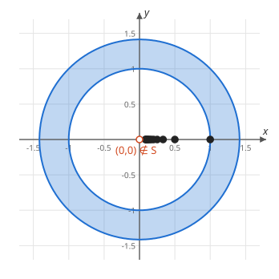

**Interior:** el anillo sin sus bordes, $1 < x^2 + y^2 < 2$.

**Aislados:** cada punto $(\frac1n, 0)$ con $n > 1$. Entre $\frac1n$ y sus vecinos $\frac{1}{n\pm1}$ hay distancia positiva, así que existe un disquito que sólo contiene a ese punto de $S$.

**Frontera:**

- las dos circunferencias;
- todos los puntos aislados (siempre son frontera);
- el **origen**: todo disco centrado en $(0,0)$ contiene puntos $(\frac1n, 0)$ de $S$ (para $n$ grande, $\frac1n < r$) y puntos que no son de $S$.

**Derivado:**

- todo el anillo cerrado, porque sus puntos son de acumulación;
- el **origen**, porque $\frac1n \to 0$ y entonces todo entorno reducido de $(0,0)$ tiene infinitos puntos de $S$.

Los puntos aislados **no** son de acumulación.

**Clausura:** $Cl(S) = S \cup S' = S \cup \lbrace(0,0)\rbrace$.

**Respuesta:**

- interior: $\overset{\circ}{S} = \lbrace(x,y) \in \Re^2 / 1 < x^2 + y^2 < 2\rbrace$.
- puntos aislados: $\lbrace(n^{-1}, 0) \in \Re^2 / n \in \mathbb{N},\ n > 1\rbrace$.
- frontera: $\partial S = \lbrace(x,y) \in \Re^2 / x^2 + y^2 = 1 \vee x^2 + y^2 = 2 \vee (n^{-1}, 0), n \in \mathbb{N}\rbrace \cup \lbrace(0,0)\rbrace$.
- conjunto derivado: $S' = \lbrace(x,y) \in \Re^2 / 1 \le x^2 + y^2 \le 2\rbrace \cup \lbrace(0,0)\rbrace$.
- clausura: $Cl(S) = \lbrace(x,y) \in \Re^2 / 1 \le x^2 + y^2 \le 2 \vee (n^{-1}, 0), n \in \mathbb{N}\rbrace \cup \lbrace(0,0)\rbrace$.

---

## Cuestionario

### Cuestionario 1)

Defina campo escalar y campo vectorial.

<b>Solución</b>

**Respuesta:**

- **Campo escalar:** función $f: D \subseteq \Re^n \to \Re$ que asigna de manera unívoca un número real a cada punto $\vec x \in D$.
- **Campo vectorial:** función $\vec F: D \subseteq \Re^n \to \Re^m$, con $m \ge 2$, que asigna de manera unívoca un vector $(F_1(\vec x), \dots, F_m(\vec x))$ a cada punto $\vec x \in D$.

---

### Cuestionario 2)

Defina gráfica y conjunto de nivel.

<b>Solución</b>

**Respuesta:**

- **Gráfica** de $f: D \subseteq \Re^n \to \Re$: $G(f) = \lbrace(\vec x, z) \in \Re^{n+1} : \vec x \in D,\ z = f(\vec x)\rbrace$.
- **Conjunto de nivel $k$:** $C_k = \lbrace\vec x \in D : f(\vec x) = k\rbrace$, para $k$ en la imagen de $f$. Es un subconjunto del dominio.

---

### Cuestionario 3)

Calcule la longitud de la poligonal de vértices en (1,2,3), (2,4,6), (3,6,7), en ese orden.

<b>Solución</b>

Solución paso a paso

La longitud de una poligonal es la suma de las longitudes de sus segmentos: $L = \Vert P_2 - P_1\Vert + \Vert P_3 - P_2\Vert$.

- $P_2 - P_1 = (1, 2, 3)$ ⇒ $\Vert P_2 - P_1\Vert = \sqrt{1 + 4 + 9} = \sqrt{14}$.
- $P_3 - P_2 = (1, 2, 1)$ ⇒ $\Vert P_3 - P_2\Vert = \sqrt{1 + 4 + 1} = \sqrt{6}$.

$$L = \sqrt{14} + \sqrt{6} \approx 3{,}742 + 2{,}449 = 6{,}191$$

**Respuesta:** $L = \sqrt{14} + \sqrt{6} \approx 6{,}19$.

---

### Cuestionario 4)

Analice si $\lbrace(x, y) \in \Re^2 / x\thinspace y < 0\rbrace$ es un $E(\bar 0)$.

<b>Solución</b>

Solución paso a paso

Un entorno de $\bar 0$ debe contener al origen y a una bola centrada en él.

- El origen **no pertenece** al conjunto, porque $0\cdot 0 = 0 \not< 0$.
- Además, toda bola centrada en el origen contiene puntos del 1.er cuadrante, como $(\frac r2, \frac r2)$, donde $xy > 0$.

Por lo tanto no contiene ninguna bola (ni reducida) centrada en $\bar 0$.

**Respuesta:** No es un entorno del origen.

---

### Cuestionario 5)

Demuestre que si $f(x, y) = a$ y $f(x, y) = b$ con $a \neq b$ son dos conjuntos de nivel de $f$, dichos conjuntos no tienen puntos comunes.

<b>Solución</b>

**Respuesta (demostración por el absurdo):** supongamos que existe un punto $P$ en ambos conjuntos. Entonces $f(P) = a$ y $f(P) = b$. Como $f$ es una función, a cada punto le asigna **un único** valor, así que $a = b$, lo que contradice la hipótesis $a \ne b$. Por lo tanto los conjuntos de nivel no tienen puntos comunes. $\blacksquare$

---

[← Volver al menú principal](../README.md)
