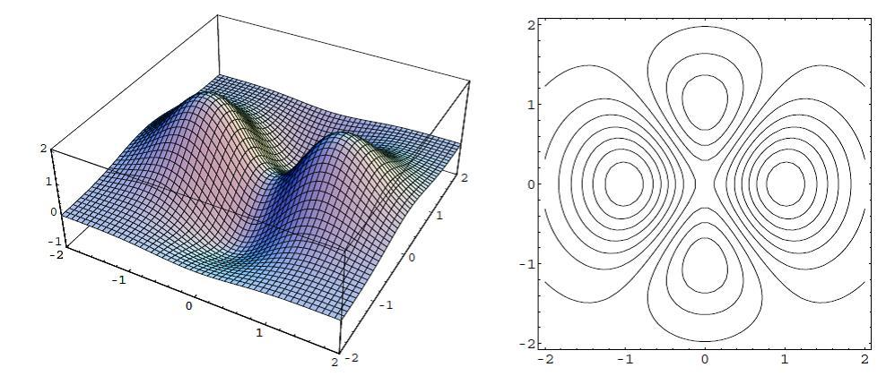
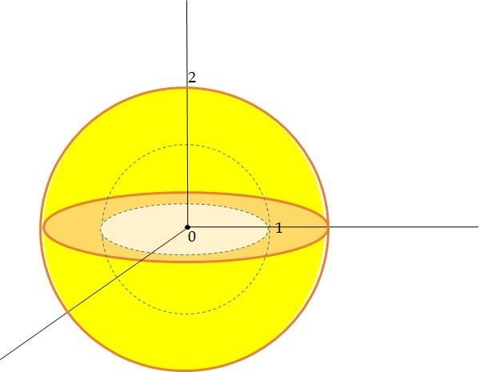

# Unidad 2 — Funciones de varias variables y nociones de topología

Resumen del material teórico de la unidad ([U02-Teoria-Funciones-Varias-Variables.pdf](../aula-virtual/02-Topologia-Funciones/U02-Teoria-Funciones-Varias-Variables.pdf)).

**Objetivos de la unidad:**

1. Comprender y distinguir los conceptos de función escalar y función vectorial.
2. Esbozar superficies y gráficos tridimensionales.
3. Conocer los conceptos topológicos básicos (entornos, puntos interiores y frontera, conjuntos abiertos, cerrados, etc.).

---

## 1. Tipos de funciones

En Análisis I se estudiaban funciones $f:\mathbb{R}\to\mathbb{R}$. Pero los fenómenos reales dependen de **varias** variables (la temperatura de un gas depende de presión y volumen) y a veces el resultado es un **vector** (la fuerza entre cargas, la posición de un proyectil).

| Nombre | Notación | Asigna | Ejemplo |
|---|---|---|---|
| **Campo escalar** | $f: D \subseteq \mathbb{R}^n \to \mathbb{R}$ | un número a cada punto | $f(x,y) = x^2 + y^2$ |
| **Campo vectorial** | $\vec F: D \subseteq \mathbb{R}^n \to \mathbb{R}^m$ ($m \ge 2$) | un vector a cada punto | $\vec F(x,y) = (-y, x)$ |
| **Función vectorial** | $\vec g: I \subseteq \mathbb{R} \to \mathbb{R}^m$ | un vector a cada número real | $\vec g(t) = (\cos t, \operatorname{sen} t)$ |

- **Dominio** $D$: el conjunto donde la función está definida. El **dominio natural** es el mayor conjunto donde la fórmula tiene sentido.
- **Imagen o recorrido**: el conjunto de los valores que toma la función.
- **El dominio de una función con varias componentes es la intersección de los dominios de todas las componentes.**

### Restricciones típicas para hallar dominios

| Expresión | Condición |
|---|---|
| $\dfrac{A}{B}$ | $B \ne 0$ |
| $\sqrt[\text{par}]{A}$ | $A \ge 0$ |
| $\ln(A)$ | $A > 0$ |
| $\arcsin(A)$, $\arccos(A)$ | $-1 \le A \le 1$ |
| $A^{-1/2} = \dfrac{1}{\sqrt A}$ | $A > 0$ |
| $\sqrt{\ln(A)}$ | $\ln A \ge 0 \iff A \ge 1$ |

**Ejemplos del material:**

- $f(x,y) = x^2 + y^2$: $D = \mathbb{R}^2$, imagen $[0, +\infty)$.
- $f(x,y) = \sqrt{y - x}$: $D = \{(x,y) : y \ge x\}$, imagen $[0, +\infty)$.
- $f(x,y,z) = \ln(xyz)$: $D = \{xyz > 0\}$, que son los octantes 1.º, 3.º, 6.º y 8.º sin los planos coordenados. Imagen $\mathbb{R}$.

---

## 2. Gráfica de un campo escalar

**Definición:** la gráfica de $f: D\subseteq\mathbb{R}^n \to \mathbb{R}$ es

$$G(f) = \{(x_1, \dots, x_n, z) \in \mathbb{R}^{n+1} : (x_1,\dots,x_n) \in D,\ z = f(x_1,\dots,x_n)\}$$

- Para $n = 1$ es una curva en el plano y para $n = 2$ es (en general) una **superficie** en $\mathbb{R}^3$.
- Para $n \ge 3$ no se puede dibujar: es una "hipersuperficie" de $\mathbb{R}^{n+1}$.

Marcar puntos sueltos no alcanza para imaginar una superficie, así que se usan **conjuntos de nivel** y **trazas**.

---

## 3. Conjuntos de nivel

**Definición:** para cada $k$ de la imagen de $f$, el **conjunto de nivel $k$** es

$$C_k = \{\vec x \in D : f(\vec x) = k\}$$

Es un subconjunto del **dominio**, no de la gráfica.

- Si $n = 2$, en general son **curvas de nivel**: son la proyección sobre el plano $xy$ de la intersección de la gráfica con el plano $z = k$, como en un **mapa topográfico**.
- Si $n = 3$, en general son **superficies de nivel**. Es la única forma de "ver" un campo de 3 variables, porque su gráfica estaría en $\mathbb{R}^4$.
- Si las curvas se dibujan para valores de $k$ equiespaciados, la superficie es **más empinada donde las curvas están más juntas**.
- **Dos conjuntos de nivel distintos nunca se cortan:** si un punto estuviera en $C_a$ y en $C_b$, sería $f = a$ y $f = b$ a la vez, lo que es imposible porque $f$ es función.
- Un conjunto de nivel puede no ser una curva: puede ser un punto, una región o el conjunto vacío.

**Ejemplos:**

- $f(x,y) = x^2 + y^2$: las curvas de nivel son circunferencias de radio $\sqrt k$ ($k \ge 0$), **no equiespaciadas**. Las trazas con $x = 0$ e $y = 0$ son parábolas. Es un **paraboloide circular**.
- $f(x,y) = \sqrt{x^2 + y^2}$: circunferencias de radio $k$, **equiespaciadas**. Las trazas son $z = |x|$ y $z = |y|$. Es una **semisuperficie cónica**.
- $f(x,y,z) = \sqrt{x^2 + y^2 + z^2}$: las superficies de nivel son esferas de radio $k$.

### Cómo esbozar la gráfica de $z = f(x,y)$

1. Hallar dominio e imagen. Si la imagen es $z \ge 0$, la superficie queda por encima del plano $xy$.
2. Dibujar curvas de nivel para varios $k$ y "elevarlas" a la altura $z = k$.
3. Completar con las **trazas**: las intersecciones con los planos $x = 0$ e $y = 0$.

### Superficies cuádricas útiles

| Ecuación | Nombre |
|---|---|
| $\dfrac{x^2}{a^2} + \dfrac{y^2}{b^2} + \dfrac{z^2}{c^2} = 1$ | Elipsoide (esfera si $a = b = c$) |
| $z = \dfrac{x^2}{a^2} + \dfrac{y^2}{b^2}$ | Paraboloide elíptico (circular si $a = b$) |
| $z = \dfrac{x^2}{a^2} - \dfrac{y^2}{b^2}$ | Paraboloide hiperbólico ("silla de montar") |
| $z^2 = \dfrac{x^2}{a^2} + \dfrac{y^2}{b^2}$ | Cono |
| $\dfrac{x^2}{a^2} + \dfrac{y^2}{b^2} - \dfrac{z^2}{c^2} = 1$ | Hiperboloide de una hoja |
| $\dfrac{z^2}{c^2} - \dfrac{x^2}{a^2} - \dfrac{y^2}{b^2} = 1$ | Hiperboloide de dos hojas |
| Falta una variable, por ejemplo $x^2 + y^2 = r^2$ | Cilindro (paralelo al eje de la variable que falta) |
| $ax + by + cz = d$ | Plano |

---

## 4. Representación de campos vectoriales y funciones vectoriales

- **Campos vectoriales** de $\mathbb{R}^2$ o $\mathbb{R}^3$: se dibuja, en cada punto, una flecha con el valor del campo (por ejemplo, el campo de velocidades de un fluido).
- **Funciones vectoriales** $\vec g(t) = (x(t), y(t), z(t))$, $t \in [a,b]$: se dibuja la **imagen**. Si las componentes son continuas, describe una **curva** con un **sentido de recorrido** (de $\vec g(a)$ a $\vec g(b)$). Las ecuaciones $x = x(t)$, $y = y(t)$, $z = z(t)$ son las **ecuaciones paramétricas** de la curva.

**Ejemplos:**

- $\vec g(t) = (t, t^2)$, $t\in[-2,1]$: arco de la parábola $y = x^2$, que va de $(-2,4)$ a $(1,1)$.
- $\vec g(t) = (\cos t, \operatorname{sen} t)$, $t\in[0, 2\pi]$: circunferencia unitaria recorrida en sentido antihorario. Es una curva **cerrada**.
- $\vec g(t) = (\cos t, \operatorname{sen} t, t)$: **hélice circular** ("resorte"), que va enrollándose sobre el cilindro $x^2 + y^2 = 1$.

### Curva intersección de dos superficies

Para parametrizar la curva intersección de dos superficies:

1. Parametrizar la superficie "más simple". Por ejemplo, para $x^2 + y^2 = r^2$ se usa $x = r\cos t$, $y = r\operatorname{sen} t$.
2. Despejar la otra coordenada de la segunda ecuación.

**Ejemplo:** el cilindro $x^2 + z^2 = 1$ cortado por el plano $y = z$ da la elipse $\vec g(t) = (\cos t, \operatorname{sen} t, \operatorname{sen} t)$.

---

## 5. Distancia y entornos en $\mathbb{R}^n$

**Distancia euclídea:**

$$d(\vec x, \vec y) = \|\vec x - \vec y\| = \sqrt{(x_1 - y_1)^2 + \dots + (x_n - y_n)^2}$$

Cumple tres propiedades:

- **Definida positiva:** $d \ge 0$, y $d = 0$ sólo si $\vec x = \vec y$.
- **Simétrica:** $d(\vec x, \vec y) = d(\vec y, \vec x)$.
- **Desigualdad triangular:** $d(\vec x, \vec z) \le d(\vec x, \vec y) + d(\vec y, \vec z)$.

**Entornos (bolas)** de centro $\vec a$ y radio $r > 0$:

| Nombre | Notación | Definición | En $\mathbb{R}^2$ |
|---|---|---|---|
| Bola abierta | $B(\vec a, r)$ o $E(\vec a, r)$ | $\{\vec x : d(\vec x, \vec a) < r\}$ | círculo sin el borde |
| Bola cerrada | $B[\vec a, r]$ | $\{\vec x : d(\vec x, \vec a) \le r\}$ | círculo con el borde |
| Bola reducida | $B^*(\vec a, r)$ o $E'(\vec a, r)$ | $\{\vec x : 0 < d(\vec x, \vec a) < r\}$ | círculo sin borde y sin centro |

---

## 6. Clasificación de puntos respecto de un conjunto $A$

| Tipo de punto $\vec a$ | Definición | Idea intuitiva |
|---|---|---|
| **Interior** | existe $r > 0$ con $B(\vec a, r) \subseteq A$ | está "bien adentro" |
| **Exterior** | existe $r > 0$ con $B(\vec a, r) \subseteq A^c$ | está "bien afuera" |
| **Frontera** | toda $B(\vec a, r)$ tiene puntos de $A$ **y** de $A^c$ | está "en el borde" (puede o no pertenecer a $A$) |
| **De acumulación** | toda $B^*(\vec a, r)$ contiene puntos de $A$ (infinitos) | se puede llegar a él "caminando por $A$" (puede no pertenecer a $A$) |
| **Aislado** | $\vec a \in A$ y existe $r$ con $B(\vec a, r)\cap A = \{\vec a\}$ | es un punto "suelto" de $A$ |

**Notación:**

- $\overset{\circ}{A}$ (o $\operatorname{int}A$): los puntos interiores.
- $\partial A$: la frontera.
- $A'$: el **conjunto derivado** (los puntos de acumulación).
- $\bar A = Cl(A) = A \cup A'$ (equivalentemente $A \cup \partial A$): la **clausura** o adherencia.

**Observaciones útiles:**

- Todo punto interior es de acumulación.
- Un punto aislado siempre es frontera y nunca es de acumulación.
- Un punto frontera que no es aislado es de acumulación.
- Un punto exterior no es de acumulación.

---

## 7. Clasificación de conjuntos

| Propiedad | Definición | Criterio práctico |
|---|---|---|
| **Abierto** | todos sus puntos son interiores | $A = \overset{\circ}{A}$, no contiene puntos de su frontera ($A \cap \partial A = \emptyset$) |
| **Cerrado** | su complemento es abierto | contiene a toda su frontera ($\partial A \subseteq A$), o $A' \subseteq A$, o $A = \bar A$ |
| **Acotado** | existe $r$ con $A \subseteq B(\vec 0, r)$ | se puede "encerrar" en una bola |
| **Compacto** | cerrado **y** acotado | |
| **Convexo** | el segmento entre dos puntos cualesquiera de $A$ está contenido en $A$ | |
| **Conexo** | no se puede partir en dos abiertos disjuntos no vacíos | intuitivamente, "es de una sola pieza" |
| **Arco-conexo** | dos puntos cualesquiera se pueden unir con una curva contenida en $A$ | |
| **Simplemente conexo** | conexo y toda curva cerrada en $A$ se puede "achicar" hasta un punto sin salir de $A$ | "no tiene agujeros" |

**Cuidado:**

- "Abierto" y "cerrado" **no son opuestos**: un conjunto puede no ser ni abierto ni cerrado (por ejemplo, un anillo con un solo borde), y $\mathbb{R}^n$ y $\emptyset$ son abiertos y cerrados a la vez.
- **Herramienta práctica:** si $f$ es continua, $\{f < c\}$ y $\{f > c\}$ son abiertos, y $\{f \le c\}$, $\{f \ge c\}$ y $\{f = c\}$ son cerrados.

### Ejemplos del material

**Ejemplo 2.23:** $A = \{(x,y) : xy > 0\}$ (cuadrantes 1.º y 3.º, sin los ejes).

- Es abierto, no es cerrado y no es acotado.
- Su frontera son los ejes coordenados.
- No es convexo ni conexo: está formado por dos "pedazos".

**Ejemplo 2.24:** $A = \{(x,y) : y \ge x^2\}$ (sobre la parábola o por encima).

- Es cerrado, no es abierto y no es acotado.
- Su frontera es la parábola.
- No es convexo: el segmento de $(1,1)$ a $(-1,1)$ está en $A$, pero el de $(1,0)$ a $(-1,0)$ ya no está.
- Es conexo y simplemente conexo.

**Ejemplo 2.25:** $A = \{(x,y,z) : 1 < x^2+y^2+z^2 \le 4\} \cup \{(0,0,0)\}$.

- No es abierto ni cerrado, pero es acotado.
- Tiene un punto aislado: el origen.
- No es conexo.

---

## 8. Estrategia para los ejercicios

**Dominio natural:** listar todas las restricciones (raíces, logaritmos, denominadores, arcsen), escribirlas como desigualdades, resolverlas (separando en casos de signo si hace falta) y dibujar. Las curvas de borde van con trazo lleno si están incluidas y punteado si no.

**Análisis topológico de un conjunto:**

1. Dibujarlo.
2. Identificar la frontera: los "bordes" del dibujo y los puntos sueltos.
3. Interior = conjunto sin la frontera; exterior = lo que queda afuera.
4. ¿Contiene toda su frontera? Entonces es cerrado. ¿No contiene ninguno de sus puntos frontera? Entonces es abierto.
5. ¿Cabe en una bola? Entonces es acotado. Si además es cerrado, es compacto.
6. ¿Es de una sola pieza? Entonces es conexo. ¿Los segmentos quedan dentro? Entonces es convexo.

**Conjuntos de nivel:** igualar $f = k$, analizar para qué valores de $k$ hay solución (según la imagen) y reconocer la curva o superficie que se obtiene.

---

## 9. Resumen de fórmulas

| Concepto | Fórmula |
|---|---|
| Distancia | $d(\vec x,\vec y) = \sqrt{\sum (x_i - y_i)^2}$ |
| Bola abierta | $B(\vec a, r) = \{\vec x : d(\vec x, \vec a) < r\}$ |
| Gráfica | $G(f) = \{(\vec x, f(\vec x)) : \vec x \in D\}$ |
| Conjunto de nivel | $C_k = \{\vec x \in D : f(\vec x) = k\}$ |
| Clausura | $\bar A = A \cup A' = A \cup \partial A$ |
| Compacto | cerrado + acotado |
| Circunferencia | $(x - a)^2 + (y - b)^2 = r^2$ ↔ $x = a + r\cos t,\ y = b + r\operatorname{sen} t$ |
| Elipse | $\frac{x^2}{a^2} + \frac{y^2}{b^2} = 1$ ↔ $x = a\cos t,\ y = b\operatorname{sen} t$ |

---

[← Volver al menú principal](../README.md)
