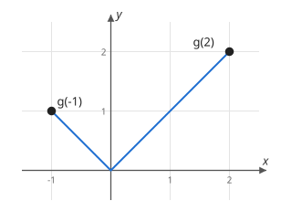
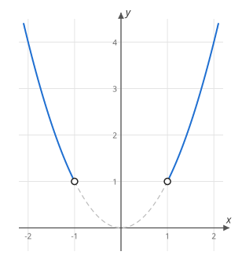
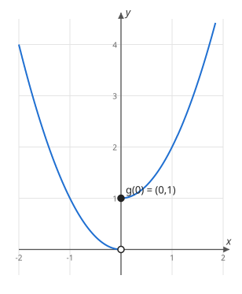
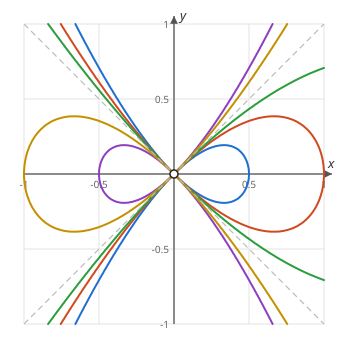
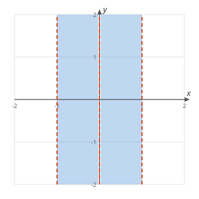
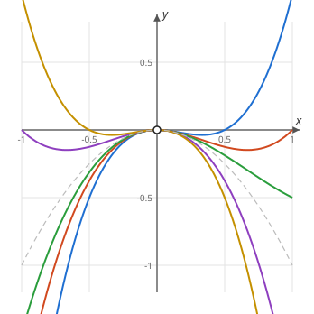
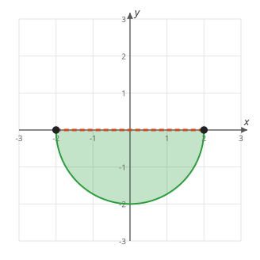
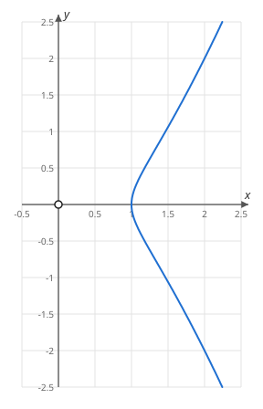

# Unidad 3 — Práctica: Límite y continuidad

Ejercicios del **T.P. N.º 3 de la Guía de Trabajos Prácticos** ([TP03-Limite-Continuidad.pdf](../aula-virtual/03-Limite-Continuidad/TP03-Limite-Continuidad.pdf)). Las respuestas se controlaron con las [respuestas oficiales de la guía](../aula-virtual/00-Guia-TP/Guia-TP-2016-Respuestas.pdf) y con la [fe de erratas](../aula-virtual/00-Guia-TP/Guia-TP-2016-Fe-de-Erratas-2018-07-31.pdf).

Cada ejercicio tiene un botón **Solución**. Al abrirlo aparece la respuesta y, arriba de ella, un segundo botón **Solución paso a paso** con el desarrollo completo.

> **Notación:** "$\nexists L$" significa "no existe el límite". Las herramientas usadas (caminos, iterados, polares, infinitésimo por acotada, curvas de nivel) están explicadas en la [teoría](teoria.md).

---

### 01) Límites de una variable

Analice la existencia de los siguiente límites de funciones escalares de una variable.

- a) $\displaystyle\lim_{x\to1} \frac{x^2 - 1}{x - 1}$.
- b) $\displaystyle\lim_{x\to0} \frac{\mathop{\mathrm{sen}}(x)}{|x|}$.
- c) $\displaystyle\lim_{x\to0} \sqrt{x}$.
- d) $\displaystyle\lim_{x\to0} f(x)$ si $f(x) = \begin{cases} 2x - 1 & \text{si } x \ge 0 \cr x^2 & \text{si } x < 0 \end{cases}$.

<b>Solución</b>

Solución paso a paso

**a)** Es una indeterminación $\frac00$. Factorizamos $x^2 - 1 = (x-1)(x+1)$ y simplificamos (vale porque $x \ne 1$):

$$\lim_{x\to1}\frac{(x-1)(x+1)}{x-1} = \lim_{x\to1}(x+1) = 2$$

**b)** Como aparece $|x|$, calculamos los límites laterales:

- Por derecha ($x > 0$, $|x| = x$): $\dfrac{\mathop{\mathrm{sen}}x}{x} \to 1$.
- Por izquierda ($x < 0$, $|x| = -x$): $\dfrac{\mathop{\mathrm{sen}}x}{-x} \to -1$.

Son distintos ⇒ el límite no existe.

**c)** El dominio de $\sqrt x$ es $[0, +\infty)$: sólo se puede acercar a 0 por la derecha, y $\sqrt{x} \to 0$. Como 0 es punto de acumulación del dominio y el límite se toma **dentro del dominio**, el límite existe y vale 0.

**d)** Laterales:

- Por derecha: $2x - 1 \to -1$.
- Por izquierda: $x^2 \to 0$.

Son distintos ⇒ no existe.

**Respuesta:**

- a) $L = 2$.
- b) $\nexists L$.
- c) $L = 0$.
- d) $\nexists L$.

---

### 02) Dominio natural de una función vectorial

¿Por qué existe el $\displaystyle\lim_{u\to0} \left(\frac{\mathop{\mathrm{sen}}(u)}{|u|},\ u\ln(u)\right)$ pero no existe el $\displaystyle\lim_{u\to0} \left(\frac{\mathop{\mathrm{sen}}(u)}{|u|},\ u\right)$?

<b>Solución</b>

Solución paso a paso

**Clave:** el límite se toma **dentro del dominio natural** de la función, que es la intersección de los dominios de las componentes.

**Primera función:** $\left(\dfrac{\mathop{\mathrm{sen}}u}{|u|},\ u\ln u\right)$.

- $\ln u$ exige $u > 0$, así que el dominio es $\mathbb{R}^+$ y sólo nos acercamos a 0 **por la derecha**.
- Ahí $|u| = u$ y $\dfrac{\mathop{\mathrm{sen}}u}{u} \to 1$.
- $u\ln u \to 0$ (por L'Hôpital: $\dfrac{\ln u}{1/u}$ da $\dfrac{1/u}{-1/u^2} = -u \to 0$).
- Ambas componentes tienen límite ⇒ el límite existe y es $(1, 0)$.

**Segunda función:** $\left(\dfrac{\mathop{\mathrm{sen}}u}{|u|},\ u\right)$.

- El dominio es $\mathbb{R} - \lbrace0\rbrace$, así que nos acercamos por los dos lados.
- La primera componente tiende a $1$ por derecha y a $-1$ por izquierda ⇒ no tiene límite.
- Un límite vectorial existe sólo si existen los de **todas** las componentes ⇒ no existe.

**Respuesta:** Al no aclararse otra cosa, $(\mathop{\mathrm{sen}}(u)/|u|,\ u\ln(u))$ tiene dominio natural $\mathbb{R}^+$ y ambas componentes tienen límite en $\mathbb{R}^+$. En cambio, $(\mathop{\mathrm{sen}}(u)/|u|,\ u)$ está definida en $\mathbb{R} - \lbrace0\rbrace$, donde no existe el $\displaystyle\lim_{u\to0}\mathop{\mathrm{sen}}(u)/|u|$.

---

### 03) Límite de una función vectorial

Analice la existencia del $\displaystyle\lim_{u\to0}\left(\frac{1 - \cos(u)}{u^2},\ 1 + 2u,\ \frac{\mathop{\mathrm{sen}}(u^2)}{u^3 + u^2}\right)$.

<b>Solución</b>

Solución paso a paso

El límite vectorial se calcula **componente a componente**.

**Componente 1.** Multiplicamos y dividimos por $1 + \cos u$:

$$\frac{1 - \cos u}{u^2} = \frac{1 - \cos^2 u}{u^2(1 + \cos u)} = \left(\frac{\mathop{\mathrm{sen}}u}{u}\right)^2\frac{1}{1 + \cos u} \to 1^2\cdot\frac12 = \frac12$$

**Componente 2.** $1 + 2u \to 1$.

**Componente 3.** Sacamos factor común $u^2$ en el denominador:

$$\frac{\mathop{\mathrm{sen}}(u^2)}{u^2(u + 1)} = \frac{\mathop{\mathrm{sen}}(u^2)}{u^2}\cdot\frac{1}{u+1} \to 1\cdot 1 = 1$$

**Respuesta:** Existe, $\vec L = (1/2,\ 1,\ 1)$.

---

### 04) Conjunto imagen: ¿es una curva?

Represente el conjunto imagen de las siguientes funciones vectoriales de una variable e indique en qué casos dicho conjunto es una curva.

- a) $\vec g : \Re \to \Re^2 \ /\ \vec g(t) = (t,\ 2t)$
- b) $\vec g : [-1, 2] \subset \Re \to \Re^2 \ /\ \vec g(u) = (u,\ |u|)$
- c) $\vec g : [0, \pi] \subset \Re \to \Re^2 \ /\ \vec g(\varphi) = (\cos(\varphi),\ \mathop{\mathrm{sen}}(\varphi))$
- d) $\vec g : \Re \to \Re^3 \ /\ \vec g(t) = (t,\ 2t,\ 1 - t)$
- e) $\vec g : D \subset \Re \to \Re^2 \ /\ \vec g(x) = (x,\ x^2)$ con $D = \lbrace x \in \Re \ /\ |x| > 1\rbrace$
- f) $\vec g(u) = \begin{cases} u^2 + 1 & \text{si } u \ge 0 \cr u^2 & \text{si } u < 0 \end{cases}$

> **Fe de erratas (31/07/18):** en el ítem 04-f dice $\vec g(u) = \begin{cases} u^2 + 1 & \text{si } u \ge 0 \cr u^2 & \text{si } u < 0 \end{cases}$, **debe decir** $\vec g(u) = \begin{cases} (u,\ u^2 + 1) & \text{si } u \ge 0 \cr (u,\ u^2) & \text{si } u < 0 \end{cases}$.

<b>Solución</b>

Solución paso a paso

**Definición usada:** un conjunto es una **curva** si es la imagen de una función vectorial **continua** definida en un **intervalo**. Hay que revisar dos cosas en cada ítem: el dominio y la continuidad.

**a)** $(t, 2t)$: $x = t$, $y = 2t$ ⇒ es la **recta** $y = 2x$. El dominio $\Re$ es un intervalo y las componentes son continuas ⇒ **es curva**.

**b)** $(u, |u|)$ con $u \in [-1, 2]$: es el gráfico de $y = |x|$ entre $x = -1$ y $x = 2$, una "V". $|u|$ es continua y $[-1, 2]$ es un intervalo ⇒ **es curva**. El "pico" no impide ser curva: sólo deja de ser suave.

**c)** $(\cos\varphi, \mathop{\mathrm{sen}}\varphi)$ con $\varphi \in [0,\pi]$: es la **semicircunferencia** superior de radio 1, recorrida de $(1,0)$ a $(-1,0)$ ⇒ **es curva**.

**d)** $(t, 2t, 1 - t) = (0, 0, 1) + t\thinspace(1, 2, -1)$: es una **recta en $\Re^3$** ⇒ **es curva**.

**e)** $(x, x^2)$ con $|x| > 1$: son dos arcos separados de la parábola $y = x^2$, uno con $x < -1$ y otro con $x > 1$. El dominio $(-\infty,-1)\cup(1,+\infty)$ **no es un intervalo** (es desconexo) ⇒ **no es curva**.

**f)** Con la corrección, $\vec g(u) = (u, u^2 + 1)$ si $u \ge 0$ y $(u, u^2)$ si $u < 0$. Es el gráfico de una función con un **salto** en $u = 0$:

- $\vec g(0) = (0, 1)$;
- $\lim_{u\to0^-}\vec g(u) = (0, 0) \ne \vec g(0)$.

$\vec g$ es **discontinua en 0** ⇒ **no es curva**.

**Respuesta:**

- a) Es curva (recta en $\Re^2$).
- b) Es curva.
- c) Es curva.
- d) Es curva (recta en $\Re^3$).
- e) No es curva pues el dominio es desconexo.
- f) No es curva pues $\vec g$ es discontinua en 0.

---

### 05) Límites dobles

Analice la existencia de los siguientes límites de campos escalares.

- a) $\displaystyle\lim_{(x,y)\to(1,1)} \frac{x^3y - xy^3}{x^4 - y^4}$
- b) $\displaystyle\lim_{(x,y)\to(0,0)} \frac{x^3 - x^2y + xy^2 - y^3}{x^2 + y^2}$
- c) $\displaystyle\lim_{(x,y)\to(0,0)} \frac{(x + y)^2}{x^2 + y^2}$
- d) $\displaystyle\lim_{(x,y)\to(1,2)} \frac{xy - 2x - y + 2}{x^2 + y^2 - 2x - 4y + 5}$
- e) $\displaystyle\lim_{(x,y)\to(0,0)} \frac{3x^2y}{x^2 + y^2}$
- f) $\displaystyle\lim_{(x,y)\to(0,0)} \frac{|x| + |y|}{\sqrt{x^2 + y^2}}$
- g) $\displaystyle\lim_{(x,y)\to(0,0)} \frac{x^2y^2}{x^2y^2 + (x - y)^2}$
- h) $\displaystyle\lim_{(x,y)\to(0,0)} \frac{x^2 + y^3}{x^2 + y^2}$
- i) $\displaystyle\lim_{(x,y)\to(0,0)} \frac{xy}{x^2 + y^2}$
- j) $\displaystyle\lim_{(x,y)\to(0,0)} \frac{xy^3}{x^2 + y^6}$
- k) $\displaystyle\lim_{(x,y)\to(0,0)} \frac{y}{x^2 + y^2}$
- l) $\displaystyle\lim_{(x,y)\to(0,1)} e^{-y/x^2}$
- m) $\displaystyle\lim_{(x,y)\to(0,0)} (y^3 + 1)\cos\negthinspace\left(\frac{1}{x^2 + y^2}\right)$
- n) $\displaystyle\lim_{(x,y)\to(0,0)} (x + y)\mathop{\mathrm{sen}}(1/x)\cos(1/y)$
- o) $\displaystyle\lim_{(x,y)\to(0,0)} f(x,y)$ si $f(x,y) = \begin{cases} x^3/(x^2 - y^2) & \text{si } x^2 - y^2 \ne 0 \cr 0 & \text{si } x^2 - y^2 = 0 \end{cases}$
- p) $\displaystyle\lim_{(x,y)\to(0,0)} f(x,y)$ si $f(x,y) = \begin{cases} xy & \text{si } y \ge x \cr x\mathop{\mathrm{sen}}(\frac{1}{y}) & \text{si } y < x \end{cases}$
- q) $\displaystyle\lim_{(x,y)\to(0,0)} f(x,y)$ si $f(x,y) = \begin{cases} (x + y)/(x^2 + xy + y^2) & \text{si } (x,y) \ne (0,0) \cr 0 & \text{si } (x,y) = (0,0) \end{cases}$

<b>Solución</b>

Solución paso a paso

**Estrategia general:**

1. Intentar simplificar.
2. Probar caminos (rectas $y = mx$, ejes, curvas). Si dan valores distintos ⇒ $\nexists$.
3. Si todos dan lo mismo, demostrar con infinitésimo × acotada o con polares.

**a)** Es $\frac00$. Factorizamos:

$$\frac{x^3y - xy^3}{x^4 - y^4} = \frac{xy\thinspace(x^2 - y^2)}{(x^2+y^2)(x^2-y^2)} = \frac{xy}{x^2+y^2}, \quad \text{si } x^2 \ne y^2$$

La expresión simplificada es continua en $(1,1)$ ⇒ $L = \dfrac{1\cdot1}{1+1} = \dfrac12$.

**b)** Factorizamos el numerador por grupos:

$$x^3 - x^2y + xy^2 - y^3 = x^2(x - y) + y^2(x - y) = (x - y)(x^2 + y^2)$$

Entonces $f = x - y$ fuera del origen ⇒ $L = 0$.

**c)** Por rectas $y = mx$:

$$\frac{(x + mx)^2}{x^2 + m^2x^2} = \frac{(1+m)^2}{1+m^2}$$

Depende de $m$: con $m = 0$ da 1 y con $m = -1$ da 0 ⇒ $\nexists L$.

**d)** Trasladamos al origen con $u = x - 1$, $v = y - 2$.

- Numerador: $xy - 2x - y + 2 = x(y - 2) - (y - 2) = (x-1)(y-2) = uv$.
- Denominador: $x^2 - 2x + 1 + y^2 - 4y + 4 = (x-1)^2 + (y-2)^2 = u^2 + v^2$.

Queda $\dfrac{uv}{u^2+v^2}$ con $(u,v)\to(0,0)$. Por $v = mu$ da $\dfrac{m}{1+m^2}$, que depende de $m$ ⇒ $\nexists L$.

**e)** Infinitésimo por acotada:

$$\frac{3x^2y}{x^2+y^2} = \underbrace{3y}_{\to 0}\cdot\underbrace{\frac{x^2}{x^2+y^2}}_{\in[0,1]} \to 0$$

**f)** En polares:

$$\frac{|r\cos\theta| + |r\mathop{\mathrm{sen}}\theta|}{r} = |\cos\theta| + |\mathop{\mathrm{sen}}\theta|$$

Depende de $\theta$: vale 1 en $\theta = 0$ y $\sqrt2$ en $\theta = \pi/4$ ⇒ $\nexists L$.

**g)** Por dos caminos:

- Sobre $y = x$: $\dfrac{x^4}{x^4 + 0} = 1$.
- Sobre $y = 0$: $\dfrac{0}{0 + x^2} = 0$.

Son distintos ⇒ $\nexists L$.

**h)** Por los ejes:

- Sobre $y = 0$: $\dfrac{x^2}{x^2} = 1$.
- Sobre $x = 0$: $\dfrac{y^3}{y^2} = y \to 0$.

Son distintos ⇒ $\nexists L$.

**i)** Por $y = mx$: $\dfrac{m}{1+m^2}$, que depende de $m$ ⇒ $\nexists L$.

**j)** Por rectas $y = mx$ da $\dfrac{m^3x^4}{x^2 + m^6x^6} = \dfrac{m^3x^2}{1 + m^6x^4} \to 0$. Pero para que $x^2$ e $y^6$ tengan el mismo orden probamos $x = y^3$:

$$\frac{y^3\cdot y^3}{y^6 + y^6} = \frac12 \ne 0$$

⇒ $\nexists L$.

**k)** Sobre $x = 0$: $\dfrac{y}{y^2} = \dfrac1y$, que tiende a $+\infty$ por arriba y a $-\infty$ por abajo. Sobre $y = 0$ vale 0 ⇒ $\nexists L$.

**l)** El dominio es $x \ne 0$. Cerca de $(0,1)$ vale $y > \frac12$, así que $\dfrac{y}{x^2} > \dfrac{1}{2x^2} \to +\infty$. Entonces:

$$0 < e^{-y/x^2} < e^{-1/(2x^2)} \xrightarrow[x\to0]{} 0$$

Por el sándwich, $L = 0$.

**m)** $y^3 + 1 \to 1$, pero $\cos\negthinspace\left(\dfrac{1}{x^2+y^2}\right)$ oscila. Sobre $y = 0$ queda $\cos(1/x^2)$, que no tiene límite: sobre $x_n = \frac{1}{\sqrt{2n\pi}}$ vale 1 y sobre $x_n = \frac{1}{\sqrt{(2n+1)\pi}}$ vale $-1$ ⇒ $\nexists L$.

**n)** Infinitésimo por acotada:

$$\underbrace{(x + y)}_{\to 0}\cdot\underbrace{\mathop{\mathrm{sen}}(1/x)\cos(1/y)}_{|\cdot|\le 1} \to 0$$

**o)** Por rectas $y = mx$ (con $m \ne \pm1$) da $\dfrac{x^3}{x^2(1 - m^2)} = \dfrac{x}{1-m^2} \to 0$. Sobre las rectas $y = \pm x$, $f = 0$. Todo da 0, pero buscamos una **curva de nivel $k \ne 0$** que pase por el origen:

$$\frac{x^3}{x^2 - y^2} = k \iff y^2 = x^2 - \frac{x^3}{k} = x^2\left(1 - \frac{x}{k}\right)$$

Para $x$ cerca de 0 el paréntesis es positivo, así que $y = \pm x\sqrt{1 - x/k}$ está bien definida y pasa por $(0,0)$. Sobre ella $f = k$ ⇒ $\nexists L$.

**p)** Usamos el teorema de la **unión finita**: el dominio es $S_1 \cup S_2$, con $S_1 = \lbrace y \ge x\rbrace$ y $S_2 = \lbrace y < x\rbrace$.

- En $S_1$: $|xy| \to 0$.
- En $S_2$: $|x\mathop{\mathrm{sen}}(1/y)| \le |x| \to 0$.

Ambos límites restringidos valen 0 y son 2 conjuntos que cubren el dominio ⇒ $L = 0$.

**q)** El valor en el origen no importa para el límite. Sobre $y = 0$:

$$\frac{x}{x^2} = \frac1x$$

Esto no tiene límite finito ($\pm\infty$ según el lado) ⇒ $\nexists L$.

**Respuesta:**

- a) $L = 1/2$
- b) $L = 0$
- c) $\nexists L$
- d) $\nexists L$
- e) $L = 0$
- f) $\nexists L$
- g) $\nexists L$
- h) $\nexists L$
- i) $\nexists L$
- j) $\nexists L$
- k) $\nexists L$
- l) $L = 0$
- m) $\nexists L$
- n) $L = 0$
- o) $\nexists L$
- p) $L = 0$
- q) $\nexists L$

---

### 06) *Optativo*: límites en la frontera del dominio

*Optativo*: Sea $f(x,y) = \dfrac{\mathop{\mathrm{sen}}(xy)}{\ln(1 - x^2)}$

- a) Halle el dominio natural $D$ de $f$ y grafíquelo.
- b) Analice si existe el $\displaystyle\lim_{(x,y)\to(a,b)} f(x,y)$ para puntos $(a,b) \in \partial D$ (frontera de $D$).

<b>Solución</b>

Solución paso a paso

**a)** Hay dos condiciones:

- El logaritmo exige $1 - x^2 > 0 \iff |x| < 1$.
- El denominador no se puede anular: $\ln(1 - x^2) \ne 0 \iff 1 - x^2 \ne 1 \iff x \ne 0$.

$D = \lbrace(x,y) : |x| < 1,\ x \ne 0\rbrace$: dos franjas verticales abiertas.

La frontera son las rectas $x = -1$, $x = 0$ y $x = 1$.

**b) Puntos $(\pm1, y_0)$:** cuando $x \to \pm1$, $1 - x^2 \to 0^+$ ⇒ $\ln(1 - x^2) \to -\infty$. El numerador está acotado ($|\mathop{\mathrm{sen}}| \le 1$):

$$|f| \le \frac{1}{|\ln(1-x^2)|} \to 0$$

Por lo tanto el límite es 0.

**Puntos $(0, y_0)$:** cerca de $x = 0$ usamos $\ln(1 - x^2) \approx -x^2$ y $\mathop{\mathrm{sen}}(xy) \approx xy$. Más precisamente:

$$f = \underbrace{\frac{\mathop{\mathrm{sen}}(xy)}{xy}}_{\to 1}\cdot\underbrace{\frac{-x^2}{\ln(1-x^2)}}_{\to 1}\cdot\left(-\frac{y}{x}\right)$$

(si $y = 0$, $f = 0$). El límite de $f$ es entonces el de $-\dfrac{y}{x}$:

- Si $y_0 \ne 0$: $-\dfrac{y}{x} \to \pm\infty$ ⇒ no existe.
- Si $y_0 = 0$: sobre $y = mx$, $-\dfrac{y}{x} = -m$, que depende de $m$ ⇒ no existe.

**Respuesta:**

- a) $D = \lbrace(x,y) \in \Re^2 / |x| < 1 \wedge x \ne 0\rbrace$.
- b) $\nexists \displaystyle\lim_{(x,y)\to(0,y_0)} f(x,y)$, $\ \displaystyle\lim_{(x,y)\to(-1,y_0)} f(x,y) = \lim_{(x,y)\to(1,y_0)} f(x,y) = 0$.

---

### 07) Límites triples y vectoriales

Analice la existencia de los siguientes límites.

- a) $\displaystyle\lim_{(x,y,z)\to(0,0,0)} \frac{x + y - z}{x + y + z}$
- b) $\displaystyle\lim_{(x,y)\to(1,1)} \frac{x + y - 2}{x - y}$
- c) $\displaystyle\lim_{(x,y)\to(2,2)} \frac{\mathop{\mathrm{sen}}(4 - xy)}{16 - x^2y^2}$
- d) $\displaystyle\lim_{(x,y,z)\to(0,0,0)} \frac{xyz}{x^3 + y^3 + z^3}$
- e) $\displaystyle\lim_{(x,y)\to(0,0)} \left(\frac{xy}{x^2 + y^2},\ \frac{e^{xy} - 1}{xy}\right)$
- f) $\displaystyle\lim_{(x,y)\to(0,0)} \left(x\mathop{\mathrm{sen}}(1/y),\ \frac{1 - \cos(x)}{x^2}\right)$

<b>Solución</b>

Solución paso a paso

**a)** Por dos caminos:

- Sobre el eje $x$ (puntos $(x, 0, 0)$): $\dfrac{x}{x} = 1$.
- Sobre el eje $z$ (puntos $(0,0,z)$): $\dfrac{-z}{z} = -1$.

Son distintos ⇒ $\nexists L$.

**b)** Con $u = x - 1$, $v = y - 1$ queda $\dfrac{u + v}{u - v}$:

- Con $v = 0$: 1.
- Con $u = 0$: $-1$.

⇒ $\nexists L$.

**c)** Diferencia de cuadrados en el denominador: $16 - x^2y^2 = (4 - xy)(4 + xy)$. Con $u = 4 - xy \to 0$:

$$\frac{\mathop{\mathrm{sen}}(4 - xy)}{(4 - xy)(4 + xy)} = \underbrace{\frac{\mathop{\mathrm{sen}}u}{u}}_{\to 1}\cdot\underbrace{\frac{1}{4 + xy}}_{\to 1/8} \to \frac18$$

**d)** Por dos caminos:

- Sobre la recta $x = y = z = t$: $\dfrac{t^3}{3t^3} = \dfrac13$.
- Sobre el eje $x$: $\dfrac{0}{x^3} = 0$.

⇒ $\nexists L$.

**e)** La primera componente, $\dfrac{xy}{x^2+y^2}$, no tiene límite: por rectas da $\dfrac{m}{1+m^2}$. Basta una componente sin límite ⇒ $\nexists \vec L$. La segunda sí tendría límite 1, pero no alcanza.

**f)** Componente a componente:

- $x\mathop{\mathrm{sen}}(1/y)$: $x \to 0$ y $|\mathop{\mathrm{sen}}(1/y)| \le 1$ ⇒ tiende a $0$.
- $\dfrac{1 - \cos x}{x^2} \to \dfrac12$ (límite notable).

**Respuesta:**

- a) $\nexists L$.
- b) $\nexists L$.
- c) $L = 1/8$.
- d) $\nexists L$.
- e) $\nexists \vec L$.
- f) $\vec L = (0,\ 1/2)$.

---

### 08) Curva contenida en una superficie

Sea $S$ la superficie de ecuación $z = x^2 + y^2$, halle la ecuación de una curva $C \subset S$ que pase por el punto $(1,2,5)$. Verifique por definición que realmente se trata de una curva.

<b>Solución</b>

Solución paso a paso

**Paso 1 — Idea.** Una forma simple de obtener una curva sobre $S$ es **fijar una de las variables**. Como el punto tiene $y = 2$, fijamos $y = 2$: la curva es la intersección de $S$ con el plano $y = 2$, una "línea coordenada".

**Paso 2 — Parametrización.** Tomando $x$ como parámetro:

$$\vec X(x) = (x,\ 2,\ x^2 + 4), \quad x \in \Re$$

**Paso 3 — Verificaciones.**

- Está en $S$: $z = x^2 + 4 = x^2 + 2^2$ ✓.
- Pasa por $(1,2,5)$: para $x = 1$ se obtiene $(1, 2, 5)$ ✓.
- **Es curva:** es la imagen de un intervalo ($\Re$) por una función vectorial continua (sus componentes son polinomios y una constante).

**Respuesta:** Por ejemplo $\vec X = (x,\ 2,\ x^2 + 4)$ con $x \in \Re$, que está incluida en $S$ por ser una de sus líneas coordenadas correspondientes a la representación $\vec X = (x, y, x^2 + y^2)$ con $(x,y) \in \Re^2$. Para $x = 1$ la imagen es el $(1,2,5)$. Es curva por ser imagen de un intervalo real ($\Re$) a través de una función vectorial continua.

---

### 09) Curva plana incluida en una superficie

Sea $C$ la curva de ecuación $\vec X = (t,\ t^2,\ 2t^2)$ con $t \in \Re$.

- a) Exprese $C$ como intersección de dos superficies.
- b) Demuestre que $C$ es una curva plana.
- c) Dada la superficie de ecuación $\vec X = (u + v,\ u - v,\ u^2 + u + v^2 - v + 2uv)$ con $(u,v) \in \Re^2$ demuestre que $C$ está incluida en ella.

<b>Solución</b>

Solución paso a paso

**a)** Eliminamos el parámetro: $x = t$, $y = t^2 = x^2$, $z = 2t^2 = 2x^2$. Entonces:

$$C: \begin{cases} y = x^2 \cr z = 2x^2 \end{cases} \quad\text{o también}\quad C: \begin{cases} y = x^2 \cr z = 2y \end{cases}$$

Son dos cilindros parabólicos (primera forma), o un cilindro parabólico y un plano (segunda forma).

**b)** De la segunda forma, todos los puntos de $C$ cumplen $z = 2y$, que es la ecuación de un **plano**. Por lo tanto $C$ es una curva plana.

**c)** Buscamos la ecuación cartesiana de la superficie. Con $x = u + v$ e $y = u - v$:

$$u^2 + 2uv + v^2 = (u + v)^2 = x^2, \qquad u - v = y$$

Entonces:

$$z = (u^2 + 2uv + v^2) + (u - v) = x^2 + y$$

Verificamos con los puntos de $C$: $x^2 + y = t^2 + t^2 = 2t^2 = z$ ✓. Todos los puntos de $C$ cumplen la ecuación ⇒ $C$ está incluida en la superficie.

**Respuesta:**

- a) Por ejemplo $C: \begin{cases} y = x^2 \cr z = 2x^2 \end{cases}$ (1); también podría ser $C: \begin{cases} y = x^2 \cr z = 2y \end{cases}$ (2).
- b) La forma (2) muestra que los puntos de $C$ están sobre el plano de ecuación $z = 2y$; por lo tanto $C$ es una curva plana.
- c) La ecuación cartesiana de la superficie es $z = x^2 + y$, y con ella cumplen todos los puntos de $C$.

---

### 10) Continuidad en el origen

Analice la continuidad en el origen de los siguientes campos escalares.

- a) $f(x,y) = \begin{cases} x^3/(x^2 + y) & \text{si } x^2 + y \ne 0 \cr 0 & \text{si } x^2 + y = 0 \end{cases}$
- b) $f(x,y) = \begin{cases} \dfrac{1 - \cos(xy)}{x} & \text{si } x \ne 0 \cr 0 & \text{si } x = 0 \end{cases}$
- c) $f(x,y) = \begin{cases} \mathop{\mathrm{sen}}(y)\mathop{\mathrm{sen}}(1/x) & \text{si } (x,y) \ne (0,y) \cr 0 & \text{si } (x,y) = (0,y) \end{cases}$
- d) $f(x,y) = \begin{cases} \dfrac{xy^3}{x^2 + y^6} & \text{si } (x,y) \ne (0,0) \cr 0 & \text{si } (x,y) = (0,0) \end{cases}$
- e) $f(x,y) = \begin{cases} \dfrac{y^2 - 4x^2}{y - 2x} & \text{si } y \ne 2x \cr 1 - x - y & \text{si } y = 2x \end{cases}$
- f) $f(x,y) = \begin{cases} \dfrac{xy}{x^2 - y^2} & \text{si } |y| \ne |x| \cr 0 & \text{si } |y| = |x| \end{cases}$
- g) $f(x,y) = \begin{cases} \dfrac{y^2}{x + y} & \text{si } x + y \ne 0 \cr 0 & \text{si } x + y = 0 \end{cases}$
- h) $f(x,y) = \begin{cases} \dfrac{(2 + x^2)\mathop{\mathrm{sen}}(y)}{y} & \text{si } y \ne 0 \cr 2 & \text{si } y = 0 \end{cases}$

<b>Solución</b>

Solución paso a paso

**Criterio:** $f$ es continua en $(0,0)$ si y sólo si existe $\lim_{(x,y)\to(0,0)} f$ y es igual a $f(0,0)$.

**a)** $f(0,0) = 0$, porque $x^2 + y = 0$ en el origen. Por rectas $y = mx$ el límite es 0, pero buscamos una curva de nivel $k \ne 0$:

$$\frac{x^3}{x^2 + y} = k \iff y = \frac{x^3}{k} - x^2$$

Esta curva pasa por el origen y, para $x \ne 0$ chico, cumple $x^2 + y = x^3/k \ne 0$, así que está en la región donde vale la primera fórmula. Sobre ella $f = k$ ⇒ no existe el límite ⇒ **no es continua**.

**b)** $f(0,0) = 0$. Usamos $1 - \cos u = 2\mathop{\mathrm{sen}}\nolimits^2(u/2) \le \dfrac{u^2}{2}$:

$$|f| = \frac{1 - \cos(xy)}{|x|} \le \frac{x^2y^2}{2|x|} = \frac{|x|\thinspace y^2}{2} \to 0$$

En los puntos con $x = 0$, $f = 0$ también. Entonces el límite es $0 = f(0,0)$ ⇒ **continua**.

**c)** $f(0,0) = 0$. Fuera del eje $y$: $|\mathop{\mathrm{sen}}(y)\mathop{\mathrm{sen}}(1/x)| \le |\mathop{\mathrm{sen}} y| \to 0$. Sobre el eje $y$, $f = 0$. Entonces el límite es $0 = f(0,0)$ ⇒ **continua**.

**d)** Sobre $x = y^3$: $\dfrac{y^6}{2y^6} = \dfrac12$. Sobre $y = 0$: 0. ⇒ No existe el límite ⇒ **no es continua**.

**e)** $f(0,0) = 1 - 0 - 0 = 1$, porque el origen está sobre $y = 2x$.

- Fuera de la recta $y = 2x$: $\dfrac{(y-2x)(y+2x)}{y - 2x} = y + 2x \to 0$.
- Sobre la recta: $1 - x - y \to 1$.

Son límites restringidos distintos (0 y 1) ⇒ no existe el límite ⇒ **no es continua**.

**f)** Por $y = mx$ ($m \ne \pm1$): $\dfrac{m}{1 - m^2}$, que depende de $m$ ⇒ no existe ⇒ **no es continua**.

**g)** Curva de nivel $k \ne 0$: $y^2 = k(x + y) \iff x = \dfrac{y^2}{k} - y$. Pasa por el origen y, para $y \ne 0$ chico, cumple $x + y = y^2/k \ne 0$. Sobre ella $f = k$ ⇒ no existe el límite ⇒ **no es continua**.

**h)** $f(0,0) = 2$.

- Para $y \ne 0$: $(2 + x^2)\cdot\dfrac{\mathop{\mathrm{sen}}y}{y} \to 2\cdot 1 = 2$.
- Sobre $y = 0$: $f = 2$.

Entonces el límite es $2 = f(0,0)$ ⇒ **continua**.

**Respuesta:**

| | a | b | c | d | e | f | g | h |
|---|---|---|---|---|---|---|---|---|
| continuo | | X | X | | | | | X |
| no continuo | X | | | X | X | X | X | |

---

### 11) Extensión por continuidad

Analice la posibilidad de redefinir la función extendiendo su dominio por continuidad.

- a) $f : \Re^2 - \lbrace\bar 0\rbrace \to \Re \ /\ \vec f(x,y) = (x^2,\ xy^2)/(x^2 + y^2)$.
- b) $f(x,y) = x\mathop{\mathrm{sen}}(xy)/y$ si $(x,y) \ne (x,0)$.
- c) $\vec g : \Re^+ \to \Re^3 \ /\ \vec g(t) = \left(\dfrac{t}{|t|},\ t\ln(t),\ \dfrac{1 - \cos(t)}{t}\right)$.
- d) $\vec g(u) = (\sqrt{u^2}/u,\ \sqrt{u})$ si $u > 0$.

> **Fe de erratas (31/07/18):** en el ítem 11-a dice $f : \Re^2 - \lbrace\bar 0\rbrace \to \Re$, **debe decir** $f : \Re^2 - \lbrace\bar 0\rbrace \to \Re^2$.

<b>Solución</b>

Solución paso a paso

**Idea:** se puede extender por continuidad a un punto de acumulación del dominio si y sólo si **existe el límite** en ese punto. En ese caso se define la función ahí como ese límite.

**a)** $\vec f = \left(\dfrac{x^2}{x^2+y^2},\ \dfrac{xy^2}{x^2+y^2}\right)$.

- La primera componente sobre $y = mx$ da $\dfrac{1}{1+m^2}$, que depende de $m$ ⇒ no existe el límite en $(0,0)$.
- Entonces el límite vectorial no existe (aunque la segunda componente sí tiende a 0).

⇒ **No** se puede extender.

**b)** El dominio es $y \ne 0$; faltan los puntos del eje $x$, $(a, 0)$. Escribimos:

$$f = \frac{x\mathop{\mathrm{sen}}(xy)}{y} = x^2\cdot\frac{\mathop{\mathrm{sen}}(xy)}{xy} \quad (x \ne 0)$$

- Si $a \ne 0$: cuando $(x,y)\to(a,0)$, $xy \to 0$ y $\dfrac{\mathop{\mathrm{sen}}(xy)}{xy} \to 1$ ⇒ $f \to a^2$.
- Si $a = 0$: $|f| \le x^2 \to 0 = a^2$, usando $|\mathop{\mathrm{sen}}u| \le |u|$. Los puntos con $x = 0$ dan $f = 0$.

Entonces el límite en $(a, 0)$ existe y vale $a^2$ ⇒ **sí**, definiendo $f(x, 0) = x^2$.

**c)** El dominio es $t > 0$ y extendemos a $t = 0$ con el límite por derecha:

- $\dfrac{t}{|t|} = 1$ para $t > 0$ ⇒ tiende a 1.
- $t\ln t \to 0$.
- $\dfrac{1 - \cos t}{t} = t\cdot\dfrac{1-\cos t}{t^2} \to 0\cdot\dfrac12 = 0$.

⇒ **Sí**, con $\vec g(0) = (1, 0, 0)$.

**d)** Para $u > 0$: $\dfrac{\sqrt{u^2}}{u} = \dfrac{|u|}{u} = 1$ y $\sqrt u \to 0$ ⇒ **sí**, con $\vec g(0) = (1, 0)$.

**Respuesta:**

- a) No.
- b) Sí, con $f(x,0) = x^2$.
- c) Sí, con $\vec g(0) = (1,0,0)$.
- d) Sí, con $\vec g(0) = (1,0)$.

---

### 12) Conjunto de continuidad

Determine el conjunto de puntos del plano para los cuales $f$ es continua y realice la representación geométrica de la gráfica de $f$.

- a) $f(x,y) = \sqrt{4 - x^2 - y^2}$ si $y \le 0 \ \wedge\ x^2 + y^2 \le 4$, $\ f(x,y) = 0 \ \ \forall$ otro $(x,y)$.
- b) $f(x,y) = \dfrac{\mathop{\mathrm{sen}}(x^2 + y^2)}{x^2 + y^2}$ si $(x,y) \ne (0,0)$, $\ f(x,y) = 1$ si $(x,y) = (0,0)$.

<b>Solución</b>

Solución paso a paso

**a)** **Gráfica:**

- Sobre el semidisco inferior ($y \le 0$, $x^2 + y^2 \le 4$), $z = \sqrt{4 - x^2 - y^2}$ es la **mitad** ($y \le 0$) de la semiesfera superior de radio 2.
- En el resto del plano, $z = 0$.

**Continuidad:**

- En el interior del semidisco y en el exterior, $f$ es una expresión elemental ⇒ continua.
- Analizamos la **costura**, que es la frontera del semidisco:
  - **Arco** $x^2 + y^2 = 4$, $y \le 0$: adentro $\sqrt{4 - x^2 - y^2} \to 0$ y afuera vale 0. Coinciden ⇒ continua.
  - **Diámetro** $y = 0$, $-2 < x < 2$: desde abajo $f \to \sqrt{4 - x^2} > 0$ y desde arriba ($y > 0$) $f = 0$. Hay un **salto** ⇒ discontinua.
  - **Extremos** $(\pm2, 0)$: ahí $\sqrt{4 - 4} = 0$, que coincide con 0 ⇒ continua.

**b)** **Gráfica:** es una superficie de revolución, $z = \dfrac{\mathop{\mathrm{sen}}(r^2)}{r^2}$ con $r^2 = x^2 + y^2$: ondas concéntricas amortiguadas que valen 1 en el centro.

**Continuidad:**

- Fuera del origen es cociente de continuas con denominador no nulo ⇒ continua.
- En el origen: con $u = x^2 + y^2 \to 0^+$, $\dfrac{\mathop{\mathrm{sen}}u}{u} \to 1 = f(0,0)$ ⇒ continua.

**Respuesta:**

- a) $\Re^2 - \lbrace(x,0) \in \Re^2 / -2 < x < 2\rbrace$.
- b) $\Re^2$.

---

### 13) Continuidad y línea de nivel

Sea $f(x,y) = x^3/(x^2 + y^2)$ si $(x,y) \ne (0,0)$, $f(0,0) = 0$.

- a) Demuestre que $f$ es continua en el origen.
- b) ¿Puede analizar el límite acercándose al origen por la línea de nivel 1 de $f$?

<b>Solución</b>

Solución paso a paso

**a)** Escribimos $f$ como infinitésimo por acotada:

$$f(x,y) = \underbrace{x}_{\to 0}\cdot\underbrace{\frac{x^2}{x^2+y^2}}_{0\thinspace\le\thinspace\cdot\thinspace\le\thinspace1}$$

En todo entorno reducido del origen vale $\left|\dfrac{x^2}{x^2+y^2}\right| \le 1$. Entonces $|f(x,y)| \le |x| \to 0$, y el límite es $0 = f(0,0)$ ⇒ continua.

**b)** La línea de nivel 1 es:

$$\frac{x^3}{x^2+y^2} = 1 \iff y^2 = x^3 - x^2 = x^2(x - 1)$$

Para que $y^2 \ge 0$ hace falta $x \ge 1$, o $x = 0$. Pero $x = 0$ obliga a $y = 0$, y el origen no está en el nivel 1 porque $f(0,0) = 0$. Por lo tanto **todos** los puntos del nivel 1 tienen $x \ge 1$: están lejos del origen y **no permiten acercarse a él**.

**Respuesta:**

- a) Se demuestra comenzando por ver que $\left|\dfrac{x^2}{x^2+y^2}\right| < 1$ en todo entorno reducido de $(0,0)$.
- b) No se puede: todo punto $(x,y)$ de dicha línea tiene coordenada $x \ge 1$.

---

### 14) Continuidad de productos escalar y vectorial

Sean $\vec f$ y $\vec g$ de $\Re^3$ en $\Re^3$ campos vectoriales continuos, demuestre que también son continuos los campos $h : \Re^3 \to \Re \ /\ h = \vec f\cdot\vec g$ y $\vec w : \Re^3 \to \Re \ /\ \vec w = \vec f \times \vec g$.

<b>Solución</b>

Solución paso a paso

**Paso 1 — Componentes.** Sean $\vec f = (f_1, f_2, f_3)$ y $\vec g = (g_1, g_2, g_3)$. Como $\vec f$ y $\vec g$ son continuos, **cada componente** $f_i$, $g_i$ es un campo escalar continuo (un campo vectorial es continuo si y sólo si lo son sus componentes).

**Paso 2 — Producto escalar.**

$$h = \vec f\cdot\vec g = f_1g_1 + f_2g_2 + f_3g_3$$

Es suma de productos de campos escalares continuos ⇒ continuo.

**Paso 3 — Producto vectorial.**

$$\vec w = \vec f\times\vec g = \big(f_2g_3 - f_3g_2,\ \ f_3g_1 - f_1g_3,\ \ f_1g_2 - f_2g_1\big)$$

Cada componente es una resta de productos de continuos ⇒ continua. Como sus tres componentes son continuas, $\vec w$ es continuo. $\blacksquare$

Observación: $\vec w$ toma valores en $\Re^3$, porque el producto vectorial es un vector.

**Respuesta:** Comience por expresar los productos escalar (para $h$) y vectorial (para $\vec w$) en función de las componentes de $\vec f$ y de $\vec g$: quedan sumas y restas de productos de campos escalares continuos, que son continuas.

---

## Cuestionario

### Cuestionario 1)

Defina límite de un campo cuando $\vec X \to \vec A$ acercándose por una curva.

<b>Solución</b>

**Respuesta:** sea $C$ una curva parametrizada por $\vec g: I \to \Re^n$ continua, con $\vec g(t_0) = \vec A$, y con $\vec A$ punto de acumulación de $C \cap D_f$. El límite de $f$ acercándose a $\vec A$ por $C$ es el límite restringido a $C$:

$$\lim_{\substack{\vec X\to\vec A \cr \vec X\in C}} f(\vec X) = \lim_{t\to t_0} f(\vec g(t))$$

Es decir: $L_C$ es ese límite si $\forall\varepsilon>0\ \exists\delta>0$ tal que si $\vec X \in C \cap D_f$ y $0 < \Vert\vec X - \vec A\Vert < \delta$, entonces $|f(\vec X) - L_C| < \varepsilon$.

---

### Cuestionario 2)

Indique un ejemplo de campo escalar con una discontinuidad evitable.

<b>Solución</b>

**Respuesta:** $f(x,y) = \begin{cases} \dfrac{\mathop{\mathrm{sen}}(x^2+y^2)}{x^2+y^2} & (x,y)\ne(0,0) \cr 0 & (x,y) = (0,0) \end{cases}$.

El límite en el origen existe y vale 1, pero $f(0,0) = 0 \ne 1$. Redefiniendo $f(0,0) = 1$ queda continua.

---

### Cuestionario 3)

Indique un ejemplo de campo escalar con una discontinuidad esencial.

<b>Solución</b>

**Respuesta:** $f(x,y) = \begin{cases} \dfrac{2xy}{x^2+y^2} & (x,y)\ne(0,0) \cr 0 & (x,y) = (0,0) \end{cases}$.

El límite en el origen no existe: por $y = mx$ da $\dfrac{2m}{1+m^2}$. Ningún valor de $f(0,0)$ la hace continua.

---

### Cuestionario 4)

Demuestre que toda función escalar continua y no nula en un punto, mantiene su signo en un entorno de dicho punto.

<b>Solución</b>

Solución paso a paso

Sea $f$ continua en $\vec A$ con $f(\vec A) \ne 0$. Tomamos en la definición de continuidad $\varepsilon = \dfrac{|f(\vec A)|}{2} > 0$. Existe $\delta > 0$ tal que si $\Vert\vec X - \vec A\Vert < \delta$:

$$|f(\vec X) - f(\vec A)| < \frac{|f(\vec A)|}{2}$$

Es decir:

$$f(\vec A) - \frac{|f(\vec A)|}{2} < f(\vec X) < f(\vec A) + \frac{|f(\vec A)|}{2}$$

- Si $f(\vec A) > 0$: $f(\vec X) > f(\vec A) - \dfrac{f(\vec A)}{2} = \dfrac{f(\vec A)}{2} > 0$.
- Si $f(\vec A) < 0$: $f(\vec X) < f(\vec A) + \dfrac{-f(\vec A)}{2} = \dfrac{f(\vec A)}{2} < 0$.

En ambos casos $f(\vec X)$ tiene el signo de $f(\vec A)$ en toda la bola $B(\vec A, \delta)$. $\blacksquare$

**Respuesta:** Se toma $\varepsilon = |f(\vec A)|/2$ en la definición de continuidad: en la bola $B(\vec A, \delta)$ correspondiente, $f(\vec X)$ queda entre $f(\vec A)/2$ y $3f(\vec A)/2$, que tienen el mismo signo que $f(\vec A)$.

---

### Cuestionario 5)

Indique un ejemplo de campo escalar que tenga límite, aún con límites sucesivos no existentes.

<b>Solución</b>

**Respuesta:** $f(x,y) = x\mathop{\mathrm{sen}}(1/y) + y\mathop{\mathrm{sen}}(1/x)$ en el origen.

- **Tiene límite 0:** $|f| \le |x| + |y| \to 0$.
- **Los iterados no existen:** por ejemplo, para $x \ne 0$ fijo, $\lim_{y\to0}[x\mathop{\mathrm{sen}}(1/y)]$ no existe, porque el seno oscila.

---

### Cuestionario 6)

¿Puede hallarse un ejemplo como el anterior pero para límites por curvas?

<b>Solución</b>

**Respuesta:** **No.** Si existe $\lim_{\vec X\to\vec A} f = L$, entonces, por el teorema de los límites restringidos, el límite restringido a **cualquier** subconjunto del que $\vec A$ sea punto de acumulación existe y vale $L$. En particular, existe por toda curva que llegue a $\vec A$ dentro del dominio. A diferencia de los límites sucesivos, el límite por una curva es un límite restringido.

---

[← Volver al menú principal](../README.md)
