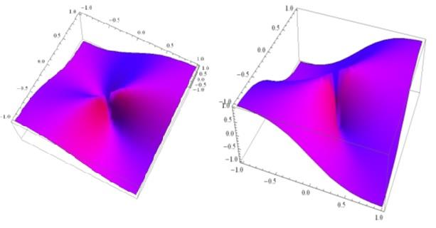

# Unidad 3 — Límite y continuidad

Resumen del material teórico de la unidad ([U03-Teoria-Limite-Continuidad.pdf](../aula-virtual/03-Limite-Continuidad/U03-Teoria-Limite-Continuidad.pdf)) y de la clase de repaso ([Clase-Limite.pdf](../aula-virtual/03-Limite-Continuidad/Clase-Limite.pdf)), complementado con el [resumen de UTNianos](../UTNianos/Resumen%20AM2.pdf).

**Objetivos de la unidad:**

1. Comprender la definición formal de límite de una función de varias variables.
2. Conocer herramientas para analizar la existencia de límites: límites restringidos, iterados, coordenadas polares, infinitésimo por acotada y curvas de nivel.
3. Relacionar la existencia del límite doble con la gráfica de la superficie.
4. Comprender el concepto de continuidad y sus propiedades.

---

## 1. Por qué es más difícil que en una variable

En $\mathbb{R}$ sólo hay **dos** formas de acercarse a un punto: por izquierda y por derecha. En $\mathbb{R}^2$ o $\mathbb{R}^3$ hay **infinitos caminos**: rectas, parábolas, espirales, etc. Para que el límite exista, la función tiene que acercarse **al mismo valor por todos los caminos a la vez**.

> **No se puede usar L'Hôpital** en límites de varias variables: sólo vale para límites de una variable. Sí se puede usar una vez que se reduce el límite a una variable, por ejemplo sobre un camino.

---

## 2. Definición de límite

**Límite de un campo escalar.** Sea $f: A \subseteq \mathbb{R}^n \to \mathbb{R}$ y $\vec x_0$ un **punto de acumulación** de $A$ (no hace falta que $\vec x_0 \in A$).

$$\lim_{\vec x \to \vec x_0} f(\vec x) = L \iff \forall \varepsilon > 0\ \exists \delta > 0 : \ \vec x \in A,\ 0 < \Vert\vec x - \vec x_0\Vert < \delta \Rightarrow |f(\vec x) - L| < \varepsilon$$

Es decir, $f(\vec x)$ queda tan cerca de $L$ como se quiera tomando $\vec x$ en una **bola reducida** de $\vec x_0$ suficientemente chica, **en cualquier dirección**. Para $n = 2$ se llama **límite doble** y para $n = 3$, **límite triple**.

**Límites infinitos:** $\lim f = +\infty$ si $\forall M > 0\ \exists \delta : 0 < \Vert\vec x - \vec x_0\Vert < \delta \Rightarrow f(\vec x) > M$.

**Propiedades** (iguales que en una variable):

- El límite, si existe, es **único**.
- Álgebra de límites: suma, producto, cociente (si el límite del denominador es $\ne 0$).
- Conservación de desigualdades.
- **Lema del sándwich:** si $f \le g \le h$ cerca de $\vec x_0$ y $f, h \to L$, entonces $g \to L$.

### Límites que se calculan "como en Análisis I"

- **Sustitución directa** si la función es continua: $\lim_{(x,y,z)\to(1,0,2)} z^3\cos(x^2 - xy - 1) = 8$.
- **Factorizar y simplificar:**

$$\frac{xy^3 - x^3y}{x^4 - y^4} = \frac{-xy\thinspace(x^2 - y^2)}{(x^2+y^2)(x^2 - y^2)} = \frac{-xy}{x^2+y^2} \xrightarrow{(1,1)} -\frac12$$

- **Cambio de variable a un límite conocido:** $\lim_{(x,y)\to(-2,2)} \dfrac{\mathop{\mathrm{sen}}(x^2 - 2y)}{x^2 - 2y} = 1$, con $u = x^2 - 2y \to 0$.
- **Infinitésimo por acotada** (ver la sección 6).

---

## 3. Límites restringidos (por caminos)

**Definición:** el límite de $f$ **restringido** a un subconjunto $S$ del dominio (con $\vec x_0$ de acumulación de $S$) es el límite de $f|_S$, es decir, acercándose a $\vec x_0$ **sólo por puntos de $S$**.

**Teorema:** si $\lim_{\vec x\to\vec x_0} f = L$, entonces el límite restringido a **cualquier** $S$ también es $L$.

**Corolario (para probar que NO existe):** el límite **no existe** si:

- el límite restringido a algún $S$ no existe, o
- hay dos subconjuntos con límites restringidos distintos.

**Caminos típicos** hacia $(x_0, y_0)$:

| Camino | Ecuación | Variable que queda |
|---|---|---|
| Rectas (límites direccionales) | $y - y_0 = m(x - x_0)$, o $x = x_0$ | $x$ |
| Parábolas | $y - y_0 = k(x - x_0)^2$ | $x$ |
| Curvas $y = k x^p$ | elegir $p$ para que los grados del numerador y el denominador se igualen | $x$ |
| Ejes | $y = y_0$, $x = x_0$ | |

**Ejemplo 3.11:** $f(x,y) = \dfrac{2xy}{x^2+y^2}$ sobre $y = mx$:

$$\lim_{x\to0} \frac{2mx^2}{x^2 + m^2x^2} = \frac{2m}{1+m^2}$$

Depende de $m$ ⇒ **no existe** el límite doble. En la gráfica se ve una "grieta" en el origen:

**Ejemplo 3.12 (cuidado):** $f = \dfrac{(x-1)^2(y-2)}{(x-1)^4 + (y-2)^2}$ tiene límite **0 por todas las rectas** que pasan por $(1,2)$, pero por las parábolas $y - 2 = k(x-1)^2$ da $\dfrac{k}{1+k^2}$ ⇒ **no existe**.

> Que todos los límites por rectas (o por cualquier familia infinita de curvas) den lo mismo **no prueba** que el límite exista. Sólo dice: "si existe, vale eso".

**Teorema (unión finita):** si $S_1 \cup S_2 \cup \dots \cup S_k = A$ (una cantidad **finita** de subconjuntos que cubren todo el dominio) y los límites restringidos a todos ellos valen $L$, entonces el límite existe y vale $L$. Es útil para funciones definidas **por partes**.

---

## 4. Límites iterados (sucesivos)

$$L_1 = \lim_{x\to x_0}\left(\lim_{y\to y_0} f(x,y)\right), \qquad L_2 = \lim_{y\to y_0}\left(\lim_{x\to x_0} f(x,y)\right)$$

- En $L_1$ se fija $x$, se hace tender $y \to y_0$ (queda una función $\varphi(x)$) y después se hace $x \to x_0$.
- **Si el límite doble existe y existen los iterados**, entonces los iterados son iguales al límite doble.
- **Corolarios:**
  - Si $L_1 \ne L_2$ (ambos existen) ⇒ no existe el límite doble.
  - Si un iterado existe y es distinto de un límite restringido ⇒ no existe el límite doble.
- **La igualdad de los iterados NO garantiza nada.** Por ejemplo, $\dfrac{2xy}{x^2+y^2}$ tiene $L_1 = L_2 = 0$ y el límite no existe.
- Los iterados pueden no existir aunque el límite doble sí exista: $x\mathop{\mathrm{sen}}(1/y) + y\mathop{\mathrm{sen}}(1/x) \to 0$, y sus iterados no existen.

**Ejemplo 3.14:** $\dfrac{2x + y}{x - y}$ en el origen tiene $L_1 = \lim_{x\to0} \dfrac{2x}{x} = 2$ y $L_2 = \lim_{y\to0}\dfrac{y}{-y} = -1$ ⇒ no existe.

---

## 5. Coordenadas polares

$$\begin{cases} x = x_0 + r\cos\theta \cr y = y_0 + r\mathop{\mathrm{sen}}\theta \end{cases} \qquad r > 0,\ \theta \in [0, 2\pi)$$

$(x,y) \to (x_0, y_0)$ equivale a $r \to 0^+$, **uniformemente en $\theta$**. Son muy útiles cuando aparece $x^2 + y^2 = r^2$.

**Teorema:** $\lim_{(x,y)\to(x_0,y_0)} f = L$ si y sólo si $f(x_0 + r\cos\theta, y_0 + r\mathop{\mathrm{sen}}\theta) \to L$ cuando $r \to 0$, uniformemente para todo $\theta$.

**Criterio práctico:** si

$$|f(r\cos\theta, r\mathop{\mathrm{sen}}\theta) - L| \le g(r)\cdot h(\theta) \quad\text{con}\quad g(r) \xrightarrow[r\to0]{} 0 \ \text{ y } \ h(\theta) \text{ acotada}$$

entonces el límite **existe y vale $L$**.

- Si después de simplificar **no queda $r$** y queda una expresión que **depende de $\theta$** ⇒ **no existe** (cada rayo da un límite distinto).
- **Cuidado:** $h(\theta)$ tiene que ser acotada **para todo $\theta$**. En $\dfrac{xy}{x - y} = r\thinspace\dfrac{\cos\theta\mathop{\mathrm{sen}}\theta}{\cos\theta - \mathop{\mathrm{sen}}\theta}$, $h$ no está acotada cerca de $\theta = \pi/4$ y el criterio **no se puede usar**.

**Ejemplos:**

- $\dfrac{x^2y}{x^2+y^2} = r\cos^2\theta\mathop{\mathrm{sen}}\theta$, con $|\cos^2\theta\mathop{\mathrm{sen}}\theta| \le 1$ ⇒ el límite es 0.
- $\dfrac{|x| + |y|}{\sqrt{x^2+y^2}} = |\cos\theta| + |\mathop{\mathrm{sen}}\theta|$, que depende de $\theta$ ⇒ no existe.

---

## 6. Infinitésimo por acotada

Si cerca de $\vec x_0$:

$$f(\vec x) = \underbrace{g(\vec x)}_{\to\thinspace0}\cdot\underbrace{h(\vec x)}_{\text{acotada}} \ \Rightarrow\ \lim_{\vec x\to\vec x_0} f(\vec x) = 0$$

**Cocientes acotados muy usados** (cerca del origen, con $(x,y) \ne (0,0)$):

$$0 \le \frac{x^2}{x^2+y^2} \le 1, \qquad 0 \le \frac{y^2}{x^2+y^2} \le 1, \qquad \frac{|x|}{\sqrt{x^2+y^2}} \le 1, \qquad \frac{|xy|}{x^2+y^2} \le \frac12$$

Además, $\mathop{\mathrm{sen}}(\cdot)$ y $\cos(\cdot)$ están acotados por 1, **aunque su argumento explote**.

**Ejemplo:** $\dfrac{3xy^2}{x^2+y^2} = \underbrace{3x}_ {\to 0}\cdot\underbrace{\dfrac{y^2}{x^2+y^2}}_ {\in[0,1]} \to 0$.

---

## 7. Curvas de nivel como camino

Si se sospecha que el límite no existe pero todos los caminos "simples" dan lo mismo, conviene buscar una **curva de nivel $k$ que pase por el punto**. Sobre ella la función vale **siempre $k$**, así que el límite restringido a esa curva es $k$.

**Ejemplo 3.28:** $f = \dfrac{xy}{x^2 + y}$ da 0 por rectas, parábolas e iterados. La curva de nivel 5 es $xy = 5(x^2 + y)$, o sea $y = \dfrac{5x^2}{x - 5}$, que **pasa por el origen** y está bien definida cerca de él. Sobre ella $f = 5 \ne 0$ ⇒ **no existe** el límite.

> Hay que justificar que la curva realmente pasa por el punto y que está dentro del dominio, por ejemplo despejando $y = h(x)$ con $h$ bien definida cerca de $x_0$.

---

## 8. Límite de funciones vectoriales

Para $\vec f = (f_1, \dots, f_m)$:

$$\lim_{\vec x\to\vec x_0}\vec f(\vec x) = \vec L \iff \lim_{\vec x\to\vec x_0} f_i(\vec x) = L_i \ \text{ para cada } i$$

El límite se calcula **componente a componente**, y si alguna componente no tiene límite, el vectorial no existe.

**Ejemplo:** $\displaystyle\lim_{t\to0}\left(t^2 - 2t + 1,\ (1+2t)^{1/t},\ \frac{1 - \cos t}{t^2}\right) = \left(1,\ e^2,\ \frac12\right)$.

**Límites de una variable que conviene recordar:**

$$\lim_{u\to0}\frac{\mathop{\mathrm{sen}}u}{u} = 1,\quad \lim_{u\to0}\frac{1-\cos u}{u^2} = \frac12,\quad \lim_{u\to0}\frac{e^u - 1}{u} = 1,\quad \lim_{u\to0}\frac{\ln(1+u)}{u} = 1,\quad \lim_{u\to0^+} u\ln u = 0$$

---

## 9. Curvas

Una **curva** es la imagen de una función vectorial **continua** $\vec g: I \to \mathbb{R}^n$ definida en un **intervalo** $I$ (un conjunto conexo de $\mathbb{R}$).

- Si el dominio no es un intervalo (por ejemplo $|x| > 1$), o si $\vec g$ es discontinua, la imagen **no es una curva** según esta definición.
- Una curva es **plana** si todos sus puntos están en un mismo plano.

---

## 10. Continuidad

**Definición:** $f$ es **continua en $\vec x_0 \in A$** si

$$\forall\varepsilon>0\ \exists\delta>0 : \ \vec x \in A,\ \Vert\vec x - \vec x_0\Vert < \delta \Rightarrow |f(\vec x) - f(\vec x_0)| < \varepsilon$$

Si $\vec x_0$ es de acumulación, esto equivale a tres condiciones:

1. $f(\vec x_0)$ está definida.
2. $\lim_{\vec x\to\vec x_0} f(\vec x)$ existe.
3. Ese límite es igual a $f(\vec x_0)$.

En los puntos **aislados** del dominio, la función es continua automáticamente.

### Tipos de discontinuidad

- **Evitable:** el límite existe, pero $f$ no está definida ahí o vale otra cosa. Se puede **redefinir** (extender por continuidad) $f(\vec x_0) = L$.
- **Esencial:** el límite no existe.

**Ejemplo:** $\dfrac{x^3+y^3}{x^2+y^2}$ se extiende con continuidad a $\mathbb{R}^2$ definiendo $f(0,0) = 0$.

### Propiedades

- Suma, producto, múltiplo escalar y cociente (con denominador $\ne 0$) de continuas son continuas.
- La **composición** de continuas es continua.
- Polinomios, racionales (donde el denominador no se anula), exponenciales, logaritmos, raíces y trigonométricas son continuas **en su dominio**.
- Un campo vectorial es continuo **si y sólo si** cada componente es continua.
- **Funciones por partes:** son continuas en el interior de cada parte, porque ahí son expresiones elementales. **Sólo hay que analizar los puntos de la "costura"** (la frontera entre las partes) y los puntos donde la fórmula falla.

### Teorema de Weierstrass

Si $f$ es continua en un conjunto **compacto** (cerrado y acotado) $A$, entonces $f$ **alcanza** máximo y mínimo absolutos en $A$.

### Conservación del signo

Si $f$ es continua en $\vec x_0$ y $f(\vec x_0) \ne 0$, entonces $f$ tiene el mismo signo que $f(\vec x_0)$ en todo un entorno de $\vec x_0$.

---

## 11. Complementos: definición general, propiedades y demostraciones

**Repaso (una variable):** $\lim\limits_{x\to x_0} f(x) = l \iff \forall\varepsilon > 0\ \exists\delta(\varepsilon) : x \in A \wedge x \in E'(x_0, \delta) \Rightarrow |f(x) - l| < \varepsilon$. En $\mathbb{R}$ sólo hay dos "caminos" (laterales): si los límites laterales existen y son distintos, no hay límite; si son iguales, el límite existe.

**Definición general** ($\vec F: A \subseteq \mathbb{R}^m \to \mathbb{R}^n$, $\vec X_0$ de acumulación de $A$):

$$\lim_{\vec X\to\vec X_0}\vec F(\vec X) = \vec L \iff \forall\varepsilon>0\ \exists\delta(\varepsilon)>0 : \vec X \in A \wedge \vec X \in E'(\vec X_0;\delta) \Rightarrow \lVert\vec F(\vec X) - \vec L\rVert < \varepsilon$$

**Interpretación geométrica del límite doble:** los puntos de la superficie $z = F(x,y)$ que corresponden a un entorno reducido de $(x_0, y_0)$ de radio $\delta$ quedan **entre los planos** $z = l - \varepsilon$ y $z = l + \varepsilon$.

**Límite a lo largo de un camino $C$** (con $(x_0,y_0)$ de acumulación de $C$): en la definición se pide además $(x,y) \in C$. Si $C$ es $y = f(x)$, se reduce a un límite de una variable.

### Propiedades de los límites de campos escalares

1. Si $\lim_{\vec X\to\vec X_0} F = l$ (finito), $F$ está **acotada** en algún entorno reducido de $\vec X_0$.
2. Si el límite es finito y **distinto de cero**, existe un entorno reducido donde $F$ tiene el **mismo signo** que el límite.
3. Límite de suma, resta y producto = suma, resta y producto de los límites; el del cociente también, si el límite del denominador es $\ne 0$.
4. Si el límite es $l$ (finito), $F(\vec X) = l + \alpha(\vec X)$ con $\alpha \to 0$: **$F$ es su límite más un infinitésimo**.

### Demostración: límite vectorial ⇔ límite de las componentes

Sea $\vec f(t) = (f_1(t), \dots, f_n(t))$ y $\vec l = (l_1, \dots, l_n)$.

**(⇒)** Para cada $i$ vale $|f_i(t) - l_i| \le \sqrt{\sum_j(f_j(t) - l_j)^2} = \lVert\vec f(t) - \vec l\rVert$. Si la norma es $< \varepsilon$ en $E'(t_0,\delta)$, cada componente también cumple $|f_i(t) - l_i| < \varepsilon$: $\lim f_i = l_i$.

**(⇐)** Para cada $i$ existe $\delta_i$ con $|f_i(t) - l_i| < \varepsilon$. Tomando $\delta = \min\lbrace\delta_i\rbrace$:

$$\lVert\vec f(t) - \vec l\rVert = \sqrt{\sum(f_i - l_i)^2} < \sqrt{n\thinspace\varepsilon^2} = \sqrt n\thinspace\varepsilon$$

Como $\sqrt n\thinspace\varepsilon$ es tan chico como se quiera, $\lim\vec f = \vec l$. $\blacksquare$

### Ejemplo: función definida por partes

$$F(x,y) = \begin{cases} \dfrac{\mathop{\mathrm{sen}}(x^2 - y^2)}{x^2 - y^2} & \lvert x\rvert \ne \lvert y\rvert \cr \tfrac12(x + y) & x = y \ \vee\ (x,y) = (-1,1) \cr 1 & x = -y,\ (x,y) \notin \lbrace(0,0), (-1,1)\rbrace \end{cases}$$

Hay que estudiar el límite por cada "pedazo" del dominio que llega al punto:

- **En $(0,0)$:** por $\lvert x\rvert \ne \lvert y\rvert$ el límite es 1 (límite notable), y por $x = y$ es $\lim\frac12(2x) = 0$. Son distintos ⇒ **no existe** el límite: discontinuidad **esencial**.
- **En $(1,1)$:** sólo llegan las ramas $\lvert x\rvert \ne \lvert y\rvert$ (da 1) y $x = y$ (da $\frac12(1 + 1) = 1$). Entre las dos cubren todos los puntos cercanos ⇒ el límite es $1 = F(1,1)$: **continua**.
- **En $(-1,1)$:** llegan $\lvert x\rvert \ne \lvert y\rvert$ (da 1) y $x = -y$ (vale 1) ⇒ el límite existe y es 1, pero $F(-1,1) = \frac12(-1 + 1) = 0$: discontinuidad **evitable**.

Esto ilustra el teorema de la **unión finita** de la sección 3: si una cantidad finita de subconjuntos cubre el dominio cerca del punto y todos dan el mismo límite, el límite existe.

---

## 12. Estrategia para analizar $\lim_{(x,y)\to(x_0,y_0)} f(x,y)$

1. **¿Se puede sustituir directamente?** Si $f$ es continua en el punto, el límite es $f(x_0,y_0)$.
2. **¿Se puede simplificar o reducir a un límite conocido?** Factorizar, usar $\frac{\mathop{\mathrm{sen}} u}{u}$, etc.
3. **Probar caminos para obtener un "candidato":** iterados, rectas $y - y_0 = m(x - x_0)$, ejes.
   - Si el resultado depende de $m$ o hay dos valores distintos ⇒ **NO existe** (fin).
4. **Si todos dan $L$, intentar demostrar que el límite es $L$** con:
   - infinitésimo × acotada;
   - coordenadas polares con $|f - L| \le g(r)\thinspace h(\theta)$;
   - el lema del sándwich.
5. **Si no se logra demostrar**, buscar un camino que dé otra cosa: parábolas, $y = kx^p$ igualando grados, **curvas de nivel**.

**Truco de los grados:** en $\dfrac{x^ay^b}{x^c + y^d}$, probar con $y = kx^{c/d}$, que hace que los dos términos del denominador sean del mismo orden.

---

## 13. Resumen de herramientas

| Herramienta | Sirve para probar... |
|---|---|
| Límites por caminos distintos | que **no** existe |
| Iterados distintos | que **no** existe |
| Polares que dependen de $\theta$ | que **no** existe |
| Curva de nivel por el punto | que **no** existe |
| Infinitésimo × acotada | que **existe** (y vale 0) |
| Polares con $g(r)\thinspace h(\theta)$ acotada | que **existe** |
| Sándwich | que **existe** |
| Álgebra de límites / continuidad | que **existe** |
| Unión finita de subconjuntos | que **existe** (funciones por partes) |

---

[← Volver al menú principal](../README.md)
