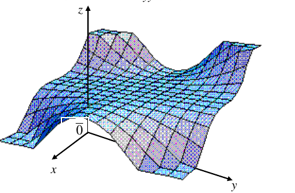

# Unidad 4 — Práctica: Derivabilidad, recta tangente y plano normal

Ejercicios del **T.P. N.º 4 de la Guía de Trabajos Prácticos** ([TP04-Derivabilidad.pdf](../aula-virtual/04-Derivabilidad/TP04-Derivabilidad.pdf)). Las respuestas se controlaron con las [respuestas oficiales de la guía](../aula-virtual/00-Guia-TP/Guia-TP-2016-Respuestas.pdf) y con la [fe de erratas](../aula-virtual/00-Guia-TP/Guia-TP-2016-Fe-de-Erratas-2018-07-31.pdf).

Cada ejercicio tiene un botón **Solución**. Al abrirlo aparece la respuesta y, arriba de ella, un segundo botón **Solución paso a paso** con el desarrollo completo.

> **Nomenclatura y consideraciones básicas:**
>
> - Trabajando con funciones de varias variables:
>   - $f'(\bar A, \bar r) \equiv \dfrac{\partial f}{\partial \bar r}(\bar A)$ simbolizan la derivada de $f$ respecto de $\bar r$ en el punto $\bar A$.
>   - Siendo $\bar r \ne \bar 0$, su dirección viene dada por $\breve r = \bar r/\Vert\bar r\Vert$; las componentes de $\breve r$ son los cosenos directores de la dirección. La derivada de $f$ respecto $\breve r$ (vector unitario o versor) también se denomina "derivada direccional" o "derivada en la dirección de $\bar r$".
>   - Las derivadas parciales son derivadas direccionales en la dirección de los versores canónicos; es decir, $f'(\bar A, \breve e_k) \equiv f'_{x_k}(\bar A) \equiv \dfrac{\partial f}{\partial x_k}(\bar A)$ donde $\breve e_k = (0, \cdots, 0, 1, 0, \cdots, 0)$ (con el 1 en la posición $k$) es el $k$-ésimo versor canónico.
> - Una derivada queda definida cuando el límite correspondiente existe y tiene norma finita, entendiéndose que:
>   - para funciones de una variable la derivada $f'(a)$ se estudia suponiendo que $a$ es interior al dominio de $f$.(\*)
>   - en el caso de funciones de varias variables, $f'(\bar A, \bar r)$ se estudia suponiendo que $f$ está definida en un entorno de $\bar A$ sobre la recta que pasa por dicho punto con dirección $\breve r$; es decir, no es necesario que $\bar A$ sea interior al dominio de la función.
>
> (\*) Las derivadas laterales en puntos frontera las consideraremos más adelante sólo cuando sean necesarias.

---

### 01) Recta tangente y plano normal a una curva intersección

Definida la curva $C$ como intersección de dos superficies $S_1$ y $S_2$ ($C = S_1 \cap S_2$):

* parametrícela convenientemente y halle una ecuación para la recta tangente a $C$ en $\bar A$,
* halle una ecuación cartesiana y una ecuación vectorial para el plano normal a $C$ en $\bar A$,
* analice si $C$ es una curva plana o alabeada.

- a) $S_1:\ y = x^2 \qquad S_2:\ y + z = 5 \qquad \bar A = (2,4,1)$.
- b) $S_1:\ z = x^2 - y^2 \qquad S_2:\ z = x + y \qquad \bar A = (2,1,3)$.
- c) $S_1:\ x^2 + y^2 + z^2 = 8 \qquad S_2:\ z = \sqrt{x^2 + y^2} \qquad \bar A = (0,2,2)$.

<b>Solución</b>

Solución paso a paso

**Fórmulas que vamos a usar:** si $C$ está parametrizada por $\vec g(t)$ y $\vec g(t_0) = \bar A$:

- Recta tangente: $\vec X = \bar A + u\thinspace\vec g'(t_0)$.
- Plano normal: $\vec g'(t_0)\cdot(\vec X - \bar A) = 0$.

**a)**

*Parametrización:* $S_1$ da $y$ en función de $x$, y $S_2$ da $z = 5 - y = 5 - x^2$. Tomando $x$ como parámetro:

$$\vec g(x) = (x,\ x^2,\ 5 - x^2), \quad x \in \Re$$

*Punto:* $\bar A = (2,4,1)$ corresponde a $x = 2$, porque $2^2 = 4$ y $5 - 4 = 1$.

*Vector tangente:* $\vec g'(x) = (1,\ 2x,\ -2x)$, así que $\vec g'(2) = (1, 4, -4)$.

*Recta tangente:* $\vec X = (2,4,1) + u\thinspace(1,4,-4) = (2 + u,\ 4 + 4u,\ 1 - 4u)$.

*Plano normal:* $(1,4,-4)\cdot(x - 2,\ y - 4,\ z - 1) = 0$, es decir:

$$x - 2 + 4y - 16 - 4z + 4 = 0 \ \Rightarrow\ x + 4y - 4z = 14$$

Despejando $x$ se obtiene una ecuación vectorial: $\vec X = (14 - 4y + 4z,\ y,\ z)$, con $(y,z)\in\Re^2$.

*¿Plana?* Todos los puntos cumplen $y + z = x^2 + 5 - x^2 = 5$: la curva está en el plano $y + z = 5$, que es $S_2$ ⇒ **plana**.

**b)**

*Parametrización:* igualando las dos expresiones de $z$:

$$x^2 - y^2 = x + y \ \Rightarrow\ (x + y)(x - y) - (x + y) = 0 \ \Rightarrow\ (x + y)(x - y - 1) = 0$$

La intersección son dos rectas: $x + y = 0$ o $x - y = 1$. $\bar A = (2,1,3)$ cumple $x - y = 1$, así que estamos en esa rama:

$$y = x - 1, \quad z = x + y = 2x - 1 \ \Rightarrow\ \vec g(x) = (x,\ x - 1,\ 2x - 1)$$

*Punto:* $\bar A$ corresponde a $x = 2$. *Vector tangente:* $\vec g' = (1, 1, 2)$, constante porque es una recta.

*Recta tangente:* $\vec X = (2 + u,\ 1 + u,\ 3 + 2u)$, que es la misma curva.

*Plano normal:* $(x - 2) + (y - 1) + 2(z - 3) = 0 \Rightarrow x + y + 2z = 9$. Ecuación vectorial: $\vec X = (x,\ y,\ (9 - x - y)/2)$.

*¿Plana?* Es una recta, así que está contenida en infinitos planos; por ejemplo $z = x + y$ ⇒ **plana**.

**c)**

*Parametrización:* de $S_2$, $z^2 = x^2 + y^2$ con $z \ge 0$. Reemplazando en $S_1$:

$$z^2 + z^2 = 8 \ \Rightarrow\ z = 2, \qquad x^2 + y^2 = 4$$

Es la circunferencia de radio 2 a altura $z = 2$:

$$\vec g(t) = (2\cos t,\ 2\mathop{\mathrm{sen}}t,\ 2), \quad t \in [0, 2\pi]$$

*Punto:* $\bar A = (0, 2, 2)$ corresponde a $t = \pi/2$.

*Vector tangente:* $\vec g'(t) = (-2\mathop{\mathrm{sen}}t,\ 2\cos t,\ 0)$, así que $\vec g'(\pi/2) = (-2, 0, 0)$. Es paralelo a $(1, 0, 0)$.

*Recta tangente:* $\vec X = (0,2,2) + u\thinspace(1,0,0) = (u,\ 2,\ 2)$.

*Plano normal:* $-2(x - 0) = 0 \Rightarrow x = 0$. Ecuación vectorial: $\vec X = (0, y, z)$.

*¿Plana?* Está en el plano $z = 2$ ⇒ **plana**.

**Respuesta:** En cada caso se indica una respuesta posible a lo requerido.

- a) Ecuación $C$: $\bar X = (x, x^2, 5 - x^2) \wedge x \in \Re$; recta tg.: $\bar X = (2 + u, 4 + 4u, 1 - 4u) \wedge u \in \Re$. Plano normal: $x + 4y - 4z = 14$, $\bar X = (14 - 4y + 4z, y, z) \wedge (y,z) \in \Re^2$.
- b) Ecuación $C$: $\bar X = (x, x - 1, 2x - 1) \wedge x \in \Re$; recta tg.: $\bar X = (2 + u, 1 + u, 3 + 2u) \wedge u \in \Re$. Plano normal: $x + y + 2z = 9$, $\bar X = (x, y, (9 - x - y)/2) \wedge (x,y) \in \Re^2$.
- c) Ecuación $C$: $\bar X = (2\cos(t), 2\mathop{\mathrm{sen}}(t), 2) \wedge t \in [0, 2\pi]$; recta tg.: $\bar X = (u, 2, 2) \wedge u \in \Re$. Plano normal: $x = 0$, $\bar X = (0, y, z) \wedge (y,z) \in \Re^2$.

Las tres son curvas planas, pertenecen a los planos de ecuación: a) $y + z = 5$; b) $z = x + y$; c) $z = 2$.

---

### 02) Intersecciones de la recta tangente

Dada $C$ de ecuación $\bar X = (u^2,\ u - 2,\ u + 3)$ con $u \in \Re$, analice si su recta tangente en el punto $(9,1,6)$ interseca ...

- a) ... al eje $z$.
- b) ... a la superficie $\Sigma$ de ecuación $z = x - 2y^2$.
- c) ... a la línea de ecuación $\bar X = (v,\ 2v,\ 32v^{-1})$ con $v \ne 0$.

<b>Solución</b>

Solución paso a paso

**Paso 1 — Valor del parámetro en el punto.** $u - 2 = 1 \Rightarrow u = 3$. Se comprueba: $u^2 = 9$ ✓ y $u + 3 = 6$ ✓.

**Paso 2 — Recta tangente.** $\bar X'(u) = (2u, 1, 1)$, así que $\bar X'(3) = (6, 1, 1)$:

$$T:\ \vec X = (9 + 6t,\ 1 + t,\ 6 + t), \quad t \in \Re$$

**a) Eje $z$** (puntos con $x = 0$ e $y = 0$):

- $x = 0 \Rightarrow t = -\frac32$.
- Entonces $y = 1 - \frac32 = -\frac12 \ne 0$.

No hay ningún $t$ que anule ambas ⇒ **no** lo interseca.

**b) Superficie $z = x - 2y^2$.** Reemplazamos el punto genérico de $T$:

$$6 + t = (9 + 6t) - 2(1 + t)^2 = 9 + 6t - 2 - 4t - 2t^2 = 7 + 2t - 2t^2$$

$$2t^2 - t - 1 = 0 \ \Rightarrow\ t = \frac{1 \pm \sqrt{1 + 8}}{4} = \frac{1 \pm 3}{4} \ \Rightarrow\ t = 1 \ \text{ o } \ t = -\frac12$$

- $t = 1$: $(15,\ 2,\ 7)$.
- $t = -\frac12$: $(6,\ 0{,}5,\ 5{,}5)$.

**c) Línea $(v, 2v, 32/v)$.** Igualamos coordenada a coordenada:

$$9 + 6t = v, \qquad 1 + t = 2v, \qquad 6 + t = \frac{32}{v}$$

- De las dos primeras: $1 + t = 2(9 + 6t) \Rightarrow 1 + t = 18 + 12t \Rightarrow t = -\frac{17}{11}$, y entonces $v = 9 - \frac{102}{11} = -\frac{3}{11}$.
- Tercera ecuación: el lado izquierdo da $6 - \frac{17}{11} = \frac{49}{11}$ y el derecho $\frac{32}{-3/11} = -\frac{352}{3}$. No coinciden.

⇒ **No** se intersecan.

**Respuesta:**

- a) No.
- b) Sí, en $(6;\ 0{,}5;\ 5{,}5)$ y en $(15, 2, 7)$.
- c) No.

---

### 03) Curva alabeada

Halle la ecuación de un plano que contenga tres puntos no alineados de la curva $C$ de ecuación $\bar X = (2\cos(t),\ 2\mathop{\mathrm{sen}}(t),\ t)$ con $t \in [0, 2\pi]$. Demuestre que $C$ es alabeada (no es plana).

<b>Solución</b>

Solución paso a paso

**Paso 1 — Tres puntos.** Elegimos valores de $t$ que den $\mathop{\mathrm{sen}}t = 0$, para que los puntos queden en un plano fácil:

- $t = 0$: $P_1 = (2, 0, 0)$.
- $t = \pi$: $P_2 = (-2, 0, \pi)$.
- $t = 2\pi$: $P_3 = (2, 0, 2\pi)$.

No están alineados: $P_2 - P_1 = (-4, 0, \pi)$ y $P_3 - P_1 = (0, 0, 2\pi)$ no son paralelos.

**Paso 2 — Plano.** Los tres tienen $y = 0$ ⇒ el plano que los contiene es $y = 0$ (el plano $xz$). Es **el único**, porque por tres puntos no alineados pasa un solo plano.

**Paso 3 — $C$ no es plana.** Si $C$ estuviera en un plano, ese plano contendría a $P_1$, $P_2$ y $P_3$, así que sería $y = 0$. Pero el punto $t = \pi/2$, $(0, 2, \pi/2) \in C$, tiene $y = 2 \ne 0$. Contradicción ⇒ $C$ es **alabeada**. Es una hélice.

**Respuesta:** Por ejemplo, el plano $y = 0$ contiene a los puntos $(2,0,0)$, $(-2,0,\pi)$ y $(2,0,2\pi)$ de la curva; la curva no es plana pues $(0, 2, \pi/2) \in C$ pero no está en el plano antes mencionado.

---

### 04) Derivadas parciales con la regla práctica

Halle las funciones derivadas parciales de 1º orden de las siguientes funciones.

- a) $f(x,y) = x^4 + 2xy + xy^3 - 1$.
- b) $f(x,y,z) = y\thinspace e^{2x} + z\thinspace e^{3y}$.
- c) $f(x,y) = x\thinspace e^{x^2 + y^2}$.
- d) $f(x,y) = \mathop{\mathrm{arctg}}(y/x)$, $x \ne 0$.
- e) $f(x,y) = \displaystyle\int_x^y e^{\mathop{\mathrm{sen}}(t)}\thinspace dt$.
- f) $f(x,y) = \displaystyle\int_x^{x^2 + y^2} e^{t^2}\thinspace dt$.

<b>Solución</b>

Solución paso a paso

**Regla:** para derivar respecto de una variable, las demás se tratan como **constantes**.

**a)**

- $f'_x$: con $y$ constante, $\dfrac{\partial}{\partial x}(x^4) = 4x^3$, $\dfrac{\partial}{\partial x}(2xy) = 2y$ y $\dfrac{\partial}{\partial x}(xy^3) = y^3$. Queda $f'_x = 4x^3 + 2y + y^3$.
- $f'_y$: con $x$ constante, $f'_y = 2x + 3xy^2$.

Ambas son polinomios ⇒ definidas en $\Re^2$.

**b)**

- $f'_x = 2y\thinspace e^{2x}$.
- $f'_y = e^{2x} + 3z\thinspace e^{3y}$.
- $f'_z = e^{3y}$.

Definidas en $\Re^3$.

**c)** Regla del producto en $x$ y de la cadena en el exponente:

- $f'_x = e^{x^2+y^2} + x\cdot 2x\thinspace e^{x^2+y^2} = (1 + 2x^2)\thinspace e^{x^2+y^2}$.
- $f'_y = x\cdot 2y\thinspace e^{x^2+y^2} = 2xy\thinspace e^{x^2+y^2}$.

Definidas en $\Re^2$.

**d)** Usamos $(\mathop{\mathrm{arctg}}u)' = \dfrac{u'}{1 + u^2}$ con $u = y/x$:

- $f'_x = \dfrac{-y/x^2}{1 + y^2/x^2} = \dfrac{-y}{x^2 + y^2}$.
- $f'_y = \dfrac{1/x}{1 + y^2/x^2} = \dfrac{x}{x^2 + y^2}$.

Definidas donde está definida $f$: $x \ne 0$.

**e)** Por el teorema fundamental del cálculo, $\dfrac{d}{db}\displaystyle\int_a^b g = g(b)$ y $\dfrac{d}{da}\displaystyle\int_a^b g = -g(a)$:

- $f'_x = -e^{\mathop{\mathrm{sen}}(x)}$.
- $f'_y = e^{\mathop{\mathrm{sen}}(y)}$.

**f)** El límite superior es $b = x^2 + y^2$ y el inferior $a = x$. Con la regla de la cadena:

- $f'_x = e^{b^2}\thinspace b'_x - e^{a^2}\thinspace a'_x = e^{(x^2+y^2)^2}\cdot 2x - e^{x^2}$.
- $f'_y = e^{(x^2+y^2)^2}\cdot 2y$.

**Respuesta:**

- a) $f'_x(x,y) = 4x^3 + 2y + y^3$, $\ f'_y(x,y) = 2x + 3xy^2$, ambas definidas en $\Re^2$.
- b) $f'_x(x,y,z) = 2y\thinspace e^{2x}$, $\ f'_y(x,y,z) = e^{2x} + 3z\thinspace e^{3y}$, $\ f'_z(x,y,z) = e^{3y}$, las tres def. en $\Re^3$.
- c) $f'_x(x,y) = (1 + 2x^2)\thinspace e^{x^2+y^2}$, $\ f'_y(x,y) = 2xy\thinspace e^{x^2+y^2}$, ambas definidas en $\Re^2$.
- d) $f'_x(x,y) = \dfrac{-y}{x^2+y^2}$, $\ f'_y(x,y) = \dfrac{x}{x^2+y^2}$, ambas definidas en $\lbrace(x,y) \in \Re^2 / x \ne 0\rbrace$.
- e) $f'_x(x,y) = -e^{\mathop{\mathrm{sen}}(x)}$, $\ f'_y(x,y) = e^{\mathop{\mathrm{sen}}(y)}$, ambas definidas en $\Re^2$.
- f) $f'_x(x,y) = 2x\thinspace e^{(x^2+y^2)^2} - e^{x^2}$, $\ f'_y(x,y) = 2y\thinspace e^{(x^2+y^2)^2}$, ambas definidas en $\Re^2$.

---

### 05) Derivadas parciales por definición

Analice por definición la existencia de las derivadas parciales de $f$ en el punto $\bar A$; cuando sea posible verifique aplicando la regla práctica de derivación.

- a) $f(x,y) = 3x^2 + 2xy$, $\bar A = (1,2)$.
- b) $f(x,y) = \begin{cases} x^2 + 2y & \text{si } x \ge 1 \cr 2x - y & \text{si } x < 1 \end{cases}$, $\bar A = (1,1)$.
- c) $f(x,y) = \sqrt{x^4 + 2y^2}$, $\bar A = (0,0)$.
- d) $f(x,y) = |x| + |y|$, $\bar A = (0,0)$.

<b>Solución</b>

Solución paso a paso

**Definiciones:**

$$f'_x(a,b) = \lim_{h\to0}\frac{f(a+h, b) - f(a,b)}{h}, \qquad f'_y(a,b) = \lim_{k\to0}\frac{f(a, b+k) - f(a,b)}{k}$$

**a)** $f(1,2) = 3 + 4 = 7$.

- $f(1+h, 2) = 3(1 + 2h + h^2) + 4(1 + h) = 7 + 10h + 3h^2$, así que $f'_x(1,2) = \lim\dfrac{10h + 3h^2}{h} = \lim(10 + 3h) = 10$.
- $f(1, 2 + k) = 3 + 2(2 + k) = 7 + 2k$, así que $f'_y(1,2) = \lim\dfrac{2k}{k} = 2$.

*Verificación con la regla:* $f'_x = 6x + 2y$, que en $(1,2)$ vale 10 ✓. $f'_y = 2x$, que vale 2 ✓.

**b)** $f(1,1) = 1 + 2 = 3$, con la rama $x \ge 1$.

*$f'_x$:* al mover $x$ cambiamos de rama según el signo de $h$, así que hay que separar en laterales.

- $h > 0$ ($x = 1 + h \ge 1$): $\dfrac{(1+h)^2 + 2 - 3}{h} = \dfrac{2h + h^2}{h} \to 2$.
- $h < 0$ ($x = 1 + h < 1$): $\dfrac{2(1+h) - 1 - 3}{h} = \dfrac{2h - 2}{h} = 2 - \dfrac{2}{h} \to +\infty$.

⇒ $\nexists f'_x(1,1)$. Además $f$ es discontinua en $(1,1)$: por la izquierda tiende a $2 - 1 = 1 \ne 3$.

*$f'_y$:* con $x = 1$ fijo siempre usamos la rama $x \ge 1$: $f(1, 1+k) = 1 + 2 + 2k$, así que $\dfrac{2k}{k} \to 2$ ⇒ $f'_y(1,1) = 2$. Coincide con la regla práctica de la rama $x \ge 1$.

**c)** $f(0,0) = 0$.

- $f'_x$: $\dfrac{\sqrt{h^4}}{h} = \dfrac{h^2}{h} = h \to 0$ ⇒ $f'_x(0,0) = 0$.
- $f'_y$: $\dfrac{\sqrt{2k^2}}{k} = \sqrt2\thinspace\dfrac{|k|}{k}$, que vale $\sqrt2$ por derecha y $-\sqrt2$ por izquierda ⇒ $\nexists f'_y(0,0)$.

*Regla práctica:* $f'_x = \dfrac{2x^3}{\sqrt{x^4+2y^2}}$ no está definida en el origen; ahí sólo sirve la definición.

**d)** $f(0,0) = 0$.

- $f'_x$: $\dfrac{|h| + 0}{h} = \dfrac{|h|}{h}$, que vale $\pm 1$ según el lado ⇒ $\nexists$.
- $f'_y$: igual ⇒ $\nexists$.

**Respuesta:**

- a) $f'_x(1,2) = 10$, $f'_y(1,2) = 2$.
- b) $\nexists f'_x(1,1)$, $f'_y(1,1) = 2$.
- c) $f'_x(0,0) = 0$, $\nexists f'_y(0,0)$.
- d) $\nexists f'_x(0,0)$, $\nexists f'_y(0,0)$.

---

### 06) Discontinua y con pocas direccionales

Dada $f(x,y) = \begin{cases} \dfrac{xy}{x^2 + y^2} & \text{si } (x,y) \ne (0,0) \cr 0 & \text{si } (x,y) = (0,0) \end{cases}$

- a) Pruebe que $f$ no es continua en $(0,0)$.
- b) Pruebe que $f'(\bar 0, \breve r)$ sólo queda definida para $\breve r$: $(1,0)$, $(-1,0)$, $(0,1)$ y $(0,-1)$.

<b>Solución</b>

Solución paso a paso

**a)** Sobre las rectas $y = mx$:

$$f(x, mx) = \frac{mx^2}{x^2(1+m^2)} = \frac{m}{1+m^2}$$

Depende de $m$ ⇒ no existe el límite en el origen ⇒ $f$ no es continua ahí.

**b)** Sea $\breve r = (a, b)$ con $a^2 + b^2 = 1$:

$$f'(\bar 0, \breve r) = \lim_{h\to0}\frac{f(ha, hb) - 0}{h} = \lim_{h\to0}\frac{1}{h}\cdot\frac{h^2ab}{h^2(a^2+b^2)} = \lim_{h\to0}\frac{ab}{h}$$

- Si $ab \ne 0$: el cociente tiende a $\pm\infty$ ⇒ no existe.
- Si $ab = 0$ (o sea $a = 0$ o $b = 0$): el límite es 0.

Con $a^2 + b^2 = 1$, los casos con $ab = 0$ son exactamente $(\pm1, 0)$ y $(0, \pm1)$.

**Respuesta:**

- a) No es continua: por ejemplo, el límite por rectas $y = mx$ da $\frac{m}{1+m^2}$, que depende de $m$.
- b) $f'(\bar 0, \breve r) = 0$ sólo existe para los $\breve r$ del enunciado.

---

### 07) Derivable en toda dirección pero discontinua

Dada $g(x,y) = \begin{cases} \dfrac{x^3y}{x^6 + y^2} & \text{si } (x,y) \ne (0,0) \cr 0 & \text{si } (x,y) = (0,0) \end{cases}$, demuestre que para todo $\breve r \in \Re^2$ la función es derivable en el origen, aun cuando $g$ es discontinua en $(0,0)$.

<b>Solución</b>

Solución paso a paso

**Paso 1 — Derivada direccional.** Sea $\breve r = (a, b)$ con $a^2 + b^2 = 1$:

$$g'(\bar 0, \breve r) = \lim_{h\to0}\frac{g(ha, hb)}{h} = \lim_{h\to0}\frac{1}{h}\cdot\frac{h^4a^3b}{h^6a^6 + h^2b^2} = \lim_{h\to0}\frac{h\thinspace a^3b}{h^4a^6 + b^2}$$

- Si $b \ne 0$: el denominador tiende a $b^2 \ne 0$ y el numerador a 0 ⇒ el límite es $0$.
- Si $b = 0$: $g(ha, 0) = 0$ ⇒ el límite es $0$.

⇒ $g'(\bar 0, \breve r) = 0$ **para todo** $\breve r$.

**Paso 2 — Discontinuidad.** Sobre $y = x^3$, que iguala los órdenes de $x^6$ y de $y^2$:

$$g(x, x^3) = \frac{x^3\cdot x^3}{x^6 + x^6} = \frac12 \ne 0 = g(0,0)$$

⇒ $g$ no es continua en el origen.

**Conclusión:** la existencia de **todas** las derivadas direccionales no implica continuidad.

**Respuesta:** $g'(\bar 0, \breve r) = 0 \ \forall\breve r \in \Re^2$. La discontinuidad se muestra, por ejemplo, con el límite por $y = x^3$, que da $1/2$.

---

### 08) $h = x^{1/3}y^{1/3}$

Dada $h : \Re^2 \to \Re \ /\ h(x,y) = x^{1/3}y^{1/3}$

- a) Demuestre que $\dfrac{\partial f}{\partial x}(0,0) = \dfrac{\partial f}{\partial y}(0,0) = 0$ y que la únicas direcciones para las que existe derivada direccional son $\breve e_1$, $-\breve e_1$, $\breve e_2$ y $-\breve e_2$.
- b) Verifique que $h$ es continua en el origen.

> **Fe de erratas (31/07/18):** en el ítem 08-a dice $\dfrac{\partial f}{\partial x}(0,0) = \dfrac{\partial f}{\partial y}(0,0) = 0$, **debe decir** $\dfrac{\partial h}{\partial x}(0,0) = \dfrac{\partial h}{\partial y}(0,0) = 0$.

<b>Solución</b>

Solución paso a paso

$x^{1/3} = \sqrt[3]{x}$ está definida para todo $x$ real, también los negativos.

**a)**

*Parciales:*

- $h(t, 0) = 0$ ⇒ $h'_x(0,0) = \lim\dfrac{0 - 0}{t} = 0$.
- $h(0, t) = 0$ ⇒ $h'_y(0,0) = 0$.

*Direccionales:* sea $\breve r = (a, b)$ unitario.

$$h'(\bar 0, \breve r) = \lim_{t\to0}\frac{\sqrt[3]{ta}\thinspace\sqrt[3]{tb}}{t} = \lim_{t\to0}\frac{t^{2/3}\sqrt[3]{ab}}{t} = \lim_{t\to0}\frac{\sqrt[3]{ab}}{t^{1/3}}$$

- Si $ab \ne 0$: el cociente tiende a $\pm\infty$ ⇒ no existe.
- Si $ab = 0$: vale 0.

Los versores con $ab = 0$ son $\pm\breve e_1$ y $\pm\breve e_2$.

**b)** $|h(x,y)| = \sqrt[3]{|xy|} \to 0 = h(0,0)$ cuando $(x,y)\to(0,0)$. También vale que $h$ es producto de funciones continuas ⇒ es continua.

**Respuesta:**

- a) Se demuestra usando la definición.
- b) Se verifica.

---

### 09) Continua sin derivadas parciales

Demuestre por definición que $f : \Re^2 \to \Re \ /\ f(x,y) = \sqrt{4x^2 + y^2}$ es continua pero no admite derivadas parciales en el origen.

<b>Solución</b>

Solución paso a paso

**Continuidad (por definición).** Hay que ver que $\forall\varepsilon > 0\ \exists\delta > 0$ tal que $\sqrt{x^2+y^2} < \delta \Rightarrow |f(x,y) - 0| < \varepsilon$.

Como $4x^2 + y^2 \le 4x^2 + 4y^2$:

$$|f(x,y)| = \sqrt{4x^2 + y^2} \le 2\sqrt{x^2 + y^2} < 2\delta$$

Tomando $\delta = \varepsilon/2$ resulta $|f| < \varepsilon$ ✓.

**Parciales.**

- $f'_x(0,0) = \lim\dfrac{\sqrt{4h^2}}{h} = \lim\dfrac{2|h|}{h}$, que vale $\pm2$ según el lado ⇒ $\nexists$.
- $f'_y(0,0) = \lim\dfrac{\sqrt{k^2}}{k} = \lim\dfrac{|k|}{k}$ ⇒ $\nexists$.

**Respuesta:** Se demuestra por definición. Comentario: tenga en cuenta que en este caso la regla práctica de derivación no permite concluir sobre la existencia de las derivadas parciales en el origen ($f'_x = \frac{4x}{\sqrt{4x^2+y^2}}$ no está definida en $(0,0)$; hay que usar la definición).

---

### 10) Derivada direccional por definición

Dada $f(x,y) = 1 - x^2 + 2y^2$, calcule usando la definición la derivada direccional de $f$ en el punto $\bar A = (1,-1)$ según la dirección del vector $\bar v = (3,4)$.

<b>Solución</b>

Solución paso a paso

**Paso 1 — Versor.** $\Vert\bar v\Vert = \sqrt{9 + 16} = 5$, así que $\breve r = \left(\frac35, \frac45\right)$.

**Paso 2 — Restricción a la recta.**

$$g(t) = f\negthinspace\left(1 + \tfrac35t,\ -1 + \tfrac45t\right)$$

Desarrollando:

$$g(t) = 1 - \left(1 + \tfrac65t + \tfrac{9}{25}t^2\right) + 2\left(1 - \tfrac85t + \tfrac{16}{25}t^2\right) = 2 - \tfrac{22}{5}t + \tfrac{23}{25}t^2$$

**Paso 3 — Cociente incremental.** $g(0) = f(1,-1) = 2$, así que:

$$f'(\bar A, \breve r) = \lim_{t\to0}\frac{g(t) - g(0)}{t} = \lim_{t\to0}\left(-\frac{22}{5} + \frac{23}{25}t\right) = -\frac{22}{5}$$

*Control (Unidad 5):* $\nabla f(1,-1) = (-2x, 4y)\big|_{(1,-1)} = (-2, -4)$, y $\nabla f\cdot\breve r = -\frac65 - \frac{16}{5} = -\frac{22}{5}$ ✓.

**Respuesta:** $f'((1,-1), \breve r) = -22/5$.

---

### 11) Derivabilidad según las direcciones

Estudie la derivabilidad en distintas direcciones en el punto $\bar A$ que se indica en cada caso.

- a) $f(x,y) = \begin{cases} \dfrac{xy - x}{x^2 + (y - 1)^2} & \text{si } (x,y) \ne (0,1) \cr 0 & \text{si } (x,y) = (0,1) \end{cases}$, $\quad \bar A = (0,1)$.
- b) $f(x,y) = \begin{cases} \dfrac{y^2}{x} & \text{si } (x,y) \ne (0,y) \cr 0 & \text{si } (x,y) = (0,y) \end{cases}$, $\quad \bar A = (0,0)$.

<b>Solución</b>

Solución paso a paso

**a)** El numerador es $xy - x = x(y - 1)$. Con $\breve r = (a, b)$ unitario, el punto es $\bar A + h\breve r = (ha,\ 1 + hb)$:

$$\frac{f(ha, 1 + hb) - 0}{h} = \frac{1}{h}\cdot\frac{ha\cdot hb}{h^2a^2 + h^2b^2} = \frac{ab}{h}$$

- Si $ab \ne 0$: no existe.
- Si $ab = 0$: vale 0.

Sólo es derivable según $(0, \pm1)$ y $(\pm1, 0)$, y en esas direcciones vale 0.

**b)** Con $\breve r = (u, v)$ unitario:

- **Si $u \ne 0$:** $(hu, hv)$ no está sobre el eje $y$, así que:

$$\frac{f(hu, hv)}{h} = \frac{1}{h}\cdot\frac{h^2v^2}{hu} = \frac{v^2}{u}$$

  Es constante, así que el límite existe y vale $\dfrac{v^2}{u}$.
- **Si $u = 0$:** $(0, hv)$ está sobre el eje $y$, donde $f = 0$ ⇒ la derivada es 0.

La función es derivable en **todas** las direcciones.

**Respuesta:**

- a) Sólo es derivable, con resultado 0, según $(0,1)$, $(0,-1)$, $(1,0)$ y $(-1,0)$.
- b) $f'(\bar 0, (u,v)) = \begin{cases} v^2/u & \text{si } u \ne 0 \cr 0 & \text{si } u = 0 \end{cases}$ con $u^2 + v^2 = 1$.

---

### 12) Dominios de las derivadas de 1.º y 2.º orden

Determine los dominios en los que quedan definidas las derivadas parciales de 1° y 2° orden de las siguientes funciones:

- a) $f(x,y) = \ln(x^2 + y^2)$.
- b) $\vec f(x,y) = (x\ln(y),\ y/x)$.
- c) $f(x,y) = \dfrac{x^2}{x^2 + y^2}$ si $(x,y) \ne (0,0)$, $f(0,0) = 0$.
- d) $f(x,y,z) = xy\ln(yz)$.

<b>Solución</b>

Solución paso a paso

**a)** $f'_x = \dfrac{2x}{x^2+y^2}$ y $f'_y = \dfrac{2y}{x^2+y^2}$. Las derivadas segundas también son racionales con denominador $(x^2+y^2)^2$. Todas están definidas donde $f$ lo está: $\Re^2 - \lbrace\bar 0\rbrace$.

**b)** El dominio de $\vec f$ es $y > 0$, $x \ne 0$. Derivadas:

- $\vec f'_x = (\ln y,\ -y/x^2)$ y $\vec f'_y = (x/y,\ 1/x)$.
- Las segundas tienen $\ln$, $1/y$ y potencias de $1/x$.

Todas están definidas en $\lbrace x \ne 0,\ y > 0\rbrace$.

**c)** **Fuera del origen** la regla práctica da:

$$f'_x = \frac{2xy^2}{(x^2+y^2)^2}, \qquad f'_y = \frac{-2x^2y}{(x^2+y^2)^2}$$

Las segundas también son racionales y están definidas en $\Re^2 - \lbrace\bar 0\rbrace$.

**En el origen** hay que usar la definición:

- $f'_x(0,0)$: $f(h,0) = 1$ si $h \ne 0$, así que $\dfrac{1 - 0}{h}$ explota ⇒ $\nexists$. Por lo tanto tampoco existen $f''_{xx}(0,0)$ ni $f''_{xy}(0,0)$, que se calculan a partir de $f'_x$.
- $f'_y(0,0)$: $f(0,k) = 0$ ⇒ $f'_y(0,0) = 0$. Entonces $f'_y$ está definida en **todo** $\Re^2$.
- $f''_{yx}(0,0) = \lim\dfrac{f'_y(h,0) - f'_y(0,0)}{h}$, y $f'_y(h, 0) = 0$ (la fórmula tiene el factor $y$) ⇒ vale $0$.
- $f''_{yy}(0,0) = \lim\dfrac{f'_y(0,k) - 0}{k}$, y $f'_y(0,k) = 0$ (la fórmula tiene el factor $x^2$) ⇒ vale $0$.

**d)** El dominio es $yz > 0$. $f'_x = y\ln(yz)$, $f'_y = x\ln(yz) + x$ y $f'_z = \dfrac{xy}{z}$. Las segundas involucran $\ln(yz)$, $1/y$ y $1/z$, todas definidas en $yz > 0$.

**Respuesta:**

- a) 1° y 2° en $\Re^2 - \lbrace\bar 0\rbrace$.
- b) 1° y 2° en $\lbrace(x,y) \in \Re^2 / x \ne 0 \wedge y > 0\rbrace$.
- c) $f'_x$, $f''_{xx}$, $f''_{xy}$ en $\Re^2 - \lbrace\bar 0\rbrace$; $f'_y$, $f''_{yx}$, $f''_{yy}$ en $\Re^2$.
- d) 1° y 2° en $\lbrace(x,y,z) \in \Re^3 / yz > 0\rbrace$.

---

### 13) Partícula que atraviesa una superficie

Sea $P$ una partícula que se desplaza en el espacio $xyz$ según la trayectoria definida por $\bar X = 3t^2\thinspace\breve\imath + (2 - t)\thinspace\breve\jmath + 2t^2\thinspace\breve k$ con $t \ge 0$, $t$: tiempo en segundos. Si $x = y^2 + z$ es la ecuación de una superficie $S$:

- a) calcule el ángulo entre los vectores velocidad y aceleración de $P$ en el instante que la partícula atraviesa a $S$.
- b) calcule el tiempo que tardará $P$ en llegar desde $S$ al plano de ecuación $x - z + 2y = 7$.

<b>Solución</b>

Solución paso a paso

**Paso 1 — Instante en que atraviesa $S$.** Reemplazamos $x = 3t^2$, $y = 2 - t$, $z = 2t^2$ en $x = y^2 + z$:

$$3t^2 = (2 - t)^2 + 2t^2 = 4 - 4t + 3t^2 \ \Rightarrow\ 4t = 4 \ \Rightarrow\ t_1 = 1\ \text{s}$$

**a) Ángulo.**

*Fórmula:* $\cos\alpha = \dfrac{\vec v\cdot\vec a}{\Vert\vec v\Vert\thinspace\Vert\vec a\Vert}$, con $\vec v = \bar X'(t) = (6t, -1, 4t)$ y $\vec a = \bar X''(t) = (6, 0, 4)$.

*Cálculo en $t = 1$:* $\vec v = (6, -1, 4)$, $\vec a = (6, 0, 4)$.

- $\vec v\cdot\vec a = 36 + 0 + 16 = 52$.
- $\Vert\vec v\Vert = \sqrt{53}$ y $\Vert\vec a\Vert = \sqrt{52}$.

$$\cos\alpha = \frac{52}{\sqrt{53}\sqrt{52}} = \sqrt{\frac{52}{53}} = 2\sqrt{\frac{13}{53}} \ \Rightarrow\ \alpha = \arccos\negthinspace\left(2\sqrt{13/53}\right) \approx 7{,}9^\circ$$

**b)** Instante en que llega al plano: reemplazamos en $x - z + 2y = 7$:

$$3t^2 - 2t^2 + 2(2 - t) = 7 \ \Rightarrow\ t^2 - 2t - 3 = 0 \ \Rightarrow\ (t - 3)(t + 1) = 0$$

Como $t \ge 0$: $t_2 = 3$ s. Tiempo transcurrido desde $S$: $t_2 - t_1 = 3 - 1 = 2$ s.

**Respuesta:**

- a) Ángulo $= \arccos(2\sqrt{13/53})$.
- b) tiempo $= 2$ segundos.

---

### 14) Derivada de una transformación lineal

Sea $L : \Re^n \to \Re$ ($n > 1$) una transformación lineal, aplicando la definición de derivada direccional demuestre que $L'(\bar A, \bar r) = L(\bar r)\ \forall\bar A, \bar r \in \Re^n$.

<b>Solución</b>

Solución paso a paso

Por definición, y usando la linealidad, $L(\bar A + h\bar r) = L(\bar A) + h\thinspace L(\bar r)$:

$$L'(\bar A, \bar r) = \lim_{h\to0}\frac{L(\bar A + h\bar r) - L(\bar A)}{h} = \lim_{h\to0}\frac{L(\bar A) + h\thinspace L(\bar r) - L(\bar A)}{h} = \lim_{h\to0}L(\bar r) = L(\bar r) \quad\blacksquare$$

**Respuesta:** Recuerde la definición de transformación lineal: $L(\bar A + h\bar r) = L(\bar A) + hL(\bar r)$; el cociente incremental es constante e igual a $L(\bar r)$.

---

### 15) Hallar $\bar k$

Sea $f(\bar X) = \bar k\cdot\bar X$ con $\bar k$ constante; utilice la propiedad demostrada en el ítem anterior para obtener $\bar k$ sabiendo que $f'((2,1), (3,4)) = 2$ y $f'((3,5), (-1,1)) = 4$.

<b>Solución</b>

Solución paso a paso

**Paso 1 — Propiedad.** $f(\bar X) = \bar k\cdot\bar X$ es lineal, así que por el ejercicio 14, $f'(\bar A, \bar r) = f(\bar r) = \bar k\cdot\bar r$, sin importar el punto $\bar A$.

**Paso 2 — Sistema.** Con $\bar k = (k_1, k_2)$:

$$\begin{cases} 3k_1 + 4k_2 = 2 \cr -k_1 + k_2 = 4 \end{cases}$$

**Paso 3 — Resolver.**

- De la segunda: $k_2 = 4 + k_1$.
- Reemplazando en la primera: $3k_1 + 16 + 4k_1 = 2 \Rightarrow k_1 = -2$, y entonces $k_2 = 2$.

**Respuesta:** $\bar k = (-2, 2)$.

---

### 16) Derivadas parciales perpendiculares

Dado $\bar v(x,y) = (y + x\thinspace g(x),\ y^2)$, halle $g(x)$ para que $\bar v'_x \perp \bar v'_y$ con $\bar v(1,1) = (3,1)$.

<b>Solución</b>

Solución paso a paso

**Paso 1 — Derivadas parciales** (suponiendo $g$ derivable):

$$\bar v'_x = (g(x) + x\thinspace g'(x),\ 0), \qquad \bar v'_y = (1,\ 2y)$$

**Paso 2 — Perpendicularidad** (producto escalar nulo):

$$\bar v'_x\cdot\bar v'_y = g(x) + x\thinspace g'(x) = 0$$

**Paso 3 — Resolver la EDO.** Observamos que $g + xg' = (x\thinspace g)'$. Entonces $(x\thinspace g)' = 0 \Rightarrow x\thinspace g(x) = C \Rightarrow g(x) = \dfrac{C}{x}$.

**Paso 4 — Condición.** $\bar v(1,1) = (1 + g(1),\ 1) = (3, 1) \Rightarrow g(1) = 2 \Rightarrow C = 2$.

**Respuesta:** Suponiendo $g$ derivable en un entorno de $x_0 = 1$: $g(x) = 2x^{-1}$.

---

### 17) Hallar $g$ con una ecuación de Laplace

Dada $f(x,y) = y^2 + g(x)$, halle $g(x)$ para que $f''_{xx} + f''_{yy} = 0$ si $f(\bar 0) = 0$, $f'_x(\bar 0) = 1$.

<b>Solución</b>

Solución paso a paso

**Paso 1 — Derivadas.** $f''_{xx} = g''(x)$ y $f''_{yy} = 2$.

**Paso 2 — Ecuación.** $g''(x) + 2 = 0 \Rightarrow g''(x) = -2$.

**Paso 3 — Integrar dos veces.** $g'(x) = -2x + a$ y $g(x) = -x^2 + ax + b$.

**Paso 4 — Condiciones.**

- $f(0,0) = 0 + g(0) = b = 0$.
- $f'_x(0,0) = g'(0) = a = 1$.

**Respuesta:** Suponiendo $g''$ existente, $g(x) = x - x^2$.

---

### 18) Trayectorias paralelas

Para tiempo $t \ge 0$ dos puntos siguen trayectorias definidas por $\bar X = (t + 1,\ g(t),\ 1 + t^2)$ y $\bar X = (2t,\ g'(t),\ 2t^2)$ respectivamente, determine $g(t)$ sabiendo que en todo momento las trayectorias son paralelas y que en $t = 1$ ambos puntos coinciden en el $(2,2,2)$.

<b>Solución</b>

Solución paso a paso

**Paso 1 — Interpretación.** "Trayectorias paralelas en todo momento" significa que los **vectores tangentes** (las velocidades) son paralelos en cada instante.

$$\bar X_1' = (1,\ g'(t),\ 2t), \qquad \bar X_2' = (2,\ g''(t),\ 4t)$$

**Paso 2 — Paralelismo.** $\bar X_2' = \lambda\thinspace\bar X_1'$. De la primera componente, $\lambda = 2$, y la tercera lo confirma: $4t = 2\cdot 2t$ ✓. La segunda da:

$$g''(t) = 2\thinspace g'(t)$$

**Paso 3 — Resolver.** Es una EDO de variables separables en $w = g'$: $w' = 2w \Rightarrow g'(t) = C\thinspace e^{2t}$.

**Paso 4 — Condiciones en $t = 1$.**

- $\bar X_2(1) = (2,\ g'(1),\ 2) = (2,2,2) \Rightarrow g'(1) = 2 \Rightarrow C\thinspace e^2 = 2 \Rightarrow g'(t) = 2e^{2(t-1)}$.
- Integrando: $g(t) = e^{2(t-1)} + D$.
- $\bar X_1(1) = (2,\ g(1),\ 2) = (2,2,2) \Rightarrow g(1) = 1 + D = 2 \Rightarrow D = 1$.

**Respuesta:** Suponiendo $g''$ existente, $g(t) = 1 + \mathop{\mathrm{Exp}}[2(t - 1)]$.

---

### 19) Ecuación de onda

Verifique que $y = (x - at)^2 + (x + at)^2$ con $a$ constante satisface la ecuación:

$$\frac{\partial^2 y}{\partial t^2} = a^2\thinspace\frac{\partial^2 y}{\partial x^2}$$

denominada "ecuación de onda" o "ecuación de la cuerda vibrante", debida a D'Alembert.

<b>Solución</b>

Solución paso a paso

**Derivadas respecto de $t$:**

$$y'_t = 2(x - at)(-a) + 2(x + at)(a), \qquad y''_{tt} = 2a^2 + 2a^2 = 4a^2$$

**Derivadas respecto de $x$:**

$$y'_x = 2(x - at) + 2(x + at), \qquad y''_{xx} = 2 + 2 = 4$$

**Verificación:** $a^2\thinspace y''_{xx} = 4a^2 = y''_{tt}$ ✓.

**Respuesta:** Se verifica por simple cálculo y reemplazo.

---

### 20) Ecuación de Laplace

Demuestre que $z = \mathop{\mathrm{sen}}(x)\mathop{\mathrm{senh}}(y)$ satisface la ecuación bidimensional de Laplace:

$$\frac{\partial^2 z}{\partial x^2} + \frac{\partial^2 z}{\partial y^2} = 0$$

<b>Solución</b>

Solución paso a paso

Recordamos que $(\mathop{\mathrm{senh}} y)' = \cosh y$ y que $(\cosh y)' = \mathop{\mathrm{senh}}y$.

- $z''_{xx}$: derivando dos veces $\mathop{\mathrm{sen}}x$ se obtiene $-\mathop{\mathrm{sen}}x$ ⇒ $z''_{xx} = -\mathop{\mathrm{sen}}(x)\mathop{\mathrm{senh}}(y)$.
- $z''_{yy}$: derivando dos veces $\mathop{\mathrm{senh}}y$ se obtiene $\mathop{\mathrm{senh}}y$ ⇒ $z''_{yy} = \mathop{\mathrm{sen}}(x)\mathop{\mathrm{senh}}(y)$.

Suma: $-\mathop{\mathrm{sen}}x\mathop{\mathrm{senh}}y + \mathop{\mathrm{sen}}x\mathop{\mathrm{senh}}y = 0$ ✓.

**Respuesta:** Se demuestra por simple cálculo y reemplazo.

---

### 21) Potencial inversamente proporcional a la distancia

Sea $U = f(x,y,z)$ con $f$ campo escalar que en cada punto $(x,y,z)$ tiene un valor inversamente proporcional a la distancia desde el punto al origen de coordenadas; verifique que:

$$U''_{xx} + U''_{yy} + U''_{zz} = 0 \ \text{ en } \ \Re^3 - \lbrace\bar 0\rbrace.$$

<b>Solución</b>

Solución paso a paso

**Paso 1 — Planteo.** "Inversamente proporcional a la distancia" significa $U = \dfrac{k}{r}$, con $r = \sqrt{x^2+y^2+z^2}$ y $k$ constante.

**Paso 2 — Derivada de $r$.** $r'_x = \dfrac{x}{r}$ (y análogamente para $y$ y $z$).

**Paso 3 — Primera derivada.** $U'_x = -\dfrac{k}{r^2}\thinspace r'_x = -\dfrac{k\thinspace x}{r^3}$.

**Paso 4 — Segunda derivada** (regla del cociente):

$$U''_{xx} = -k\thinspace\frac{r^3 - x\cdot 3r^2\thinspace\frac{x}{r}}{r^6} = -k\thinspace\frac{r^2 - 3x^2}{r^5}$$

Por simetría: $U''_{yy} = -k\dfrac{r^2 - 3y^2}{r^5}$ y $U''_{zz} = -k\dfrac{r^2 - 3z^2}{r^5}$.

**Paso 5 — Suma.**

$$U''_{xx} + U''_{yy} + U''_{zz} = -k\thinspace\frac{3r^2 - 3(x^2+y^2+z^2)}{r^5} = -k\thinspace\frac{3r^2 - 3r^2}{r^5} = 0 \ ✓$$

Vale para $r \ne 0$, es decir en $\Re^3 - \lbrace\bar 0\rbrace$.

**Respuesta:** Según se enuncia, debe trabajar derivando $f(x,y,z) = \dfrac{k}{\sqrt{x^2+y^2+z^2}}$ con $k$ constante; al sumar las tres derivadas segundas se obtiene 0.

---

### 22) Divergencia nula

Sea $\vec f = (P, Q, R) \ /\ \vec f(x,y,z) = \dfrac{k\thinspace\vec r}{r^3}$ con $k$ constante, $\vec r = (x,y,z)$, $r = \Vert\vec r\Vert$. Verifique que:

$$P'_x + Q'_y + R'_z = 0 \ \text{ en } \ \Re^3 - \lbrace\bar 0\rbrace.$$

<b>Solución</b>

Solución paso a paso

**Paso 1 — Componentes.**

$$P = \frac{k\thinspace x}{r^3}, \quad Q = \frac{k\thinspace y}{r^3}, \quad R = \frac{k\thinspace z}{r^3}, \quad \text{con } r^3 = (x^2+y^2+z^2)^{3/2}$$

**Paso 2 — Derivada de $P$ respecto de $x$** (cociente, con $(r^3)'_x = 3r^2\cdot\frac{x}{r} = 3rx$):

$$P'_x = k\thinspace\frac{r^3 - x\cdot 3rx}{r^6} = k\thinspace\frac{r^2 - 3x^2}{r^5}$$

**Paso 3 — Análogas.** $Q'_y = k\dfrac{r^2 - 3y^2}{r^5}$ y $R'_z = k\dfrac{r^2 - 3z^2}{r^5}$.

**Paso 4 — Suma.**

$$P'_x + Q'_y + R'_z = k\thinspace\frac{3r^2 - 3r^2}{r^5} = 0 \ ✓$$

Observación: $\vec f = -\nabla\negthinspace\left(\dfrac{k}{r}\right)$, así que este ejercicio es el 21 escrito de otra forma.

**Respuesta:** Observe que, por ejemplo, $P(x,y,z) = \dfrac{k\thinspace x}{(x^2+y^2+z^2)^{3/2}}$; derivando y sumando se obtiene 0.

---

### 23) Derivada a partir del gráfico

Dada $f(x,y) = \sqrt{3 - x^2 - y^2}$, obtenga $f'_y(1,0)$ observando el gráfico de la curva intersección de $z = \sqrt{3 - x^2 - y^2}$ con $x = 1$.

<b>Solución</b>

Solución paso a paso

**Paso 1 — Curva intersección.** Con $x = 1$: $z = \sqrt{2 - y^2}$, es decir $y^2 + z^2 = 2$ con $z \ge 0$. Es una **semicircunferencia** de radio $\sqrt2$ en el plano $x = 1$.

**Paso 2 — Leer la pendiente.** $f'_y(1,0)$ es la pendiente de la tangente a esa curva en $y = 0$. Ahí está el **punto más alto** de la semicircunferencia, $(1, 0, \sqrt2)$, donde la tangente es **horizontal** ⇒ pendiente 0.

*Control:* $f'_y = \dfrac{-y}{\sqrt{3 - x^2 - y^2}}$, que en $(1,0)$ vale 0 ✓.

**Respuesta:** $f'_y(1,0) = 0$.

---

### 24) Lectura de derivadas segundas en un gráfico

En la figura se representa la superficie de ecuación $z = f(x,y)$; opine con fundamento si es posible afirmar que $f''_{xx}(0,0) = 0$ y $f''_{yy}(0,0) \le 0$.

<b>Solución</b>

Solución paso a paso

**Idea:** $f''_{xx}(0,0)$ es la derivada segunda (concavidad) de la curva $z = f(x, 0)$, que es la intersección de la superficie con el plano $xz$, en $x = 0$. Análogamente, $f''_{yy}(0,0)$ es la de $z = f(0, y)$, que es el corte con el plano $yz$.

**$f''_{xx}(0,0) = 0$:** el dibujo intenta mostrar que la intersección de la superficie con el plano $xz$ ($y = 0$) es una **recta paralela al eje $x$**: sobre el eje $x$, la superficie es "plana" en esa dirección. Si $f(x, 0) = c$ es constante, sus derivadas primera y segunda son 0 ⇒ $f''_{xx}(0,0) = 0$.

**$f''_{yy}(0,0) \le 0$:** en el corte con el plano $yz$, el origen aparece en la parte alta de una "loma" que baja hacia la derecha. Esa curva es cóncava hacia abajo, lo que es compatible con $f''_{yy}(0,0) \le 0$.

**Cuidado:** un gráfico sólo permite **opinar**, no demostrar. Lo que se afirma depende de que el dibujo represente fielmente la superficie.

**Respuesta:** El dibujo intenta mostrar que la intersección de la superficie con el plano $xz$ es una recta paralela al eje $x$; por eso $f''_{xx}(0,0) = 0$.

---

## Cuestionario

### Cuestionario 1)

Exprese la definición de $f'''_{xyx}(a,b)$.

<b>Solución</b>

**Respuesta:** con la convención de subíndices (se deriva en el orden en que se leen), $f'''_{xyx}$ es la derivada respecto de $x$ de $f''_{xy}$, que a su vez es la derivada respecto de $y$ de $f'_x$:

$$f'''_{xyx}(a,b) = \lim_{h\to0}\frac{f''_{xy}(a + h,\ b) - f''_{xy}(a,b)}{h}, \qquad \text{donde } f''_{xy}(x,y) = \lim_{k\to0}\frac{f'_x(x, y + k) - f'_x(x,y)}{k}$$

---

### Cuestionario 2)

Siendo $f \in C^3(E(\bar A))$, aplicando el teorema de Schwarz demuestre que: $f'''_{xxy}(\bar A) = f'''_{yxx}(\bar A)$

<b>Solución</b>

Solución paso a paso

**Paso 1 — Aplicar Schwarz a $g = f'_x$.** Como $f \in C^3$, la función $g = f'_x$ es $C^2$ en el entorno. Por Schwarz aplicado a $g$, $(g'_x)'_y = (g'_y)'_x$, es decir:

$$f'''_{xxy} = f'''_{xyx}$$

**Paso 2 — Aplicar Schwarz a $f$.** $f$ es $C^2$, así que $f''_{xy} = f''_{yx}$ en **todo el entorno**. Al ser iguales como funciones, también lo son sus derivadas respecto de $x$:

$$f'''_{xyx} = (f''_{xy})'_x = (f''_{yx})'_x = f'''_{yxx}$$

**Conclusión:** $f'''_{xxy}(\bar A) = f'''_{xyx}(\bar A) = f'''_{yxx}(\bar A)$. $\blacksquare$

**Respuesta:** Se aplica Schwarz dos veces: a $f'_x$ (para intercambiar las dos últimas derivaciones) y a $f$ en todo el entorno (para intercambiar las dos primeras).

---

### Cuestionario 3)

Demuestre la propiedad de homogeneidad.

<b>Solución</b>

Solución paso a paso

**Enunciado:** si existe $f'(\bar A, \bar r)$, entonces para todo $\lambda \ne 0$ existe $f'(\bar A, \lambda\bar r) = \lambda\thinspace f'(\bar A, \bar r)$.

**Demostración.** Usamos el cambio de variable $s = \lambda h$; cuando $h \to 0$ también $s \to 0$:

$$f'(\bar A, \lambda\bar r) = \lim_{h\to0}\frac{f(\bar A + h\lambda\bar r) - f(\bar A)}{h} = \lim_{s\to0}\lambda\thinspace\frac{f(\bar A + s\bar r) - f(\bar A)}{s} = \lambda\thinspace f'(\bar A, \bar r)$$

Si $\lambda = 0$, la derivada respecto de $\bar 0$ es trivialmente 0. $\blacksquare$

**Respuesta:** $f'(\bar A, \lambda\bar r) = \lambda\thinspace f'(\bar A, \bar r)$; se demuestra con el cambio de variable $s = \lambda h$ en el límite.

---

### Cuestionario 4)

Si existe $f'(\bar A, \bar r)$, demuestre que existe $f'(\bar A, -\bar r)$ y $f'(\bar A, -\bar r) = -f'(\bar A, \bar r)$.

<b>Solución</b>

**Respuesta:** es la homogeneidad con $\lambda = -1$. Directamente, con $s = -h$:

$$f'(\bar A, -\bar r) = \lim_{h\to0}\frac{f(\bar A - h\bar r) - f(\bar A)}{h} = -\lim_{s\to0}\frac{f(\bar A + s\bar r) - f(\bar A)}{s} = -f'(\bar A, \bar r) \quad\blacksquare$$

---

### Cuestionario 3) (segundo, en la columna derecha de la guía)

Si $f : \Re^n \to \Re$ ($n > 1$) es una transformación lineal, justifique que: $f'(\bar X, \bar u + \bar v) = f'(\bar X, \bar u) + f'(\bar X, \bar v)$.

<b>Solución</b>

**Respuesta:** por el ejercicio 14, para una transformación lineal $f'(\bar X, \bar r) = f(\bar r)$. Entonces, usando la linealidad:

$$f'(\bar X, \bar u + \bar v) = f(\bar u + \bar v) = f(\bar u) + f(\bar v) = f'(\bar X, \bar u) + f'(\bar X, \bar v) \quad\blacksquare$$

---

[← Volver al menú principal](../README.md)
