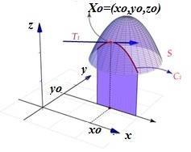

# Unidad 4 — Derivabilidad: derivadas parciales y direccionales

Resumen del material teórico de la unidad ([U04-Teoria-Derivadas-Parciales-Direccionales.pdf](../aula-virtual/04-Derivabilidad/U04-Teoria-Derivadas-Parciales-Direccionales.pdf)), de los apuntes [Derivadas de campos vectoriales](../aula-virtual/04-Derivabilidad/Derivadas-Campos-Vectoriales.pdf) e [Interpretación geométrica de las derivadas direccionales](../aula-virtual/04-Derivabilidad/Interpretacion-Geometrica-Derivadas-Direccionales.pdf), y del [pizarrón de clase](../aula-virtual/04-Derivabilidad/Pizarron-2025-05-06-Derivadas-Direccionales.pdf), complementado con el [resumen de UTNianos](../UTNianos/Resumen%20AM2.pdf).

**Objetivos de la unidad:**

1. Entender la derivada respecto de una dirección como razón de cambio en esa dirección.
2. Conocer las relaciones (y las **no** relaciones) entre continuidad, derivadas parciales y derivadas direccionales.
3. Calcular la recta tangente y el plano normal a una curva.

---

## 1. Recta tangente y plano normal a una curva

Sea $C$ una curva parametrizada por $\vec g(t) = (x(t), y(t), z(t))$, con $\vec g(t_0) = \vec A$.

- La **derivada** de una función vectorial se calcula componente a componente: $\vec g'(t) = (x'(t), y'(t), z'(t))$.
- Si $\vec g'(t_0) \ne \vec 0$, es un **vector tangente** a $C$ en $\vec A$.

**Recta tangente en $\vec A$:**

$$\vec X = \vec A + u\,\vec g'(t_0), \quad u \in \mathbb{R}$$

**Plano normal en $\vec A$** (el plano perpendicular a la tangente):

$$\vec g'(t_0)\cdot(\vec X - \vec A) = 0$$

**Curva definida como intersección de dos superficies.** Si $C = S_1 \cap S_2$, primero hay que **parametrizarla**. Lo habitual es despejar dos variables en función de la tercera, o usar $\cos$ y $\operatorname{sen}$ si aparece una circunferencia. Recién después se deriva.

**Curva plana / alabeada:**

- Es **plana** si está contenida en un plano.
- Si no lo está, es **alabeada**.
- **Para probar que es alabeada:** se toman 3 puntos no alineados de la curva, se halla el (único) plano que los contiene y se muestra un cuarto punto de la curva que no está en ese plano.

---

## 2. Derivadas parciales

**Definición:** para $f: A \subseteq \mathbb{R}^n \to \mathbb{R}$ y $\vec x_0 = (a_1, \dots, a_n)$:

$$\frac{\partial f}{\partial x_i}(\vec x_0) = f'_{x_i}(\vec x_0) = \lim_{h\to0}\frac{f(a_1, \dots, a_i + h, \dots, a_n) - f(a_1, \dots, a_n)}{h}$$

**Cálculo práctico:** se derivan como en Análisis I, considerando **constantes** a todas las otras variables. Por ejemplo, $f = 2x^2y^3 - 2x + 3y + 7$ da $f'_x = 4xy^3 - 2$ y $f'_y = 6x^2y^2 + 3$.

**¿Cuándo hay que usar la definición (el límite)?** Cuando la regla práctica **no se puede aplicar**:

- en funciones definidas **por partes**, en los puntos de "costura";
- en puntos donde la fórmula de la derivada no está definida, aunque $f$ sí lo esté (por ejemplo, $\sqrt{x^2 + y^2}$ en el origen);
- con valores absolutos o raíces de expresiones que se anulan.

En esos casos, que la fórmula de la derivada no esté definida **no prueba** que la derivada no exista: hay que ir a la definición.

**Interpretación geométrica:**

- $f'_x(x_0,y_0)$ es la **pendiente de la recta tangente** a la curva que se obtiene al cortar la superficie $z = f(x,y)$ con el plano vertical $y = y_0$.
- Lo mismo vale para $f'_y$ con el plano $x = x_0$.

**Derivadas de integrales** (teorema fundamental del cálculo, combinado con la regla de la cadena):

$$\frac{\partial}{\partial x}\int_{a(x,y)}^{b(x,y)} g(t)\,dt = g(b)\,b'_x - g(a)\,a'_x$$

---

## 3. Derivada direccional y derivada respecto de un vector

**Definición:** para $\vec r \ne \vec 0$,

$$f'(\vec A, \vec r) = \frac{\partial f}{\partial \vec r}(\vec A) = \lim_{h\to0}\frac{f(\vec A + h\,\vec r) - f(\vec A)}{h}$$

- Si $\vec r$ es **unitario** (un versor, $\|\vec r\| = 1$), se llama **derivada direccional**. Mide la razón de cambio de $f$ por unidad de longitud en esa dirección.
- Si $\vec r$ no es unitario se llama **derivada respecto del vector** $\vec r$. El versor de la dirección es $\breve r = \vec r/\|\vec r\|$, y sus componentes son los cosenos directores.
- Las **derivadas parciales** son las direccionales según los versores canónicos: $f'(\vec A, \breve e_k) = f'_{x_k}(\vec A)$.

**Cálculo práctico (siempre válido):** se define la función de una variable $g(t) = f(\vec A + t\vec r)$ (la restricción de $f$ a la recta) y entonces $f'(\vec A, \vec r) = g'(0)$.

**Interpretación geométrica:**

- Es la pendiente de la recta tangente a la curva que se obtiene al cortar la superficie con el **plano vertical** que contiene a la recta $\vec A + t\breve r$.
- El vector tangente a esa curva es $(r_1, r_2, f'(\vec A, \breve r))$.

**Propiedades:**

- **Homogeneidad:** $f'(\vec A, \lambda\vec r) = \lambda\,f'(\vec A, \vec r)$ para $\lambda \ne 0$. En particular, $f'(\vec A, -\vec r) = -f'(\vec A, \vec r)$.
- Si $L$ es una **transformación lineal**: $L'(\vec A, \vec r) = L(\vec r)$.
- **Campos vectoriales:** la derivada direccional se calcula componente a componente.

> **Ojo:** la propiedad $f'(\vec A, \vec u + \vec v) = f'(\vec A, \vec u) + f'(\vec A, \vec v)$ (aditividad) **no vale en general**. Vale para funciones lineales y, como se verá en la Unidad 5, para funciones diferenciables.

---

## 4. Derivabilidad y continuidad: ¡no se implican!

A diferencia de Análisis I, en varias variables:

| Afirmación | ¿Es cierta? | Contraejemplo |
|---|---|---|
| Existen las derivadas parciales ⇒ $f$ es continua | **NO** | $f = \frac{xy}{x^2+y^2}$, $f(0,0)=0$: las parciales en el origen valen 0, pero $f$ es discontinua |
| Existen **todas** las derivadas direccionales ⇒ $f$ es continua | **NO** | $f = \frac{x^3y}{x^6+y^2}$, $f(0,0)=0$: todas las direccionales valen 0, pero sobre $y = x^3$ el límite es $\frac12$ |
| $f$ continua ⇒ existen las parciales | **NO** | $f = \sqrt{x^2+y^2}$, o $f = \sqrt{4x^2 + y^2}$ |
| Existen las parciales ⇒ existen todas las direccionales | **NO** | $x^{1/3}y^{1/3}$: sólo existen según $\pm\breve e_1$ y $\pm\breve e_2$ |

Las derivadas parciales y direccionales son una noción **débil** (derivada de Gâteaux): sólo miran a la función **sobre rectas**. Por eso hace falta un concepto más fuerte, la **diferenciabilidad** (Unidad 5).

---

## 5. Derivadas de orden superior y teorema de Schwarz

$$f''_{xy} = \frac{\partial}{\partial y}\left(\frac{\partial f}{\partial x}\right) = \frac{\partial^2 f}{\partial y\,\partial x}$$

Con la notación de subíndices **se deriva en el orden en que se leen** ($f''_{xy}$: primero respecto de $x$, después de $y$).

Para $n$ variables hay $n^2$ derivadas segundas.

**Las derivadas mixtas pueden ser distintas.** Por ejemplo, $g = xy\dfrac{x^2-y^2}{x^2+y^2}$ tiene $g''_{xy}(0,0) = -1$ y $g''_{yx}(0,0) = 1$.

**Teorema de Schwarz:** si $f''_{xy}$ y $f''_{yx}$ existen en un entorno de $(x_0,y_0)$ y son **continuas** en ese punto, entonces

$$f''_{xy}(x_0,y_0) = f''_{yx}(x_0,y_0)$$

**Consecuencia:** si $f \in C^k$ (todas las derivadas hasta orden $k$ son continuas), el orden en que se deriva no importa hasta el orden $k$.

### Ecuaciones en derivadas parciales clásicas

- **Ecuación de onda:** $y''_{tt} = a^2\,y''_{xx}$.
- **Ecuación de Laplace** (funciones **armónicas**): $\Delta f = f''_{xx} + f''_{yy}\ (+ f''_{zz}) = 0$.

---

## 6. Complementos: derivada de una función vectorial y curvas

**Repaso (una variable):** $f'(x_0) = \lim\limits_{x\to x_0}\dfrac{f(x) - f(x_0)}{x - x_0}$. Puede ser un número, infinito o no existir; $f$ es **derivable** si el límite existe y es **finito**. Geométricamente, el cociente incremental es la pendiente de una recta secante, y su límite es la pendiente de la **recta tangente**.

**Vector derivado** de $\vec f: A \subseteq \mathbb{R} \to \mathbb{R}^n$ en $t_0$ (interior):

$$\vec f\,'(t_0) = \lim_{\Delta t\to0}\frac{\vec f(t_0 + \Delta t) - \vec f(t_0)}{\Delta t}$$

**Teorema:** $\vec f$ es derivable en $t_0$ si y sólo si **cada componente** $f_i$ lo es, y $\vec f\,'(t_0) = (f_1'(t_0), \dots, f_n'(t_0))$. Se demuestra igual que para límites: el límite de un vector existe si y sólo si existen los de sus componentes.

**Por qué $\vec f\,'(t_0)$ es tangente:** $\vec f(t_0 + \Delta t) - \vec f(t_0)$ es la **cuerda** entre dos puntos de la curva; al dividir por $\Delta t$ y hacer $\Delta t \to 0$, la cuerda tiende a la dirección **tangente**.

**Ecuaciones simétricas de la recta tangente** (si todas las $f_i'(t_0) \ne 0$):

$$\frac{x - f_1(t_0)}{f_1'(t_0)} = \frac{y - f_2(t_0)}{f_2'(t_0)} = \frac{z - f_3(t_0)}{f_3'(t_0)}$$

**Plano normal (cartesiana):** $f_1'(t_0)(x - f_1(t_0)) + f_2'(t_0)(y - f_2(t_0)) + f_3'(t_0)(z - f_3(t_0)) = 0$.

**Puntos regulares y singulares:**

- $P_0 \in C$ es **regular** si existe la recta tangente: hay una parametrización continua $\vec f$ de $C$ con $\vec f\,'(t_0)$ existente y **no nulo**, $P_0 = \vec f(t_0)$.
- Los demás son **singulares**. Una curva admite muchas parametrizaciones: puede que en una el vector derivado sea nulo y en otra no.
- Si $\vec f$ es **inyectiva** en $[a,b]$, la curva es **simple**.
- Si $\vec f\,'$ es **continua y no nula** en todo $[a,b]$, la curva es **lisa** (suave).

**Derivadas sucesivas de funciones vectoriales:** también componente a componente, $\vec f^{(n)}(t) = (f_1^{(n)}(t), \dots, f_m^{(n)}(t))$.

---

## 7. Complementos: incrementos, teorema del valor medio y gradiente

**Incrementos** de $z = F(x,y)$ en $P_0 = (a, b)$:

- **Parciales:** $\Delta_xF = F(a + h, b) - F(a, b)$ (sólo varía $x$) y $\Delta_yF = F(a, b + k) - F(a, b)$.
- **Total:** $\Delta F = F(a + h, b + k) - F(a, b)$. Es la variación de $z$ sobre la curva que se obtiene cortando la superficie con el plano vertical que contiene a $P_0$ y $(a + h, b + k)$.

Las derivadas parciales son $F'_x = \lim\limits_{h\to0}\dfrac{\Delta_xF}{h}$ y $F'_y = \lim\limits_{k\to0}\dfrac{\Delta_yF}{k}$.

### Teorema del valor medio para campos escalares

**Repaso (Lagrange):** si $f$ es continua en $[a,b]$ y derivable en $(a,b)$, existe $c \in (a,b)$ con $f(b) - f(a) = f'(c)(b - a)$: hay una tangente paralela a la cuerda.

**Teorema:** si existe $F'(\vec x; \breve v)$ en un conjunto que contiene a $\vec x_0$, a $\vec x_0 + t\breve v$ y al segmento que los une, entonces

$$\exists\,c \in (0, t) : \quad F(\vec x_0 + t\breve v) - F(\vec x_0) = t\cdot F'(\vec x_0 + c\breve v;\ \breve v)$$

**Demostración.** Sea $\varphi(s) = F(\vec x_0 + s\breve v)$, $s \in [0, t]$. Como existe la derivada direccional sobre el segmento, $\varphi$ es derivable (y por lo tanto continua). Por Lagrange, $\varphi(t) - \varphi(0) = t\,\varphi'(c)$. Y por definición:

$$\varphi'(c) = \lim_{\lambda\to0}\frac{F(\vec x_0 + c\breve v + \lambda\breve v) - F(\vec x_0 + c\breve v)}{\lambda} = F'(\vec x_0 + c\breve v;\ \breve v) \quad\blacksquare$$

### Aditividad de las derivadas direccionales

Si $F$ tiene derivadas direccionales **continuas** en $\vec x_0$ respecto de $\breve u$ y $\breve v$, y $\vec w = \breve u + \breve v$:

$$F'(\vec x_0; \vec w) = F'(\vec x_0; \breve u) + F'(\vec x_0; \breve v)$$

**Demostración.** Se suma y resta $F(\vec x_0 + t\breve u)$ en el numerador:

$$\frac{F(\vec x_0 + t\breve u + t\breve v) - F(\vec x_0)}{t} = \frac{F(\vec x_0 + t\breve u) - F(\vec x_0)}{t} + \frac{F(\vec x_0 + t\breve u + t\breve v) - F(\vec x_0 + t\breve u)}{t}$$

El primer término tiende a $F'(\vec x_0; \breve u)$. Al segundo se le aplica el TVM: es $F'(\vec x_0 + t\breve u + \alpha\breve v;\ \breve v)$ con $\alpha$ entre 0 y $t$, que por la **continuidad** tiende a $F'(\vec x_0; \breve v)$. $\blacksquare$

### Derivada direccional en función de las parciales

Un versor se escribe con sus **cosenos directores**: $\breve v = \sum\cos\alpha_i\,\breve e_i$. Si las parciales son continuas en $\vec x_0$, por homogeneidad y aditividad:

$$F'(\vec x_0; \breve v) = \sum_i\cos\alpha_i\,\frac{\partial F}{\partial x_i}(\vec x_0) = \nabla F(\vec x_0)\cdot\breve v$$

En tres variables: $F'(\vec x_0; \breve v) = F'_x\cos\alpha_1 + F'_y\cos\alpha_2 + F'_z\cos\alpha_3$.

**Gradiente:** si $F$ tiene todas las parciales en $B$, el gradiente es el campo vectorial $\nabla F = \left(\dfrac{\partial F}{\partial x_1}, \dots, \dfrac{\partial F}{\partial x_n}\right)$. La derivada direccional es la **proyección** de $\nabla F(\vec x_0)$ sobre $\breve v$. (La dirección de máximo crecimiento y sus consecuencias están en la Unidad 5.)

**Ejemplo:** $F = x^2 - 2xy$, $P_0 = (1,1)$, $\breve v = \left(-\frac{\sqrt2}{2}, \frac{\sqrt2}{2}\right)$.

- Por definición: $\dfrac{F(1 - t\frac{\sqrt2}{2},\ 1 + t\frac{\sqrt2}{2}) - F(1,1)}{t} = \dfrac{-\sqrt2\,t + \frac32t^2}{t} \to -\sqrt2$.
- Con el gradiente: $\nabla F(1,1) = (2x - 2y,\ -2x) = (0, -2)$, y $(0,-2)\cdot\breve v = -\sqrt2$ ✓.

**Cuidado:** si las parciales no son continuas, la fórmula del gradiente puede fallar. Por ejemplo, $F = \dfrac{xy^2}{x^2 + y^2}$ ($F(0,0) = 0$) tiene $F'(\vec 0; (h,k)) = hk^2 = h - h^3$, que es máxima en **dos** direcciones $\left(\frac{1}{\sqrt3}, \pm\sqrt{\frac23}\right)$; con un gradiente habría una sola.

---

## 8. Complementos: derivadas de campos vectoriales y matriz jacobiana

Para $\vec F: A \subseteq \mathbb{R}^n \to \mathbb{R}^m$:

- **Derivada direccional:** $\vec F'(\vec X_0; \breve v) = \lim\limits_{t\to0}\dfrac{\vec F(\vec X_0 + t\breve v) - \vec F(\vec X_0)}{t} = (F_1'(\vec X_0;\breve v), \dots, F_m'(\vec X_0;\breve v))$, componente a componente. Respecto de un vector cualquiera $\vec v$ se define igual.
- Si las derivadas de las componentes son continuas, valen la **homogeneidad** y la **aditividad**.
- **Derivadas parciales:** son las direccionales según los versores canónicos: $\dfrac{\partial\vec F}{\partial x_j} = \left(\dfrac{\partial F_1}{\partial x_j}, \dots, \dfrac{\partial F_m}{\partial x_j}\right)$.

**Matriz jacobiana** (matriz derivada) $D\vec F(\vec X)$, de $m \times n$:

$$D\vec F = \begin{pmatrix} \frac{\partial F_1}{\partial x_1} & \cdots & \frac{\partial F_1}{\partial x_n} \\ \vdots & & \vdots \\ \frac{\partial F_m}{\partial x_1} & \cdots & \frac{\partial F_m}{\partial x_n} \end{pmatrix}$$

- Las **filas** son los gradientes de cada componente.
- Las **columnas** son los vectores derivados respecto de cada variable.

**Ejemplo:** $\vec F(x,y,z) = (2x^2y + z,\ 2z^2x + 3y)$ ⇒ $D\vec F = \begin{pmatrix} 4xy & 2x^2 & 1 \\ 2z^2 & 3 & 4zx \end{pmatrix}$.

**Derivada direccional con la jacobiana:** si $\vec F$ tiene derivadas parciales continuas en $\vec X_0$,

$$\vec F'(\vec X_0; \breve v) = D\vec F(\vec X_0)\cdot\breve v$$

(cada fila da $\nabla F_i\cdot\breve v$).

---

## 9. Complementos: cantidad de derivadas sucesivas

- Un campo escalar de $n$ variables tiene $n$ derivadas primeras, $n^2$ segundas, …, $n^k$ derivadas de orden $k$.
- Si se cumplen las hipótesis de Schwarz, de las $n^2$ derivadas segundas sólo $\dfrac{n(n+1)}{2}$ son distintas.
- En general, el número de derivadas de orden $k$ distintas es el de **combinaciones con repetición**: $\dbinom{n + k - 1}{k}$. Por ejemplo, un campo de 3 variables tiene $\binom{6}{4} = 15$ derivadas de 4.º orden distintas.

**Teorema de Schwarz (versión con hipótesis más débiles):** si existen $F'_x$, $F'_y$ y $F''_{xy}$ en un entorno de $(x_0,y_0)$ y $F''_{xy}$ es **continua** en $(x_0,y_0)$, entonces existe $F''_{yx}(x_0,y_0)$ y es igual a $F''_{xy}(x_0,y_0)$. Vale para cualquier cantidad de variables, porque al derivar respecto de dos de ellas las demás quedan constantes.

**Ejemplo de derivadas cruzadas distintas:** $F = \dfrac{3x^3y - 2xy^3}{x^2 + y^2}$ con $F(0,0) = 0$.

- Por definición, $F'_x(0,0) = F'_y(0,0) = 0$, y con la regla del cociente $F'_x(0,k) = -2k$ y $F'_y(h,0) = 3h$.
- $F''_{xy}(0,0) = \lim\limits_{k\to0}\dfrac{F'_x(0,k) - 0}{k} = -2$ y $F''_{yx}(0,0) = \lim\limits_{h\to0}\dfrac{F'_y(h,0) - 0}{h} = 3$.

Son distintas porque las derivadas segundas no son continuas en el origen (no se cumple Schwarz).

---

## 10. Estrategia para los ejercicios

1. **Recta tangente / plano normal:** parametrizar la curva, hallar $t_0$ tal que $\vec g(t_0) = \vec A$, derivar y usar las fórmulas de la sección 1.
2. **Parciales con regla práctica:** derivar respecto de una variable tratando las demás como constantes. Indicar **dónde** quedan definidas.
3. **Parciales o direccionales "por definición":**
   - Escribir el cociente incremental $\dfrac{f(\vec A + h\vec r) - f(\vec A)}{h}$.
   - En funciones por partes, ver **qué fórmula** corresponde a $\vec A + h\vec r$, que puede depender del signo de $h$ y de la dirección.
   - Calcular el límite (laterales si hace falta).
4. **"Derivable en distintas direcciones":** tomar $\vec r = (a, b)$ con $a^2 + b^2 = 1$, separar casos (por ejemplo $a = 0$ y $a \ne 0$) y ver para cuáles existe el límite.
5. **Verificar EDP:** calcular las derivadas necesarias y reemplazar.

---

## 11. Resumen de fórmulas

| Concepto | Fórmula |
|---|---|
| Parcial | $f'_{x_i}(\vec A) = \lim\limits_{h\to0}\dfrac{f(\vec A + h\breve e_i) - f(\vec A)}{h}$ |
| Respecto de $\vec r$ | $f'(\vec A, \vec r) = \lim\limits_{h\to0}\dfrac{f(\vec A + h\vec r) - f(\vec A)}{h} = g'(0)$, con $g(t) = f(\vec A + t\vec r)$ |
| Versor | $\breve r = \vec r/\lVert\vec r\rVert$ |
| Homogeneidad | $f'(\vec A, \lambda\vec r) = \lambda f'(\vec A, \vec r)$ |
| Recta tangente | $\vec X = \vec g(t_0) + u\,\vec g'(t_0)$ |
| Plano normal | $\vec g'(t_0)\cdot(\vec X - \vec g(t_0)) = 0$ |
| Schwarz | $f''_{xy} = f''_{yx}$ si son continuas |
| Laplaciano | $\Delta f = \sum f''_{x_ix_i}$ |

---

[← Volver al menú principal](../README.md)
