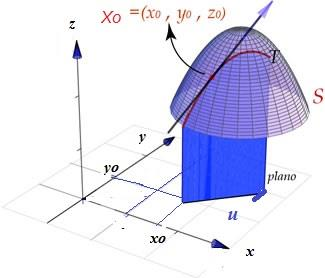

# Unidad 4 — Derivabilidad: derivadas parciales y direccionales

Resumen del material teórico de la unidad ([U04-Teoria-Derivadas-Parciales-Direccionales.pdf](../aula-virtual/04-Derivabilidad/U04-Teoria-Derivadas-Parciales-Direccionales.pdf)), de los apuntes [Derivadas de campos vectoriales](../aula-virtual/04-Derivabilidad/Derivadas-Campos-Vectoriales.pdf) e [Interpretación geométrica de las derivadas direccionales](../aula-virtual/04-Derivabilidad/Interpretacion-Geometrica-Derivadas-Direccionales.pdf), y del [pizarrón de clase](../aula-virtual/04-Derivabilidad/Pizarron-2025-05-06-Derivadas-Direccionales.pdf).

**Objetivos de la unidad:**

1. Entender la derivada respecto de una dirección como razón de cambio en esa dirección.
2. Conocer las relaciones (y las **no** relaciones) entre continuidad, derivadas parciales y derivadas direccionales.
3. Calcular la recta tangente y el plano normal a una curva.

---

## 1. Recta tangente y plano normal a una curva

Sea $C$ una curva parametrizada por $\vec g(t) = (x(t), y(t), z(t))$, con $\vec g(t_0) = \vec A$.

- La **derivada** de una función vectorial se calcula componente a componente: $\vec g'(t) = (x'(t), y'(t), z'(t))$.
- Si $\vec g'(t_0) \ne \vec 0$, es un **vector tangente** a $C$ en $\vec A$.

**Recta tangente en $\vec A$:**

$$\vec X = \vec A + u\,\vec g'(t_0), \quad u \in \mathbb{R}$$

**Plano normal en $\vec A$** (el plano perpendicular a la tangente):

$$\vec g'(t_0)\cdot(\vec X - \vec A) = 0$$

**Curva definida como intersección de dos superficies.** Si $C = S_1 \cap S_2$, primero hay que **parametrizarla**. Lo habitual es despejar dos variables en función de la tercera, o usar $\cos$ y $\operatorname{sen}$ si aparece una circunferencia. Recién después se deriva.

**Curva plana / alabeada:**

- Es **plana** si está contenida en un plano.
- Si no lo está, es **alabeada**.
- **Para probar que es alabeada:** se toman 3 puntos no alineados de la curva, se halla el (único) plano que los contiene y se muestra un cuarto punto de la curva que no está en ese plano.

---

## 2. Derivadas parciales

**Definición:** para $f: A \subseteq \mathbb{R}^n \to \mathbb{R}$ y $\vec x_0 = (a_1, \dots, a_n)$:

$$\frac{\partial f}{\partial x_i}(\vec x_0) = f'_{x_i}(\vec x_0) = \lim_{h\to0}\frac{f(a_1, \dots, a_i + h, \dots, a_n) - f(a_1, \dots, a_n)}{h}$$

**Cálculo práctico:** se derivan como en Análisis I, considerando **constantes** a todas las otras variables. Por ejemplo, $f = 2x^2y^3 - 2x + 3y + 7$ da $f'_x = 4xy^3 - 2$ y $f'_y = 6x^2y^2 + 3$.

**¿Cuándo hay que usar la definición (el límite)?** Cuando la regla práctica **no se puede aplicar**:

- en funciones definidas **por partes**, en los puntos de "costura";
- en puntos donde la fórmula de la derivada no está definida, aunque $f$ sí lo esté (por ejemplo, $\sqrt{x^2 + y^2}$ en el origen);
- con valores absolutos o raíces de expresiones que se anulan.

En esos casos, que la fórmula de la derivada no esté definida **no prueba** que la derivada no exista: hay que ir a la definición.

**Interpretación geométrica:**

- $f'_x(x_0,y_0)$ es la **pendiente de la recta tangente** a la curva que se obtiene al cortar la superficie $z = f(x,y)$ con el plano vertical $y = y_0$.
- Lo mismo vale para $f'_y$ con el plano $x = x_0$.

**Derivadas de integrales** (teorema fundamental del cálculo, combinado con la regla de la cadena):

$$\frac{\partial}{\partial x}\int_{a(x,y)}^{b(x,y)} g(t)\,dt = g(b)\,b'_x - g(a)\,a'_x$$

---

## 3. Derivada direccional y derivada respecto de un vector

**Definición:** para $\vec r \ne \vec 0$,

$$f'(\vec A, \vec r) = \frac{\partial f}{\partial \vec r}(\vec A) = \lim_{h\to0}\frac{f(\vec A + h\,\vec r) - f(\vec A)}{h}$$

- Si $\vec r$ es **unitario** (un versor, $\|\vec r\| = 1$), se llama **derivada direccional**. Mide la razón de cambio de $f$ por unidad de longitud en esa dirección.
- Si $\vec r$ no es unitario se llama **derivada respecto del vector** $\vec r$. El versor de la dirección es $\breve r = \vec r/\|\vec r\|$, y sus componentes son los cosenos directores.
- Las **derivadas parciales** son las direccionales según los versores canónicos: $f'(\vec A, \breve e_k) = f'_{x_k}(\vec A)$.

**Cálculo práctico (siempre válido):** se define la función de una variable $g(t) = f(\vec A + t\vec r)$ (la restricción de $f$ a la recta) y entonces $f'(\vec A, \vec r) = g'(0)$.

**Interpretación geométrica:**

- Es la pendiente de la recta tangente a la curva que se obtiene al cortar la superficie con el **plano vertical** que contiene a la recta $\vec A + t\breve r$.
- El vector tangente a esa curva es $(r_1, r_2, f'(\vec A, \breve r))$.

**Propiedades:**

- **Homogeneidad:** $f'(\vec A, \lambda\vec r) = \lambda\,f'(\vec A, \vec r)$ para $\lambda \ne 0$. En particular, $f'(\vec A, -\vec r) = -f'(\vec A, \vec r)$.
- Si $L$ es una **transformación lineal**: $L'(\vec A, \vec r) = L(\vec r)$.
- **Campos vectoriales:** la derivada direccional se calcula componente a componente.

> **Ojo:** la propiedad $f'(\vec A, \vec u + \vec v) = f'(\vec A, \vec u) + f'(\vec A, \vec v)$ (aditividad) **no vale en general**. Vale para funciones lineales y, como se verá en la Unidad 5, para funciones diferenciables.

---

## 4. Derivabilidad y continuidad: ¡no se implican!

A diferencia de Análisis I, en varias variables:

| Afirmación | ¿Es cierta? | Contraejemplo |
|---|---|---|
| Existen las derivadas parciales ⇒ $f$ es continua | **NO** | $f = \frac{xy}{x^2+y^2}$, $f(0,0)=0$: las parciales en el origen valen 0, pero $f$ es discontinua |
| Existen **todas** las derivadas direccionales ⇒ $f$ es continua | **NO** | $f = \frac{x^3y}{x^6+y^2}$, $f(0,0)=0$: todas las direccionales valen 0, pero sobre $y = x^3$ el límite es $\frac12$ |
| $f$ continua ⇒ existen las parciales | **NO** | $f = \sqrt{x^2+y^2}$, o $f = \sqrt{4x^2 + y^2}$ |
| Existen las parciales ⇒ existen todas las direccionales | **NO** | $x^{1/3}y^{1/3}$: sólo existen según $\pm\breve e_1$ y $\pm\breve e_2$ |

Las derivadas parciales y direccionales son una noción **débil** (derivada de Gâteaux): sólo miran a la función **sobre rectas**. Por eso hace falta un concepto más fuerte, la **diferenciabilidad** (Unidad 5).

---

## 5. Derivadas de orden superior y teorema de Schwarz

$$f''_{xy} = \frac{\partial}{\partial y}\left(\frac{\partial f}{\partial x}\right) = \frac{\partial^2 f}{\partial y\,\partial x}$$

Con la notación de subíndices **se deriva en el orden en que se leen** ($f''_{xy}$: primero respecto de $x$, después de $y$).

Para $n$ variables hay $n^2$ derivadas segundas.

**Las derivadas mixtas pueden ser distintas.** Por ejemplo, $g = xy\dfrac{x^2-y^2}{x^2+y^2}$ tiene $g''_{xy}(0,0) = -1$ y $g''_{yx}(0,0) = 1$.

**Teorema de Schwarz:** si $f''_{xy}$ y $f''_{yx}$ existen en un entorno de $(x_0,y_0)$ y son **continuas** en ese punto, entonces

$$f''_{xy}(x_0,y_0) = f''_{yx}(x_0,y_0)$$

**Consecuencia:** si $f \in C^k$ (todas las derivadas hasta orden $k$ son continuas), el orden en que se deriva no importa hasta el orden $k$.

### Ecuaciones en derivadas parciales clásicas

- **Ecuación de onda:** $y''_{tt} = a^2\,y''_{xx}$.
- **Ecuación de Laplace** (funciones **armónicas**): $\Delta f = f''_{xx} + f''_{yy}\ (+ f''_{zz}) = 0$.

---

## 6. Estrategia para los ejercicios

1. **Recta tangente / plano normal:** parametrizar la curva, hallar $t_0$ tal que $\vec g(t_0) = \vec A$, derivar y usar las fórmulas de la sección 1.
2. **Parciales con regla práctica:** derivar respecto de una variable tratando las demás como constantes. Indicar **dónde** quedan definidas.
3. **Parciales o direccionales "por definición":**
   - Escribir el cociente incremental $\dfrac{f(\vec A + h\vec r) - f(\vec A)}{h}$.
   - En funciones por partes, ver **qué fórmula** corresponde a $\vec A + h\vec r$, que puede depender del signo de $h$ y de la dirección.
   - Calcular el límite (laterales si hace falta).
4. **"Derivable en distintas direcciones":** tomar $\vec r = (a, b)$ con $a^2 + b^2 = 1$, separar casos (por ejemplo $a = 0$ y $a \ne 0$) y ver para cuáles existe el límite.
5. **Verificar EDP:** calcular las derivadas necesarias y reemplazar.

---

## 7. Resumen de fórmulas

| Concepto | Fórmula |
|---|---|
| Parcial | $f'_{x_i}(\vec A) = \lim\limits_{h\to0}\dfrac{f(\vec A + h\breve e_i) - f(\vec A)}{h}$ |
| Respecto de $\vec r$ | $f'(\vec A, \vec r) = \lim\limits_{h\to0}\dfrac{f(\vec A + h\vec r) - f(\vec A)}{h} = g'(0)$, con $g(t) = f(\vec A + t\vec r)$ |
| Versor | $\breve r = \vec r/\lVert\vec r\rVert$ |
| Homogeneidad | $f'(\vec A, \lambda\vec r) = \lambda f'(\vec A, \vec r)$ |
| Recta tangente | $\vec X = \vec g(t_0) + u\,\vec g'(t_0)$ |
| Plano normal | $\vec g'(t_0)\cdot(\vec X - \vec g(t_0)) = 0$ |
| Schwarz | $f''_{xy} = f''_{yx}$ si son continuas |
| Laplaciano | $\Delta f = \sum f''_{x_ix_i}$ |

---

[← Volver al menú principal](../README.md)
