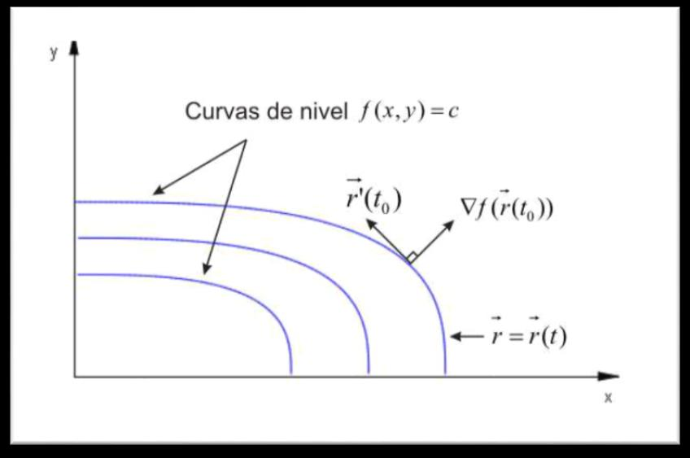
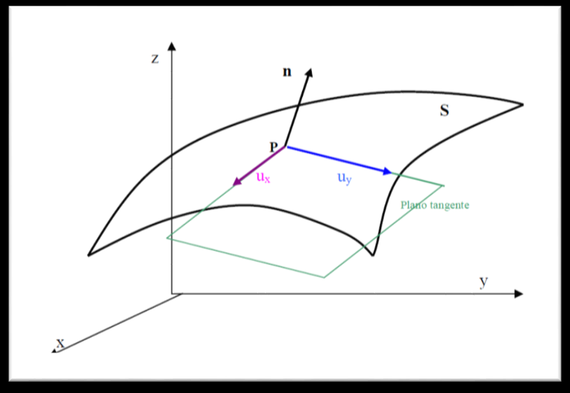

# Unidad 5 — Diferenciabilidad, plano tangente y recta normal

Resumen del material teórico de la unidad ([U05-Teoria-Diferenciabilidad.pdf](../aula-virtual/05-Diferenciabilidad/U05-Teoria-Diferenciabilidad.pdf)), del apunte [Diferenciabilidad de un campo vectorial](../aula-virtual/05-Diferenciabilidad/Diferenciabilidad-Campo-Vectorial.pdf) y del [pizarrón de clase](../aula-virtual/05-Diferenciabilidad/Pizarron-2025-06-03-Diferencial-Compuestas.pdf), complementado con el [resumen de UTNianos](../UTNianos/Resumen%20AM2.pdf).

**Objetivos de la unidad:**

1. Comprender el concepto de diferenciabilidad como "aproximación lineal" de la función.
2. Relacionar diferenciabilidad, continuidad y derivadas direccionales.
3. Usar el gradiente: derivada direccional, dirección de máximo crecimiento, plano tangente.
4. Usar el diferencial para aproximar valores y propagar errores.

---

## 1. Idea: aproximar por una función lineal

En una variable, $f$ es derivable en $x_0$ si y sólo si

$$f(x_0 + h) = f(x_0) + f'(x_0)\thinspace h + |h|\thinspace\varphi(h), \quad \text{con } \varphi(h) \xrightarrow[h\to0]{} 0$$

Es decir, cerca de $x_0$ la función se parece a la recta tangente, y el error es más chico que $h$. La parte lineal, $df = f'(x_0)\thinspace h$, es el **diferencial**.

En varias variables, la mera existencia de derivadas parciales o direccionales **no** alcanza para tener una buena aproximación lineal (Unidad 4). Por eso se define una noción más fuerte.

---

## 2. Definición de diferenciabilidad

**Campo escalar.** $f: A \subseteq \mathbb{R}^n \to \mathbb{R}$ es **diferenciable** en $\vec A$ (interior a $A$) si existe una transformación lineal $T(\vec h) = \vec c\cdot\vec h$ tal que

$$f(\vec A + \vec h) - f(\vec A) = T(\vec h) + \Vert\vec h\Vert\thinspace\varphi(\vec h), \qquad \lim_{\vec h\to\vec 0}\varphi(\vec h) = 0$$

Si $f$ es diferenciable, necesariamente $\vec c = \nabla f(\vec A)$, y la condición queda:

$$\boxed{\lim_{\vec h\to\vec 0}\frac{f(\vec A + \vec h) - f(\vec A) - \nabla f(\vec A)\cdot\vec h}{\Vert\vec h\Vert} = 0}$$

**Cómo probar diferenciabilidad por definición en $\vec A$:**

1. Calcular las parciales en $\vec A$ (por definición si hace falta) ⇒ $\nabla f(\vec A)$.
2. Plantear el límite del recuadro y ver si es 0.
   - Si da 0, es diferenciable.
   - Si no existe o da otra cosa, no lo es.

**Campo vectorial.** $\vec f: \mathbb{R}^n \to \mathbb{R}^m$ es diferenciable si y sólo si **cada componente** lo es. La transformación lineal se representa con la **matriz jacobiana**:

$$D\vec f(\vec A) = \begin{pmatrix} \frac{\partial f_1}{\partial x_1} & \cdots & \frac{\partial f_1}{\partial x_n} \cr \vdots & & \vdots \cr \frac{\partial f_m}{\partial x_1} & \cdots & \frac{\partial f_m}{\partial x_n} \end{pmatrix}_{\vec A}$$

Tiene $m$ filas (una por componente; cada fila es el gradiente de esa componente) y $n$ columnas (una por variable). Para un campo escalar, $Df(\vec A)$ es la matriz fila $\nabla f(\vec A)$.

**Gradiente:**

$$\nabla f(\vec A) = \left(\frac{\partial f}{\partial x_1}(\vec A), \dots, \frac{\partial f}{\partial x_n}(\vec A)\right)$$

---

## 3. Consecuencias de la diferenciabilidad

Si $f$ es diferenciable en $\vec A$:

1. **Es continua** en $\vec A$.
2. **Tiene derivada en toda dirección**, y además:

$$\boxed{f'(\vec A, \vec r) = \nabla f(\vec A)\cdot\vec r}$$

   Esto vale para todo $\vec r$, no sólo para versores.
3. Las derivadas direccionales son **lineales** en $\vec r$: $f'(\vec A, \vec u + \vec v) = f'(\vec A, \vec u) + f'(\vec A, \vec v)$.
4. **Existe plano tangente** a la gráfica en $(\vec A, f(\vec A))$.

**Criterios para probar que NO es diferenciable** (contrarrecíprocos):

- $f$ no es continua en $\vec A$.
- Falta alguna derivada direccional.
- Existe alguna dirección con $f'(\vec A, \breve r) \ne \nabla f(\vec A)\cdot\breve r$.
- Las direccionales no son lineales en $\breve r$. Por ejemplo, si $f'(\vec 0, (u,v)) = u^2 v$, que no es de la forma $au + bv$.

---

## 4. Condición suficiente: funciones $C^1$

**Teorema:** si las derivadas parciales **existen en un entorno** de $\vec A$ y son **continuas en $\vec A$**, entonces $f$ es diferenciable en $\vec A$.

- $f \in C^1(W)$ significa que todas las parciales de 1.er orden son continuas en $W$. Entonces $f$ es diferenciable en todo $W$.
- Polinomios, exponenciales, senos, etc. (y sus combinaciones) son $C^1$ en el interior de su dominio, donde sus derivadas también son elementales.

**Cadena de implicaciones** (ninguna recíproca vale en general):

$$C^1 \ \Rightarrow\ \text{diferenciable} \ \Rightarrow\ \begin{cases}\text{continua} \cr \text{derivable en toda dirección, con } f' = \nabla f\cdot\breve r\end{cases}$$

---

## 5. Gradiente y derivada direccional

Si $f$ es diferenciable y $\breve r$ es un versor que forma un ángulo $\alpha$ con $\nabla f$:

$$f'(\vec A, \breve r) = \nabla f(\vec A)\cdot\breve r = \Vert\nabla f(\vec A)\Vert\cos\alpha$$

| Dirección | Versor | Valor de la derivada |
|---|---|---|
| **Máxima** | $\breve r = \dfrac{\nabla f}{\lVert\nabla f\rVert}$ | $\lVert\nabla f(\vec A)\rVert$ |
| **Mínima** | $\breve r = -\dfrac{\nabla f}{\lVert\nabla f\rVert}$ | $-\lVert\nabla f(\vec A)\rVert$ |
| **Nula** | $\breve r \perp \nabla f$ | $0$ |

En $\mathbb{R}^2$ hay dos versores de derivada nula: si $\nabla f = (a, b)$, son $\pm\dfrac{(-b, a)}{\lVert\nabla f\rVert}$.

**El gradiente es perpendicular a los conjuntos de nivel:**

- Si $\vec r(t)$ es una curva contenida en la curva de nivel $f = c$, entonces $f(\vec r(t)) = c$. Derivando, $\nabla f\cdot\vec r\thinspace'(t) = 0$.
- En $\mathbb{R}^3$, el gradiente es perpendicular a las superficies de nivel.

---

## 6. Plano tangente y recta normal

**Superficie dada como gráfica $z = f(x,y)$**, diferenciable en $(x_0, y_0)$, con $z_0 = f(x_0, y_0)$:

$$\text{Plano tangente: } \ z = z_0 + f'_x(x_0,y_0)\thinspace(x - x_0) + f'_y(x_0,y_0)\thinspace(y - y_0)$$

$$\text{Recta normal: } \ \vec X = (x_0, y_0, z_0) + t\thinspace\big(f'_x,\ f'_y,\ -1\big)$$

**Plano tangente "horizontal"** (paralelo al plano $xy$): ocurre donde $\nabla f = \vec 0$.

**Superficie dada en forma implícita $F(x,y,z) = 0$** (es una superficie de nivel de $F$), con $F \in C^1$ y $\nabla F(\vec A) \ne \vec 0$:

$$\text{Plano tangente: } \ \nabla F(\vec A)\cdot(\vec X - \vec A) = 0, \qquad \text{Recta normal: } \ \vec X = \vec A + t\thinspace\nabla F(\vec A)$$

**Superficie dada en forma paramétrica** $\vec X(u, v)$, con $\vec X(u_0, v_0) = \vec A$:

$$\vec n = \vec X'_u \times \vec X'_v \Big|_{(u_0, v_0)}$$

- $\vec A$ es un **punto regular** si $\vec n \ne \vec 0$ (con $\vec X \in C^1$).
- El plano tangente es $\vec n\cdot(\vec X - \vec A) = 0$ y la recta normal es $\vec A + t\thinspace\vec n$.

> Una gráfica $z = f(x,y)$ con $f \in C^1$ siempre es regular, porque su normal $(f'_x, f'_y, -1)$ nunca es nula.

---

## 7. Diferencial y aproximación lineal

$$df(\vec A, \vec h) = \nabla f(\vec A)\cdot\vec h = \sum_i f'_{x_i}(\vec A)\thinspace h_i$$

**Aproximación lineal** (equivale a "moverse por el plano tangente"):

$$f(\vec A + \vec h) \approx f(\vec A) + \nabla f(\vec A)\cdot\vec h$$

**Cómo se usa:** para calcular $f(\vec X)$ cerca de un punto "cómodo" $\vec A$, se toma $\vec h = \vec X - \vec A$.

**Ejemplo:** para calcular $\sqrt{25 - 2(1{,}96)^2 - (0{,}96)^2}$, se usa $\vec A = (2, 1)$ y $\vec h = (-0{,}04;\ -0{,}04)$.

- $\Delta f = f(\vec A + \vec h) - f(\vec A)$ es el incremento verdadero, y $df$ es su aproximación lineal.
- Son iguales para todo $\vec h$ sólo si $f$ es **afín** (lineal + constante).

---

## 8. Propagación de errores

Si $w = f(x_1, \dots, x_n)$ y cada $x_i$ se mide con error absoluto $\varepsilon_{x_i}$:

$$\varepsilon_w \approx \sum_{i=1}^n \left|f'_{x_i}(\vec A)\right|\varepsilon_{x_i}$$

**Error relativo:** $\varepsilon_{\text{rel}} = \dfrac{\varepsilon_w}{|w|}$. Para productos y cocientes de potencias:

$$w = x^a y^b \ \Rightarrow\ \varepsilon_{\text{rel}\thinspace w} = |a|\thinspace\varepsilon_{\text{rel}\thinspace x} + |b|\thinspace\varepsilon_{\text{rel}\thinspace y}$$

---

## 9. Complementos: transformaciones lineales y diferencial en una variable

**Transformación lineal (T.L.).** $T: U \to V$ es lineal si $T(\vec x + \vec y) = T(\vec x) + T(\vec y)$ y $T(\lambda\vec x) = \lambda T(\vec x)$.

- De $\mathbb{R}$ en $\mathbb{R}$ son $T(x) = kx$: rectas por el origen.
- De $\mathbb{R}^2$ en $\mathbb{R}$ son $T(x,y) = ax + by$: planos por el origen.
- De $\mathbb{R}^n$ en $\mathbb{R}$ son $T(\vec x) = \sum a_ix_i$, con $a_i = T(\breve e_i)$. Son polinomios, así que son **continuas**.
- Una T.L. queda definida por las imágenes de una base. Su **matriz asociada** (de $m\times n$) tiene por columnas las imágenes de los versores canónicos. Ejemplo: $T(x,y) = (2x,\ 3y,\ x - y)$ tiene $T(1,0) = (2,0,1)$, $T(0,1) = (0,3,-1)$ y matriz $\begin{pmatrix} 2 & 0 \cr 0 & 3 \cr 1 & -1 \end{pmatrix}$.

**Diferencial en una variable.** Si $f$ es derivable en $x_0$, el cociente incremental es su límite más un infinitésimo:

$$f(x) - f(x_0) = f'(x_0)(x - x_0) + \varphi(x)(x - x_0), \qquad \varphi(x) \xrightarrow[x\to x_0]{} 0$$

El término $df(x_0; \Delta x) = f'(x_0)\thinspace\Delta x$ es el **diferencial**: es la variación de la ordenada de la **recta tangente** al pasar de $x_0$ a $x_0 + \Delta x$, una aproximación lineal de $\Delta f$. Como $f'(x_0)$ es constante, $df$ es una T.L. de $\mathbb{R}$ en $\mathbb{R}$. Esta forma ("existe una T.L. $T$ con $f(x) - f(x_0) = T(x - x_0) +$ resto") es la que se generaliza a varias variables.

**Ejemplo de por qué hace falta algo más que las parciales:** $F(x,y) = x^{1/3}y^{1/3}$ tiene $F'_x(0,0) = F'_y(0,0) = 0$, así que el "candidato" a plano tangente sería $z = 0$; pero la superficie no tiene plano tangente en el origen.

---

## 10. Complementos: demostraciones de las propiedades

Sea $F$ diferenciable en $\vec x_0$: $F(\vec x) - F(\vec x_0) = T(\vec x - \vec x_0) + \varphi(\vec x - \vec x_0)\thinspace\lVert\vec x - \vec x_0\rVert$, con $\varphi \to 0$.

**Diferenciable ⇒ continua.** Tomando límite: $T$ es continua y $T(\vec 0) = 0$, y el segundo término es infinitésimo por acotado. Entonces $\lim[F(\vec x) - F(\vec x_0)] = 0$. $\blacksquare$

**Diferenciable ⇒ existen las parciales, y la matriz de $T$ es la jacobiana.** Sea $M = (a_{11} \dots a_{1n})$ la matriz de $T$. Con $\vec x = \vec x_0 + h\breve e_k$ (así $\lVert\vec x - \vec x_0\rVert = |h|$):

$$\frac{F(\vec x_0 + h\breve e_k) - F(\vec x_0)}{h} = \frac{h\thinspace T(\breve e_k)}{h} + \underbrace{\varphi(h\breve e_k)\frac{|h|}{h}}_{\to\thinspace0} \ \Rightarrow\ \frac{\partial F}{\partial x_k}(\vec x_0) = T(\breve e_k) = a_{1k} \quad\blacksquare$$

**Diferenciable ⇒ existen todas las direccionales, con $F'(\vec x_0;\breve v) = \nabla F(\vec x_0)\cdot\breve v$.** Igual que antes con $\vec x = \vec x_0 + t\breve v$: el cociente es $T(\breve v) + \varphi(t\breve v)\frac{|t|}{t} \to T(\breve v) = \nabla F\cdot\breve v$. $\blacksquare$

**Condición suficiente: parciales continuas en un entorno ⇒ diferenciable.** Por el TVM (Unidad 4), $F(\vec x_0 + t\breve v) - F(\vec x_0) = t\thinspace F'(\vec x_0 + c\breve v; \breve v)$, y como las parciales son continuas, esa derivada vale $\sum\frac{\partial F}{\partial x_k}(\vec x_0 + c\breve v)\cos\alpha_k$. Por la continuidad, cada $\frac{\partial F}{\partial x_k}(\vec x_0 + c\breve v) = \frac{\partial F}{\partial x_k}(\vec x_0) + \varepsilon_k$ con $\varepsilon_k \to 0$. Queda:

$$F(\vec x_0 + t\breve v) - F(\vec x_0) = \nabla F(\vec x_0)\cdot t\breve v + |t|\thinspace\underbrace{\tfrac{t}{|t|}\sum\varepsilon_k\cos\alpha_k}_{\to\thinspace0}$$

que es la definición de diferenciable. $\blacksquare$

**Campos vectoriales.** $\vec F: \mathbb{R}^n \to \mathbb{R}^m$ es diferenciable en $\vec x_0$ si existe una T.L. $T: \mathbb{R}^n \to \mathbb{R}^m$ con $\vec F(\vec x) - \vec F(\vec x_0) = T(\vec x - \vec x_0) + \lVert\vec x - \vec x_0\rVert\thinspace\vec\varphi$, $\vec\varphi \to \vec 0$. Valen las mismas propiedades: diferenciable ⇒ continua, con parciales y con todas las direccionales; y parciales continuas en un entorno ⇒ diferenciable.

---

## 11. Complementos: diferencial total y plano tangente

**Diferencial total** de $F$ en $\vec x_0$: es la T.L. de la definición, aplicada al incremento:

$$dF_{\vec x_0} = T(\vec x - \vec x_0) = \sum_{i=1}^n F'_{x_i}(\vec x_0)\thinspace(x_i - x_{i0}) = \sum_{i=1}^n F'_{x_i}(\vec x_0)\thinspace dx_i$$

**Plano tangente como lugar geométrico.** El plano tangente a $z = F(x,y)$ en $P_0$ es el lugar de las rectas tangentes a **todas** las curvas de la superficie que pasan por $P_0$.

1. Cortando con $x = a$ se obtiene una curva con tangente de dirección $\vec v_1 = (0,\ 1,\ F'_y)$; cortando con $y = b$, otra con $\vec v_2 = (1,\ 0,\ F'_x)$. El plano por $P_0$ paralelo a $\vec v_1$ y $\vec v_2$ es:

$$F'_x(x_0,y_0)(x - x_0) + F'_y(x_0,y_0)(y - y_0) - (z - z_0) = 0$$

2. Cortando con un plano vertical en la dirección $\alpha$, la tangente tiene $\vec v_3 = (\cos\alpha,\ \mathop{\mathrm{sen}}\alpha,\ F'_ {\breve u})$. Si $F$ es diferenciable, $F'_ {\breve u} = F'_ x\cos\alpha + F'_ y\mathop{\mathrm{sen}}\alpha$, y entonces el producto mixto $[\vec v_1, \vec v_2, \vec v_3] = 0$: las tres tangentes son **coplanares**. Por eso el plano existe sólo si $F$ es diferenciable.

**Recta normal (forma simétrica):**

$$\frac{x - x_0}{F'_x(x_0,y_0)} = \frac{y - y_0}{F'_y(x_0,y_0)} = \frac{z - F(x_0,y_0)}{-1}$$

El segundo miembro de la ecuación del plano tangente es justamente $dF(x_0,y_0)$: **el diferencial es la variación de la $z$ del plano tangente** al pasar de $(x_0,y_0)$ a $(x,y)$.

---

## 12. Estrategia para los ejercicios

**¿Es diferenciable en $\vec A$?**

1. Si $f$ es $C^1$ cerca de $\vec A$ (las parciales son elementales y continuas), **sí**.
2. Si no, ver si es continua en $\vec A$. Si no es continua, **no** es diferenciable.
3. Calcular las direccionales por definición y compararlas con $\nabla f\cdot\breve r$. Si alguna no coincide (o no existe), **no** es diferenciable.
4. Si todo coincide, verificar el límite de la definición.

**Problemas con gradiente:**

- Máximo crecimiento ⇒ dirección de $\nabla f$.
- Derivada direccional ⇒ $\nabla f\cdot\breve r$.
- Si te dan dos derivadas direccionales de una $f \in C^1$, plantear $\nabla f\cdot\vec r_i =$ dato y resolver el sistema para obtener $\nabla f$.

**Aproximaciones:** elegir $\vec A$ cercano con valores "redondos" y usar $f(\vec A) + \nabla f\cdot\vec h$.

---

## 13. Resumen de fórmulas

| Concepto | Fórmula |
|---|---|
| Diferenciable | $\lim\limits_{\vec h\to0}\dfrac{f(\vec A + \vec h) - f(\vec A) - \nabla f(\vec A)\cdot\vec h}{\lVert\vec h\rVert} = 0$ |
| Derivada direccional | $f'(\vec A, \vec r) = \nabla f(\vec A)\cdot\vec r$ |
| Derivada máxima | $\lVert\nabla f(\vec A)\rVert$, en la dirección de $\nabla f$ |
| Plano tangente ($z = f$) | $z = z_0 + f'_x\thinspace(x - x_0) + f'_y\thinspace(y - y_0)$ |
| Normal ($z = f$) | $(f'_x, f'_y, -1)$ |
| Normal ($F = 0$) | $\nabla F$ |
| Normal (paramétrica) | $\vec X'_u \times \vec X'_v$ |
| Diferencial | $df = \nabla f\cdot\vec h$ |
| Aproximación | $f(\vec A + \vec h) \approx f(\vec A) + df$ |
| Error absoluto | $\varepsilon_w = \sum \lvert f'_ {x_i}\rvert\thinspace\varepsilon_{x_i}$ |

---

[← Volver al menú principal](../README.md)
