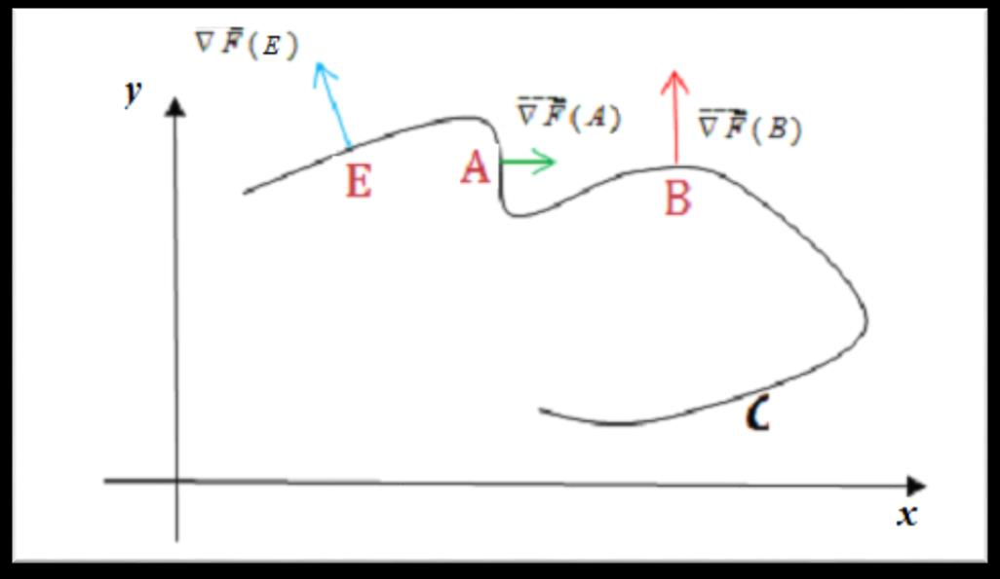

# Unidad 6 — Funciones compuestas e implícitas

Resumen del material teórico de la unidad ([U06-Teoria-Funciones-Implicitas.pdf](../aula-virtual/06-Compuestas-Implicitas/U06-Teoria-Funciones-Implicitas.pdf)) y de la parte de regla de la cadena del [pizarrón de clase de la Unidad 5](../aula-virtual/05-Diferenciabilidad/Pizarron-2025-06-03-Diferencial-Compuestas.pdf).

**Objetivos de la unidad:**

1. Componer funciones de varias variables y derivarlas con la regla de la cadena.
2. Entender cuándo una ecuación $F = 0$ define implícitamente una función (teorema de Cauchy-Dini).
3. Derivar funciones definidas implícitamente sin despejarlas.

---

## 1. Composición de funciones

Dadas $\vec g: D_g \subseteq \mathbb{R}^n \to \mathbb{R}^m$ y $\vec f: D_f \subseteq \mathbb{R}^m \to \mathbb{R}^p$, la composición es

$$(\vec f\circ\vec g)(\vec x) = \vec f(\vec g(\vec x))$$

**Condiciones para que quede definida:**

1. **Dimensiones compatibles:** la cantidad de componentes de $\vec g$ ($m$) tiene que ser igual a la cantidad de variables de $\vec f$.
2. **Dominio natural:** $D_{f\circ g} = \{\vec x \in D_g : \vec g(\vec x) \in D_f\}$. Si es vacío, la composición no queda definida.

**Truco para "descomponer" una función** (por ejemplo $h = x\ln(1 - xy)$): se busca una función "de afuera" simple y se ponen en $\vec g$ las expresiones de adentro: $f(u,v) = u\ln v$ con $\vec g(x,y) = (x,\ 1 - xy)$.

---

## 2. Regla de la cadena

**Teorema:** si $\vec g$ es diferenciable en $\vec A$ y $\vec f$ es diferenciable en $\vec g(\vec A)$, entonces $\vec f\circ\vec g$ es diferenciable en $\vec A$ y

$$\boxed{D(\vec f\circ\vec g)(\vec A) = D\vec f(\vec g(\vec A))\cdot D\vec g(\vec A)}$$

Es un **producto de matrices jacobianas**, y el orden importa: primero la de afuera evaluada en $\vec g(\vec A)$, después la de adentro.

**Caso típico:** $z = f(u, v)$ con $u = u(x,y)$ y $v = v(x,y)$:

$$\frac{\partial z}{\partial x} = \frac{\partial f}{\partial u}\frac{\partial u}{\partial x} + \frac{\partial f}{\partial v}\frac{\partial v}{\partial x}, \qquad \frac{\partial z}{\partial y} = \frac{\partial f}{\partial u}\frac{\partial u}{\partial y} + \frac{\partial f}{\partial v}\frac{\partial v}{\partial y}$$

**Árbol de dependencias:** para cada variable final se suman los productos de derivadas a lo largo de **todos los caminos** que llevan de $z$ a esa variable. Si $z$ depende de $x$ también en forma directa (por ejemplo, $w = u^3 - xv^2$), ese camino directo también suma.

**A lo largo de una curva:** si $\vec X(t)$ es una curva y $T = f(\vec X(t))$:

$$\frac{dT}{dt} = \nabla f(\vec X(t))\cdot\vec X'(t)$$

**Cuidado con las hipótesis:** si $\vec f$ **no** es diferenciable en $\vec g(\vec A)$, la regla de la cadena **no se puede aplicar**, aunque la composición resulte diferenciable. Por ejemplo, $f(u,v) = |u - 1| - v$ con $\vec g = (1 + x^2, 2y - 1)$ da $h = x^2 - 2y + 1$, que es $C^\infty$.

### Funciones homogéneas de grado 0

Si $z = f\!\left(\dfrac{x^2 - y^2}{x^2 + y^2}\right)$, o en general $z = f(t)$ con $t$ homogénea de grado 0, entonces $x z'_x + y z'_y = 0$. Es un caso particular de la **identidad de Euler** ($x f'_x + y f'_y = k f$ para homogéneas de grado $k$).

---

## 3. Funciones definidas implícitamente

**Definición:** la ecuación $F(x,y) = 0$ define implícitamente $y = f(x)$ cerca de $(x_0,y_0)$ si $y_0 = f(x_0)$ y $F(x, f(x)) = 0$ para todo $x$ en un entorno de $x_0$.

No toda ecuación define una función:

- $2x^2 + y^2 + 2 = 0$ no tiene soluciones.
- $2x^2 + y^2 = 0$ sólo tiene el punto $(0,0)$.
- $xy = 0$ son dos rectas que se cruzan: cerca del origen no es el gráfico de una única función.

### Teorema de la función implícita (Cauchy-Dini) — 2 variables

**Hipótesis:**

1. $F \in C^1$ en un entorno de $(x_0, y_0)$.
2. $F(x_0, y_0) = 0$.
3. $F'_y(x_0, y_0) \ne 0$.

**Tesis:** existe un intervalo $I \ni x_0$ y una **única** $f \in C^1(I)$ con $f(x_0) = y_0$ y $F(x, f(x)) = 0$. Además:

$$\boxed{f'(x) = -\frac{F'_x(x, f(x))}{F'_y(x, f(x))}}$$

Si en cambio $F'_x \ne 0$, se puede despejar $x = \varphi(y)$, con $\varphi' = -F'_y/F'_x$.

**De dónde sale la fórmula:** se deriva $F(x, f(x)) = 0$ con la regla de la cadena: $F'_x + F'_y\,f'(x) = 0$, y se despeja $f'$.

**Interpretación geométrica:** $\nabla F$ es normal a la curva $F = 0$.

- Si $F'_y = 0$, el gradiente es horizontal y la tangente es vertical (punto $A$ de la figura): ahí no se puede escribir $y = f(x)$.
- Si $F'_x = 0$, la tangente es horizontal (punto $B$): ahí no se puede escribir $x = \varphi(y)$.

### Teorema para 3 variables

**Hipótesis:** $F(x,y,z) \in C^1$, $F(\vec A) = 0$, $F'_z(\vec A) \ne 0$.

**Tesis:** $F = 0$ define $z = f(x,y)$ ($C^1$) en un entorno de $(x_0,y_0)$, con

$$\boxed{f'_x = -\frac{F'_x}{F'_z}, \qquad f'_y = -\frac{F'_y}{F'_z}}$$

**Plano tangente** a la superficie $F = 0$: $\nabla F(\vec A)\cdot(\vec X - \vec A) = 0$. Es equivalente a usar el plano tangente de $z = f(x,y)$ con las derivadas de arriba.

### Curva intersección de dos superficies

Si $F, G \in C^1$, $F(\vec A) = G(\vec A) = 0$ y

$$\vec d = \nabla F(\vec A)\times\nabla G(\vec A) \ne \vec 0$$

entonces $F = 0$, $G = 0$ definen una curva regular cerca de $\vec A$, cuya **recta tangente** tiene dirección $\vec d$. La tangente es perpendicular a las dos normales, por eso se usa el producto vectorial.

### Sistemas de ecuaciones y funciones implícitas compuestas

Cuando una variable intermedia viene definida implícitamente (por ejemplo, $u = f(x,y)$ dada por $2y - ux - \ln u = 0$):

1. Hallar el valor de $u$ en el punto, resolviendo la ecuación (a veces "a ojo").
2. Calcular $u'_x$ y $u'_y$ con las fórmulas de Cauchy-Dini.
3. Usarlas dentro de la regla de la cadena.

---

## 4. Estrategia para los ejercicios

1. **Composición:** identificar quién es la función "de afuera" y quién la "de adentro", chequear dimensiones y dominios, y multiplicar jacobianas **en el orden correcto** evaluando la de afuera en $\vec g(\vec A)$.
2. **Derivadas en un punto:** conviene calcular primero **todos los valores numéricos** (las variables intermedias en el punto, cada derivada parcial) y recién al final armar la suma de la regla de la cadena.
3. **Implícitas:**
   - encontrar la coordenada faltante del punto;
   - verificar $F'_z \ne 0$ (hipótesis de Cauchy-Dini);
   - usar $f'_x = -F'_x/F'_z$.
4. **Aproximación lineal de una implícita:** $f(x,y) \approx z_0 + f'_x(x - x_0) + f'_y(y - y_0)$.
5. **Verificar identidades** (como $x h'_x + y h'_y = 0$): derivar en forma genérica con la regla de la cadena y simplificar.

---

## 5. Resumen de fórmulas

| Situación | Fórmula |
|---|---|
| Regla de la cadena (matricial) | $D(\vec f\circ\vec g)(\vec A) = D\vec f(\vec g(\vec A))\,D\vec g(\vec A)$ |
| $z = f(u,v)$, $u,v$ de $(x,y)$ | $z'_x = f'_u u'_x + f'_v v'_x$ |
| Sobre una curva | $\frac{d}{dt}f(\vec X(t)) = \nabla f\cdot\vec X'(t)$ |
| Implícita $F(x,y) = 0$ | $y' = -F'_x/F'_y$ |
| Implícita $F(x,y,z) = 0$ | $z'_x = -F'_x/F'_z$, $\ z'_y = -F'_y/F'_z$ |
| Plano tangente a $F = 0$ | $\nabla F(\vec A)\cdot(\vec X - \vec A) = 0$ |
| Tangente a $F = 0 \cap G = 0$ | $\vec d = \nabla F\times\nabla G$ |

---

[← Volver al menú principal](../README.md)
