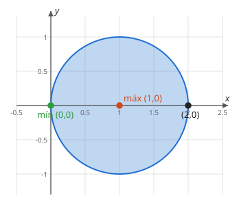
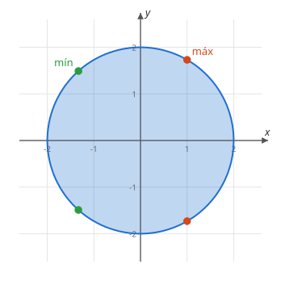
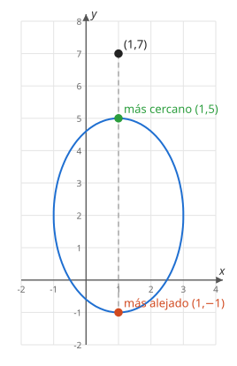
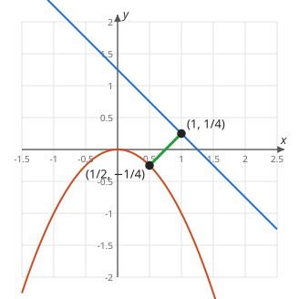

# Unidad 7 — Práctica: Polinomio de Taylor y extremos

Ejercicios del **T.P. N.º 7 de la Guía de Trabajos Prácticos** ([TP07-Taylor-Extremos.pdf](../aula-virtual/07-Taylor-Extremos/TP07-Taylor-Extremos.pdf)). Las respuestas se controlaron con las [respuestas oficiales de la guía](../aula-virtual/00-Guia-TP/Guia-TP-2016-Respuestas.pdf).

Cada ejercicio tiene un botón **Solución**. Al abrirlo aparece la respuesta y, arriba de ella, un segundo botón **Solución paso a paso** con el desarrollo completo.

---

### 01) Reescribir un polinomio de Taylor

Sea $p(x,y) = x^2 - xy + y^3 - 3$ el polinomio de Taylor de 3° orden del campo escalar $f$ en un entorno del punto $(1,2)$.

- a) Expréselo en potencias de $(x - 1)$ e $(y - 2)$.
- b) ¿Cuál es el valor de $f$ en $(1,2)$?, ¿se puede calcular con el polinomio dado sin obtener la forma pedida en "a"?.

<b>Solución</b>

Solución paso a paso

**a)** Cambio de variables $u = x - 1$, $v = y - 2$, o sea $x = 1 + u$, $y = 2 + v$. Desarrollamos cada término:

- $x^2 = 1 + 2u + u^2$.
- $xy = (1+u)(2+v) = 2 + 2u + v + uv$.
- $y^3 = (2 + v)^3 = 8 + 12v + 6v^2 + v^3$.

Sumando $p = x^2 - xy + y^3 - 3$:

- constantes: $1 - 2 + 8 - 3 = 4$;
- términos en $u$: $2u - 2u = 0$;
- términos en $v$: $-v + 12v = 11v$;
- de grado 2: $u^2 - uv + 6v^2$;
- de grado 3: $v^3$.

$$p = 4 + 11v + u^2 - uv + 6v^2 + v^3$$

**b)** El polinomio de Taylor coincide con $f$ **en el punto** (es el término de orden 0). Basta evaluar el polinomio dado: $p(1,2) = 1 - 2 + 8 - 3 = 4$. No hace falta reescribirlo.

**Respuesta:**

- a) $p(x,y) = 4 + 11(y-2) + (x-1)^2 - (x-1)(y-2) + 6(y-2)^2 + (y-2)^3$.
- b) $f(1,2) = 4$. Se puede calcular evaluando el polinomio dato en $(1,2)$.

---

### 02) Mismo plano tangente

Dadas las superficies de ecuación $z = f(x,y)$ y $z = p(x,y)$, donde $p$ es la función polinómica que resulta de desarrollar $f$ en un entorno de $(x_0,y_0)$ hasta el orden $n$, verifique que ambas superficies tienen el mismo plano tangente en el punto $(x_0,y_0,f(x_0,y_0))$.(\*)

(\*) En general, en $(x_0,y_0)$ coinciden los valores de $f$ y $p$ y los de todas sus derivadas hasta el orden $n$ inclusive.

<b>Solución</b>

Solución paso a paso

**Paso 1 — Forma del polinomio** ($n \ge 1$):

$$p(x,y) = f(x_0,y_0) + f'_x(x_0,y_0)\thinspace(x - x_0) + f'_y(x_0,y_0)\thinspace(y - y_0) + (\text{términos de grado} \ge 2)$$

**Paso 2 — Valores en el punto.**

- $p(x_0,y_0) = f(x_0,y_0)$, porque todos los demás términos se anulan.
- $p'_x(x_0,y_0) = f'_x(x_0,y_0)$: al derivar, los términos de grado $\ge 2$ siguen teniendo algún factor $(x - x_0)$ o $(y - y_0)$, que se anula en el punto.
- Por lo mismo, $p'_y(x_0,y_0) = f'_y(x_0,y_0)$.

**Paso 3 — Plano tangente.** El plano tangente de cada superficie es:

$$z = g(x_0,y_0) + g'_x(x_0,y_0)(x - x_0) + g'_y(x_0,y_0)(y - y_0)$$

con $g = f$ o $g = p$. Como coinciden los tres datos, los planos son iguales. Además, es justamente $z = P_1(x,y)$.

**Respuesta:** Se verifica: $f$ y $p$ tienen el mismo valor y las mismas derivadas primeras en $(x_0,y_0)$, que son los únicos datos que determinan el plano tangente.

---

### 03) Desarrollos de Taylor de 2.º orden

Desarrolle los siguientes campos por Taylor hasta 2° orden en un entorno de $\bar A$.

- a) $f(x,y) = x - y\sqrt{6 - x}$, $\ \bar A = (2,3)$.
- b) $f(x,y) = y\ln(x) + x\ln(y - x)$, $\ \bar A = (1,2)$.
- c) $f(x,y,z) = e^{xz} - (z + 1)\sqrt{y - x}$, $\ \bar A = (1,2,0)$.
- d) $f(x,y,z) = \cos(x + y)\thinspace e^{z - x}$, $\ \bar A = (0,0,0)$.

<b>Solución</b>

Solución paso a paso

**Fórmula** ($n = 2$, con $h = x - x_0$, $k = y - y_0$):

$$P_2 = f + f'_x h + f'_y k + \tfrac12\left(f''_{xx}h^2 + 2f''_{xy}hk + f''_{yy}k^2\right)$$

**a)** En $(2,3)$ vale $\sqrt{6 - x} = 2$.

*Valor:* $f = 2 - 3\cdot2 = -4$.

*Primeras derivadas:*

- $f'_x = 1 + \dfrac{y}{2\sqrt{6-x}} \to 1 + \dfrac34 = \dfrac74$.
- $f'_y = -\sqrt{6 - x} \to -2$.

*Segundas derivadas:*

- $f''_{xx} = \dfrac{y}{4(6-x)^{3/2}} \to \dfrac{3}{32}$.
- $f''_{xy} = \dfrac{1}{2\sqrt{6-x}} \to \dfrac14$.
- $f''_{yy} = 0$.

*Armado:*

$$P_2 = -4 + \tfrac74(x-2) - 2(y-3) + \tfrac12\left[\tfrac{3}{32}(x-2)^2 + 2\cdot\tfrac14(x-2)(y-3)\right]$$

**b)** En $(1,2)$: $\ln x = 0$, $y - x = 1$, $\ln(y-x) = 0$.

*Valor:* $f = 0 + 0 = 0$.

*Primeras derivadas:*

- $f'_x = \dfrac{y}{x} + \ln(y-x) - \dfrac{x}{y-x} \to 2 + 0 - 1 = 1$.
- $f'_y = \ln x + \dfrac{x}{y-x} \to 0 + 1 = 1$.

*Segundas derivadas:*

- $f''_{xx} = -\dfrac{y}{x^2} - \dfrac{1}{y-x} - \dfrac{(y-x) + x}{(y-x)^2} \to -2 - 1 - 2 = -5$.
- $f''_{xy} = \dfrac1x + \dfrac{1}{y-x} + \dfrac{x}{(y-x)^2} \to 1 + 1 + 1 = 3$.
- $f''_{yy} = -\dfrac{x}{(y-x)^2} \to -1$.

*Armado:*

$$P_2 = (x-1) + (y-2) + \tfrac12\left[-5(x-1)^2 + 6(x-1)(y-2) - (y-2)^2\right]$$

**c)** En $(1,2,0)$: $e^{xz} = 1$ y $s = \sqrt{y - x} = 1$.

*Valor:* $f = 1 - 1\cdot1 = 0$.

*Primeras derivadas:*

- $f'_x = ze^{xz} + \dfrac{z+1}{2s} \to \dfrac12$.
- $f'_y = -\dfrac{z+1}{2s} \to -\dfrac12$.
- $f'_z = xe^{xz} - s \to 0$.

*Segundas derivadas:* usamos $\dfrac{\partial}{\partial x}(y-x)^{-1/2} = \dfrac12(y-x)^{-3/2}$ y $\dfrac{\partial}{\partial y}(y-x)^{-1/2} = -\dfrac12(y-x)^{-3/2}$.

- $f''_{xx} = z^2e^{xz} + \dfrac{z+1}{4}(y-x)^{-3/2} \to \dfrac14$.
- $f''_{yy} = \dfrac{z+1}{4}(y-x)^{-3/2} \to \dfrac14$.
- $f''_{zz} = x^2e^{xz} \to 1$.
- $f''_{xy} = -\dfrac{z+1}{4}(y-x)^{-3/2} \to -\dfrac14$.
- $f''_{xz} = e^{xz} + xze^{xz} + \dfrac{1}{2s} \to \dfrac32$.
- $f''_{yz} = -\dfrac{1}{2s} \to -\dfrac12$.

*Armado* ($h = x - 1$, $k = y - 2$, $l = z$):

$$P_2 = \tfrac{h}{2} - \tfrac{k}{2} + \tfrac12\left[\tfrac14h^2 + \tfrac14k^2 + l^2 + 2(-\tfrac14)hk + 2\cdot\tfrac32hl + 2(-\tfrac12)kl\right]$$

**d)** Usamos desarrollos conocidos (atajo), con $u = x + y$ y $w = z - x$:

$$\cos u \approx 1 - \frac{u^2}{2}, \qquad e^{w} \approx 1 + w + \frac{w^2}{2}$$

Multiplicamos y nos quedamos con los términos de grado $\le 2$:

$$f \approx 1 + w + \frac{w^2}{2} - \frac{u^2}{2} = 1 + (z - x) + \frac{(z-x)^2}{2} - \frac{(x+y)^2}{2}$$

Desarrollando:

$$1 - x + z + \frac{z^2 - 2xz + x^2}{2} - \frac{x^2 + 2xy + y^2}{2} = 1 - x + z - \frac{y^2}{2} + \frac{z^2}{2} - xy - xz$$

**Respuesta:**

- a) $f(x,y) \cong -4 + \frac74(x-2) - 2(y-3) + \frac{3}{64}(x-2)^2 + \frac14(x-2)(y-3)$.
- b) $f(x,y) \cong (x-1) + (y-2) - \frac52(x-1)^2 + 3(x-1)(y-2) - \frac12(y-2)^2$.
- c) $f(x,y,z) \cong \frac{(x-1)}{2} - \frac{(y-2)}{2} + \frac{(x-1)^2}{8} + \frac{(y-2)^2}{8} + \frac{z^2}{2} - \frac{(x-1)(y-2)}{4} + \frac{3(x-1)z}{2} - \frac{(y-2)z}{2}$.
- d) $f(x,y,z) \cong 1 - x + z - \frac12y^2 + \frac12z^2 - xy - xz$.

---

### 04) Cálculos aproximados

Calcule en forma aproximada:

- a) $0.98^{2.01}$
- b) $\sqrt{3.99} + \sqrt[3]{8.06}$
- c) $8.97 / 3.02$

<b>Solución</b>

Solución paso a paso

**Método:** se elige una función y un punto "cómodo" $\vec A$ cercano, y se usa $f(\vec A + \vec h) \approx f(\vec A) + \nabla f(\vec A)\cdot\vec h$ (Taylor de orden 1).

**a)** $f(x,y) = x^y$, con $\vec A = (1, 2)$ y $\vec h = (-0{,}02;\ 0{,}01)$.

- $f(1,2) = 1$.
- $f'_x = y\thinspace x^{y-1} \to 2$ y $f'_y = x^y\ln x \to 0$.
- $0{,}98^{2{,}01} \approx 1 + 2(-0{,}02) + 0 = 0{,}96$. (Calculadora: $0{,}9602$.)

**b)** $f(x,y) = \sqrt x + \sqrt[3]{y}$, con $\vec A = (4, 8)$ y $\vec h = (-0{,}01;\ 0{,}06)$.

- $f(4,8) = 2 + 2 = 4$.
- $f'_x = \dfrac{1}{2\sqrt x} \to \dfrac14$ y $f'_y = \dfrac{1}{3y^{2/3}} \to \dfrac{1}{12}$.
- $\approx 4 - \dfrac{0{,}01}{4} + \dfrac{0{,}06}{12} = 4 - 0{,}0025 + 0{,}005 = 4{,}0025$.

**c)** $f(x,y) = x/y$, con $\vec A = (9, 3)$ y $\vec h = (-0{,}03;\ 0{,}02)$.

- $f(9,3) = 3$.
- $f'_x = \dfrac1y \to \dfrac13$ y $f'_y = -\dfrac{x}{y^2} \to -1$.
- $\approx 3 - 0{,}01 - 0{,}02 = 2{,}97$. (Calculadora: $2{,}9702$.)

**Respuesta:**

- a) $0.96$
- b) $4.0025$
- c) $2.97$

---

### 05) Hallar $g$ a partir de una aproximación lineal

Dada $f(x,y) = y\thinspace g(x)$ con $g$ derivable, halle $g(x)$ tal que en un entorno del punto $(x_0,y_0)$ con $y_0 \ne 0$ resulte $f(x,y) \cong g(x_0)\thinspace(x + y - x_0)$.

<b>Solución</b>

Solución paso a paso

**Paso 1 — Aproximación lineal de $f$ en $(x_0,y_0)$.** $f'_x = y\thinspace g'(x)$ y $f'_y = g(x)$:

$$f \approx y_0\thinspace g(x_0) + y_0\thinspace g'(x_0)(x - x_0) + g(x_0)(y - y_0)$$

**Paso 2 — Reescribir la expresión pedida** en la misma forma:

$$g(x_0)(x + y - x_0) = g(x_0)(x - x_0) + g(x_0)(y - y_0) + y_0\thinspace g(x_0)$$

**Paso 3 — Igualar coeficientes.** Los términos constantes y los de $(y - y_0)$ ya coinciden. Para el de $(x - x_0)$:

$$y_0\thinspace g'(x_0) = g(x_0)$$

Esto debe valer para todo $x_0$, con $y_0$ fijo.

**Paso 4 — Resolver la EDO.** $g' = \dfrac{g}{y_0} \Rightarrow g(x) = K\thinspace e^{x/y_0}$.

**Respuesta:** $g(x) = K\thinspace e^{x/y_0}$ con $K$ constante arbitraria.

---

### 06) ¿Es extremo $f(0,0)$?

Dada $f : \Re^2 \to \Re$, analice en cada caso si $f(0,0)$ es extremo local; en caso afirmativo clasifíquelo y calcule su valor.

- a) $f(x,y) = 2 + \sqrt{|xy|}$.
- b) $f(x,y) = x^3 + xy^2$.
- c) $f(x,y) = (y - x^3)(x - y^2)$.

<b>Solución</b>

Solución paso a paso

**Método:** como el Hessiano no decide (o $f$ no es diferenciable), se estudia el **signo** de $\Delta f = f(x,y) - f(0,0)$ cerca del origen.

**a)** $f(0,0) = 2$ y $\Delta f = \sqrt{|xy|} \ge 0$ siempre ⇒ **mínimo local**, de valor 2. Es en sentido amplio, porque $\Delta f = 0$ sobre los ejes. Notar que $f$ no es diferenciable en el origen, así que Fermat no aplica: hay que mirar el signo.

**b)** $f(0,0) = 0$ y $f = x(x^2 + y^2)$ tiene el signo de $x$: positiva a la derecha del eje $y$ y negativa a la izquierda. En todo entorno toma valores de ambos signos ⇒ **no es extremo**.

**c)** $f(0,0) = 0$. Sobre el eje $x$ ($y = 0$): $f = (-x^3)(x) = -x^4 < 0$. Sobre la parábola $x = 2y^2$:

$$f = (y - 8y^6)(2y^2 - y^2) = y^3\thinspace(1 - 8y^5)$$

Cerca de 0 esto tiene el signo de $y^3$: positivo para $y > 0$. Toma valores de ambos signos ⇒ **no es extremo**.

*Sugerencia de la guía:* dibujar el conjunto de nivel $f = 0$, es decir la curva $y = x^3$ y la parábola $x = y^2$. Esas curvas dividen el plano en regiones donde $f$ alterna su signo alrededor del origen.

**Respuesta:**

- a) $f(0,0) = 2$ mínimo local.
- b) $f(0,0) = 0$ no es extremo local.
- c) $f(0,0) = 0$ no es extremo local.

---

### 07) Mínimo en sentido amplio

Siendo $f(x,y) = (x + y)^4$, demuestre que $f(-a,a)\ \forall a \in \Re$ es extremo local en sentido amplio.

<b>Solución</b>

Solución paso a paso

- $f(-a, a) = (-a + a)^4 = 0$.
- $f(x,y) = (x + y)^4 \ge 0$ en todo punto, en particular en un entorno de $(-a, a)$.

Entonces $f(x,y) \ge f(-a,a)$ cerca del punto ⇒ **mínimo local**. Es en **sentido amplio** (no estricto) porque en todo entorno hay otros puntos de la recta $x + y = 0$ donde $f$ también vale 0.

El Hessiano no sirve acá: en esos puntos todas las derivadas segundas son 0, porque contienen el factor $(x+y)^2$.

**Respuesta:** Note que $f(-a, a) = 0$ y $f(x,y) \ge 0$ en todo punto, en especial en un entorno de $(-a, a)$.

---

### 08) Extremos relativos y absolutos

Estudie la existencia de extremos relativos (locales) y de extremos absolutos en sus dominios naturales de:

- a) $f(x,y) = x^2 + y^2 + xy^2$.
- b) $f(x,y) = x^3 - x^2 + xy$.
- c) $f(x,y) = \sqrt{y - x}$.
- d) $f(x,y) = \ln(y - x)$.
- e) $f(x,y) = \sqrt{10 - (x - 4)^2 - (y - 2)^2}$.
- f) $f(x,y,z) = x^2 + y^4 + z^3$.

<b>Solución</b>

Solución paso a paso

**a)** *Puntos estacionarios:*

$$f'_x = 2x + y^2 = 0, \qquad f'_y = 2y + 2xy = 2y(1 + x) = 0$$

- $y = 0$ ⇒ $x = 0$: punto $(0,0)$.
- $x = -1$ ⇒ $y^2 = 2$: puntos $(-1, \pm\sqrt2)$.

*Hessiano:* $f''_{xx} = 2$, $f''_{yy} = 2 + 2x$ y $f''_{xy} = 2y$.

- $(0,0)$: $H = 2\cdot2 - 0 = 4 > 0$ y $f''_{xx} > 0$ ⇒ **mínimo relativo**, $f = 0$.
- $(-1, \pm\sqrt2)$: $H = 2\cdot0 - (2\sqrt2)^2 = -8 < 0$ ⇒ silla.

*¿Es absoluto?* No: sobre $x = -2$, $f = 4 + y^2 - 2y^2 = 4 - y^2 \to -\infty$. Tampoco hay máximo absoluto.

**b)** *Puntos estacionarios:* $f'_x = 3x^2 - 2x + y = 0$ y $f'_y = x = 0$ ⇒ $y = 0$. Único punto: $(0,0)$.

*Hessiano:* $f''_{xx} = 6x - 2 \to -2$, $f''_{xy} = 1$ y $f''_{yy} = 0$ ⇒ $H = 0 - 1 = -1 < 0$ ⇒ silla. **No hay extremos.**

**c)** $f = \sqrt{y - x} \ge 0$, con dominio $y \ge x$. Vale 0 exactamente sobre la recta $y = x$ ⇒ **mínimo absoluto, en sentido amplio**, en todos los puntos $(a, a)$. Ahí $f$ no es diferenciable, por eso no aparecen con $\nabla f = 0$. No hay máximo, porque $f$ no es acotada.

**d)** $\nabla f = \left(\dfrac{-1}{y-x}, \dfrac{1}{y-x}\right) \ne \vec 0$ y el dominio $y > x$ es abierto ⇒ **no hay extremos**.

**e)** El dominio es el disco $(x-4)^2 + (y-2)^2 \le 10$ y $f \ge 0$.

- **Máximo:** el radicando es máximo, igual a 10, en el centro $(4,2)$ ⇒ $f(4,2) = \sqrt{10}$ es **máximo local y absoluto estricto**.
- **Mínimo:** sobre la circunferencia borde $f = 0$ ⇒ **mínimo absoluto en sentido amplio** en todos esos puntos.

**f)** *Puntos estacionarios:* $\nabla f = (2x, 4y^3, 3z^2) = \vec 0 \Rightarrow (0,0,0)$.

Pero sobre el eje $z$, $f = z^3$ cambia de signo alrededor de 0 ⇒ **no es extremo**. No hay otros candidatos ⇒ **no produce extremos**.

**Respuesta:**

- a) $f(0,0)$ mínimo relativo.
- b) No produce extremos.
- c) $f(a,a)$ mínimo absoluto (en sentido amplio) para todo $a \in \Re$.
- d) No produce extremos.
- e) $f$ produce mínimo absoluto en sentido amplio $\forall(x,y) \ /\ (x - 4)^2 + (y - 2)^2 = 10$. $f$ produce máximo local y absoluto en sentido estricto en el punto $(4,2)$.
- f) No produce extremos.

---

### 09) Extremos absolutos en un disco

Analice la existencia de extremos absolutos de $f(x,y) = x/(x^2 + y^2 + 1)$ en la región $D = \lbrace(x,y) \in \Re^2 \ /\ x^2 + y^2 \le 2x\rbrace$, identifíquelos e indique en qué puntos se producen.

<b>Solución</b>

Solución paso a paso

**Paso 0 — Existencia.** $D$: $(x - 1)^2 + y^2 \le 1$ es un disco cerrado (compacto), y $f$ es continua (el denominador nunca se anula). Por Weierstrass, **existen** máximo y mínimo absolutos.

**Paso 1 — Interior.** Derivadas:

$$f'_x = \frac{(x^2+y^2+1) - 2x^2}{(x^2+y^2+1)^2} = \frac{1 - x^2 + y^2}{(\cdot)^2}, \qquad f'_y = \frac{-2xy}{(\cdot)^2}$$

- $f'_y = 0$ ⇒ $x = 0$ o $y = 0$.
- $x = 0$: $f'_x = \dfrac{1 + y^2}{(\cdot)^2} \ne 0$ ⇒ no hay puntos.
- $y = 0$: $1 - x^2 = 0 \Rightarrow x = \pm1$. Sólo $(1,0)$ está en el interior de $D$.

Valor: $f(1,0) = \dfrac12$.

**Paso 2 — Frontera** $x^2 + y^2 = 2x$, con $x \in [0, 2]$. Reemplazando:

$$f = \frac{x}{2x + 1} = \varphi(x), \qquad \varphi'(x) = \frac{1}{(2x+1)^2} > 0$$

$\varphi$ es creciente: el mínimo es $\varphi(0) = 0$ en $(0,0)$ y el máximo es $\varphi(2) = \dfrac25$ en $(2,0)$.

**Paso 3 — Comparar** los candidatos: $\frac12$, $0$ y $\frac25$.

- Máximo absoluto: $\frac12$ en $(1,0)$.
- Mínimo absoluto: $0$ en $(0,0)$.

**Respuesta:** $f(1,0) = 1/2$ máximo absoluto, $f(0,0) = 0$ mínimo absoluto.

---

### 10) Planos tangentes horizontales sin extremos

Demuestre que la gráfica de $f(x,y) = 6 + x^3$ tiene infinitos puntos con plano tangente horizontal, pero en ninguno de ellos el valor de $f$ es un extremo.

<b>Solución</b>

Solución paso a paso

**Planos horizontales.** $\nabla f = (3x^2, 0) = \vec 0 \iff x = 0$. Todos los puntos $(0, y)$ (el eje $y$, infinitos puntos) tienen plano tangente $z = 6$.

**No son extremos.** En $(0, y_0)$, $f - 6 = x^3$: es positivo para $x > 0$ y negativo para $x < 0$. Todo entorno de $(0,y_0)$ tiene puntos de ambos tipos ⇒ no es extremo.

**Respuesta:** Los puntos $(0,y)$ con $y \in \Re$, es decir, los puntos del eje $y$.

---

### 11) Densidad de carga máxima y mínima

Una chapa circular plana $S = \lbrace(x,y) \in \Re^2 / x^2 + y^2 \le 4\rbrace$ tiene una densidad de carga electrostática $\sigma(x,y) = 2xy^2 - x^2$ en $\mu\mathrm{Coul/cm^2}$. Halle los puntos de máxima y mínima densidad de carga; no olvide analizar en puntos de la frontera.

<b>Solución</b>

Solución paso a paso

**Paso 1 — Interior.**

$$\sigma'_x = 2y^2 - 2x = 0, \qquad \sigma'_y = 4xy = 0$$

- Si $x = 0$: $y = 0$.
- Si $y = 0$: $x = 0$.

Único punto: $(0,0)$, con $\sigma = 0$.

**Paso 2 — Frontera.** $y^2 = 4 - x^2$, con $x \in [-2, 2]$:

$$\sigma = 2x(4 - x^2) - x^2 = 8x - 2x^3 - x^2 = g(x)$$

$$g'(x) = 8 - 6x^2 - 2x = 0 \ \Rightarrow\ 3x^2 + x - 4 = 0 \ \Rightarrow\ x = \frac{-1 \pm 7}{6} \ \Rightarrow\ x = 1 \ \text{ o } \ x = -\frac43$$

Valores:

- $g(1) = 8 - 2 - 1 = 5$, en $(1, \pm\sqrt3)$.
- $g(-\tfrac43) = -\tfrac{32}{3} + \tfrac{128}{27} - \tfrac{16}{9} = \dfrac{-288 + 128 - 48}{27} = -\dfrac{208}{27} \approx -7{,}70$, en $\left(-\tfrac43, \pm\sqrt{4 - \tfrac{16}{9}}\right) = \left(-\tfrac43, \pm\tfrac{2\sqrt5}{3}\right)$.
- Extremos del intervalo ($x = \pm2$, $y = 0$): $g(\pm2) = -4$.

**Paso 3 — Comparar:** $\lbrace0,\ 5,\ -208/27,\ -4\rbrace$.

- Máximo: 5.
- Mínimo: $-208/27$.

**Respuesta:** Máxima en $(1, \sqrt3)$ y $(1, -\sqrt3)$, con $\sigma = 5$; mínima en $(-4/3,\ 2\sqrt5/3)$ y $(-4/3,\ -2\sqrt5/3)$, con $\sigma = -208/27$.

---

### 12) Extremo a partir del polinomio de Taylor

Aplicando Taylor resulta $f(x,y) \cong 7x + y + xy - y^2 - 4x^2$ en un entorno de $\bar A = (1,1)$; analice si $f(\bar A)$ es extremo local, en caso afirmativo clasifíquelo y calcule su valor.

<b>Solución</b>

Solución paso a paso

El polinomio de Taylor (de orden 2) tiene el mismo valor y las mismas derivadas primeras y segundas que $f$ en $\bar A$. Trabajamos con él, y lo llamamos $p$.

**Paso 1 — ¿Es estacionario?**

- $p'_x = 7 + y - 8x \to 7 + 1 - 8 = 0$ ✓.
- $p'_y = 1 + x - 2y \to 1 + 1 - 2 = 0$ ✓.

**Paso 2 — Hessiano.** $f''_{xx} = -8$, $f''_{xy} = 1$ y $f''_{yy} = -2$ ⇒ $H = 16 - 1 = 15 > 0$, con $f''_{xx} < 0$ ⇒ **máximo local**.

**Paso 3 — Valor.** $f(1,1) = p(1,1) = 7 + 1 + 1 - 1 - 4 = 4$.

**Respuesta:** $f(1,1) = 4$ es máximo local.

---

### 13) Resistores en paralelo

Conectando en paralelo $n$ resistores con resistencias eléctricas $R_1, \dots, R_n$ se obtiene una resistencia eléctrica equivalente $R_{EQ}$ tal que $(R_{EQ})^{-1} = (R_1)^{-1} + \cdots + (R_n)^{-1}$. Sabiendo que $R_1, \dots, R_n$ son positivas, demuestre que $R_{EQ}$ es menor que cada una de ellas (con lo cual es menor que la menor).

<b>Solución</b>

Solución paso a paso

Fijamos un índice $k$. Como todos los $R_i > 0$, todos los términos $\dfrac{1}{R_i}$ son positivos, y entonces (con $n \ge 2$):

$$\frac{1}{R_{EQ}} = \frac{1}{R_k} + \sum_{i \ne k}\frac{1}{R_i} > \frac{1}{R_k}$$

Tomando recíprocos (invierte la desigualdad entre positivos): $R_{EQ} < R_k$.

Como vale para todo $k$, en particular vale para el menor. $\blacksquare$

**Respuesta:** Observe que la suma de números positivos siempre resulta mayor que el mayor de ellos: $\frac{1}{R_{EQ}} > \frac{1}{R_k}$ para cada $k$, y por lo tanto $R_{EQ} < R_k$.

---

### 14) Derivadas segundas de una implícita en un punto estacionario

Dada $z = f(x,y)$ definida implícitamente por $F(x,y,z) = 0$, suponga $F \in C^2$ y el punto $\bar A = (x_0,y_0,z_0) \ /\ F(\bar A) = 0 \ \wedge\ F'_z(\bar A) \ne 0$.

Demuestre que si $(x_0,y_0)$ es punto estacionario de $f$ entonces:

$$f''_{xx}(x_0,y_0) = -\frac{F''_{xx}(\bar A)}{F'_z(\bar A)}, \quad f''_{xy}(x_0,y_0) = -\frac{F''_{xy}(\bar A)}{F'_z(\bar A)}, \quad f''_{yy}(x_0,y_0) = -\frac{F''_{yy}(\bar A)}{F'_z(\bar A)}.$$

<b>Solución</b>

Solución paso a paso

**Paso 1 — Primeras derivadas.** Por Cauchy-Dini, $f'_x = -\dfrac{F'_x(x,y,f(x,y))}{F'_z(x,y,f(x,y))}$. En el punto estacionario $f'_x = f'_y = 0$, y como $F'_z \ne 0$:

$$F'_x(\bar A) = F'_y(\bar A) = 0$$

**Paso 2 — Derivar otra vez.** Derivamos respecto de $x$ el cociente $f'_x = -\dfrac{F'_x}{F'_z}$, teniendo en cuenta que $z = f(x,y)$ también depende de $x$:

$$f''_{xx} = -\frac{\left(F''_{xx} + F''_{xz}\thinspace f'_x\right)F'_z - F'_x\left(F''_{zx} + F''_{zz}\thinspace f'_x\right)}{(F'_z)^2}$$

**Paso 3 — Evaluar en el punto estacionario.** Ahí $f'_x = 0$ y $F'_x = 0$:

$$f''_{xx} = -\frac{F''_{xx}\thinspace F'_z}{(F'_z)^2} = -\frac{F''_{xx}(\bar A)}{F'_z(\bar A)}$$

**Paso 4 — Las otras dos.** Con el mismo razonamiento:

- derivando $f'_x$ respecto de $y$ (usando $f'_y = 0$) se obtiene $f''_{xy} = -\dfrac{F''_{xy}}{F'_z}$;
- derivando $f'_y$ respecto de $y$ (usando $F'_y = 0$) se obtiene $f''_{yy} = -\dfrac{F''_{yy}}{F'_z}$. $\blacksquare$

**Respuesta:** Aplique derivada de función definida implícitamente y derivada de la composición de funciones. Por ejemplo, para obtener la expresión de $f''_{xy}(x_0,y_0)$ tenga en cuenta que $f'_x(x,y) = -\dfrac{F'_x(x,y,z)}{F'_z(x,y,z)}$ con $z = f(x,y)$; al evaluar en el punto estacionario se anulan los términos con $F'_x$, $F'_y$, $f'_x$ y $f'_y$.

---

### 15) Dos funciones implícitas en un elipsoide

Aplicando el teorema de existencia de las funciones definidas implícitamente, demuestre que $x^2 + 4y^2 + z^2 = 36$ define dos funciones $\varphi_1$ y $\varphi_2$ de las variables $x$ e $y$ que producen extremos relativos en $(0,0)$; uno es máximo y el otro es mínimo. Halle las funciones correspondientes e interprete geométricamente.

<b>Solución</b>

Solución paso a paso

**Paso 1 — Puntos con $(x,y) = (0,0)$:** $z^2 = 36 \Rightarrow z = \pm6$.

**Paso 2 — Cauchy-Dini.** $F = x^2 + 4y^2 + z^2 - 36$ es $C^\infty$ y $F'_z = 2z = \pm12 \ne 0$. En cada uno de los dos puntos queda definida una función: $\varphi_1$ (con $z = 6$) y $\varphi_2$ (con $z = -6$).

**Paso 3 — Estacionario.** $\varphi'_x = -\dfrac{2x}{2z}$ y $\varphi'_y = -\dfrac{8y}{2z}$ se anulan en $(0,0)$ ✓.

**Paso 4 — Clasificación** (con el ejercicio 14). $F''_{xx} = 2$, $F''_{yy} = 8$ y $F''_{xy} = 0$.

- $\varphi_1$ ($F'_z = 12$): $\varphi''_{xx} = -\frac{2}{12} < 0$, $\varphi''_{yy} = -\frac{8}{12}$, $\varphi''_{xy} = 0$ ⇒ $H = \frac{16}{144} > 0$ ⇒ **máximo**, $\varphi_1(0,0) = 6$.
- $\varphi_2$ ($F'_z = -12$): $\varphi''_{xx} = \frac{2}{12} > 0$ y $H > 0$ ⇒ **mínimo**, $\varphi_2(0,0) = -6$.

**Paso 5 — Funciones explícitas:** $\varphi_{1,2} = \pm\sqrt{36 - x^2 - 4y^2}$.

**Interpretación:** son las mitades superior e inferior del elipsoide, y los extremos son el "polo norte" $(0,0,6)$ y el "polo sur" $(0,0,-6)$.

**Respuesta:** $\varphi_1(x,y) = \sqrt{36 - x^2 - 4y^2}$, con $\varphi_1(0,0)$ máximo; $\varphi_2(x,y) = -\sqrt{36 - x^2 - 4y^2}$, con $\varphi_2(0,0)$ mínimo.

---

### 16) Extremos de una función implícita en un elipsoide

Dada la superficie $S$ de ecuación $x^2 + 4y^2 + 9z^2 = 1$. Suponiendo una representación del tipo $z = \varphi(x,y)$, ¿en qué puntos $\varphi$ produce extremos locales?, ¿es una única función $\varphi$?.

<b>Solución</b>

Solución paso a paso

**Paso 1 — Estacionarios.** Con $F = x^2 + 4y^2 + 9z^2 - 1$ y $F'_z = 18z \ne 0$ (para $z \ne 0$):

$$\varphi'_x = -\frac{2x}{18z} = 0, \qquad \varphi'_y = -\frac{8y}{18z} = 0 \ \Rightarrow\ (x,y) = (0,0)$$

Ahí $9z^2 = 1 \Rightarrow z = \pm\frac13$.

**Paso 2 — No es única.** Hay dos funciones, una por cada "mitad" del elipsoide: $\varphi_{1,2} = \pm\sqrt{\dfrac{1 - x^2 - 4y^2}{9}}$.

**Paso 3 — Clasificación** (ejercicio 14, con $F''_{xx} = 2$, $F''_{yy} = 8$, $F''_{xy} = 0$):

- $\varphi_1$ ($z = \frac13$, $F'_z = 6$): las derivadas segundas son negativas ⇒ **máximo**, $\frac13$.
- $\varphi_2$ ($z = -\frac13$, $F'_z = -6$): las derivadas segundas son positivas ⇒ **mínimo**, $-\frac13$.

**Respuesta:** No es única. $\varphi_1(x,y) = \sqrt{\dfrac{1 - x^2 - 4y^2}{9}}$, con $\varphi_1(0,0)$ máximo; $\varphi_2(x,y) = -\sqrt{\dfrac{1 - x^2 - 4y^2}{9}}$, con $\varphi_2(0,0)$ mínimo.

---

### 17) Extremos relativos

Analice la existencia de extremos relativos, clasifíquelos y calcule sus valores.

- a) $f(x,y) = 4x^3 + 4y^3 + 12x^{-1} + 12y^{-1}$.
- b) $f(x,y) = x - y^2 - x^3 + 2xy$.
- c) $f(x,y) = (2 - 4x + 3y)^4$. Ejemplo con infinitos puntos de mínimo.
- d) $f(x,y)$ definida implícitamente por $xy - z\cos(yz) + 1 = 0$.
- e) $f(x,y,z) = xy + xz$ en puntos de la superficie de ec. $\bar X = (u,\ u - v,\ v^2)$ con $(u,v) \in \Re^2$.
- f) $f(x,y,z) = z^2(x + 9) - 6y$ en puntos de la recta de ec. $\bar X = (2t,\ 4t,\ t)$ con $t \in \Re$.

<b>Solución</b>

Solución paso a paso

**a)** *Estacionarios:*

$$f'_x = 12x^2 - \frac{12}{x^2} = 0 \Rightarrow x^4 = 1 \Rightarrow x = \pm1, \qquad f'_y = 0 \Rightarrow y = \pm1$$

Hay 4 puntos: $(\pm1, \pm1)$.

*Hessiano:* $f''_{xx} = 24x + \dfrac{24}{x^3}$, $f''_{yy} = 24y + \dfrac{24}{y^3}$ y $f''_{xy} = 0$.

- $(1,1)$: $f''_{xx} = f''_{yy} = 48$ ⇒ $H > 0$ y $f''_{xx} > 0$ ⇒ **mínimo**, $f = 4 + 4 + 12 + 12 = 32$.
- $(-1,-1)$: $f''_{xx} = f''_{yy} = -48$ ⇒ $H > 0$ y $f''_{xx} < 0$ ⇒ **máximo**, $f = -32$.
- $(1,-1)$ y $(-1,1)$: $f''_{xx}$ y $f''_{yy}$ tienen signos opuestos ⇒ $H < 0$ ⇒ silla.

**b)** *Estacionarios:* $f'_y = -2y + 2x = 0 \Rightarrow y = x$. Reemplazando en $f'_x = 1 - 3x^2 + 2y = 0$: $3x^2 - 2x - 1 = 0 \Rightarrow x = 1$ o $x = -\frac13$.

*Hessiano:* $f''_{xx} = -6x$, $f''_{xy} = 2$ y $f''_{yy} = -2$.

- $(1,1)$: $f''_{xx} = -6$ ⇒ $H = 12 - 4 = 8 > 0$ ⇒ **máximo**, $f = 1 - 1 - 1 + 2 = 1$.
- $(-\frac13, -\frac13)$: $f''_{xx} = 2$ ⇒ $H = -4 - 4 = -8 < 0$ ⇒ silla, con $f = -\frac{5}{27}$.

**c)** $f \ge 0$, y $f = 0$ sobre toda la recta $4x - 3y = 2$ ⇒ **mínimo relativo en sentido amplio** en cada punto de esa recta.

**d)** Con $F = xy - z\cos(yz) + 1$, los estacionarios cumplen $F'_x = F'_y = 0$:

- $F'_x = y = 0$.
- $F'_y = x + z^2\mathop{\mathrm{sen}}(yz)$; con $y = 0$ queda $x = 0$.

En $(0,0)$: $0 - z + 1 = 0 \Rightarrow z = 1$. Además $F'_z = -\cos(yz) + yz\mathop{\mathrm{sen}}(yz) = -1 \ne 0$.

Derivadas segundas (ejercicio 14):

- $F''_{xx} = 0$, $F''_{xy} = 1$ y $F''_{yy} = z^3\cos(yz) = 1$.
- $f''_{xx} = 0$, $f''_{xy} = -\frac{1}{-1} = 1$ y $f''_{yy} = 1$.

$H = 0 - 1 < 0$ ⇒ silla ⇒ **no produce extremos**.

**e)** Sustituimos la superficie (queda un problema libre en $u$, $v$):

$$g(u,v) = u(u - v) + u\thinspace v^2 = u^2 - uv + uv^2$$

*Estacionarios:*

$$g'_u = 2u - v + v^2 = 0, \qquad g'_v = -u + 2uv = u(2v - 1) = 0$$

- $u = 0$: $v^2 - v = 0 \Rightarrow v = 0$ o $v = 1$.
- $v = \frac12$: $2u - \frac12 + \frac14 = 0 \Rightarrow u = \frac18$.

*Hessiano:* $g''_{uu} = 2$, $g''_{uv} = -1 + 2v$ y $g''_{vv} = 2u$.

- $(0,0)$ y $(0,1)$: $H = 0 - 1 < 0$ ⇒ sillas.
- $(\frac18, \frac12)$: $H = 2\cdot\frac14 - 0 = \frac12 > 0$ y $g''_{uu} > 0$ ⇒ **mínimo**, $g = \frac{1}{64} - \frac{1}{16} + \frac{1}{32} = -\frac{1}{64}$.

El punto del espacio es $\bar X = (\frac18,\ \frac18 - \frac12,\ \frac14) = (\frac18, -\frac38, \frac14)$.

**f)** Sustituimos la recta: $g(t) = t^2(2t + 9) - 24t = 2t^3 + 9t^2 - 24t$.

$$g'(t) = 6t^2 + 18t - 24 = 6(t + 4)(t - 1) = 0 \ \Rightarrow\ t = -4 \ \text{ o } \ t = 1$$

$g''(t) = 12t + 18$:

- $t = -4$: $g'' = -30 < 0$ ⇒ **máximo**, $g(-4) = -128 + 144 + 96 = 112$, en $(-8,-16,-4)$.
- $t = 1$: $g'' = 30 > 0$ ⇒ **mínimo**, $g(1) = 2 + 9 - 24 = -13$, en $(2,4,1)$.

**Respuesta:**

- a) $f(-1,-1) = -32$ es máximo local, $f(1,1) = 32$ es mínimo local.
- b) $f(-1/3,-1/3) = -5/27$ no es extremo local, $f(1,1) = 1$ es máximo local.
- c) $f$ produce mínimo relativo en sentido amplio en todo punto de la recta $4x - 3y = 2$.
- d) No produce extremos.
- e) $f(1/8,\ -3/8,\ 1/4) = -1/64$ es mínimo relativo.
- f) $f(-8,-16,-4) = 112$ es máximo relativo; $f(2,4,1) = -13$ es mínimo relativo.

---

### 18) Puntos más próximo y más alejado

Determine los puntos de la curva de ecuación $4y^2 - 18x + 9x^2 - 16y = 11$ más próximo y más alejado del punto $(1,7)$.

<b>Solución</b>

Solución paso a paso

**Paso 1 — Reconocer la curva** completando cuadrados:

$$9(x^2 - 2x) + 4(y^2 - 4y) = 11 \ \Rightarrow\ 9(x-1)^2 - 9 + 4(y-2)^2 - 16 = 11$$

$$9(x-1)^2 + 4(y-2)^2 = 36 \ \Rightarrow\ \frac{(x-1)^2}{4} + \frac{(y-2)^2}{9} = 1$$

Es una elipse de centro $(1,2)$ y semiejes 2 (horizontal) y 3 (vertical).

**Paso 2 — Parametrizar:** $x = 1 + 2\cos t$, $y = 2 + 3\mathop{\mathrm{sen}}t$.

**Paso 3 — Distancia al cuadrado** a $(1,7)$:

$$d^2 = (2\cos t)^2 + (3\mathop{\mathrm{sen}}t - 5)^2 = 4 - 4\mathop{\mathrm{sen}}\nolimits^2t + 9\mathop{\mathrm{sen}}\nolimits^2t - 30\mathop{\mathrm{sen}}t + 25 = 5s^2 - 30s + 29$$

con $s = \mathop{\mathrm{sen}}t \in [-1, 1]$.

**Paso 4 — Optimizar en $[-1,1]$.** $\dfrac{d}{ds}(5s^2 - 30s + 29) = 10s - 30 < 0$ para $s \le 1$ ⇒ la función es decreciente:

- mínimo en $s = 1$: $d^2 = 4$, punto $(1, 5)$;
- máximo en $s = -1$: $d^2 = 64$, punto $(1, -1)$.

**Respuesta:** El más cercano: $(1,5)$. El más alejado: $(1,-1)$.

---

### 19) Cilindro óptimo

Un cuerpo tiene forma de cilindro circular recto de volumen $V$, siendo $A$ el área de su superficie frontera. Determine las dimensiones del cuerpo (diámetro y altura) si se desea ...

- a) ... volumen máximo para área $A$ dada.
- b) ... área mínima para volumen $V$ dado.

<b>Solución</b>

Solución paso a paso

**Planteo** (radio $r$, altura $h$, cilindro cerrado):

$$V = \pi r^2h, \qquad A = 2\pi r^2 + 2\pi rh$$

**a) Lagrange:** maximizar $V$ con $A$ fija ⇒ $\nabla V = \lambda\nabla A$:

$$\begin{cases} 2\pi rh = \lambda(4\pi r + 2\pi h) \cr \pi r^2 = \lambda\thinspace2\pi r \end{cases}$$

- De la segunda: $\lambda = \dfrac r2$.
- En la primera: $2\pi rh = 2\pi r^2 + \pi rh \Rightarrow \pi rh = 2\pi r^2 \Rightarrow h = 2r$.

**La altura es igual al diámetro.** Con $h = 2r$: $A = 2\pi r^2 + 4\pi r^2 = 6\pi r^2$, así que $r = \sqrt{\dfrac{A}{6\pi}}$ y:

$$d = h = 2r = \sqrt{\frac{4A}{6\pi}} = \sqrt{\frac{2A}{3\pi}}$$

**b)** Minimizar $A$ con $V$ fijo lleva al **mismo sistema**, con los roles intercambiados ⇒ también $h = 2r$. Entonces:

$$V = \pi r^2(2r) = 2\pi r^3 \Rightarrow r = \left(\frac{V}{2\pi}\right)^{1/3} \Rightarrow d = h = 2r = \left(\frac{8V}{2\pi}\right)^{1/3} = \left(\frac{4V}{\pi}\right)^{1/3}$$

**Respuesta:**

- a) diámetro $=$ altura $= \sqrt{2A/(3\pi)}$.
- b) diámetro $=$ altura $= (4V/\pi)^{1/3}$.

---

### 20) Camino más corto entre dos rutas

Se desea construir un camino de la menor longitud posible (recto) que permita unir dos rutas cuyas trazas locales tienen ecuaciones $4x + 4y = 5$ e $y = -x^2$, halle los puntos de ambas rutas a interconectar por dicho camino.

<b>Solución</b>

Solución paso a paso

**Paso 1 — Distancia de un punto de la parábola a la recta.** Un punto de la parábola es $P = (a, -a^2)$. Su distancia a la recta $4x + 4y - 5 = 0$ es:

$$d(a) = \frac{|4a - 4a^2 - 5|}{\sqrt{32}}$$

**Paso 2 — Sacar el valor absoluto.** $-4a^2 + 4a - 5$ tiene discriminante $16 - 80 < 0$ y coeficiente principal negativo ⇒ siempre es negativo. Entonces $d(a) = \dfrac{4a^2 - 4a + 5}{\sqrt{32}}$.

**Paso 3 — Minimizar.** $(4a^2 - 4a + 5)' = 8a - 4 = 0 \Rightarrow a = \frac12$, y el valor mínimo es $1 - 2 + 5 = 4$.

$$d_{\min} = \frac{4}{\sqrt{32}} = \frac{4}{4\sqrt2} = \frac{1}{\sqrt2}$$

El punto de la parábola es $P = (\frac12, -\frac14)$.

**Paso 4 — Pie de la perpendicular sobre la recta.** Desde $P$ en la dirección normal $(1,1)$: $(\frac12 + t,\ -\frac14 + t)$. Reemplazando en la recta:

$$4\left(\tfrac12 + t\right) + 4\left(-\tfrac14 + t\right) = 5 \ \Rightarrow\ 1 + 8t = 5 \ \Rightarrow\ t = \tfrac12$$

El punto de la recta es $Q = (1, \frac14)$.

**Respuesta:** Los puntos a unir son el $(1, 1/4)$ de la recta con el $(1/2, -1/4)$ de la parábola; la distancia entre ambos (longitud del camino a construir) es de $1/\sqrt2$.

---

## Cuestionario

### Cuestionario a)

La función del ítem 17a genera máximo local y mínimo local, observe que el máximo es menor que el mínimo. ¿Por qué pueden ocurrir estas situaciones?.

<b>Solución</b>

**Respuesta:** porque los extremos **locales** sólo comparan $f$ con los valores **cercanos** al punto, no con todo el dominio.

En 17a, además, el dominio ($x \ne 0$, $y \ne 0$) está formado por **cuatro cuadrantes separados**, y $f$ es discontinua (explota) sobre los ejes. El máximo local $-32$ está en el 3.er cuadrante, donde $f$ es negativa; el mínimo local $32$ está en el 1.º, donde $f$ es positiva. No hay ninguna contradicción: son extremos de "pedazos" distintos, y ninguno es absoluto.

---

### Cuestionario b)

Proponga $f$ tal que $f(x_0,y_0)$ sea mínimo local y el Hessiano sea nulo en $(x_0,y_0)$.

<b>Solución</b>

**Respuesta:** $f(x,y) = x^4 + y^4$ en $(0,0)$.

- Es mínimo, porque $f \ge 0 = f(0,0)$.
- Todas las derivadas segundas en el origen son 0 (son $12x^2$ y $12y^2$), así que el Hessiano es nulo.

---

### Cuestionario c)

Dada $f$ diferenciable, si $f(x_0,y_0)$ es extremo local, demuestre que el plano tangente a la gráfica de $f$ en $(x_0,y_0,f(x_0,y_0))$ es paralelo al plano $xy$.

<b>Solución</b>

**Respuesta:** sea $g(t) = f(x_0 + t, y_0)$. Como $f(x_0,y_0)$ es extremo local de $f$, $g(0)$ es extremo local de $g$. $g$ es derivable (porque $f$ es diferenciable), así que por Fermat en una variable:

$$g'(0) = f'_x(x_0,y_0) = 0$$

Del mismo modo, $f'_y(x_0,y_0) = 0$. El plano tangente es entonces:

$$z = f(x_0,y_0) + 0\cdot(x - x_0) + 0\cdot(y - y_0) = f(x_0,y_0)$$

Es un plano horizontal, paralelo al plano $xy$. $\blacksquare$

---

### Cuestionario d)

Proponga una función de dos variables que produzca extremo local en un punto donde no es derivable.

<b>Solución</b>

**Respuesta:** $f(x,y) = \sqrt{x^2 + y^2}$ en $(0,0)$.

- Es mínimo (absoluto), porque $f \ge 0 = f(0,0)$.
- No tiene derivadas parciales en el origen: $\lim\dfrac{|h|}{h}$ no existe.

Otro ejemplo es $f = |x| + |y|$.

---

[← Volver al menú principal](../README.md)
