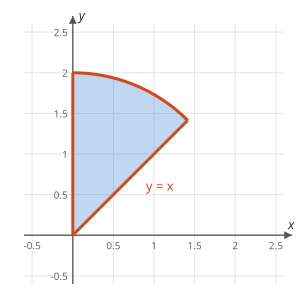
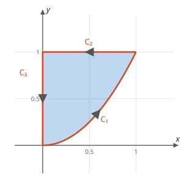

# Unidad 8 — Práctica: Curvas, integrales de línea y función potencial

Ejercicios del **T.P. N.º 8 de la Guía de Trabajos Prácticos** ([TP08-Curvas-Integrales-Linea.pdf](../aula-virtual/08-Curvas-Integrales-Linea/TP08-Curvas-Integrales-Linea.pdf)). Las respuestas se controlaron con las [respuestas oficiales de la guía](../aula-virtual/00-Guia-TP/Guia-TP-2016-Respuestas.pdf).

Cada ejercicio tiene un botón **Solución**. Al abrirlo aparece la respuesta y, arriba de ella, un segundo botón **Solución paso a paso** con el desarrollo completo.

> **Nomenclatura y consideraciones básicas:**
>
> - Se denomina ***trayectoria*** o ***camino continuo*** a toda función $\bar g : [a,b] \subset \Re \to \Re^n$ ($n > 1$) continua en el $[a,b]$. El conjunto imagen $C \subset \Re^n$ es una ***curva***(\*) con ecuación vectorial $\bar X = \bar g(t) \wedge t \in [a,b]$.
> - La ecuación vectorial de una curva $C$ impone una forma de recorrerla; la ***orientación***, o ***sentido de los arcos crecientes***, es aquella según la cual se desplaza $\bar g(t)$ sobre la curva cuando el parámetro $t$ crece.
> - Según la representación dada por $\bar g$, la curva $C$ es ***regular*** cuando existe $\bar g'$ y $\bar g'(t) \ne \bar 0$ en todo el $[a,b]$(\*\*); si además $\bar g'$ es continua, la curva es ***suave***. Cuando $C$ es suave, el versor tangente ($T = \bar g'/\Vert\bar g'\Vert$) se "desplaza" con continuidad sobre la curva. La curva es ***suave a trozos*** cuando el intervalo $[a,b]$ puede ser dividido en cantidad finita de intervalos cerrados en cada uno de los cuales $\bar g'$ es continua y no nula.
> - $\int_C f\thinspace ds$ simboliza la ***integral de línea*** del campo escalar $f$ a lo largo de la curva $C$, siendo $ds = \Vert\bar g'(t)\Vert dt$ el *diferencial de arco de curva*.
> - $\int_C \bar f\cdot d\bar s \equiv \int_C \bar f\cdot d\bar g$ simboliza la ***integral de línea*** o ***circulación***(#) del campo vectorial $\bar f$ a lo largo de la curva $C$, siendo $d\bar s \equiv d\bar g \doteq T\thinspace ds = \bar g'(t)\thinspace dt$.
>
> ***Observación***: Si $C$ es suave y simple según dos representaciones $\bar g_1$ y $\bar g_2$, la $\int_C f\thinspace ds$ tiene el mismo resultado usando cualquiera de ellas, mientras que se observará un cambio de signo en el resultado de $\int_C \bar f\cdot d\bar s$ cuando $\bar g_1$ y $\bar g_2$ orienten a $C$ en sentidos opuestos.
>
> (\*) A veces llamado *arco de curva* por estar definido en intervalo $[a,b]$ cerrado y acotado.
> (\*\*) La derivabilidad en los puntos frontera del intervalo cerrado se cumple cuando existen las derivadas laterales (límite del cociente incremental por derecha para $a$ y por izquierda para $b$).
> (#) Algunos autores sólo llaman circulación al caso de $C$ cerrada.

---

### 01) Dos parametrizaciones y longitud

Dados los siguientes arcos de curva, halle dos parametrizaciones que los orienten en sentido opuesto y plantee el cálculo de su longitud verificando que el resultado no depende de la orientación.

- a) Arco de parábola de ecuación $y = x^2$ entre los puntos $(-1,1)$ y $(2,4)$.
- b) Circunferencia de radio 2 con centro en $(2,1)$.
- c) Elipse de ecuación $\dfrac{x^2}{a^2} + \dfrac{y^2}{b^2} = 1$ con $a,b \in \Re^+$.
- d) Segmento $\overline{AB}$, con $\bar A = (2,3,-1)$ y $\bar B = (3,2,1)$.
- e) $C \subset \Re^3$, intersección de $y = x^2$ con $x + z = 2$ en el 1° octante.
- f) $C \subset \Re^3$, intersección de $x^2 + y^2 + z^2 = 8$ con $z = \sqrt{x^2 + y^2}$.
- g) $C$: línea coordenada de $u = 3$, correspondiente a la superficie de ecuación $\bar X = (u^2v,\ u - v,\ v + u)$ con $(u,v) \in \Re^2$ entre los puntos $(9,2,4)$ y $(18,1,5)$.

<b>Solución</b>

Solución paso a paso

**Fórmula:** $L = \displaystyle\int_a^b\lVert\bar g'(t)\rVert\thinspace dt$. Para invertir el sentido se reemplaza $t$ por $a + b - u$ (o un cambio equivalente); el integrando queda igual con un cambio de variable, así que **la longitud no cambia**.

**a)**

*Parametrizaciones:*

- $\bar X = (t, t^2)$, $t\in[-1,2]$, va de $(-1,1)$ a $(2,4)$.
- $\bar X = (2 - u, (2-u)^2)$, $u\in[0,3]$, va al revés.

*Longitud:* $\lVert(1, 2t)\rVert = \sqrt{1 + 4t^2}$. Con la segunda parametrización $\lVert(-1, -2(2-u))\rVert = \sqrt{1 + 4(2-u)^2}$, y el cambio $t = 2 - u$ da la misma integral.

$$L = \int_{-1}^2\sqrt{1 + 4t^2}\thinspace dt$$

Sustituyendo $w = 2t$ y usando $\int\sqrt{1+w^2}\thinspace dw = \tfrac{w\sqrt{1+w^2}}{2} + \tfrac{\mathop{\mathrm{argsenh}}w}{2}$:

$$L = \frac12\left[\frac{w\sqrt{1+w^2}}{2} + \frac{\mathop{\mathrm{argsenh}}w}{2}\right]_{-2}^{4} = \frac{4\sqrt{17} + 2\sqrt5 + \mathop{\mathrm{argsenh}}(2) + \mathop{\mathrm{argsenh}}(4)}{4} \approx 6{,}1257$$

**b)**

*Parametrizaciones:*

- $(2 + 2\cos t,\ 1 + 2\mathop{\mathrm{sen}}t)$, antihoraria.
- $(2 + 2\mathop{\mathrm{sen}}u,\ 1 + 2\cos u)$, horaria.

*Longitud:* en ambos casos $\lVert\bar g'\rVert = 2$, así que $L = \int_0^{2\pi}2\thinspace dt = 4\pi$.

**c)**

*Parametrizaciones:* $(a\cos t,\ b\mathop{\mathrm{sen}}t)$ y $(a\mathop{\mathrm{sen}}u,\ b\cos u)$, con $t, u \in [0,2\pi]$.

*Longitud:* $\lVert\bar g'\rVert = \sqrt{a^2\mathop{\mathrm{sen}}\nolimits^2t + b^2\cos^2t}$. La integral (elíptica) no tiene primitiva elemental, así que sólo se **plantea**.

**d)** $\bar B - \bar A = (1, -1, 2)$.

*Parametrizaciones:*

- $\bar X = \bar A + t(\bar B - \bar A) = (2 + t,\ 3 - t,\ -1 + 2t)$.
- $\bar X = \bar B - u(\bar B - \bar A) = (3 - u,\ 2 + u,\ 1 - 2u)$.

*Longitud:* $L = \lVert(1,-1,2)\rVert = \sqrt6$.

**e)** En el 1.er octante, $z = 2 - x \ge 0$, así que $x\in[0,2]$.

*Parametrizaciones:* $\bar X = (t,\ t^2,\ 2 - t)$ con $t\in[0,2]$, y la opuesta $(2 - u,\ (2-u)^2,\ u)$.

*Longitud:* $\lVert(1, 2t, -1)\rVert = \sqrt{2 + 4t^2} = \sqrt2\sqrt{1 + 2t^2}$. Con $w = \sqrt2\thinspace t$ (y $dt = dw/\sqrt2$):

$$L = \int_0^{2\sqrt2}\sqrt{1 + w^2}\thinspace dw = \left[\frac{w\sqrt{1+w^2}}{2} + \frac{\mathop{\mathrm{argsenh}}w}{2}\right]_0^{2\sqrt2} = \frac{2\sqrt2\cdot3}{2} + \frac{\mathop{\mathrm{argsenh}}(2\sqrt2)}{2} = 3\sqrt2 + \frac{\mathop{\mathrm{argsenh}}(2\sqrt2)}{2} \approx 5{,}1240$$

**f)** Como en la Unidad 4: $z = 2$ y $x^2 + y^2 = 4$.

*Parametrizaciones:* $(2\cos t,\ 2\mathop{\mathrm{sen}}t,\ 2)$ y $(2\mathop{\mathrm{sen}}u,\ 2\cos u,\ 2)$.

*Longitud:* $L = 2\pi\cdot2 = 4\pi$.

**g)** Con $u = 3$: $\bar X = (9v,\ 3 - v,\ 3 + v)$.

*Extremos:* $(9,2,4)$ corresponde a $v = 1$ y $(18,1,5)$ a $v = 2$.

*Parametrizaciones:* $\bar X = (9v, 3 - v, 3 + v)$ con $v\in[1,2]$, y la opuesta, poniendo $v = 3 - t$: $(9(3-t),\ t,\ 6 - t)$ con $t\in[1,2]$.

*Longitud:* es un segmento, $L = \lVert(9, -1, 1)\rVert = \sqrt{83}$.

**Respuesta:** Por ejemplo:

- a) $\bar X = (t, t^2) \wedge t\in[-1,2]$; $\ \bar X = (2 - u, (2 - u)^2) \wedge u\in[0,3]$. long. $= (2\sqrt5 + 4\sqrt{17} + \mathop{\mathrm{argsenh}}(2) + \mathop{\mathrm{argsenh}}(4))/4 \cong 6.12573$.
- b) $\bar X = (2 + 2\cos(t),\ 1 + 2\mathop{\mathrm{sen}}(t)) \wedge t\in[0,2\pi]$; $\ \bar X = (2 + 2\mathop{\mathrm{sen}}(u),\ 1 + 2\cos(u)) \wedge u\in[0,2\pi]$. long. $= 4\pi$.
- c) $\bar X = (a\cos(t),\ b\mathop{\mathrm{sen}}(t)) \wedge t\in[0,2\pi]$; $\ \bar X = (a\mathop{\mathrm{sen}}(u),\ b\cos(u)) \wedge u\in[0,2\pi]$. long. $= \displaystyle\int_0^{2\pi}\sqrt{a^2\mathop{\mathrm{sen}}\nolimits^2(t) + b^2\cos^2(t)}\thinspace dt$.
- d) $\bar X = (2 + t,\ 3 - t,\ 2t - 1) \wedge t\in[0,1]$; $\ \bar X = (3 - u,\ 2 + u,\ 1 - 2u) \wedge u\in[0,1]$. long. $= \sqrt6$.
- e) $\bar X = (t,\ t^2,\ 2 - t) \wedge t\in[0,2]$; $\ \bar X = (2 - u,\ (2-u)^2,\ u) \wedge u\in[0,2]$. long. $= 3\sqrt2 + \mathop{\mathrm{argsenh}}(2\sqrt2)/2 \cong 5.12401$.
- f) $\bar X = (2\cos(t),\ 2\mathop{\mathrm{sen}}(t),\ 2) \wedge t\in[0,2\pi]$; $\ \bar X = (2\mathop{\mathrm{sen}}(u),\ 2\cos(u),\ 2) \wedge u\in[0,2\pi]$. long. $= 4\pi$.
- g) $\bar X = (9v,\ 3 - v,\ 3 + v) \wedge v\in[1,2]$; $\ \bar X = (9(3 - t),\ t,\ 6 - t) \wedge t\in[1,2]$. long. $= \sqrt{83}$.

---

### 02) Longitud de una frontera

Calcule la longitud de la frontera de la región plana definida por: $x^2 + y^2 \le 4,\ y \ge x,\ x \ge 0$.

<b>Solución</b>

Solución paso a paso

**Paso 1 — Región.** Es el **sector circular** de radio 2 comprendido entre la recta $y = x$ ($\theta = \pi/4$) y el eje $y$ ($\theta = \pi/2$).

**Paso 2 — Tramos de la frontera.**

- Segmento sobre $y = x$, del origen a $(\sqrt2, \sqrt2)$: longitud $2$ (el radio).
- Segmento sobre el eje $y$, del origen a $(0,2)$: longitud $2$.
- Arco de circunferencia de radio 2 y ángulo $\frac\pi2 - \frac\pi4 = \frac\pi4$: longitud $R\thinspace\Delta\theta = 2\cdot\frac\pi4 = \frac\pi2$.

**Paso 3 — Total.** $L = 2 + 2 + \dfrac\pi2 = 4 + \dfrac\pi2 \approx 5{,}57$.

**Respuesta:** $4 + \pi/2$.

---

### 03) Longitud de una trayectoria sobre una superficie

Calcule la longitud de la trayectoria de una partícula que se mueve sobre la superficie de ecuación $z = x^2 - 4y^2$ desde el punto $(1,2,-15)$ hasta el $(3,1,5)$, si la proyección de su recorrido sobre el plano $xy$ es el segmento de puntos extremos $(1,2,0)$ y $(3,1,0)$.

<b>Solución</b>

Solución paso a paso

**Paso 1 — Parametrizar la proyección.** $(x, y) = (1,2) + t\thinspace(2,-1) = (1 + 2t,\ 2 - t)$, con $t\in[0,1]$.

**Paso 2 — Subir a la superficie.**

$$z = (1 + 2t)^2 - 4(2 - t)^2 = 1 + 4t + 4t^2 - 16 + 16t - 4t^2 = -15 + 20t$$

La trayectoria es un **segmento**: $\bar X = (1 + 2t,\ 2 - t,\ -15 + 20t)$.

**Paso 3 — Longitud.** $\bar X' = (2, -1, 20)$:

$$L = \int_0^1\sqrt{4 + 1 + 400}\thinspace dt = \sqrt{405} = 9\sqrt5 \approx 20{,}12$$

**Respuesta:** $9\sqrt5$.

---

### 04) Resistencia de un hilo conductor

Entre los puntos $(0,0,0)$ y $(1,1,1)$, en la intersección del plano $y = x$ con la superficie de ecuación $z = 2y - x^2$ con $z \ge 0$, se ha formado un hilo conductor eléctrico con resistividad lineal ($\Omega/$m) que en cada punto es proporcional a la distancia desde el punto al plano $x = 1$. Calcule la resistencia eléctrica de dicho hilo conductor.

<b>Solución</b>

Solución paso a paso

**Paso 1 — Parametrizar.** Con $y = x = t$: $z = 2t - t^2$, así que $\bar X = (t,\ t,\ 2t - t^2)$, con $t\in[0,1]$.

**Paso 2 — $ds$.** $\bar X' = (1, 1, 2 - 2t)$ ⇒ $\lVert\bar X'\rVert = \sqrt{2 + 4(1-t)^2}$.

**Paso 3 — Resistividad.** La distancia al plano $x = 1$ es $|1 - x| = 1 - t$, así que $\rho = k(1 - t)$.

**Paso 4 — Resistencia.**

$$R = \int_C\rho\thinspace ds = k\int_0^1(1-t)\sqrt{2 + 4(1-t)^2}\thinspace dt$$

Con $w = 1 - t$:

$$R = k\int_0^1 w\sqrt{2 + 4w^2}\thinspace dw = k\left[\frac{(2 + 4w^2)^{3/2}}{12}\right]_0^1 = \frac{k}{12}\left(6\sqrt6 - 2\sqrt2\right) = k\left(\frac{\sqrt6}{2} - \frac{\sqrt2}{6}\right)$$

Como $\dfrac{\sqrt6}{2} = \sqrt{3/2}$, el resultado es $k\left(\sqrt{3/2} - \sqrt2/6\right) \approx 0{,}989\thinspace k$.

**Respuesta:** $k\thinspace(\sqrt{3/2} - \sqrt2/6)$; $k$ constante de proporcionalidad.

---

### 05) Centro de masa de un alambre

Halle las coordenadas del centro de masa de un alambre filiforme cuya densidad lineal en cada punto es proporcional a la distancia desde el punto al eje $z$, si la forma del alambre queda determinada por la intersección de $x + y + z = 4$ con $y = 2x$ en el 1° octante.

<b>Solución</b>

Solución paso a paso

**Paso 1 — Parametrizar.** Con $x = t$: $y = 2t$ y $z = 4 - 3t$. En el 1.er octante, $z \ge 0 \Rightarrow t\in[0, \frac43]$. Además $\lVert\bar X'\rVert = \lVert(1, 2, -3)\rVert = \sqrt{14}$.

**Paso 2 — Densidad.** La distancia al eje $z$ es $\sqrt{x^2 + y^2} = \sqrt5\thinspace t$, así que $\delta = k\sqrt5\thinspace t$.

**Paso 3 — Masa.**

$$M = \int_0^{4/3}k\sqrt5\thinspace t\thinspace\sqrt{14}\thinspace dt = k\sqrt{70}\cdot\frac{(4/3)^2}{2} = \frac{8}{9}k\sqrt{70}$$

**Paso 4 — Momento respecto de $x$.**

$$\int x\thinspace\delta\thinspace ds = k\sqrt{70}\int_0^{4/3}t^2\thinspace dt = k\sqrt{70}\thinspace\frac{(4/3)^3}{3} = \frac{64}{81}k\sqrt{70}$$

**Paso 5 — Coordenadas.**

$$x_{CM} = \frac{64/81}{8/9} = \frac89$$

Las otras dos son funciones lineales de $t$, así que sus promedios ponderados siguen las mismas relaciones:

- $y_{CM} = 2x_{CM} = \frac{16}{9}$;
- $z_{CM} = 4 - 3x_{CM} = \frac43$.

**Respuesta:** $G = (8/9,\ 16/9,\ 4/3)$.

---

### 06) Norma constante ⇒ perpendicular a la derivada

Demuestre que si $\bar h : \Re \to \Re^n$ ($n > 1$) es derivable y $\Vert\bar h\Vert$ es constante, $\bar h \perp \bar h'$.

<b>Solución</b>

Solución paso a paso

$\bar h\cdot\bar h = \lVert\bar h\rVert^2 = c$, constante. Derivando con la regla del producto escalar:

$$\bar h'\cdot\bar h + \bar h\cdot\bar h' = 2\thinspace\bar h\cdot\bar h' = 0 \ \Rightarrow\ \bar h\cdot\bar h' = 0$$

Por lo tanto $\bar h \perp \bar h'$ (cuando ambos son no nulos). $\blacksquare$

**Respuesta:** Sugerencia: recuerde que $\bar h\cdot\bar h = \Vert\bar h\Vert^2$ y derive ambos miembros en las condiciones del enunciado.

---

### 07) Abscisa curvilínea, triedro y curvaturas

Sea $C \subset \Re^3$ una curva suave de ecuación $\bar X = \bar g(t)$ con $t \in I$ (intervalo real).

Dado $b \in I$, $\boxed{s = \lambda(t) \doteq \int_b^t\Vert\bar g'(t)\Vert\thinspace dt}$ es la ***abscisa curvilínea*** del punto $\bar g(t) \in C$, donde $s_b = \lambda(b) = 0$ es el origen de dicha abscisa.

Siendo $s' = \lambda'(t) = \Vert\bar g'(t)\Vert > 0 \Rightarrow \lambda$ estrictamente creciente $\Rightarrow \exists\thinspace\lambda^{-1}$ tal que $t = \lambda^{-1}(s)$, componiendo con $\bar g$ resulta: $\boxed{\bar X = \underbrace{\bar g(\lambda^{-1}(s))}_{\bar G(s)} \text{ con } s \in I_s}$ que es la ecuación ***normal*** de $C$, donde $I_s$ es la imagen de $I$ a través de $\lambda$.

Se define el ***versor tangente principal*** $T \doteq d\bar G/ds$; aplicando la regla de la cadena y la regla de derivación de función inversa resulta:

$$T = \frac{d\bar g}{dt}\frac{dt}{ds} = \bar g'\thinspace\frac{1}{s'} = \frac{\bar g'}{\Vert\bar g'\Vert} \qquad (1)$$

versor orientado según $\bar g'$ (sentido de los arcos crecientes). Suponiendo existente y no nula la $dT/ds$, esta derivada es ortogonal a $T$ ($\Vert T\Vert$ constante) y quedan definidos el ***versor normal principal*** $N \doteq \dfrac{dT/ds}{\Vert dT/ds\Vert}$ y el ***versor binormal*** $B \doteq T \wedge N$.

Así como (1) permite hallar $T$ sin obtener una ecuación normal de la curva, denotando $s_o = \lambda(t_o)$ y suponiendo existentes $\bar g'_o = \bar g'(t_o)$, $\bar g''_o = \bar g''(t_o)$, $\bar g'''_o = \bar g'''(t_o)$, es posible demostrar que en todo $\bar X_o = \bar g(t_o) \in C$, si $\bar g'_o \wedge \bar g''_o \ne \bar 0$ resultan:

$$\boxed{T_o = \frac{\bar g'_o}{\Vert\bar g'_o\Vert}, \quad B_o = \frac{\bar g'_o \wedge \bar g''_o}{\Vert\bar g'_o \wedge \bar g''_o\Vert}, \quad N_o = B_o \wedge T_o.}$$

El ***triedro intrínseco*** de $C$ en $\bar X_o$ está formado por los planos ***normal***, ***osculador*** y ***rectificante*** que son perpendiculares en dicho punto a $T_o$, $B_o$ y $N_o$ respectivamente.

La ***curvatura de flexión*** de $C$ en $\bar X_o$ es: $\boxed{cf_o \doteq \left\Vert\frac{dT}{ds}(s_o)\right\Vert = \frac{\Vert\bar g'_o \wedge \bar g''_o\Vert}{\Vert\bar g'_o\Vert^3}}$

La ***curvatura de torsión*** de $C$ en $\bar X_o$ es: $\boxed{ct_o \doteq \left\Vert\frac{dB}{ds}(s_o)\right\Vert = -\frac{(\bar g'_o \wedge \bar g''_o)\cdot\bar g'''_o}{\Vert\bar g'_o \wedge \bar g''_o\Vert^2}}$

- a) Halle la ecuación normal de la curva de ecuación $\bar X = (2\cos(t),\ 2\mathop{\mathrm{sen}}(t),\ 4t)$ con $t \in [0, 2\pi]$, definiendo como origen de abscisa curvilínea el punto $(0,2,2\pi)$.
- b) Halle la ecuación cartesiana del plano osculador de la curva $C$ intersección del cilindro parabólico de ecuación $z = x^2$ con el plano de ecuación $z + x = 2$ en el punto $(1,1,1)$; y calcule las curvaturas de flexión y de torsión de $C$ en dicho punto.
- c) Demuestre que toda recta, tiene curvatura de flexión nula en todos sus puntos.
- d) Demuestre que la circunferencia tiene igual curvatura de flexión en todos sus puntos.
- e) Determine la posición del centro de curvatura de flexión correspondiente al punto $(4,1,12)$ de la curva de ecuación $\bar X = (2t,\ t - 1,\ t^3 + 4)$ con $t \ge 1$.
- f) Sean $\bar X = \bar g(t)$, $\bar v = \bar g'$ y $\bar a = \bar v'$ la posición, velocidad y aceleración de un punto que se desplaza por el espacio, donde $t$ es el tiempo. Demuestre que la velocidad es siempre tangencial; y la aceleración: es nula si el movimiento es rectilíneo uniforme ($\bar v$ constante), es tangencial si es rectilíneo no uniforme, y yace en el plano osculador si no es rectilíneo (es expresable como combinación lineal de $T$ y $N$).

<b>Solución</b>

Solución paso a paso

**a)**

*Paso 1 — Origen.* $(0, 2, 2\pi)$: $2\cos t = 0$, $2\mathop{\mathrm{sen}}t = 2$ y $4t = 2\pi$ ⇒ $t = \pi/2$.

*Paso 2 — Rapidez.* $\bar X' = (-2\mathop{\mathrm{sen}}t,\ 2\cos t,\ 4)$ ⇒ $\lVert\bar X'\rVert = \sqrt{4 + 16} = 2\sqrt5$, constante.

*Paso 3 — Abscisa curvilínea.*

$$s = \int_{\pi/2}^t 2\sqrt5\thinspace du = 2\sqrt5\left(t - \frac\pi2\right) \ \Rightarrow\ t = \frac{s}{2\sqrt5} + \frac\pi2 = \frac{\sqrt5\thinspace\pi + s}{2\sqrt5}$$

Rango: $t = 0 \Rightarrow s = -\sqrt5\thinspace\pi$ y $t = 2\pi \Rightarrow s = 3\sqrt5\thinspace\pi$.

*Paso 4 — Ecuación normal.* Reemplazando $t$ (y $4t = \dfrac{2(\sqrt5\pi + s)}{\sqrt5}$):

$$\bar X = \left(2\cos\negthinspace\left(\frac{\sqrt5\pi + s}{2\sqrt5}\right),\ 2\mathop{\mathrm{sen}}\negthinspace\left(\frac{\sqrt5\pi + s}{2\sqrt5}\right),\ \frac{2(\sqrt5\pi + s)}{\sqrt5}\right)$$

**b)** $z = x^2$ y $z = 2 - x$ ⇒ $x^2 + x - 2 = 0 \Rightarrow x = 1$ o $x = -2$. Por el punto $(1,1,1)$, la curva es la **recta** $x = 1$, $z = 1$, con $y$ libre: $\bar g(t) = (1, t, 1)$.

Entonces $\bar g'' = \bar 0$ y $\bar g'\wedge\bar g'' = \bar 0$:

- la curvatura de flexión es $0$;
- $B$, $N$, el plano osculador y la torsión **no quedan definidos**: cualquier plano que contenga a la recta "oscula".

**c)** Una recta es $\bar g(t) = \bar A + t\thinspace\bar v$. Entonces $\bar g' = \bar v$ y $\bar g'' = \bar 0$ ⇒ $\bar g'\wedge\bar g'' = \bar 0$ ⇒ $cf = 0$ en todo punto. Esto vale para cualquier parametrización: $T$ es constante, así que $dT/ds = \bar 0$.

**d)** Circunferencia de radio $R$ (en un plano adecuado): $\bar g = (R\cos t,\ R\mathop{\mathrm{sen}}t,\ 0)$.

- $\bar g' = (-R\mathop{\mathrm{sen}}t,\ R\cos t,\ 0)$ y $\bar g'' = (-R\cos t,\ -R\mathop{\mathrm{sen}}t,\ 0)$.
- $\bar g'\wedge\bar g'' = (0, 0, R^2)$ y $\lVert\bar g'\rVert = R$.

$$cf = \frac{R^2}{R^3} = \frac1R$$

Es constante: igual en todos los puntos.

**e)** $\bar X(t) = (2t,\ t - 1,\ t^3 + 4)$, y el punto $(4,1,12)$ corresponde a $t = 2$.

*Derivadas:*

- $\bar g' = (2, 1, 3t^2) \to (2, 1, 12)$.
- $\bar g'' = (0, 0, 6t) \to (0, 0, 12)$.

$$\bar g'\wedge\bar g'' = \begin{vmatrix} \breve\imath & \breve\jmath & \breve k \cr 2 & 1 & 12 \cr 0 & 0 & 12 \end{vmatrix} = (12,\ -24,\ 0)$$

*Curvatura:* $\lVert\bar g'\rVert = \sqrt{149}$ y $\lVert\bar g'\wedge\bar g''\rVert = \sqrt{720} = 12\sqrt5$ ⇒ $cf = \dfrac{12\sqrt5}{149^{3/2}}$ y $\rho = \dfrac{1}{cf} = \dfrac{149^{3/2}}{12\sqrt5}$.

*Versores:*

- $B = \dfrac{(1, -2, 0)}{\sqrt5}$ y $T = \dfrac{(2, 1, 12)}{\sqrt{149}}$.
- $N = B\wedge T = \dfrac{(1,-2,0)\wedge(2,1,12)}{\sqrt5\sqrt{149}} = \dfrac{(-24,\ -12,\ 5)}{\sqrt{745}}$.

*Centro de curvatura:*

$$\bar X_0 + \rho N = (4,1,12) + \frac{149^{3/2}}{12\sqrt5}\cdot\frac{(-24,-12,5)}{\sqrt5\sqrt{149}} = (4,1,12) + \frac{149}{60}(-24,-12,5)$$

$$= \left(4 - \frac{298}{5},\ 1 - \frac{149}{5},\ 12 + \frac{149}{12}\right) = \left(-\frac{278}{5},\ -\frac{144}{5},\ \frac{293}{12}\right)$$

**f)**

*Velocidad.* $\bar v = \bar g' = s'\thinspace T$: es paralela a $T$, o sea **tangencial**.

*Aceleración.* Derivando y usando $\dfrac{dT}{dt} = \dfrac{dT}{ds}s' = cf\thinspace N\thinspace s'$:

$$\bar a = s''\thinspace T + s'\thinspace\frac{dT}{dt} = s''\thinspace T + (s')^2\thinspace cf\thinspace N$$

- **Rectilíneo uniforme:** $\bar v$ constante ⇒ $\bar a = \bar v' = \bar 0$.
- **Rectilíneo no uniforme:** $T$ es constante ($cf = 0$) ⇒ $\bar a = s''\thinspace T$, tangencial.
- **No rectilíneo:** $\bar a$ es combinación lineal de $T$ y $N$ ⇒ está en el **plano osculador**.

**Respuesta:**

- a) $\bar X = \left(2\cos\negthinspace\left(\dfrac{\sqrt5\pi + s}{2\sqrt5}\right),\ 2\mathop{\mathrm{sen}}\negthinspace\left(\dfrac{\sqrt5\pi + s}{2\sqrt5}\right),\ \dfrac{2(\sqrt5\pi + s)}{\sqrt5}\right) \wedge s\in[-\sqrt5\pi,\ 3\sqrt5\pi]$.
- b) curv. flexión $= 0$; plano osc. y curv. torsión: no quedan definidos.
- c) Se demuestra: $\bar g'' = \bar 0$.
- d) $cf = 1/R$ con $R$ radio de la circunferencia.
- e) $(-278/5,\ -144/5,\ 293/12)$.
- f) Se demuestra: $\bar a = s''\thinspace T + (s')^2\thinspace cf\thinspace N$.

---

### 08) Notación diferencial

En $\Re^2$, si $\bar f = (P,Q)$, interprete la igualdad $\displaystyle\int_C \bar f\cdot d\bar s = \int_C P(x,y)\thinspace dx + Q(x,y)\thinspace dy$ e indique como se expresaría en $\Re^3$.

<b>Solución</b>

**Respuesta:** si $\bar X = (x(t), y(t)) = \bar g(t)$, entonces $d\bar s = \bar g'(t)\thinspace dt = (x'\thinspace dt,\ y'\thinspace dt) = (dx, dy)$. Por lo tanto:

$$\bar f\cdot d\bar s = (P, Q)\cdot(dx, dy) = P\thinspace dx + Q\thinspace dy$$

En $\Re^3$, con $\bar f = (P, Q, R)$ y $d\bar s = (dx, dy, dz)$:

$$\int_C\bar f\cdot d\bar s = \int_C P\thinspace dx + Q\thinspace dy + R\thinspace dz$$

---

### 09) Campo constante sobre un segmento

Sea $\bar F$ constante en todo punto del segmento $\overline{AB}$, verifique que $\displaystyle\int_{\overline{AB}}\bar F\cdot d\bar s = \bar F\cdot(\bar B - \bar A)$. Relacione este resultado con la conocida expresión del trabajo de una fuerza contante a lo largo de un camino recto.

<b>Solución</b>

Solución paso a paso

Parametrizamos: $\bar X = \bar A + t(\bar B - \bar A)$, $t\in[0,1]$, con $\bar X' = \bar B - \bar A$:

$$\int_{\overline{AB}}\bar F\cdot d\bar s = \int_0^1\bar F\cdot(\bar B - \bar A)\thinspace dt = \bar F\cdot(\bar B - \bar A)$$

**Relación con la física:** es la fórmula $W = \vec F\cdot\Delta\vec r = \lVert\vec F\rVert\thinspace\lVert\Delta\vec r\rVert\cos\alpha$: el trabajo de una fuerza constante es "fuerza por desplazamiento" (sólo cuenta la componente en la dirección del movimiento).

**Respuesta:** Se verifica. Es la expresión $W = \bar F\cdot\Delta\bar r$ del trabajo de una fuerza constante a lo largo de un desplazamiento recto.

---

### 10) Campo tangente de módulo constante

Sea $C$ un arco de curva suave y simple, demuestre que si $\bar H = k\thinspace T$ con $k$ constante positiva $\displaystyle\int_C\bar H\cdot d\bar s = H\cdot\text{longitud}(C)$ donde $H = \Vert\bar H\Vert$.(\*)

(\*) $T$ versor tangente principal, $\bar H$ de módulo constante y orientado según $T$ en cada punto.

<b>Solución</b>

Solución paso a paso

Como $d\bar s = T\thinspace ds$ y $T\cdot T = 1$:

$$\int_C\bar H\cdot d\bar s = \int_C k\thinspace T\cdot T\thinspace ds = k\int_C ds = k\cdot\text{longitud}(C)$$

Además $H = \lVert k\thinspace T\rVert = k$, porque $k > 0$ y $\lVert T\rVert = 1$. $\blacksquare$

**Respuesta:** Se demuestra usando $d\bar s = T\thinspace ds$ y $T\cdot T = 1$.

---

### 11) Circulación sobre la frontera de una región

Calcule la circulación de $\bar f(x,y) = (y,\ -x)$ a lo largo de la frontera de la región definida por $x^2 \le y \le 1 \ \wedge\ 0 \le x \le 1$, en sentido positivo. Observe que en este ejemplo la circulación no resulta nula, aún con camino cerrado.

<b>Solución</b>

Solución paso a paso

**Paso 1 — Tramos en sentido positivo (antihorario).**

- $C_1$: parábola de $(0,0)$ a $(1,1)$: $(t, t^2)$, $t\in[0,1]$.
- $C_2$: segmento $y = 1$ de $(1,1)$ a $(0,1)$: $(1 - t, 1)$, $t\in[0,1]$.
- $C_3$: eje $y$ de $(0,1)$ a $(0,0)$: $(0, 1 - t)$, $t\in[0,1]$.

**Paso 2 — Cada integral.**

- $C_1$: $\bar f = (t^2, -t)$ y $\bar X' = (1, 2t)$ ⇒ $\bar f\cdot\bar X' = t^2 - 2t^2 = -t^2$ ⇒ $\displaystyle\int_0^1 -t^2\thinspace dt = -\frac13$.
- $C_2$: $\bar f = (1, -(1-t))$ y $\bar X' = (-1, 0)$ ⇒ el producto es $-1$ ⇒ la integral vale $-1$.
- $C_3$: $\bar f = (1 - t, 0)$ y $\bar X' = (0, -1)$ ⇒ el producto es $0$ ⇒ la integral vale $0$.

**Paso 3 — Total.** $-\dfrac13 - 1 + 0 = -\dfrac43$.

*Control con Green (Unidad 11):* $\displaystyle\iint(Q'_x - P'_y)\thinspace dA = \iint(-1 - 1)\thinspace dA = -2\cdot\text{Área}$, con $\text{Área} = \displaystyle\int_0^1(1 - x^2)\thinspace dx = \frac23$. Resulta $-\frac43$ ✓.

La circulación no es nula porque $\bar f$ **no es conservativo**: $P'_y = 1 \ne Q'_x = -1$.

**Respuesta:** $-4/3$.

---

### 12) Circulación sobre una curva intersección

Calcule la circulación de $\bar f(x,y,z) = (x - y,\ x,\ yz)$ a lo largo de la curva intersección de $z = x - y^2$ con $y = x^2$ desde $(1,1,0)$ hasta $(-1,1,-2)$.

<b>Solución</b>

Solución paso a paso

**Paso 1 — Parametrizar.** Con $x = t$: $y = t^2$ y $z = t - t^4$. El recorrido va de $t = 1$ hasta $t = -1$; se respeta el sentido integrando de 1 a $-1$.

**Paso 2 — Integrando.** $\bar X' = (1,\ 2t,\ 1 - 4t^3)$ y $\bar f(\bar X) = (t - t^2,\ t,\ t^2(t - t^4)) = (t - t^2,\ t,\ t^3 - t^6)$:

$$\bar f\cdot\bar X' = (t - t^2) + 2t^2 + (t^3 - t^6)(1 - 4t^3) = t + t^2 + t^3 - 5t^6 + 4t^9$$

**Paso 3 — Integrar.**

$$\int_1^{-1}(\dots)\thinspace dt = -\int_{-1}^{1}(t + t^2 + t^3 - 5t^6 + 4t^9)\thinspace dt$$

En el intervalo simétrico, las potencias impares se anulan:

$$= -\int_{-1}^1(t^2 - 5t^6)\thinspace dt = -\left(\frac23 - \frac{10}{7}\right) = -\frac{14 - 30}{21} = \frac{16}{21}$$

**Respuesta:** $16/21$.

---

### 13) Trabajo de un campo no conservativo

Calcule el trabajo de $\bar f(x,y,z) = 3x\thinspace\breve\imath - xz\thinspace\breve\jmath + yz\thinspace\breve k$ a lo largo de la curva de ecuación $\bar X = (t - 1,\ t^2,\ 2t)$ con $t \in [1,3]$. ¿Cuáles son los puntos inicial y final del recorrido?, ¿puede asegurar el mismo resultado si manteniendo dichos puntos se utiliza otra curva?.

<b>Solución</b>

Solución paso a paso

**Paso 1 — Extremos.** $t = 1$: $(0, 1, 2)$; $t = 3$: $(2, 9, 6)$.

**Paso 2 — Integrando.** $\bar X' = (1, 2t, 2)$ y $\bar f(\bar X) = (3(t-1),\ -(t-1)\thinspace2t,\ t^2\cdot2t) = (3t - 3,\ -2t^2 + 2t,\ 2t^3)$:

$$\bar f\cdot\bar X' = 3t - 3 + 2t(-2t^2 + 2t) + 4t^3 = 3t - 3 - 4t^3 + 4t^2 + 4t^3 = 4t^2 + 3t - 3$$

**Paso 3 — Integrar.**

$$W = \int_1^3(4t^2 + 3t - 3)\thinspace dt = \frac43(27 - 1) + \frac32(9 - 1) - 3(2) = \frac{104}{3} + 12 - 6 = \frac{122}{3}$$

**Paso 4 — ¿Independiente del camino?** Haría falta que $\bar f$ fuera conservativo, pero $D\bar f$ no es simétrica: por ejemplo, $P'_y = 0$ y $Q'_x = -z$. Entonces **no** se puede asegurar: con otra curva el trabajo puede cambiar.

**Respuesta:** $122/3$; Pto. inic. $= (0,1,2)$, Pto. final $= (2,9,6)$; no ($D\bar f$ no es simétrica).

---

### 14) Función potencial

Verifique si los siguientes campos admiten función potencial; de existir, determínela.

- a) $\bar f(x,y) = (y - 2xy + 1,\ x + 1 - x^2)$.
- b) $\bar f(x,y) = (x - y^2,\ y - x^2)$.
- c) $\bar f(x,y,z) = (z\cos(xz),\ z,\ y + x\cos(xz))$.
- d) $\bar f(x,y,z) = (2x + y + 1,\ x + z,\ y + 2z)$.

<b>Solución</b>

Solución paso a paso

**Método:**

1. Verificar la jacobiana simétrica. Todos los dominios son $\Re^2$ o $\Re^3$, que son simplemente conexos, así que con la simetría alcanza.
2. Integrar componente a componente.

**a)** $P'_y = 1 - 2x$ y $Q'_x = 1 - 2x$ ✓.

- $\phi = \int(y - 2xy + 1)\thinspace dx = xy - x^2y + x + g(y)$.
- $\phi'_y = x - x^2 + g'(y) = x + 1 - x^2 \Rightarrow g' = 1 \Rightarrow g = y + C$.
- $\phi = x + y + xy - x^2y + C$.

**b)** $P'_y = -2y$ y $Q'_x = -2x$: no son iguales ⇒ **no admite** función potencial.

**c)** Simetría:

- $P'_y = 0 = Q'_x$ ✓.
- $P'_z = \cos(xz) - xz\mathop{\mathrm{sen}}(xz) = R'_x$ ✓.
- $Q'_z = 1 = R'_y$ ✓.

Integración:

- $\phi = \int z\cos(xz)\thinspace dx = \mathop{\mathrm{sen}}(xz) + g(y,z)$.
- $\phi'_y = g'_y = z \Rightarrow g = yz + h(z)$.
- $\phi'_z = x\cos(xz) + y + h'(z) = y + x\cos(xz) \Rightarrow h' = 0$.
- $\phi = yz + \mathop{\mathrm{sen}}(xz) + C$.

**d)** Simetría: $P'_y = 1 = Q'_x$, $P'_z = 0 = R'_x$ y $Q'_z = 1 = R'_y$ ✓.

- $\phi = x^2 + xy + x + g(y,z)$.
- $\phi'_y = x + g'_y = x + z \Rightarrow g = yz + h(z)$.
- $\phi'_z = y + h' = y + 2z \Rightarrow h = z^2$.
- $\phi = x^2 + xy + x + yz + z^2 + C$.

**Respuesta:** Cuando admite función potencial, se indica la familia de funciones a la cual pertenece:

- a) $x + y + xy - x^2y + C$.
- b) No admite función potencial.
- c) $yz + \mathop{\mathrm{sen}}(xz) + C$.
- d) $x^2 + xy + x + zy + z^2 + C$.

---

### 15) Energía potencial

Siendo $\bar f = \nabla\phi$ un campo de fuerzas y $C$ un arco de curva recorrido desde $\bar A$ hasta $\bar B$ el trabajo realizado por el campo es $\displaystyle\int_C\bar f\cdot d\bar s = \phi(\bar B) - \phi(\bar A)$. Para calcular $-\displaystyle\int_C\bar f\cdot d\bar s$ que es el trabajo en contra del campo, se acostumbra denominar función potencial a $U = -\phi$; demuestre que en este caso resultan: $\bar f = -\nabla U$ y $-\displaystyle\int_C\bar f\cdot d\bar s = U(\bar B) - U(\bar A)$.

<b>Solución</b>

**Respuesta:**

- $\nabla U = \nabla(-\phi) = -\nabla\phi = -\bar f$ ⇒ $\bar f = -\nabla U$.
- $-\displaystyle\int_C\bar f\cdot d\bar s = -\big(\phi(\bar B) - \phi(\bar A)\big) = (-\phi(\bar B)) - (-\phi(\bar A)) = U(\bar B) - U(\bar A)$. $\blacksquare$

---

### 16) Jacobiana simétrica sin potencial

Sea $\bar f : \Re^2 - \lbrace\bar 0\rbrace \to \Re^2 \ /\ \bar f(x,y) = \left(\dfrac{y}{x^2 + y^2},\ \dfrac{-x}{x^2 + y^2}\right)$, demuestre que $\bar f$ tiene matriz jacobiana continua y simétrica en su dominio. Por otra parte, verifique que su circulación a lo largo de una circunferencia con centro en el origen no resulta nula.

En este caso, ¿puede asegurar que $\bar f$ admite función potencial en su dominio?.

<b>Solución</b>

Solución paso a paso

**Paso 1 — Jacobiana.** Con $r^2 = x^2 + y^2$:

$$P'_y = \frac{r^2 - y\cdot2y}{r^4} = \frac{x^2 - y^2}{r^4}, \qquad Q'_x = -\frac{r^2 - x\cdot2x}{r^4} = \frac{x^2 - y^2}{r^4}$$

Son iguales ⇒ **simétrica**. Todas las derivadas son racionales con denominador $r^4 \ne 0$ ⇒ **continuas** en $\Re^2 - \lbrace\bar 0\rbrace$.

**Paso 2 — Circulación** sobre $x = R\cos t$, $y = R\mathop{\mathrm{sen}}t$, en sentido antihorario:

- $\bar f = \left(\dfrac{\mathop{\mathrm{sen}}t}{R}, -\dfrac{\cos t}{R}\right)$ y $\bar X' = (-R\mathop{\mathrm{sen}}t,\ R\cos t)$.
- $\bar f\cdot\bar X' = -\mathop{\mathrm{sen}}\nolimits^2t - \cos^2t = -1$.

$$\oint\bar f\cdot d\bar s = \int_0^{2\pi}(-1)\thinspace dt = -2\pi \ne 0$$

**Paso 3 — Conclusión.** Si $\bar f$ admitiera potencial, toda circulación cerrada sería 0 ⇒ **no admite** potencial en su dominio.

No hay contradicción: la simetría sólo garantiza potencial en dominios **simplemente conexos**, y $\Re^2 - \lbrace\bar 0\rbrace$ tiene un "agujero" en el origen.

**Respuesta:** Se demuestra. Se verifica: la circulación es $-2\pi$ (en sentido antihorario). El campo no admite función potencial en su dominio.

---

### 17) Campo de gradientes a partir de su jacobiana

Sean $\bar f$ un campo de gradientes con matriz jacobiana $D\bar f(x,y) = \begin{pmatrix} 2y - 6x & 2x \cr 2x & 0 \end{pmatrix}$ y $C$ una curva abierta cualquiera con puntos extremos $\bar A$ perteneciente al eje $y$ y $\bar B$ perteneciente a la curva de ecuación $y = x - x^{-1}$. Demuestre que $\displaystyle\int_C\bar f\cdot d\bar s = 0$, sabiendo que la gráfica de su función potencial pasa por $(1,1,3)$ con plano tangente de ecuación $z = y + 2$.

<b>Solución</b>

Solución paso a paso

**Paso 1 — Reconstruir $\phi$.** $D\bar f$ es el Hessiano de $\phi$:

- $\phi''_{xx} = 2y - 6x$, así que $\phi'_x = 2xy - 3x^2 + a(y)$.
- $\phi''_{xy} = 2x + a'(y) = 2x \Rightarrow a = $ constante $= a$.
- $\phi = x^2y - x^3 + ax + c(y)$.
- $\phi''_{yy} = c''(y) = 0 \Rightarrow c = by + c_0$.

**Paso 2 — Datos del plano tangente $z = y + 2$ en $(1,1,3)$:** $\phi(1,1) = 3$, $\phi'_x(1,1) = 0$ y $\phi'_y(1,1) = 1$.

- $\phi'_x(1,1) = 2 - 3 + a = 0 \Rightarrow a = 1$.
- $\phi'_y = x^2 + b \Rightarrow 1 + b = 1 \Rightarrow b = 0$.
- $\phi(1,1) = 1 - 1 + 1 + c_0 = 3 \Rightarrow c_0 = 2$.

$$\phi(x,y) = x^2y - x^3 + x + 2$$

**Paso 3 — Integral.** $\displaystyle\int_C\bar f\cdot d\bar s = \phi(\bar B) - \phi(\bar A)$.

- $\bar A = (0, y_A)$: $\phi = 0 - 0 + 0 + 2 = 2$.
- $\bar B = (x, x - 1/x)$: $\phi = x^2\left(x - \frac1x\right) - x^3 + x + 2 = x^3 - x - x^3 + x + 2 = 2$.

Entonces $\phi(\bar B) - \phi(\bar A) = 0$ ✓ para cualquier curva y cualesquiera puntos así elegidos.

**Respuesta:** Se cumple, la expresión de la función potencial es $x^2y - x^3 + x + 2$.

---

### 18) Hallar $g$ para que haya potencial

Sea $\bar f \in C^1 \ /\ \bar f(x,y) = (xy^2,\ y\thinspace g(x))$, determine $g$ de manera que $\bar f$ admita función potencial; suponga que $\bar f(2,1) = (2,6)$.

<b>Solución</b>

Solución paso a paso

**Paso 1 — Condición de simetría** (el dominio es $\Re^2$, simplemente conexo): $P'_y = 2xy$ y $Q'_x = y\thinspace g'(x)$ ⇒ $g'(x) = 2x$ ⇒ $g(x) = x^2 + c$.

**Paso 2 — Dato.** $\bar f(2,1) = (2\cdot1,\ 1\cdot g(2)) = (2, 6) \Rightarrow g(2) = 4 + c = 6 \Rightarrow c = 2$.

**Respuesta:** $g(x) = x^2 + 2$.

---

### 19) Circulación usando la función potencial

Siendo $\bar f(x,y,z) = (2xy + z^2,\ x^2,\ 2xz)$, **verifique** que admite función potencial en $\Re^3$ y **calcule** $\displaystyle\int_C\bar f\cdot d\bar s$ a lo largo de la curva $C$ de ecuación $\bar X = (2t + e^{t^3 - t},\ t^2 - t,\ 3t)$ con $0 \le t \le 1$ orientada en el sentido que impone la parametrización que se indica.

<b>Solución</b>

Solución paso a paso

**Paso 1 — Simetría en $\Re^3$.** $P'_y = 2x = Q'_x$, $P'_z = 2z = R'_x$ y $Q'_z = 0 = R'_y$ ✓.

**Paso 2 — Potencial.**

- $\phi = \int(2xy + z^2)\thinspace dx = x^2y + xz^2 + g(y,z)$.
- $\phi'_y = x^2 + g'_y = x^2 \Rightarrow g = h(z)$.
- $\phi'_z = 2xz + h' = 2xz \Rightarrow h$ constante.

$$\phi = x^2y + xz^2$$

**Paso 3 — Extremos de la curva** (no hace falta integrar sobre la curva complicada):

- $t = 0$: $(0 + e^0,\ 0,\ 0) = (1, 0, 0)$.
- $t = 1$: $(2 + e^0,\ 0,\ 3) = (3, 0, 3)$.

**Paso 4 — Resultado.**

$$\int_C\bar f\cdot d\bar s = \phi(3,0,3) - \phi(1,0,0) = (0 + 27) - 0 = 27$$

**Respuesta:** $27$.

---

### 20) Fuerza proporcional a la velocidad

Sea $\bar X = \bar g(t)$ la "posición" y $\bar X' = \bar g'(t)$ la "velocidad" ($t$ es el tiempo). Demuestre que toda fuerza proporcional a la velocidad es disipativa (no conservativa).

<b>Solución</b>

Solución paso a paso

Sea $\bar F = k\thinspace\bar X'$ con $k \ne 0$, y sea una trayectoria **cerrada** recorrida con $\bar X' \ne \bar 0$, por ejemplo una circunferencia. La circulación es:

$$\oint\bar F\cdot d\bar s = \int_{t_0}^{t_1}k\thinspace\bar X'(t)\cdot\bar X'(t)\thinspace dt = k\int_{t_0}^{t_1}\lVert\bar X'(t)\rVert^2\thinspace dt \ne 0$$

El integrando es positivo. Una fuerza conservativa tendría circulación 0 sobre **toda** curva cerrada ⇒ $\bar F$ **no** es conservativa. Con $k < 0$, como el rozamiento viscoso, el trabajo es negativo y disipa energía. $\blacksquare$

**Respuesta:** Demuestre que la circulación en camino cerrado no es nula: es $k\int\lVert\bar X'\rVert^2\thinspace dt \ne 0$.

---

### 21) Circulación mínima

Dada $\bar f(x,y) = (ax,\ y - ax)$ y la curva $C$ de ecuación $\bar X = (\cos(t),\ b\mathop{\mathrm{sen}}(t)) \wedge t \in [0, 2\pi]$, determine $a$ y $b$ de manera que $a + b = 6$ y la circulación de $\bar f$ a lo largo de $C$ sea mínima.

<b>Solución</b>

Solución paso a paso

**Paso 1 — Circulación.** $\bar X' = (-\mathop{\mathrm{sen}}t,\ b\cos t)$ y $\bar f(\bar X) = (a\cos t,\ b\mathop{\mathrm{sen}}t - a\cos t)$:

$$\bar f\cdot\bar X' = -a\cos t\mathop{\mathrm{sen}}t + b^2\mathop{\mathrm{sen}}t\cos t - ab\cos^2t$$

Integrando en $[0, 2\pi]$, los términos con $\mathop{\mathrm{sen}}t\cos t$ dan 0 y $\int_0^{2\pi}\cos^2t\thinspace dt = \pi$:

$$\oint\bar f\cdot d\bar s = -\pi\thinspace ab$$

**Paso 2 — Minimizar** $-\pi ab$ con $a + b = 6$, es decir **maximizar** $ab = a(6 - a)$:

$$\frac{d}{da}(6a - a^2) = 6 - 2a = 0 \Rightarrow a = 3 \Rightarrow b = 3$$

La circulación mínima es $-9\pi$.

**Respuesta:** $a = b = 3$.

---

## Demuestre las siguientes propiedades; cuando corresponda suponga $C$ suave.

### Propiedad a)

$C$ arco simple $\Rightarrow \displaystyle\int_C T\cdot d\bar s = \text{longitud}(C)$.

<b>Solución</b>

**Respuesta:** $d\bar s = T\thinspace ds$ ⇒ $\displaystyle\int_C T\cdot T\thinspace ds = \int_C 1\thinspace ds = \text{longitud}(C)$. Es el ejercicio 10 con $k = 1$. $\blacksquare$

---

### Propiedad b)

$\bar f = \nabla\phi \in C^1 \Rightarrow D\bar f$ simétrica.

<b>Solución</b>

**Respuesta:** las componentes de $\bar f$ son $f_i = \phi'_{x_i}$, así que $(D\bar f)_{ij} = \dfrac{\partial f_i}{\partial x_j} = \phi''_{x_ix_j}$: $D\bar f$ es el Hessiano de $\phi$. Como $\bar f \in C^1$, $\phi \in C^2$, y por el teorema de Schwarz $\phi''_{x_ix_j} = \phi''_{x_jx_i}$ ⇒ $D\bar f$ simétrica. $\blacksquare$

---

### Propiedad c)

$\bar f = \nabla\phi \in C^1 \ \wedge\ \displaystyle\int_C\bar f\cdot d\bar s = 0 \Rightarrow$ puntos extremos de $C$ con igual potencial.

<b>Solución</b>

**Respuesta:** $0 = \displaystyle\int_C\bar f\cdot d\bar s = \phi(\bar B) - \phi(\bar A)$ ⇒ $\phi(\bar A) = \phi(\bar B)$: los extremos están sobre el mismo conjunto de nivel de $\phi$ (equipotencial). $\blacksquare$

---

### Propiedad d)

$\displaystyle\oint_C\bar f\cdot d\bar s = 0\ \forall C \Rightarrow \int_{C_1}\bar f\cdot d\bar s = \int_{C_2}\bar f\cdot d\bar s$ donde $C_1$ y $C_2$ son curvas abiertas recorridas desde $\bar A$ hasta $\bar B$.

<b>Solución</b>

**Respuesta:** recorriendo $C_1$ de $\bar A$ a $\bar B$ y luego $C_2$ en sentido inverso (de $\bar B$ a $\bar A$) se obtiene una curva cerrada $C$. Por hipótesis:

$$0 = \oint_C\bar f\cdot d\bar s = \int_{C_1}\bar f\cdot d\bar s - \int_{C_2}\bar f\cdot d\bar s$$

El signo menos aparece por invertir la orientación de $C_2$. Por lo tanto ambas integrales son iguales. $\blacksquare$

---

### Propiedad e)

$f \in C^1 \Rightarrow \displaystyle\int_{\overline{AB}} f'(\bar X, \breve r)\thinspace ds = f(\bar B) - f(\bar A)$ con $\breve r$ orientado de $\bar A$ a $\bar B$.

<b>Solución</b>

**Respuesta:** parametrizamos el segmento por longitud de arco: $\bar X(s) = \bar A + s\thinspace\breve r$, con $s\in[0, L]$ y $L = \lVert\bar B - \bar A\rVert$. Como $f \in C^1$ es diferenciable, por la regla de la cadena:

$$\frac{d}{ds}f(\bar X(s)) = \nabla f(\bar X(s))\cdot\breve r = f'(\bar X(s), \breve r)$$

Integrando en $[0,L]$, por la regla de Barrow:

$$\int_0^L f'(\bar X, \breve r)\thinspace ds = f(\bar X(L)) - f(\bar X(0)) = f(\bar B) - f(\bar A) \quad\blacksquare$$

También se puede ver como la propiedad del ejercicio 19, con $\bar f = \nabla f$ y $d\bar s = \breve r\thinspace ds$.

---

[← Volver al menú principal](../README.md)
