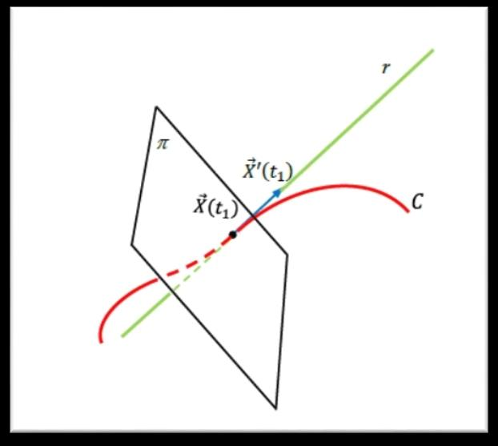

# Unidad 8 — Curvas, integrales de línea y función potencial

Resumen del material teórico de la unidad ([U08-Teoria-Curvas-Integrales-Linea.pdf](../aula-virtual/08-Curvas-Integrales-Linea/U08-Teoria-Curvas-Integrales-Linea.pdf)) y de los apuntes [Repaso de curvas](../aula-virtual/08-Curvas-Integrales-Linea/Repaso-Curvas.pdf), [Propiedades de la derivada de una función vectorial](../aula-virtual/08-Curvas-Integrales-Linea/Derivada-Funcion-Vectorial-Propiedades.pdf), [Resumen de integrales de línea](../aula-virtual/08-Curvas-Integrales-Linea/Resumen-Integrales-Linea.pdf), [Aplicaciones](../aula-virtual/08-Curvas-Integrales-Linea/Aplicaciones-Integrales-Linea.pdf) y [Condiciones de existencia de la función potencial](../aula-virtual/08-Curvas-Integrales-Linea/Funcion-Potencial-Condiciones.pdf), complementado con el [resumen de UTNianos](../UTNianos/Resumen%20AM2.pdf).

**Objetivos de la unidad:**

1. Parametrizar curvas y calcular longitudes de arco.
2. Calcular integrales de línea de campos escalares (masa, centro de masa) y vectoriales (trabajo, circulación).
3. Reconocer campos conservativos y hallar su función potencial.

---

## 1. Curvas parametrizadas

Una **trayectoria** es una función continua $\vec g: [a,b] \to \mathbb{R}^n$. Su imagen $C$ es una **curva**, de ecuación $\vec X = \vec g(t)$.

- **Orientación:** la parametrización impone un sentido de recorrido, el de $t$ creciente.
- **Regular:** existe $\vec g'$ y $\vec g' \ne \vec 0$ en todo $[a,b]$. **Suave:** además $\vec g'$ es continua.
- **Suave a trozos:** se puede partir $[a,b]$ en finitos tramos suaves (por ejemplo, una poligonal).
- **Cerrada:** $\vec g(a) = \vec g(b)$. **Simple:** no se corta a sí misma.
- En curvas planas cerradas simples, la **orientación positiva** es la antihoraria (la región queda a la izquierda).

### Parametrizaciones típicas

| Curva | Parametrización |
|---|---|
| Gráfico $y = f(x)$, $x\in[a,b]$ | $(t,\ f(t))$ |
| Segmento de $A$ a $B$ | $A + t\thinspace(B - A)$, $\ t\in[0,1]$ |
| Circunferencia de centro $(x_0,y_0)$ y radio $R$ (antihoraria) | $(x_0 + R\cos t,\ y_0 + R\mathop{\mathrm{sen}}t)$, $\ t\in[0,2\pi]$ |
| Elipse $\frac{x^2}{a^2} + \frac{y^2}{b^2} = 1$ | $(a\cos t,\ b\mathop{\mathrm{sen}}t)$ |
| Hélice | $(R\cos t,\ R\mathop{\mathrm{sen}}t,\ ct)$ |

**Invertir el sentido:** si $\vec g$ va de $A$ a $B$ con $t\in[a,b]$, entonces $\vec g(a + b - u)$, con $u\in[a,b]$, recorre la misma curva de $B$ a $A$. Otra forma es intercambiar $\cos$ y $\mathop{\mathrm{sen}}$ en una circunferencia.

**Curva intersección de dos superficies:** se despejan variables o se usa la ecuación más simple para parametrizar (ver Unidad 4).

### Derivada de funciones vectoriales

Se deriva **componente a componente**. Valen las propiedades:

- $(k\vec f)' = k\vec f'$ y $(\vec f + \vec g)' = \vec f' + \vec g'$;
- $(\vec f\cdot\vec g)' = \vec f'\cdot\vec g + \vec f\cdot\vec g'$;
- $(\vec f\times\vec g)' = \vec f'\times\vec g + \vec f\times\vec g'$.

**Consecuencia:** si $\lVert\vec h\rVert$ es constante, entonces $\vec h\perp\vec h'$.

**Cinemática:** si $\vec X(t)$ es la posición, la velocidad es $\vec v = \vec X'$ (tangente a la trayectoria) y la aceleración es $\vec a = \vec X''$.

---

## 2. Longitud de arco

$$L(C) = \int_a^b \lVert\vec g\thinspace'(t)\rVert\thinspace dt, \qquad ds = \lVert\vec g\thinspace'(t)\rVert\thinspace dt$$

La longitud **no depende de la parametrización** ni de la orientación.

Para una curva suave a trozos, se suman las longitudes de cada tramo.

**Integrales útiles:**

$$\int\sqrt{1 + u^2}\thinspace du = \frac{u\sqrt{1+u^2}}{2} + \frac{\mathop{\mathrm{argsenh}}(u)}{2} + C, \qquad \int u\sqrt{a + bu^2}\thinspace du = \frac{(a + bu^2)^{3/2}}{3b} + C$$

### Abscisa curvilínea, triedro de Frenet y curvaturas

- **Abscisa curvilínea:** $s = \lambda(t) = \int_{t_0}^t \lVert\vec g'(u)\rVert\thinspace du$. Despejando $t = \lambda^{-1}(s)$ se obtiene la **ecuación normal** $\vec X = \vec G(s)$, que recorre la curva con velocidad 1.
- **Versor tangente:** $T = \dfrac{\vec g'}{\lVert\vec g'\rVert}$.
- **Versor binormal:** $B = \dfrac{\vec g'\times\vec g''}{\lVert\vec g'\times\vec g''\rVert}$.
- **Versor normal principal:** $N = B\times T$.
- **Planos:**
  - **normal**, perpendicular a $T$;
  - **osculador**, perpendicular a $B$ (contiene a $T$ y $N$);
  - **rectificante**, perpendicular a $N$.
- **Curvatura de flexión** y **torsión**:

$$cf = \frac{\lVert\vec g'\times\vec g''\rVert}{\lVert\vec g'\rVert^3}, \qquad ct = -\frac{(\vec g'\times\vec g'')\cdot\vec g'''}{\lVert\vec g'\times\vec g''\rVert^2}$$

- **Radio de curvatura:** $\rho = 1/cf$. El **centro de curvatura** es $\vec X_0 + \rho\thinspace N$.
- **Casos particulares:** una recta tiene $cf = 0$; una circunferencia de radio $R$ tiene $cf = 1/R$; una curva plana tiene torsión 0.
- **Aceleración:** $\vec a = s''\thinspace T + (s')^2\thinspace cf\thinspace N$. Siempre está en el plano osculador.

---

## 3. Integral de línea de un campo escalar

$$\int_C f\thinspace ds = \int_a^b f(\vec g(t))\thinspace\lVert\vec g\thinspace'(t)\rVert\thinspace dt$$

- **No depende** de la parametrización ni de la orientación.
- Con $f = 1$ da la longitud.

**Aplicaciones (alambres)**, con densidad lineal $\delta$:

| Magnitud | Fórmula |
|---|---|
| Masa | $M = \int_C \delta\thinspace ds$ |
| Centro de masa | $x_{CM} = \dfrac{1}{M}\int_C x\thinspace\delta\thinspace ds$ (ídem $y$, $z$) |
| Momento de inercia respecto de un eje | $I = \int_C d^2\thinspace\delta\thinspace ds$ ($d$ = distancia al eje) |
| Resistencia de un hilo (resistividad lineal $\rho$) | $R = \int_C \rho\thinspace ds$ |

"Proporcional a la distancia a ..." significa $\delta = k\cdot\text{distancia}$, con $k$ constante.

---

## 4. Integral de línea de un campo vectorial (trabajo, circulación)

$$\int_C \vec f\cdot d\vec s = \int_a^b \vec f(\vec g(t))\cdot\vec g\thinspace'(t)\thinspace dt = \int_C P\thinspace dx + Q\thinspace dy\ (+\thinspace R\thinspace dz)$$

- Sólo cuenta la **componente tangencial** del campo: $\vec f\cdot d\vec s = (\vec f\cdot T)\thinspace ds$.
- **Cambia de signo** si se invierte la orientación.
- Si la curva es cerrada se llama **circulación** y se escribe $\oint_C$.

**Casos útiles:**

- **Campo constante sobre un segmento:** $\int_{\overline{AB}}\vec F\cdot d\vec s = \vec F\cdot(B - A)$ (trabajo = fuerza · desplazamiento).
- **Campo tangente de módulo constante $H$:** $\int_C \vec H\cdot d\vec s = H\cdot L(C)$.
- **Fuerza proporcional a la velocidad** ($\vec F = k\vec v$): su circulación sobre una trayectoria cerrada es $k\int\lVert\vec v\rVert^2dt \ne 0$ ⇒ no es conservativa.

---

## 5. Campos conservativos y función potencial

$\vec f$ es un **campo de gradientes** (conservativo) si existe $\phi$ con $\nabla\phi = \vec f$. A $\phi$ se la llama **función potencial**. En física se usa $U = -\phi$, que da $\vec f = -\nabla U$.

**Teorema (independencia del camino):** si $\vec f = \nabla\phi$ es continuo y $C$ va de $A$ a $B$:

$$\boxed{\int_C \vec f\cdot d\vec s = \phi(B) - \phi(A)}$$

Es como la regla de Barrow: **sólo importan los extremos**.

**Equivalencias** (para $\vec f$ continuo en un abierto conexo):

$$\vec f = \nabla\phi \iff \oint_C\vec f\cdot d\vec s = 0 \ \ \forall C \text{ cerrada} \iff \int_C\vec f\cdot d\vec s \text{ no depende del camino}$$

### Condición necesaria: matriz jacobiana simétrica

Si $\vec f = \nabla\phi$ con $\phi \in C^2$, por Schwarz $D\vec f$ (el Hessiano de $\phi$) es **simétrica**:

- en $\mathbb{R}^2$: $P'_y = Q'_x$;
- en $\mathbb{R}^3$: $P'_y = Q'_x$, $\ P'_z = R'_x$, $\ Q'_z = R'_y$.

**Si no es simétrica ⇒ NO admite potencial.**

### ¿Cuándo la simetría alcanza?

- Si el dominio es **simplemente conexo** (por ejemplo todo $\mathbb{R}^2$, $\mathbb{R}^3$, un disco, un semiplano), la jacobiana simétrica y continua **garantiza** que existe la potencial.
- Si el dominio **tiene "agujeros"** (por ejemplo $\mathbb{R}^2 - \lbrace\vec 0\rbrace$), la simetría no alcanza: hay que verificar que la circulación alrededor de cada agujero sea 0.

**Ejemplo clásico:** $\vec f = \left(\dfrac{y}{x^2+y^2}, \dfrac{-x}{x^2+y^2}\right)$ tiene jacobiana simétrica, pero su circulación sobre una circunferencia centrada en el origen es $-2\pi \ne 0$ ⇒ **no** es conservativo en $\mathbb{R}^2 - \lbrace\vec 0\rbrace$.

### Cómo hallar la función potencial

1. Verificar la simetría de $D\vec f$.
2. Integrar la primera componente respecto de $x$: $\phi = \int P\thinspace dx + g(y,z)$.
3. Derivar respecto de $y$ e igualar a $Q$ ⇒ despejar $g'_y$ ⇒ integrar ⇒ $g = \dots + h(z)$.
4. Derivar respecto de $z$ e igualar a $R$ ⇒ despejar $h'$ ⇒ integrar.
5. $\phi$ queda determinada salvo una constante $C$.

---

## 6. Complementos: curvas rectificables y reparametrización

**Curva rectificable.** Sea $\vec f: [a,b] \to \mathbb{R}^m$ continua e inyectiva. Una partición $a = t_0 < t_1 < \dots < t_n = b$ determina una **poligonal inscripta** en la curva, de longitud $S_P = \sum\lvert P_{i-1}P_i\rvert$. La curva es **rectificable** si el conjunto de los $S_P$ está acotado superiormente, y su **longitud** es el supremo de ese conjunto.

**De la poligonal a la integral.** Si $\vec f = (x(t), y(t), z(t))$ tiene derivadas continuas, por el TVM en cada componente:

$$\lvert P_{i-1}P_i\rvert = \sqrt{\Delta x^2 + \Delta y^2 + \Delta z^2} = \sqrt{x'^2(\alpha_i) + y'^2(\beta_i) + z'^2(\gamma_i)}\ \Delta t$$

y en el límite:

$$s = \int_a^b\sqrt{x'^2 + y'^2 + z'^2}\thinspace dt, \qquad s'(t) = \lVert\vec f\thinspace'(t)\rVert, \qquad ds = \lVert\vec f\thinspace'(t)\rVert\thinspace dt$$

**Reparametrización.** Si $h: [a,b] \to [a_1, b_1]$ es biyectiva y $C^1$, $\vec g = \vec f\circ h$ es una **reparametrización** de $\vec f$. Lleva extremos en extremos:

- si $h(a) = a_1$ y $h(b) = b_1$, **preserva** la orientación;
- si $h(a) = b_1$ y $h(b) = a_1$, la **invierte**.

**La longitud no depende de la parametrización.** Con $\vec g(u) = \vec f(h(u))$, $\lVert\vec g\thinspace'(u)\rVert = \lVert\vec f\thinspace'(h(u))\rVert\thinspace\lvert h'(u)\rvert$. Con el cambio $t = h(u)$:

- si $h$ es creciente, $\lvert h'\rvert = h'$ y la integral es la misma;
- si es decreciente, $\lvert h'\rvert = -h'$, pero también se invierten los límites, y los dos signos se compensan. $\blacksquare$

---

## 7. Complementos: propiedades e interpretaciones de las integrales de línea

**Integral de un campo escalar** como límite de sumas de Riemann:

$$\int_C F\thinspace ds = \lim_{n\to\infty}\sum F(\vec r(\alpha_i))\thinspace\lVert\vec r\thinspace'(\alpha_i)\rVert\thinspace\Delta t_i = \int_a^b F(\vec r(t))\thinspace\lVert\vec r\thinspace'(t)\rVert\thinspace dt$$

con $C$ de clase $C^1$ a trozos (derivada continua salvo en finitos puntos).

**Propiedades:**

1. Con $F = 1$ da la longitud.
2. **Linealidad:** $\int_C(F + G)\thinspace ds = \int_C F\thinspace ds + \int_C G\thinspace ds$.
3. **Aditividad respecto de los arcos:** $\int_{C_1\cup C_2} = \int_{C_1} + \int_{C_2}$.

**Interpretación geométrica:** si $F \ge 0$ y $C$ es una curva plana, $\int_C F\thinspace ds$ es el **área lateral de la "pared"** que tiene a $C$ como base y altura $F(x,y)$.

**Campo vectorial: por qué es el trabajo.** En un intervalo chico, la partícula pasa de $\vec r(t)$ a $\vec r(t + \Delta t)$, y por el TVM $\Delta\vec r \approx \vec r\thinspace'(t)\Delta t$. El trabajo de ese tramo es aproximadamente $\vec F(\vec r(t))\cdot\vec r\thinspace'(t)\thinspace\Delta t$ (fuerza · desplazamiento), y sumando y tomando límite:

$$W = \int_a^b\vec F(\vec r(t))\cdot\vec r\thinspace'(t)\thinspace dt = \int_a^b(F_1x' + F_2y' + F_3z')\thinspace dt$$

Si $\vec g$ es una reparametrización de $\vec r$: $\int\vec F\cdot d\vec g = \pm\int\vec F\cdot d\vec r$, según conserve o invierta la orientación.

**Curvas simples y cerradas.** Una curva **simple** es la imagen de $\vec f: [a,b] \to \mathbb{R}^3$ inyectiva; con su sentido de recorrido es una curva simple **orientada**. Si además $\vec f(a) = \vec f(b)$, es **simple cerrada** (si es inyectiva salvo en los extremos) o sólo **cerrada** (si se corta a sí misma).

---

## 8. Complementos: demostraciones y condiciones para la función potencial

**Teorema (independencia del camino).** Si $F \in C^1$ con $\nabla F$ continuo y $C$ es $C^1$ a trozos, de $\vec r(a)$ a $\vec r(b)$:

$$\int_C\nabla F\cdot d\vec r = F(\vec r(b)) - F(\vec r(a))$$

*Demostración.* Sea $G = F\circ\vec r$. Por la regla de la cadena, $G'(t) = \nabla F(\vec r(t))\cdot\vec r\thinspace'(t)$. Entonces $\int_a^b\nabla F\cdot\vec r\thinspace'\thinspace dt = \int_a^b G'(t)\thinspace dt = G(b) - G(a)$. $\blacksquare$

Si la curva es cerrada, la integral es 0. Un campo es **conservativo** si su integral sobre toda curva cerrada es 0.

**Condición necesaria (demostración).** Si $\vec F = (P, Q) = \nabla U$, con $P, Q, P'_y, Q'_x$ continuas en un abierto conexo, entonces $U''_{xy} = P'_y$ y $U''_{yx} = Q'_x$; por Schwarz son iguales: $P'_y = Q'_x$. **No es suficiente**: $\left(\frac{-y}{x^2+y^2}, \frac{x}{x^2+y^2}\right)$ la cumple y tiene circulación $2\pi$ sobre la circunferencia unitaria. No es conservativo en $\mathbb{R}^2 - \lbrace\vec 0\rbrace$, pero sí en cualquier subconjunto simplemente conexo que no contenga al origen.

**Condición necesaria y suficiente (dominios convexos).** Si $P, Q, P'_y, Q'_x$ son continuas en un abierto **convexo**, $\vec F$ es conservativo si y sólo si $P'_y = Q'_x$ en todo el conjunto. Para $n$ variables, en un abierto convexo: conservativo $\iff \frac{\partial F_i}{\partial x_j} = \frac{\partial F_j}{\partial x_i}$ para todo $i, j$. En $\mathbb{R}^3$ eso equivale a $\nabla\wedge\vec F = \vec 0$: un campo de $\mathbb{R}^3$ en $\mathbb{R}^3$ es conservativo si y sólo si es **irrotacional**.

**Fórmula general de la función potencial** (en $\mathbb{R}^2$):

$$U(x,y) = \int P(x,y)\thinspace dx + \int\left[Q(x,y) - \frac{\partial}{\partial y}\int P(x,y)\thinspace dx\right]dy + C$$

En $\mathbb{R}^3$ se integra tres veces: en la primera la "constante" es una función de dos variables, en la segunda de una variable y en la tercera es un número.

---

## 9. Estrategia para los ejercicios

1. **Longitud o integral de un campo escalar:** parametrizar, calcular $\lVert\vec g'\rVert$, armar $\int f(\vec g(t))\lVert\vec g'\rVert\thinspace dt$ e integrar.
2. **Trabajo o circulación:**
   - ¿El campo es conservativo (jacobiana simétrica en un dominio simplemente conexo)? Entonces se usa $\phi(B) - \phi(A)$, que suele ser mucho más fácil.
   - Si no, parametrizar **respetando el sentido** pedido y calcular $\int \vec f(\vec g(t))\cdot\vec g'(t)\thinspace dt$.
   - Para curvas cerradas planas, se puede usar Green (Unidad 11).
3. **Curvas por tramos:** sumar las integrales de cada tramo, cada uno parametrizado en el sentido correcto.

---

## 10. Resumen de fórmulas

| Concepto | Fórmula |
|---|---|
| Longitud | $\int_a^b\lVert\vec g'\rVert\thinspace dt$ |
| Integral de campo escalar | $\int_C f\thinspace ds = \int f(\vec g)\lVert\vec g'\rVert\thinspace dt$ |
| Integral de campo vectorial | $\int_C\vec f\cdot d\vec s = \int\vec f(\vec g)\cdot\vec g'\thinspace dt$ |
| Campo conservativo | $\int_C\nabla\phi\cdot d\vec s = \phi(B) - \phi(A)$ |
| Condición necesaria | $D\vec f$ simétrica |
| Curvatura de flexión | $\lVert\vec g'\times\vec g''\rVert/\lVert\vec g'\rVert^3$ |
| Torsión | $-\dfrac{(\vec g'\times\vec g'')\cdot\vec g'''}{\lVert\vec g'\times\vec g''\rVert^2}$ |
| Triedro | $T = \frac{\vec g'}{\lVert\vec g'\rVert}$, $B = \frac{\vec g'\times\vec g''}{\lVert\vec g'\times\vec g''\rVert}$, $N = B\times T$ |

---

[← Volver al menú principal](../README.md)
