# Unidad 9 — Práctica: Integrales múltiples

Ejercicios del **T.P. N.º 9 de la Guía de Trabajos Prácticos** ([TP09-Integrales-Multiples.pdf](../aula-virtual/09-Integrales-Multiples/TP09-Integrales-Multiples.pdf)). Las respuestas se controlaron con las [respuestas oficiales de la guía](../aula-virtual/00-Guia-TP/Guia-TP-2016-Respuestas.pdf).

Cada ejercicio tiene un botón **Solución**. Al abrirlo aparece la respuesta y, arriba de ella, un segundo botón **Solución paso a paso** con el desarrollo completo.

> **Convención de los gráficos:** la región sombreada es el dominio de integración; los bordes llenos están incluidos y los punteados no.

---

### 01) Áreas con integrales dobles

Calcule el área de las siguientes regiones planas mediante integrales dobles; se recomienda no aplicar propiedades de simetría, plantee los límites para toda la región.

- a) $D = \lbrace(x,y) \in \Re^2 \ /\ y \ge 2x^2 + 1 \ \wedge\ x + y \le 4\rbrace$.
- b) $D$ : definida por $x^2 \le y < \sqrt{2 - x^2}$.
- c) $D$ : dominio del campo $\bar f(x,y) = (\ln(x + y - 2),\ \sqrt{y - 2x + 2},\ (2x + 2 - y - x^2)^{-1/4})$.
- d) $D$ : limitada por las curvas de ecuación $y = x^3$ e $y = x$.
- e) $D$ : conjunto de positividad de $f(x,y) = (y - 2|x|)\sqrt{20 - x^2 - y^2}$.
- f) $D$ : conjunto donde son positivas las componentes de $\bar f(x,y) = (4 - x^2 - y^2,\ 2 - x - y^2)$.

<b>Solución</b>

Solución paso a paso

**Fórmula:** $A = \displaystyle\iint_D dA = \int_a^b dx\int_{g_1(x)}^{g_2(x)}dy = \int_a^b\big(g_2(x) - g_1(x)\big)\thinspace dx$, con $g_2$ el "techo" y $g_1$ el "piso".

**a)** *Región:* entre la parábola $y = 2x^2 + 1$ (piso) y la recta $y = 4 - x$ (techo).

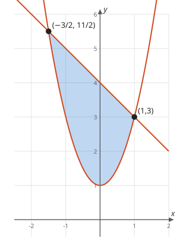

*Intersección:* $2x^2 + 1 = 4 - x \Rightarrow 2x^2 + x - 3 = 0 \Rightarrow x = -\frac32$ o $x = 1$.

$$A = \int_{-3/2}^{1}dx\int_{2x^2+1}^{4-x}dy = \int_{-3/2}^1(3 - x - 2x^2)\thinspace dx = \left[3x - \frac{x^2}{2} - \frac{2x^3}{3}\right]_{-3/2}^{1}$$

En $x = 1$ vale $\frac{11}{6}$ y en $x = -\frac32$ vale $-\frac{27}{8}$:

$$A = \frac{11}{6} + \frac{27}{8} = \frac{125}{24}$$

**b)** *Región:* entre la parábola $y = x^2$ (piso) y la semicircunferencia $y = \sqrt{2 - x^2}$ (techo, radio $\sqrt2$).

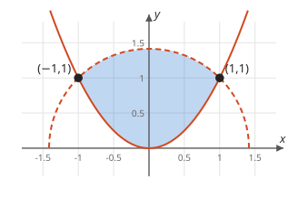

*Intersección:* $x^2 = \sqrt{2 - x^2} \Rightarrow x^4 + x^2 - 2 = 0 \Rightarrow x^2 = 1 \Rightarrow x = \pm1$.

$$A = \int_{-1}^1dx\int_{x^2}^{\sqrt{2-x^2}}dy = \int_{-1}^1\sqrt{2 - x^2}\thinspace dx - \int_{-1}^1x^2\thinspace dx$$

Con $\int\sqrt{a^2 - x^2}\thinspace dx = \frac12\left(x\sqrt{a^2-x^2} + a^2\arcsin\frac xa\right)$ y $a = \sqrt2$:

$$\int_{-1}^1\sqrt{2-x^2}\thinspace dx = \left(1 + 2\cdot\frac\pi4\right) = 1 + \frac\pi2, \qquad \int_{-1}^1x^2\thinspace dx = \frac23$$

$$A = 1 + \frac\pi2 - \frac23 = \frac13 + \frac\pi2$$

**c)** *Condiciones del dominio:*

- $\ln$: $x + y - 2 > 0 \Rightarrow y > 2 - x$;
- raíz: $y \ge 2x - 2$;
- potencia $-1/4$ (raíz cuarta en el denominador): $y < -x^2 + 2x + 2$.

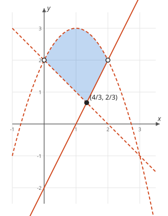

*Intersecciones:*

- $2 - x = 2x - 2 \Rightarrow x = \frac43$.
- Parábola con $y = 2 - x$: $x = 0$ (y $x = 3$).
- Parábola con $y = 2x - 2$: $x = 2$ (y $x = -2$).

El piso cambia en $x = 4/3$, así que partimos la región:

$$A = \int_0^{4/3}dx\int_{2-x}^{-x^2+2x+2}dy + \int_{4/3}^2dx\int_{2x-2}^{-x^2+2x+2}dy = \int_0^{4/3}(3x - x^2)\thinspace dx + \int_{4/3}^2(4 - x^2)\thinspace dx$$

$$= \frac{152}{81} + \frac{64}{81} = \frac{216}{81} = \frac83$$

**d)** *Región:* $y = x^3$ e $y = x$ se cortan en $x = -1, 0, 1$. Entre $-1$ y $0$ el techo es $x^3$; entre $0$ y $1$ el techo es $x$.

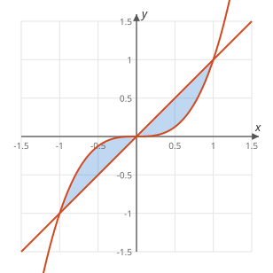

$$A = \int_{-1}^0dx\int_x^{x^3}dy + \int_0^1dx\int_{x^3}^x dy = \int_{-1}^0(x^3 - x)\thinspace dx + \int_0^1(x - x^3)\thinspace dx = \frac14 + \frac14 = \frac12$$

**e)** *Positividad:* la raíz es $> 0$ si $x^2 + y^2 < 20$, y el primer factor es $> 0$ si $y > 2|x|$. Es el "sector" del círculo de radio $\sqrt{20}$ por encima de la V $y = 2|x|$.

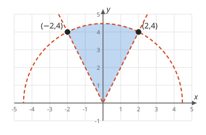

*Intersección:* $2|x| = \sqrt{20 - x^2} \Rightarrow 5x^2 = 20 \Rightarrow x = \pm2$.

$$A = \int_{-2}^2dx\int_{2|x|}^{\sqrt{20-x^2}}dy = \int_{-2}^2\sqrt{20 - x^2}\thinspace dx - \int_{-2}^2 2|x|\thinspace dx$$

- Primera integral: $2\cdot\frac12\left(2\cdot4 + 20\arcsin\frac{2}{\sqrt{20}}\right) = 8 + 20\arcsin\frac{1}{\sqrt5}$.
- Segunda integral: $8$.

$$A = 20\arcsin(1/\sqrt5) \approx 9{,}27295$$

*Control con polares:* $A = \frac12R^2\Delta\varphi = 10\thinspace(\pi - 2\arctan2) = 20\arctan\frac12$, que es lo mismo.

**f)** *Condiciones:* $x^2 + y^2 < 4$ y $x < 2 - y^2$. Conviene integrar primero en $x$ (región tipo II).

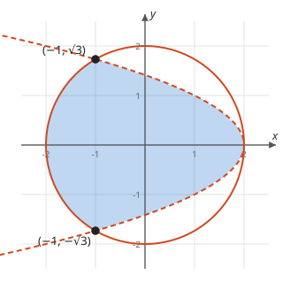

*Intersección:* $(2 - y^2)^2 + y^2 = 4 \Rightarrow y^4 - 3y^2 = 0 \Rightarrow y = 0, \pm\sqrt3$. Para $|y| \le \sqrt3$, $x$ va desde la circunferencia (izquierda) hasta la parábola (derecha):

$$A = \int_{-\sqrt3}^{\sqrt3}dy\int_{-\sqrt{4-y^2}}^{2-y^2}dx = \int_{-\sqrt3}^{\sqrt3}(2 - y^2)\thinspace dy + \int_{-\sqrt3}^{\sqrt3}\sqrt{4 - y^2}\thinspace dy$$

- Primera integral: $\left[2y - \frac{y^3}{3}\right]_{-\sqrt3}^{\sqrt3} = 2(2\sqrt3 - \sqrt3) = 2\sqrt3$.
- Segunda integral: $\sqrt3\cdot1 + 4\cdot\frac\pi3 = \sqrt3 + \frac{4\pi}{3}$.

$$A = 3\sqrt3 + \frac{4\pi}{3} \approx 9{,}38494$$

**Respuesta:**

- a) $125/24$.
- b) $\dfrac13 + \dfrac\pi2$.
- c) $8/3$.
- d) $0.5$.
- e) $20\arcsin(1/\sqrt5) \cong 9.27295$.
- f) $3\sqrt3 + 4\pi/3 \cong 9.38494$.

---

### 02) Ambos órdenes de integración

Calcule las siguientes integrales en ambos órdenes de integración y verifique que los resultados coinciden.

- a) $\displaystyle\iint_D dx\thinspace dy$, $D$ definido por: $0 \le y \le \mathop{\mathrm{sen}}(x)$, $0 \le x \le \pi$.
- b) $\displaystyle\iint_D x\thinspace dx\thinspace dy$, $D = [-1,1]\times[-1,1]$.
- c) $\displaystyle\iint_D |x|\thinspace dx\thinspace dy$, $D = [-1,1]\times[-1,1]$.
- d) $\displaystyle\iint_D f(x,y)\thinspace dx\thinspace dy$, $D$ definido por: $x^2 - 1 \le y \le 1 - x^2$, $f(x,y) = \begin{cases} xy & \text{si } x \ge 0 \cr -2x & \text{si } x < 0 \end{cases}$.
- e) $\displaystyle\int_0^1dx\int_0^x(x + y)\thinspace dy + \int_1^4dx\int_0^1(x + y)\thinspace dy$.
- f) $\displaystyle\iint_D e^{-x}\thinspace dx\thinspace dy$, $D$ definido por: $e^x \le y \le e^{2x} \ \wedge\ 0 \le x \le \ln2$.

<b>Solución</b>

Solución paso a paso

**a)**

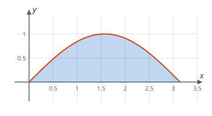

*Orden $dy\thinspace dx$:* $\displaystyle\int_0^\pi dx\int_0^{\mathop{\mathrm{sen}}x}dy = \int_0^\pi\mathop{\mathrm{sen}}x\thinspace dx = 2$.

*Orden $dx\thinspace dy$:* para $y\in[0,1]$, $x$ va de $\arcsin y$ a $\pi - \arcsin y$:

$$\int_0^1(\pi - 2\arcsin y)\thinspace dy = \pi - 2\left[y\arcsin y + \sqrt{1-y^2}\right]_0^1 = \pi - 2\left(\frac\pi2 - 1\right) = 2 \ ✓$$

**b)** En ambos órdenes: $\displaystyle\int_{-1}^1\negthinspace\int_{-1}^1 x\thinspace dx\thinspace dy = \int_{-1}^1\left[\frac{x^2}{2}\right]_{-1}^1dy = 0$. En el otro orden, $\displaystyle\int_{-1}^1x\cdot2\thinspace dx = 0$.

**c)** En ambos órdenes: $\displaystyle\int_{-1}^1|x|\thinspace dx = 1$, multiplicado por la longitud del intervalo en $y$ (2) da $2$.

**d)** *Región:* entre las parábolas $y = 1 - x^2$ e $y = x^2 - 1$, con $x\in[-1,1]$.

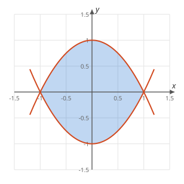

*Orden $dy\thinspace dx$:*

- Para $x \ge 0$: $\displaystyle\int_{x^2-1}^{1-x^2}xy\thinspace dy = 0$, porque el intervalo es simétrico en $y$ y el integrando es impar en $y$.
- Para $x < 0$: $\displaystyle\int_{-1}^0(-2x)(2 - 2x^2)\thinspace dx = \left[-2x^2 + x^4\right]_{-1}^0 = 1$.

Total: $1$.

*Orden $dx\thinspace dy$:* la región es $x^2 \le 1 - |y|$, con $y\in[-1,1]$:

$$\int_{-1}^1dy\left[\int_{-\sqrt{1-|y|}}^0(-2x)\thinspace dx + \int_0^{\sqrt{1-|y|}}xy\thinspace dx\right] = \int_{-1}^1\left[(1 - |y|) + \frac{y(1 - |y|)}{2}\right]dy = 1 + 0 = 1 \ ✓$$

**e)** *Región:* $0 \le y \le x$ con $x\in[0,1]$, unida con $0 \le y \le 1$ con $x\in[1,4]$. En conjunto, $y\in[0,1]$ y $y \le x \le 4$.

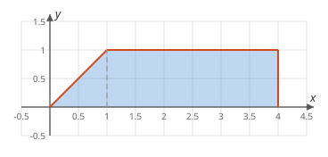

*Orden dado:*

- $\displaystyle\int_0^1\left[xy + \frac{y^2}{2}\right]_0^x dx = \int_0^1\frac{3x^2}{2}\thinspace dx = \frac12$.
- $\displaystyle\int_1^4\left(x + \frac12\right)dx = \frac{15}{2} + \frac32 = 9$.

Total: $9{,}5$.

*Otro orden:*

$$\int_0^1dy\int_y^4(x + y)\thinspace dx = \int_0^1\left(8 + 4y - \frac{3y^2}{2}\right)dy = 8 + 2 - \frac12 = 9{,}5 \ ✓$$

**f)** *Región:* entre $y = e^x$ e $y = e^{2x}$, con $x\in[0, \ln2]$.

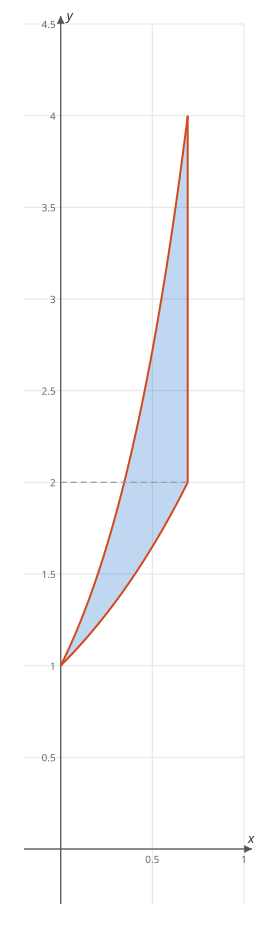

*Orden $dy\thinspace dx$:*

$$\int_0^{\ln2}e^{-x}(e^{2x} - e^x)\thinspace dx = \int_0^{\ln2}(e^x - 1)\thinspace dx = (2 - 1) - \ln2 = 1 - \ln2$$

*Orden $dx\thinspace dy$:* $y$ va de 1 a 4, y hay que partir en $y = 2$:

- Para $y\in[1,2]$: $\frac{\ln y}{2} \le x \le \ln y$.
- Para $y\in[2,4]$: $\frac{\ln y}{2} \le x \le \ln2$.

Usando $\int e^{-x}dx = -e^{-x}$:

$$\int_1^2\left(y^{-1/2} - y^{-1}\right)dy + \int_2^4\left(y^{-1/2} - \tfrac12\right)dy = (2\sqrt2 - \ln2 - 2) + (3 - 2\sqrt2) = 1 - \ln2 \ ✓$$

**Respuesta:**

- a) $2$.
- b) $0$.
- c) $2$.
- d) $1$.
- e) $9.5$.
- f) $1 - \ln(2)$.

---

### 03) Masa y centro de masa de una placa circular

Calcule la masa y el centro de masa de una placa circular con centro en el origen de coordenadas, si su densidad superficial (kg/m²) en cada punto es proporcional a la distancia desde el punto al eje $x$.

<b>Solución</b>

Solución paso a paso

**Paso 1 — Planteo.** Radio $r$, densidad $\delta = k|y|$. Usamos polares, con $dA = \rho\thinspace d\rho\thinspace d\varphi$ e $|y| = \rho|\mathop{\mathrm{sen}}\varphi|$.

**Paso 2 — Masa.**

$$M = \int_0^{2\pi}\negthinspace\negthinspace\int_0^r k\rho|\mathop{\mathrm{sen}}\varphi|\thinspace\rho\thinspace d\rho\thinspace d\varphi = k\left(\int_0^{2\pi}|\mathop{\mathrm{sen}}\varphi|\thinspace d\varphi\right)\left(\int_0^r\rho^2\thinspace d\rho\right) = k\cdot4\cdot\frac{r^3}{3} = \frac{4kr^3}{3}$$

**Paso 3 — Centro de masa.** La placa y la densidad son simétricas respecto de ambos ejes ($|y|$ no cambia con $x \to -x$ ni con $y \to -y$). Entonces:

- $\iint x\thinspace\delta = 0$, porque el integrando es impar en $x$;
- $\iint y\thinspace\delta = 0$, porque el integrando es impar en $y$.

Resultado: $G = (0, 0)$.

**Respuesta:** Llamando $r$ al radio y $k$ a la constante de proporcionalidad: masa $= \dfrac{4kr^3}{3}$; $G = (0,0)$.

---

### 04) Momento de inercia mínimo

Sea $D$ una placa plana con densidad $\delta(x,y)$ y centro de masa $\bar G$. Demuestre que el momento de inercia de $D$ respecto a una recta $r$ paralela a los ejes coordenados es mínimo cuando $r$ pasa por $\bar G$.(\*)

(\*) En general, el momento de inercia respecto de una recta es mínimo cuando la recta pasa por $\bar G$.

<b>Solución</b>

Solución paso a paso

Tomamos una recta vertical $r: x = a$; la horizontal es análoga.

**Paso 1 — Momento como función de $a$.**

$$I(a) = \iint_D(x - a)^2\thinspace\delta\thinspace dA$$

**Paso 2 — Derivar respecto de $a$** (bajo el signo integral):

$$I'(a) = -2\iint_D(x - a)\thinspace\delta\thinspace dA = -2\left(\iint_D x\thinspace\delta\thinspace dA - a\thinspace M\right) = -2M\thinspace(x_G - a)$$

**Paso 3 — Punto crítico.** $I'(a) = 0 \iff a = x_G$. Además $I''(a) = 2M > 0$ ⇒ es un **mínimo**.

La recta de momento mínimo es $x = x_G$, que pasa por $\bar G$. $\blacksquare$

Desarrollando el cuadrado se obtiene el teorema de Steiner: $I(a) = I(x_G) + M(a - x_G)^2$.

**Respuesta:** $I(a) = \iint(x - a)^2\delta\thinspace dA$ tiene derivada $-2M(x_G - a)$, que se anula sólo en $a = x_G$ y corresponde a un mínimo ($I'' = 2M > 0$).

---

### 05) Integrales donde conviene invertir el orden

Calcule las siguientes integrales, en algunos casos puede convenirle invertir el orden de integración.

- a) $\displaystyle\int_0^1\int_0^{\sqrt{1-x^2}}x\thinspace dy\thinspace dx$.
- b) $\displaystyle\int_0^1\int_y^1 e^{x^2}\thinspace dx\thinspace dy$.
- c) $\displaystyle\int_{-4}^0 dy\int_{-\sqrt{y+4}}^{\sqrt{y+4}}dx + \int_0^5 dy\int_{y-2}^{\sqrt{y+4}}dx$.

<b>Solución</b>

Solución paso a paso

**a)** Directo:

$$\int_0^1x\sqrt{1 - x^2}\thinspace dx = \left[-\frac{(1 - x^2)^{3/2}}{3}\right]_0^1 = \frac13$$

**b)** $\int e^{x^2}dx$ **no tiene primitiva elemental** ⇒ invertimos el orden.

- La región es $0 \le y \le x \le 1$, es decir $x\in[0,1]$, $0 \le y \le x$.

$$\int_0^1dx\int_0^x e^{x^2}dy = \int_0^1x\thinspace e^{x^2}dx = \left[\frac{e^{x^2}}{2}\right]_0^1 = \frac{e - 1}{2}$$

**c)** *Región:* $x^2 \le y + 4$ (sobre la parábola $y = x^2 - 4$) y, para $y \ge 0$, $x \ge y - 2$ (bajo la recta $y = x + 2$).

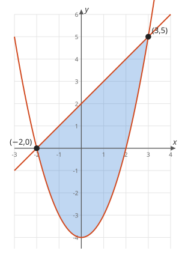

*Intersecciones:* $x^2 - 4 = x + 2 \Rightarrow x = -2,\ 3$. Integrando primero en $y$ queda una sola integral:

$$\int_{-2}^3dx\int_{x^2-4}^{x+2}dy = \int_{-2}^3(-x^2 + x + 6)\thinspace dx = \left[-\frac{x^3}{3} + \frac{x^2}{2} + 6x\right]_{-2}^3 = \frac{27}{2} + \frac{22}{3} = \frac{125}{6}$$

**Respuesta:**

- a) $\dfrac13$.
- b) $\dfrac{e - 1}{2}$.
- c) $\dfrac{125}{6}$.

---

### 06) Cambios de coordenadas

Resuelva los siguientes ejercicios usando el cambio de coordenadas indicado.

- a) $\displaystyle\iint_D(6 - x - y)^{-1}\thinspace dx\thinspace dy$, $D : |x + y| \le 2 \ \wedge\ y \le x + 2 \le 4$, usando $(x,y) = (v,\ u - v)$.
- b) Calcule el área de la región plana definida por $1 \le \dfrac{x^2}{a^2} + \dfrac{y^2}{b^2} \le 4$, $a,b \in \mathbb{R}^+$ aplicando la transformación $(x,y) = (a\rho\cos(\varphi),\ b\rho\mathop{\mathrm{sen}}(\varphi))$.
- c) $\displaystyle\iint_D(x - y)^4\thinspace dx\thinspace dy$, $D = \lbrace(x,y) \in \mathbb{R}^2 \ /\ |x| + |y| \le 4\rbrace$, aplicando una transformación lineal apropiada.
- d) $\displaystyle\iint_D(x + y - 2)^2\thinspace dx\thinspace dy$ aplicando el cambio de variables definido por: $(x,y) = (u + v,\ u - v)$, con $D = \lbrace(x,y) \in \mathbb{R}^2 \ /\ y \ge |x|,\ x + 2y \le 3\rbrace$.
- e) Siendo $D$ la región sombreada del dibujo, **calcule** $\displaystyle\iint_D y\thinspace(x^2 + y^2)^{-1}\thinspace dx\thinspace dy$ usando coordenadas polares.

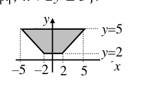

<b>Solución</b>

Solución paso a paso

**Recordatorio:** $dx\thinspace dy = \left|\dfrac{\partial(x,y)}{\partial(u,v)}\right|du\thinspace dv$.

**a)**

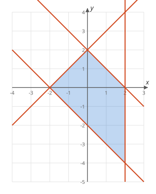

*Jacobiano:* $x = v$, $y = u - v$ ⇒ $\dfrac{\partial(x,y)}{\partial(u,v)} = \begin{vmatrix} 0 & 1 \cr 1 & -1 \end{vmatrix} = -1$ ⇒ $|J| = 1$.

*Región en $(u,v)$:* $u = x + y$ y $v = x$.

- $|u| \le 2$.
- $y \le x + 2 \Rightarrow u - v \le v + 2 \Rightarrow v \ge \frac{u - 2}{2}$.
- $x + 2 \le 4 \Rightarrow v \le 2$.

*Integrando:* $\dfrac{1}{6 - u}$.

$$\int_{-2}^2du\int_{(u-2)/2}^{2}\frac{dv}{6 - u} = \int_{-2}^2\frac{2 - \frac{u-2}{2}}{6 - u}\thinspace du = \int_{-2}^2\frac{\frac{6 - u}{2}}{6 - u}\thinspace du = \int_{-2}^2\frac12\thinspace du = 2$$

**b)** *Jacobiano:*

$$\left|\frac{\partial(x,y)}{\partial(\rho,\varphi)}\right| = \left|\begin{vmatrix} a\cos\varphi & -a\rho\mathop{\mathrm{sen}}\varphi \cr b\mathop{\mathrm{sen}}\varphi & b\rho\cos\varphi \end{vmatrix}\right| = ab\thinspace\rho$$

*Región:* $\frac{x^2}{a^2} + \frac{y^2}{b^2} = \rho^2$ ⇒ $1 \le \rho \le 2$, con $\varphi\in[0,2\pi]$.

$$A = \int_0^{2\pi}\negthinspace\negthinspace\int_1^2ab\thinspace\rho\thinspace d\rho\thinspace d\varphi = 2\pi ab\thinspace\frac{4 - 1}{2} = 3\pi ab$$

Es el área de la elipse grande, $4\pi ab$, menos la de la chica, $\pi ab$.

**c)**

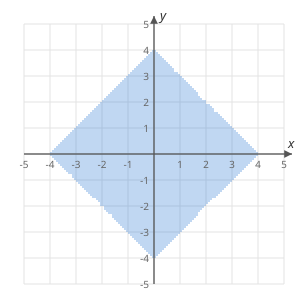

*Cambio:* $u = x - y$, $v = x + y$. Como $|x| + |y| = \max(|x+y|, |x-y|)$, la región es el cuadrado $|u| \le 4$, $|v| \le 4$.

*Jacobiano:* $x = \frac{u+v}{2}$, $y = \frac{v-u}{2}$ ⇒ $|J| = \left|\begin{vmatrix} \frac12 & \frac12 \cr -\frac12 & \frac12 \end{vmatrix}\right| = \frac12$.

$$\int_{-4}^4\negthinspace\int_{-4}^4u^4\cdot\frac12\thinspace du\thinspace dv = \frac12\cdot8\cdot\frac{2\cdot4^5}{5} = \frac{8192}{5} = 1638{,}4$$

**d)**

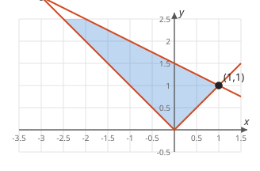

*Jacobiano:* $x = u + v$, $y = u - v$ ⇒ $|J| = \left|\begin{vmatrix} 1 & 1 \cr 1 & -1 \end{vmatrix}\right| = 2$.

*Integrando:* $x + y = 2u$ ⇒ $(2u - 2)^2 = 4(u - 1)^2$.

*Región:*

- $y \ge |x| \iff y \ge x \wedge y \ge -x$. Esto da $u - v \ge u + v \Rightarrow v \le 0$, y $u - v \ge -u - v \Rightarrow u \ge 0$.
- $x + 2y = 3u - v \le 3 \Rightarrow v \ge 3u - 3$.
- En conjunto: $u\in[0,1]$ y $3u - 3 \le v \le 0$.

$$\int_0^1du\int_{3u-3}^0 4(u-1)^2\cdot2\thinspace dv = \int_0^1 8(u-1)^2(3 - 3u)\thinspace du = 24\int_0^1(1 - u)^3\thinspace du = 24\cdot\frac14 = 6$$

**e)** *Región:* el trapecio entre $y = 2$ e $y = 5$, limitado por las rectas $y = x$ e $y = -x$. Es decir, $2 \le y \le 5$ y $|x| \le y$.

*En polares:*

- $\varphi\in[\pi/4,\ 3\pi/4]$.
- $y = 2 \Rightarrow \rho = \dfrac{2}{\mathop{\mathrm{sen}}\varphi}$ e $y = 5 \Rightarrow \rho = \dfrac{5}{\mathop{\mathrm{sen}}\varphi}$.

*Integrando por jacobiano:* $\dfrac{y}{x^2+y^2}\thinspace\rho = \dfrac{\rho\mathop{\mathrm{sen}}\varphi}{\rho^2}\thinspace\rho = \mathop{\mathrm{sen}}\varphi$.

$$\int_{\pi/4}^{3\pi/4}d\varphi\int_{2/\mathop{\mathrm{sen}}\varphi}^{5/\mathop{\mathrm{sen}}\varphi}\mathop{\mathrm{sen}}\varphi\thinspace d\rho = \int_{\pi/4}^{3\pi/4}\mathop{\mathrm{sen}}\varphi\cdot\frac{3}{\mathop{\mathrm{sen}}\varphi}\thinspace d\varphi = 3\cdot\frac\pi2 = \frac{3\pi}{2}$$

**Respuesta:**

- a) $2$.
- b) $3\pi ab$.
- c) $1638.4$.
- d) $6$.
- e) $3\pi/2$.

---

### 07) Curvas de nivel elípticas

- a) Dada $f(x,y) = e^{x^2 + 2y^2}$, calcule el área de la región plana limitada por las curvas de nivel $e^4$ y $e^8$ de la función.
- b) Calcule $\displaystyle\iint_D e^{x^2 + 2y^2}\thinspace dx\thinspace dy$, $D = \lbrace(x,y) \in \mathbb{R}^2 / x^2 + 2y^2 \le 4 \ \wedge\ x \ge \sqrt2\thinspace|y|\rbrace$.

<b>Solución</b>

Solución paso a paso

**Cambio útil:** $x = \rho\cos\varphi$, $y = \dfrac{\rho\mathop{\mathrm{sen}}\varphi}{\sqrt2}$. Así $x^2 + 2y^2 = \rho^2$ y $|J| = \dfrac{\rho}{\sqrt2}$ (polares elípticas con $a = 1$, $b = 1/\sqrt2$).

**a)** Las curvas de nivel $e^4$ y $e^8$ son las elipses $x^2 + 2y^2 = 4$ y $x^2 + 2y^2 = 8$, es decir $\rho = 2$ y $\rho = 2\sqrt2$.

$$A = \int_0^{2\pi}\negthinspace\negthinspace\int_2^{2\sqrt2}\frac{\rho}{\sqrt2}\thinspace d\rho\thinspace d\varphi = \frac{2\pi}{\sqrt2}\cdot\frac{8 - 4}{2} = \frac{4\pi}{\sqrt2} = 2\sqrt2\thinspace\pi$$

**b)** *Región:* la elipse $\rho \le 2$, con $x \ge \sqrt2|y| \iff \rho\cos\varphi \ge \rho|\mathop{\mathrm{sen}}\varphi| \iff |\varphi| \le \frac\pi4$.

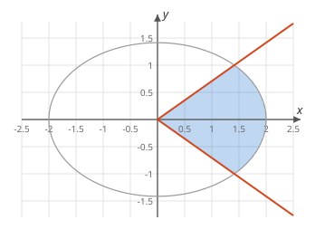

$$\int_{-\pi/4}^{\pi/4}d\varphi\int_0^2e^{\rho^2}\frac{\rho}{\sqrt2}\thinspace d\rho = \frac{\pi}{2}\cdot\frac{1}{\sqrt2}\cdot\frac{e^4 - 1}{2} = \frac{\sqrt2\thinspace\pi\thinspace(e^4 - 1)}{8} \approx 29{,}7663$$

**Respuesta:**

- a) $2\sqrt2\thinspace\pi$.
- b) $\sqrt2\thinspace\pi\thinspace(e^4 - 1)/8 \cong 29.7663$.

---

### 08) La integral de Gauss

Dada la $\displaystyle\iint_D e^{-x^2 - y^2}\thinspace dx\thinspace dy$ con $D = \mathbb{R}^2$.

- a) Calcúlela usando coordenadas polares.
- b) Trabajando en cartesianas, demuestre que su resultado es del tipo $\left(\displaystyle\int_{-\infty}^{+\infty}e^{-u^2}\thinspace du\right)^2$.
- c) Dada $f(z) = (2\pi)^{-1/2}e^{-z^2/2}$, demuestre que: $\displaystyle\int_{-\infty}^{+\infty}f(z)\thinspace dz = 1$.

Definida en $\mathbb{R}$, $f$ es la función de densidad de probabilidad normal estandarizada que se utiliza en múltiples aplicaciones, incluso en teoría de errores. La gráfica de $f$ se denomina "campana de Gauss".

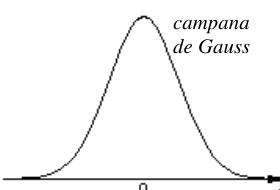

<b>Solución</b>

Solución paso a paso

**a)**

$$\int_0^{2\pi}\negthinspace\negthinspace\int_0^\infty e^{-\rho^2}\rho\thinspace d\rho\thinspace d\varphi = 2\pi\left[-\frac{e^{-\rho^2}}{2}\right]_0^\infty = 2\pi\cdot\frac12 = \pi$$

**b)** Como $e^{-x^2-y^2} = e^{-x^2}e^{-y^2}$ y el dominio es "rectangular" ($\mathbb{R}\times\mathbb{R}$), la integral se separa:

$$\iint e^{-x^2}e^{-y^2}\thinspace dx\thinspace dy = \left(\int_{-\infty}^\infty e^{-x^2}dx\right)\left(\int_{-\infty}^\infty e^{-y^2}dy\right) = \left(\int_{-\infty}^\infty e^{-u^2}du\right)^2$$

Comparando con a): $\displaystyle\int_{-\infty}^\infty e^{-u^2}du = \sqrt\pi$.

**c)** Con $u = \dfrac{z}{\sqrt2}$, $dz = \sqrt2\thinspace du$:

$$\int_{-\infty}^\infty\frac{e^{-z^2/2}}{\sqrt{2\pi}}\thinspace dz = \frac{\sqrt2}{\sqrt{2\pi}}\int_{-\infty}^\infty e^{-u^2}du = \frac{1}{\sqrt\pi}\cdot\sqrt\pi = 1 \ ✓$$

**Respuesta:**

- a) $\pi$.
- b) Se demuestra separando la integral; resulta $\int_{-\infty}^{\infty}e^{-u^2}du = \sqrt\pi$.
- c) Se demuestra con el cambio $u = z/\sqrt2$.

---

### 09) Polares en una región triangular

Calcule $\displaystyle\iint_D\frac{x + 4y}{x^2}\thinspace dx\thinspace dy$ con $D$: $x \ge y$, $x + 4y \le 4$, $y \ge 0$ usando coordenadas polares.

<b>Solución</b>

Solución paso a paso

**Paso 1 — Región en polares.**

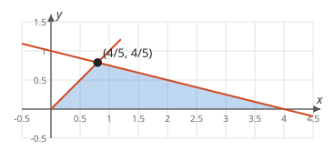

- $0 \le y \le x \Rightarrow \varphi\in[0, \pi/4]$.
- $x + 4y \le 4 \Rightarrow \rho(\cos\varphi + 4\mathop{\mathrm{sen}}\varphi) \le 4 \Rightarrow \rho \le \dfrac{4}{\cos\varphi + 4\mathop{\mathrm{sen}}\varphi}$.

**Paso 2 — Integrando por jacobiano.**

$$\frac{\rho(\cos\varphi + 4\mathop{\mathrm{sen}}\varphi)}{\rho^2\cos^2\varphi}\cdot\rho = \frac{\cos\varphi + 4\mathop{\mathrm{sen}}\varphi}{\cos^2\varphi}$$

No depende de $\rho$.

**Paso 3 — Integrar.** La integral en $\rho$ multiplica por la longitud del intervalo:

$$\int_0^{\pi/4}\frac{\cos\varphi + 4\mathop{\mathrm{sen}}\varphi}{\cos^2\varphi}\cdot\frac{4}{\cos\varphi + 4\mathop{\mathrm{sen}}\varphi}\thinspace d\varphi = \int_0^{\pi/4}\frac{4}{\cos^2\varphi}\thinspace d\varphi = 4\tan\frac\pi4 = 4$$

**Respuesta:** $4$.

---

### 10) De polares a cartesianas

En los siguientes casos se indica una integral planteada en coordenadas polares, grafique la región correspondiente en el plano $xy$, plantee la integral en coordenadas cartesianas y resuélvala en alguno de los dos sistemas de coordenadas.

- a) $\displaystyle\int_0^{\pi/2}d\varphi\int_0^{2\cos(\varphi)}\rho^3\thinspace d\rho$.
- b) $\displaystyle\int_{-\pi/6}^{\pi/3}d\varphi\int_0^{\sqrt3/\cos(\varphi)}\rho^2\cos(\varphi)\thinspace d\rho$.

<b>Solución</b>

Solución paso a paso

**Clave:** el integrando polar ya incluye el jacobiano $\rho$. Para obtener $f$ hay que **dividir por $\rho$**.

**a)**

*Región:* $\rho = 2\cos\varphi \iff \rho^2 = 2\rho\cos\varphi \iff x^2 + y^2 = 2x$, la circunferencia de centro $(1,0)$ y radio 1. Con $\varphi\in[0,\pi/2]$ queda la **mitad superior** del disco.

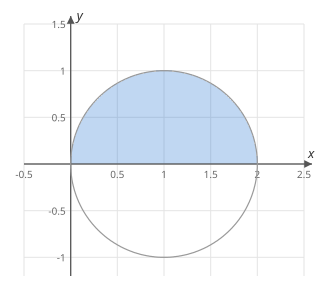

*Integrando:* $\rho^3 = \rho^2\cdot\rho$ ⇒ $f = \rho^2 = x^2 + y^2$.

*Cartesianas:*

$$\int_0^2dx\int_0^{\sqrt{2x - x^2}}(x^2 + y^2)\thinspace dy$$

*Cálculo en polares:*

$$\int_0^{\pi/2}\frac{(2\cos\varphi)^4}{4}d\varphi = 4\int_0^{\pi/2}\cos^4\varphi\thinspace d\varphi = 4\cdot\frac{3\pi}{16} = \frac{3\pi}{4}$$

**b)**

*Región:*

- $\rho \le \dfrac{\sqrt3}{\cos\varphi} \iff x \le \sqrt3$.
- $\varphi = \frac\pi3$ es la recta $y = \sqrt3\thinspace x$ y $\varphi = -\frac\pi6$ es la recta $y = -\dfrac{x}{\sqrt3}$.

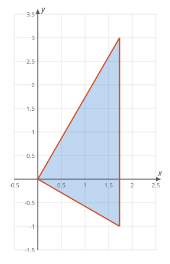

*Integrando:* $\rho^2\cos\varphi = (\rho\cos\varphi)\thinspace\rho$ ⇒ $f = x$.

*Cartesianas:*

$$\int_0^{\sqrt3}x\thinspace dx\int_{-x/\sqrt3}^{\sqrt3x}dy$$

*Cálculo:*

$$\int_0^{\sqrt3}x\left(\sqrt3 + \frac{1}{\sqrt3}\right)x\thinspace dx = \frac{4}{\sqrt3}\cdot\frac{(\sqrt3)^3}{3} = \frac{4}{\sqrt3}\cdot\sqrt3 = 4$$

**Respuesta:**

- a) $3\pi/4$; planteo en cartesianas: $\displaystyle\int_0^2dx\int_0^{\sqrt{2x - x^2}}(x^2 + y^2)\thinspace dy$.
- b) $4$; planteo en cartesianas: $\displaystyle\int_0^{\sqrt3}x\thinspace dx\int_{-x/\sqrt3}^{\sqrt3x}dy$.

---

### 11) De cilíndricas a cartesianas

Dada $\displaystyle\int_0^{\pi/2}d\varphi\int_0^2d\rho\int_0^{4-\rho^2}\rho^2\thinspace dz$ planteada en coordenadas cilíndricas, represente la región de integración en el espacio $xyz$, plantee la integral en coordenadas cartesianas y resuélvala en alguno de los dos sistemas de coordenadas.

<b>Solución</b>

Solución paso a paso

**Región:**

- $\varphi\in[0,\pi/2]$ y $\rho\in[0,2]$: el cuarto de disco $x, y \ge 0$, $x^2+y^2 \le 4$.
- $0 \le z \le 4 - \rho^2$: bajo el **paraboloide** $z = 4 - x^2 - y^2$.

Es la cuarta parte (1.er octante) del sólido entre el plano $xy$ y el paraboloide.

**Integrando:** $\rho^2 = \rho\cdot\rho$, y el segundo $\rho$ es el jacobiano ⇒ $f = \rho = \sqrt{x^2+y^2}$.

**Cartesianas:**

$$\int_0^2dx\int_0^{\sqrt{4-x^2}}dy\int_0^{4-x^2-y^2}\sqrt{x^2+y^2}\thinspace dz$$

**Cálculo en cilíndricas:**

$$\frac\pi2\int_0^2\rho^2(4 - \rho^2)\thinspace d\rho = \frac\pi2\left(\frac{32}{3} - \frac{32}{5}\right) = \frac\pi2\cdot\frac{64}{15} = \frac{32\pi}{15}$$

**Respuesta:** $\dfrac{32}{15}\pi$; planteo en cartesianas: $\displaystyle\int_0^2dx\int_0^{\sqrt{4-x^2}}dy\int_0^{4-x^2-y^2}\sqrt{x^2+y^2}\thinspace dz$.

---

### 12) Volúmenes con integrales triples

Calcule mediante integrales triples el volumen del cuerpo $H$, usando el sistema de coordenadas que crea más conveniente.

- a) $H$ definido por $2y \ge x^2 + z$, $x + y \le 4$, 1° octante.
- b) $H = \lbrace(x,y,z) \in \mathbb{R}^3 \ /\ x + y + z \le 6 \ \wedge\ z \ge x + y \ \wedge\ x \ge 0 \wedge y \ge 0\rbrace$.
- c) $H$ definido por $x^2 + z^2 \le 2ax$, interior a la esfera de radio $2a$ con centro en el origen de coordenadas.
- d) $H$ definido por $z \ge \sqrt{x^2 + y^2}$, $x^2 + y^2 + z^2 \le 2a^2$ con $a > 0$.
- e) $H = \lbrace(x,y,z) \in \mathbb{R}^3 \ /\ z \ge x^2 \ \wedge\ x \ge z^2 \ \wedge\ x \ge |y|\rbrace$.
- f) $H$ definido por $x^2 + z^2 \le 9$, $y \ge 2x$, $y \le 2x + 4$.
- g) $H$ definido por $y \ge x^2$, $x^2 + y^2 \le 2$, $z \ge 0$, $z \le x$.
- h) $H$ definido por $x^2 + 2y^2 + z \le 32$, $z \ge x^2$.

<b>Solución</b>

Solución paso a paso

**Método general:** $V = \displaystyle\iint_{D}(z_{\text{techo}} - z_{\text{piso}})\thinspace dA$, o la variable que convenga en el lugar de $z$.

**a)**

- *Piso y techo:* $0 \le z \le 2y - x^2$, que requiere $y \ge x^2/2$.
- *Proyección sobre $xy$:* $x \ge 0$, $\frac{x^2}{2} \le y \le 4 - x$. Las curvas se cortan en $x = 2$.

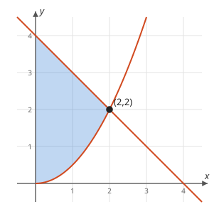

$$V = \int_0^2dx\int_{x^2/2}^{4-x}(2y - x^2)\thinspace dy = \int_0^2\left[y^2 - x^2y\right]_{x^2/2}^{4-x}dx = \int_0^2\left(16 - 8x - 3x^2 + x^3 + \frac{x^4}{4}\right)dx$$

$$= 32 - 16 - 8 + 4 + \frac{8}{5} = \frac{68}{5}$$

**b)**

- *Piso y techo:* $x + y \le z \le 6 - x - y$, que requiere $x + y \le 3$.
- *Proyección:* el triángulo $x, y \ge 0$, $x + y \le 3$. La altura es $6 - 2(x + y)$.

$$V = \int_0^3dx\int_0^{3-x}(6 - 2x - 2y)\thinspace dy = \int_0^3(3 - x)^2\thinspace dx = 9$$

**c)** Es la **bóveda de Viviani**.

- El cilindro $x^2 + z^2 \le 2ax$ tiene eje paralelo al eje $y$, con centro $(a, 0)$ y radio $a$ en el plano $xz$.
- Polares en $xz$: $x = \rho\cos\theta$, $z = \rho\mathop{\mathrm{sen}}\theta$, con $\rho \le 2a\cos\theta$ y $\theta\in[-\pi/2, \pi/2]$.
- $y$ va de $-\sqrt{4a^2 - \rho^2}$ a $+\sqrt{4a^2 - \rho^2}$.

$$V = \int_{-\pi/2}^{\pi/2}d\theta\int_0^{2a\cos\theta}2\sqrt{4a^2 - \rho^2}\thinspace\rho\thinspace d\rho = \int_{-\pi/2}^{\pi/2}\frac23\left(8a^3 - 8a^3|\mathop{\mathrm{sen}}\theta|^3\right)d\theta$$

$$= \frac{16a^3}{3}\left(\pi - 2\cdot\frac23\right) = \frac{16}{9}a^3(3\pi - 4)$$

**d)** Es un "cono de helado". En **esféricas**:

- el cono $z = \sqrt{x^2+y^2}$ es $\theta = \pi/4$;
- la esfera es $r = \sqrt2\thinspace a$.

$$V = \int_0^{2\pi}d\varphi\int_0^{\pi/4}\mathop{\mathrm{sen}}\theta\thinspace d\theta\int_0^{\sqrt2a}r^2\thinspace dr = 2\pi\left(1 - \frac{\sqrt2}{2}\right)\frac{2\sqrt2\thinspace a^3}{3} = \frac43\pi a^3(\sqrt2 - 1)$$

**e)**

- En el plano $xz$: $x^2 \le z$ y $z^2 \le x \Rightarrow x^2 \le z \le \sqrt x$, con $x\in[0,1]$.
- En $y$: $-x \le y \le x$, de longitud $2x$.

$$V = \int_0^1dx\int_{x^2}^{\sqrt x}dz\int_{-x}^{x}dy = \int_0^1 2x(\sqrt x - x^2)\thinspace dx = 2\left(\frac25 - \frac14\right) = \frac{3}{10}$$

**f)** La sección en $xz$ es el disco $x^2 + z^2 \le 9$, de área $9\pi$. Para cada punto del disco, $y$ va de $2x$ a $2x + 4$, siempre con longitud 4:

$$V = \iint_{x^2+z^2\le9}4\thinspace dA = 4\cdot9\pi = 36\pi$$

**g)**

- $0 \le z \le x$ requiere $x \ge 0$.
- Proyección: $x^2 \le y \le \sqrt{2 - x^2}$, con $x\in[0,1]$ (se cortan en $(1,1)$).

$$V = \int_0^1x\left(\sqrt{2 - x^2} - x^2\right)dx = \left[-\frac{(2 - x^2)^{3/2}}{3}\right]_0^1 - \frac14 = \frac{2\sqrt2 - 1}{3} - \frac14 = \frac23\sqrt2 - \frac{7}{12}$$

**h)**

- *Piso y techo:* $x^2 \le z \le 32 - x^2 - 2y^2$.
- *Proyección:* igualando, $2x^2 + 2y^2 \le 32 \iff x^2 + y^2 \le 16$.

En polares:

$$V = \iint(32 - 2x^2 - 2y^2)\thinspace dA = \int_0^{2\pi}\negthinspace\negthinspace\int_0^4(32 - 2\rho^2)\rho\thinspace d\rho\thinspace d\varphi = 2\pi(256 - 128) = 256\pi$$

**Respuesta:**

- a) $\dfrac{68}{5}$.
- b) $9$.
- c) $\dfrac{16}{9}a^3(3\pi - 4)$.
- d) $\dfrac43\pi a^3(\sqrt2 - 1)$.
- e) $\dfrac{3}{10}$.
- f) $36\pi$.
- g) $\dfrac23\sqrt2 - \dfrac{7}{12}$.
- h) $256\pi$.

---

### 13) Centro de masa de un cuerpo

Determine el centro de masa del cuerpo limitado por $y = x$, $y = 2x$, $x + y + z = 6$, $z = 0$, si su densidad en cada punto es proporcional a la distancia desde el punto al plano $yz$.

<b>Solución</b>

Solución paso a paso

**Paso 1 — Cuerpo.** $0 \le z \le 6 - x - y$, sobre la región del plano entre $y = x$ e $y = 2x$ con $x + y \le 6$. La densidad es $\delta = kx$.

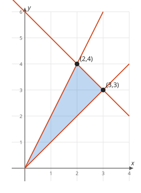

La recta $x + y = 6$ corta a $y = 2x$ en $(2,4)$ y a $y = x$ en $(3,3)$. Partimos en $x = 2$:

- $x\in[0,2]$: $x \le y \le 2x$;
- $x\in[2,3]$: $x \le y \le 6 - x$.

**Paso 2 — Masa** ($M = \iiint kx\thinspace dV = k\iint x(6 - x - y)\thinspace dA$).

- Tramo 1: $\displaystyle\int_x^{2x}(6 - x - y)\thinspace dy = 6x - \frac52x^2$, y $\displaystyle\int_0^2x\left(6x - \frac52x^2\right)dx = 16 - 10 = 6$.
- Tramo 2: $\displaystyle\int_x^{6-x}(6 - x - y)\thinspace dy = \frac{(6 - 2x)^2}{2}$, y $\displaystyle\int_2^3x\thinspace\frac{(6-2x)^2}{2}dx = \frac32$.

$M = 7{,}5\thinspace k$.

**Paso 3 — Momentos.** Con el mismo esquema de integración:

- $\iiint x\cdot kx\thinspace dV = k(8 + 3{,}4) = 11{,}4\thinspace k$.
- $\iiint y\cdot kx\thinspace dV = k(11{,}4\overline{6} + 4{,}1\overline{3}) = 15{,}6\thinspace k$.
- $\iiint z\cdot kx\thinspace dV = k\iint x\frac{(6 - x - y)^2}{2}dA = k(8{,}2\overline{6} + 0{,}7\overline{3}) = 9\thinspace k$.

**Paso 4 — Coordenadas.**

$$x_G = \frac{11{,}4}{7{,}5} = \frac{38}{25}, \qquad y_G = \frac{15{,}6}{7{,}5} = \frac{52}{25}, \qquad z_G = \frac{9}{7{,}5} = \frac65$$

**Respuesta:** $G = (38/25,\ 52/25,\ 6/5)$.

---

### 14) Momento de inercia respecto del eje $x$

Dado el cuerpo definido por $\sqrt{y^2 + z^2} \le x \le 4$, calcule su momento de inercia respecto del eje $x$ sabiendo que su densidad es $\delta(x,y,z) = k|y|$ con $k$ constante.

<b>Solución</b>

Solución paso a paso

**Paso 1 — Coordenadas cilíndricas de eje $x$:** $y = \rho\cos\theta$, $z = \rho\mathop{\mathrm{sen}}\theta$, $dV = \rho\thinspace d\rho\thinspace d\theta\thinspace dx$. El cuerpo es el cono $\rho \le x \le 4$, es decir, para $x\in[0,4]$, $\rho\in[0,x]$.

**Paso 2 — Integrando.** El cuadrado de la distancia al eje $x$ es $y^2 + z^2 = \rho^2$, y $\delta = k\rho|\cos\theta|$.

$$I_x = \int_0^4dx\int_0^x d\rho\int_0^{2\pi}\rho^2\cdot k\rho|\cos\theta|\cdot\rho\thinspace d\theta = k\left(\int_0^{2\pi}|\cos\theta|\thinspace d\theta\right)\int_0^4\frac{x^5}{5}\thinspace dx = 4k\cdot\frac{4^6}{30}$$

$$I_x = \frac{16384}{30}k = \frac{8192}{15}k$$

**Respuesta:** $k\thinspace8192/15$.

---

### 15) Volumen de un cono

Determine el volumen de un cuerpo cónico (cono circular recto) de altura $h$ y ángulo de apertura $\omega$; ubíquelo en la posición más conveniente para facilitar los cálculos.

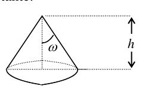

<b>Solución</b>

Solución paso a paso

**Paso 1 — Posición.** Vértice en el origen y eje en el eje $z$, abierto hacia arriba. En cada altura $z\in[0,h]$, el radio de la sección es $\rho = z\tan\omega$, porque $\omega$ es el ángulo entre el eje y la generatriz.

**Paso 2 — Integral en cilíndricas.**

$$V = \int_0^{2\pi}d\varphi\int_0^hdz\int_0^{z\tan\omega}\rho\thinspace d\rho = 2\pi\int_0^h\frac{z^2\tan^2\omega}{2}\thinspace dz = \frac{\pi h^3}{3}\tan^2\omega$$

Coincide con $\frac13\pi R^2h$, con $R = h\tan\omega$.

**Respuesta:** $\dfrac{\pi h^3}{3}[\mathop{\mathrm{tg}}(\omega)]^2$.

---

### 16) Simetría

Sea el cuerpo $H$ convexo y simétrico respecto del plano $xz$, calcule $\displaystyle\iiint_H y^n\thinspace dx\thinspace dy\thinspace dz$ cuando $n$ es un número natural impar.

<b>Solución</b>

**Respuesta:** $0$. Al ser $H$ simétrico respecto del plano $xz$, si $(x,y,z) \in H$ también $(x,-y,z) \in H$. Como $n$ es impar, $(-y)^n = -y^n$: las contribuciones de los puntos simétricos se cancelan de a pares.

---

### 17) Masas

Calcule la masa de los siguiente cuerpos:

- a) Cuerpo limitado por $z = 4 - x^2 - y^2$, $z = 8 - 2x^2 - 2y^2$ si la densidad en cada punto es proporcional a la distancia desde el punto al eje $z$.
- b) Cuerpo definido por $z \ge |y|$, $x^2 + y^2 + z^2 \le 1$ si la densidad en cada punto es proporcional a la distancia desde el punto al plano $xy$.
- c) Cuerpo definido por $x^2 + y^2 \le 9$, $0 \le z \le 2$ con densidad en cada punto proporcional a la distancia desde el punto al plano $xz$.

<b>Solución</b>

Solución paso a paso

**a)**

- *Intersección:* $4 - \rho^2 = 8 - 2\rho^2 \Rightarrow \rho = 2$. Para $\rho < 2$, el techo es $8 - 2\rho^2$ y la altura es $4 - \rho^2$.
- *Densidad:* $k\rho$.

$$M = \int_0^{2\pi}\negthinspace\negthinspace\int_0^2k\rho\thinspace(4 - \rho^2)\thinspace\rho\thinspace d\rho\thinspace d\varphi = 2\pi k\left(\frac{32}{3} - \frac{32}{5}\right) = \frac{128}{15}\pi k$$

**b)** *Densidad:* $k|z| = kz$, porque $z \ge 0$.

Usamos cilíndricas de eje $x$ ($y = \rho\cos\theta$, $z = \rho\mathop{\mathrm{sen}}\theta$):

- $z \ge |y| \iff \theta\in[\pi/4, 3\pi/4]$;
- la esfera es $x^2 + \rho^2 \le 1$.

$$M = \int_{-1}^1dx\int_{\pi/4}^{3\pi/4}d\theta\int_0^{\sqrt{1-x^2}}k\rho\mathop{\mathrm{sen}}\theta\thinspace\rho\thinspace d\rho = k\sqrt2\int_{-1}^1\frac{(1-x^2)^{3/2}}{3}dx = k\sqrt2\cdot\frac13\cdot\frac{3\pi}{8} = \frac{k\pi\sqrt2}{8}$$

**c)** *Densidad:* $k|y|$. En cilíndricas:

$$M = \int_0^2dz\int_0^{2\pi}d\varphi\int_0^3k\rho|\mathop{\mathrm{sen}}\varphi|\thinspace\rho\thinspace d\rho = 2k\cdot4\cdot9 = 72k$$

**Respuesta:**

- a) $k\dfrac{128}{15}\pi$.
- b) $k\pi\sqrt2/8$.
- c) $72k$.

---

### 18) Volumen de un recipiente

En la figura se representa la forma de un recipiente cuya ecuación es $z = 8x^2 + 8y^2 - (x^2 + y^2)^2$ con $(x,y) \in [-2,2]\times[-2,2]$; el recipiente se apoya en el plano $xy$ en las puntas y en el origen.

Calcule el volumen de líquido que contiene el recipiente cuando se lo llena exactamente hasta el borde superior; considere que la expresión dada permite calcular $z$ en centímetros cuando $x$ e $y$ están expresados en cm.

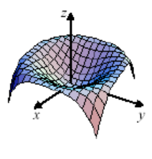

<b>Solución</b>

Solución paso a paso

**Paso 1 — Forma en polares.** $z = 8\rho^2 - \rho^4$.

- Crece desde $z = 0$ (origen) hasta el máximo en $\rho^2 = 4$, es decir $\rho = 2$, donde $z = 32 - 16 = 16$.
- Después decrece: en las puntas, $\rho = 2\sqrt2$, vuelve a $z = 0$.

El "cuenco" es la parte $\rho \le 2$, y su **borde superior** es la circunferencia $\rho = 2$ a altura $16$, que toca los lados del cuadrado en sus puntos medios.

**Paso 2 — Volumen de líquido:** entre el fondo $z = 8\rho^2 - \rho^4$ y el nivel $z = 16$, para $\rho \le 2$:

$$V = \int_0^{2\pi}\negthinspace\negthinspace\int_0^2\left(16 - 8\rho^2 + \rho^4\right)\rho\thinspace d\rho\thinspace d\varphi$$

Observar que $16 - 8\rho^2 + \rho^4 = (4 - \rho^2)^2 \ge 0$.

**Paso 3 — Calcular.**

$$V = 2\pi\left[8\rho^2 - 2\rho^4 + \frac{\rho^6}{6}\right]_0^2 = 2\pi\left(32 - 32 + \frac{64}{6}\right) = \frac{64\pi}{3}\ \text{cm}^3 \approx 67{,}0\ \text{cm}^3$$

**Respuesta:** $64\pi/3$ (cm³).

---

## Cuestionario

### Cuestionario a)

¿Pueden usarse coordenadas polares en regiones que contengan al origen? (recuerde que el jacobiano se anula en el origen).

<b>Solución</b>

**Respuesta:** **Sí.** El teorema de cambio de variables admite que el jacobiano se anule (o que la transformación no sea biyectiva) en un conjunto de **área nula**, como un punto o un segmento. Una forma de verlo: se integra en la región sin un disquito de radio $\varepsilon$ alrededor del origen, donde todo vale, y se hace $\varepsilon \to 0$. Lo que se quita tiende a 0.

---

### Cuestionario b)

¿Por qué el área de un círculo no cambia si se incluye o no la circunferencia frontera?.

<b>Solución</b>

**Respuesta:** porque la circunferencia tiene **área nula**: se puede cubrir con rectángulos de área total tan chica como se quiera. Agregar o quitar un conjunto de área nula no cambia el valor de una integral doble.

---

### Cuestionario c)

Realice una interpretación geométrica de la fórmula de cambio de variables en integrales dobles.

<b>Solución</b>

**Respuesta:** la transformación $T(u,v)$ lleva un rectangulito $du\times dv$ del plano $uv$ a un "paralelogramo curvo" del plano $xy$. Ese paralelogramo está generado aproximadamente por los vectores $T'_u\thinspace du$ y $T'_v\thinspace dv$, así que su área es:

$$|T'_u\times T'_v|\thinspace du\thinspace dv = \left|\frac{\partial(x,y)}{\partial(u,v)}\right|du\thinspace dv$$

El valor absoluto del jacobiano es el **factor de escala local de áreas**. Por eso $dx\thinspace dy = |J|\thinspace du\thinspace dv$. En polares, el "rectangulito" de lados $d\rho$ y $\rho\thinspace d\varphi$ tiene área $\rho\thinspace d\rho\thinspace d\varphi$.

---

### Cuestionario d)

Describa las superficies coordenadas de cilíndricas y esféricas en el espacio $xyz$.

<b>Solución</b>

**Respuesta:**

- **Cilíndricas** $(\rho, \varphi, z)$:
  - $\rho = $ cte: cilindros circulares de eje $z$;
  - $\varphi = $ cte: semiplanos verticales que contienen al eje $z$;
  - $z = $ cte: planos horizontales.
- **Esféricas** $(r, \theta, \varphi)$:
  - $r = $ cte: esferas centradas en el origen;
  - $\theta = $ cte (ángulo con $z^+$): conos circulares de eje $z$ y vértice en el origen (para $\theta = \pi/2$, el plano $xy$);
  - $\varphi = $ cte: semiplanos que contienen al eje $z$.

---

[← Volver al menú principal](../README.md)
