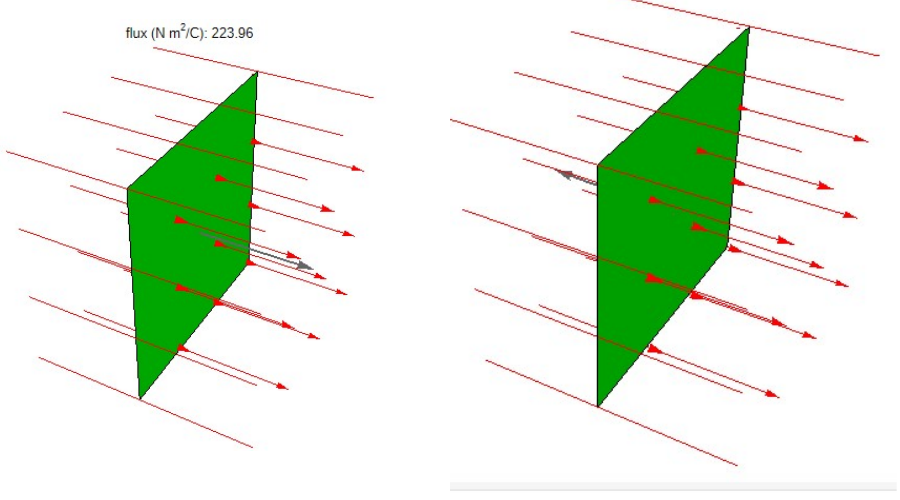

# Unidad 10 — Integrales de superficie y flujo

Resumen del material teórico de la unidad ([U10-Teoria-Integrales-Superficie.pdf](../aula-virtual/10-Integrales-Superficie/U10-Teoria-Integrales-Superficie.pdf)) y de los apuntes [Otras formas de la integral de superficie](../aula-virtual/10-Integrales-Superficie/Integral-Superficie-Otras-Formas.pdf) y [Gráficos de flujo](../aula-virtual/10-Integrales-Superficie/Graficos-Flujo.pdf).

**Objetivos de la unidad:**

1. Parametrizar superficies (cilíndricas, cónicas, cuádricas, gráficos).
2. Calcular áreas e integrales de campos escalares sobre superficies.
3. Calcular el **flujo** de un campo vectorial a través de una superficie orientada.

---

## 1. Superficies parametrizadas

Una superficie es $S: \vec X = \vec F(u,v)$ con $(u,v)\in D$.

**Vector normal:**

$$\vec N = \vec F'_u\wedge\vec F'_v$$

- $S$ es **suave** si $\vec F \in C^1$ y $\vec N \ne \vec 0$ en $D$. Entonces el **versor normal** $\breve n = \vec N/\lVert\vec N\rVert$ varía con continuidad.
- $S$ es **suave a trozos** si se puede dividir en finitas partes suaves (por ejemplo, la frontera de un cubo).
- **Orientable:** tiene dos "caras" y se puede elegir $\breve n$ en forma continua (la cinta de Möbius no lo es).
- Si $S$ es **cerrada** (la frontera de un cuerpo), por convención se orienta con **normal saliente**.

### Superficies cilíndricas y cónicas

- **Cilíndrica:** se genera con rectas paralelas a un vector $\vec w$ que pasan por una curva directriz $\vec c(u)$:

$$\vec X(u,v) = \vec c(u) + v\,\vec w$$

- **Cónica:** se genera con rectas que unen un vértice $V$ con los puntos de una directriz $\vec c(u)$:

$$\vec X(u,v) = V + v\,(\vec c(u) - V)$$

  Si $V$ está en el plano de la directriz, la "superficie cónica" es ese plano.

Para obtener la **ecuación cartesiana** hay que **eliminar los parámetros**.

### Parametrizaciones habituales

| Superficie | Parametrización | $\lVert\vec N\rVert$ |
|---|---|---|
| Gráfico $z = f(x,y)$ | $(x,\ y,\ f(x,y))$ | $\sqrt{1 + f_x'^2 + f_y'^2}$ |
| Cilindro $x^2 + y^2 = R^2$ | $(R\cos u,\ R\operatorname{sen}u,\ v)$ | $R$ |
| Esfera de radio $R$ | $(R\operatorname{sen}\theta\cos\varphi,\ R\operatorname{sen}\theta\operatorname{sen}\varphi,\ R\cos\theta)$ | $R^2\operatorname{sen}\theta$ |
| Elipsoide $\frac{x^2}{a^2} + \frac{y^2}{b^2} + \frac{z^2}{c^2} = 1$ | $(a\operatorname{sen}\theta\cos\varphi,\ b\operatorname{sen}\theta\operatorname{sen}\varphi,\ c\cos\theta)$ | |
| Cono $z = k\sqrt{x^2+y^2}$ | $(\rho\cos\varphi,\ \rho\operatorname{sen}\varphi,\ k\rho)$ | $\rho\sqrt{1 + k^2}$ |

**Normal de un gráfico $z = f(x,y)$:** $\vec N = (-f'_x,\ -f'_y,\ 1)$, que apunta hacia arriba ($z^+$).

---

## 2. Área e integral de un campo escalar

$$d\sigma = \lVert\vec F'_u\wedge\vec F'_v\rVert\,du\,dv, \qquad A(S) = \iint_S d\sigma, \qquad \iint_S f\,d\sigma = \iint_D f(\vec F(u,v))\,\lVert\vec N\rVert\,du\,dv$$

Estas integrales **no dependen de la orientación**.

**Superficie implícita $G(x,y,z) = 0$**, proyectable sobre el plano $xy$ (con $G'_z \ne 0$):

$$d\sigma = \frac{\lVert\nabla G\rVert}{|G'_z|}\,dx\,dy, \qquad \iint_S\vec f\cdot d\vec\sigma = \iint_{D_{xy}}\frac{\vec f\cdot\nabla G}{|G'_z|}\,dx\,dy$$

En la segunda fórmula, la orientación es la de $\nabla G$. Análogamente se proyecta sobre $xz$ o $yz$, cambiando $G'_z$ por $G'_y$ o $G'_x$.

**Aplicaciones (chapas):** masa $\iint\delta\,d\sigma$, centro de masa, momento de inercia $\iint d^2\,\delta\,d\sigma$.

---

## 3. Flujo de un campo vectorial

$$\Phi = \iint_S\vec f\cdot d\vec\sigma = \iint_S\vec f\cdot\breve n\,d\sigma = \pm\iint_D\vec f(\vec F(u,v))\cdot(\vec F'_u\wedge\vec F'_v)\,du\,dv$$

- Se toma $+$ si $\vec F'_u\wedge\vec F'_v$ apunta en el sentido de la orientación pedida y $-$ si no.
- **Notar:** en la última integral **no** se divide por la norma, porque $\breve n\,d\sigma = \vec N\,du\,dv$.
- Mide "cuánto campo atraviesa" la superficie: sólo cuenta la componente **normal** $\vec f\cdot\breve n$.
- **Cambia de signo** si se invierte la orientación.

### Casos simples (sin integrar)

- **$\vec f\cdot\breve n$ constante sobre $S$** ⇒ $\Phi = (\vec f\cdot\breve n)\cdot A(S)$.
  - $\vec f = k\breve n$ ⇒ $\Phi = k\,A(S)$.
  - $\vec f = (x,y,z)$ sobre una esfera de radio $R$ ⇒ $\vec f\cdot\breve n = R$ ⇒ $\Phi = R\cdot4\pi R^2$.
- **Campo constante y superficie plana** ⇒ $\Phi = \vec f\cdot\breve n\cdot A(S)$.
- **Campo tangente a $S$** ⇒ $\Phi = 0$.
- **Campo de gradientes $\nabla\phi$ a través de una equipotencial** orientada hacia potenciales crecientes ⇒ $\Phi = \iint\lVert\nabla\phi\rVert\,d\sigma > 0$.
- **Simetrías:** si la región de integración es simétrica y el integrando es impar, la integral es 0.

### Superficies cerradas

El flujo total es la suma de los flujos a través de cada cara, cada una con normal **saliente**. En la Unidad 11, el **teorema de la divergencia** permite calcularlo con una integral triple:

$$\oint\!\!\!\oint_{\partial H}\vec f\cdot\breve n\,d\sigma = \iiint_H\operatorname{div}\vec f\,dV$$

---

## 4. Estrategia para los ejercicios

1. **Parametrizar** la superficie. Si es un gráfico, usar $(x, y, f(x,y))$; si no, cilíndricas o esféricas.
2. Calcular $\vec N = \vec F'_u\wedge\vec F'_v$ y **chequear su sentido** contra la orientación pedida (por ejemplo, "hacia $z^+$" pide $N_z > 0$). Si no coincide, cambiar el signo.
3. Determinar la **región $D$** de los parámetros: es la proyección de $S$.
4. Calcular:
   - **área / campo escalar:** $\iint f\,\lVert\vec N\rVert$;
   - **flujo:** $\iint\vec f\cdot\vec N$.
5. Para superficies cerradas: sumar las caras con normal saliente, o usar el teorema de la divergencia.

---

## 5. Resumen de fórmulas

| Concepto | Fórmula |
|---|---|
| Normal | $\vec N = \vec F'_u\wedge\vec F'_v$ |
| Normal de un gráfico | $(-f'_x, -f'_y, 1)$ |
| Elemento de área | $d\sigma = \lVert\vec N\rVert\,du\,dv$ |
| Área | $\iint_D\lVert\vec N\rVert\,du\,dv$ |
| Campo escalar | $\iint_D f\,\lVert\vec N\rVert\,du\,dv$ |
| Flujo | $\iint_D\vec f\cdot\vec N\,du\,dv$ (signo según la orientación) |
| Implícita | $d\sigma = \frac{\lVert\nabla G\rVert}{\lvert G'_z\rvert}\,dx\,dy$ |
| Esfera | $d\sigma = R^2\operatorname{sen}\theta\,d\theta\,d\varphi$, $\ \breve n = \vec X/R$ |

---

[← Volver al menú principal](../README.md)
