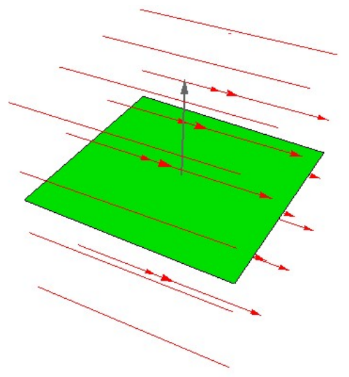

# Unidad 10 — Integrales de superficie y flujo

Resumen del material teórico de la unidad ([U10-Teoria-Integrales-Superficie.pdf](../aula-virtual/10-Integrales-Superficie/U10-Teoria-Integrales-Superficie.pdf)) y de los apuntes [Otras formas de la integral de superficie](../aula-virtual/10-Integrales-Superficie/Integral-Superficie-Otras-Formas.pdf) y [Gráficos de flujo](../aula-virtual/10-Integrales-Superficie/Graficos-Flujo.pdf), complementado con el [resumen de UTNianos](../UTNianos/Resumen%20AM2.pdf).

**Objetivos de la unidad:**

1. Parametrizar superficies (cilíndricas, cónicas, cuádricas, gráficos).
2. Calcular áreas e integrales de campos escalares sobre superficies.
3. Calcular el **flujo** de un campo vectorial a través de una superficie orientada.

---

## 1. Superficies parametrizadas

Una superficie es $S: \vec X = \vec F(u,v)$ con $(u,v)\in D$.

**Vector normal:**

$$\vec N = \vec F'_u\times\vec F'_v$$

- $S$ es **suave** si $\vec F \in C^1$ y $\vec N \ne \vec 0$ en $D$. Entonces el **versor normal** $\breve n = \vec N/\lVert\vec N\rVert$ varía con continuidad.
- $S$ es **suave a trozos** si se puede dividir en finitas partes suaves (por ejemplo, la frontera de un cubo).
- **Orientable:** tiene dos "caras" y se puede elegir $\breve n$ en forma continua (la cinta de Möbius no lo es).
- Si $S$ es **cerrada** (la frontera de un cuerpo), por convención se orienta con **normal saliente**.

### Superficies cilíndricas y cónicas

- **Cilíndrica:** se genera con rectas paralelas a un vector $\vec w$ que pasan por una curva directriz $\vec c(u)$:

$$\vec X(u,v) = \vec c(u) + v\thinspace\vec w$$

- **Cónica:** se genera con rectas que unen un vértice $V$ con los puntos de una directriz $\vec c(u)$:

$$\vec X(u,v) = V + v\thinspace(\vec c(u) - V)$$

  Si $V$ está en el plano de la directriz, la "superficie cónica" es ese plano.

Para obtener la **ecuación cartesiana** hay que **eliminar los parámetros**.

### Parametrizaciones habituales

| Superficie | Parametrización | $\lVert\vec N\rVert$ |
|---|---|---|
| Gráfico $z = f(x,y)$ | $(x,\ y,\ f(x,y))$ | $\sqrt{1 + f_x'^2 + f_y'^2}$ |
| Cilindro $x^2 + y^2 = R^2$ | $(R\cos u,\ R\mathop{\mathrm{sen}}u,\ v)$ | $R$ |
| Esfera de radio $R$ | $(R\mathop{\mathrm{sen}}\theta\cos\varphi,\ R\mathop{\mathrm{sen}}\theta\mathop{\mathrm{sen}}\varphi,\ R\cos\theta)$ | $R^2\mathop{\mathrm{sen}}\theta$ |
| Elipsoide $\frac{x^2}{a^2} + \frac{y^2}{b^2} + \frac{z^2}{c^2} = 1$ | $(a\mathop{\mathrm{sen}}\theta\cos\varphi,\ b\mathop{\mathrm{sen}}\theta\mathop{\mathrm{sen}}\varphi,\ c\cos\theta)$ | |
| Cono $z = k\sqrt{x^2+y^2}$ | $(\rho\cos\varphi,\ \rho\mathop{\mathrm{sen}}\varphi,\ k\rho)$ | $\rho\sqrt{1 + k^2}$ |

**Normal de un gráfico $z = f(x,y)$:** $\vec N = (-f'_x,\ -f'_y,\ 1)$, que apunta hacia arriba ($z^+$).

---

## 2. Área e integral de un campo escalar

$$d\sigma = \lVert\vec F'_u\times\vec F'_v\rVert\thinspace du\thinspace dv, \qquad A(S) = \iint_S d\sigma, \qquad \iint_S f\thinspace d\sigma = \iint_D f(\vec F(u,v))\thinspace\lVert\vec N\rVert\thinspace du\thinspace dv$$

Estas integrales **no dependen de la orientación**.

**Superficie implícita $G(x,y,z) = 0$**, proyectable sobre el plano $xy$ (con $G'_z \ne 0$):

$$d\sigma = \frac{\lVert\nabla G\rVert}{|G'_z|}\thinspace dx\thinspace dy, \qquad \iint_S\vec f\cdot d\vec\sigma = \iint_{D_{xy}}\frac{\vec f\cdot\nabla G}{|G'_z|}\thinspace dx\thinspace dy$$

En la segunda fórmula, la orientación es la de $\nabla G$. Análogamente se proyecta sobre $xz$ o $yz$, cambiando $G'_z$ por $G'_y$ o $G'_x$.

**Aplicaciones (chapas):** masa $\iint\delta\thinspace d\sigma$, centro de masa, momento de inercia $\iint d^2\thinspace\delta\thinspace d\sigma$.

---

## 3. Flujo de un campo vectorial

$$\Phi = \iint_S\vec f\cdot d\vec\sigma = \iint_S\vec f\cdot\breve n\thinspace d\sigma = \pm\iint_D\vec f(\vec F(u,v))\cdot(\vec F'_u\times\vec F'_v)\thinspace du\thinspace dv$$

- Se toma $+$ si $\vec F'_u\times\vec F'_v$ apunta en el sentido de la orientación pedida y $-$ si no.
- **Notar:** en la última integral **no** se divide por la norma, porque $\breve n\thinspace d\sigma = \vec N\thinspace du\thinspace dv$.
- Mide "cuánto campo atraviesa" la superficie: sólo cuenta la componente **normal** $\vec f\cdot\breve n$.
- **Cambia de signo** si se invierte la orientación.

### Casos simples (sin integrar)

- **$\vec f\cdot\breve n$ constante sobre $S$** ⇒ $\Phi = (\vec f\cdot\breve n)\cdot A(S)$.
  - $\vec f = k\breve n$ ⇒ $\Phi = k\thinspace A(S)$.
  - $\vec f = (x,y,z)$ sobre una esfera de radio $R$ ⇒ $\vec f\cdot\breve n = R$ ⇒ $\Phi = R\cdot4\pi R^2$.
- **Campo constante y superficie plana** ⇒ $\Phi = \vec f\cdot\breve n\cdot A(S)$.
- **Campo tangente a $S$** ⇒ $\Phi = 0$.
- **Campo de gradientes $\nabla\phi$ a través de una equipotencial** orientada hacia potenciales crecientes ⇒ $\Phi = \iint\lVert\nabla\phi\rVert\thinspace d\sigma > 0$.
- **Simetrías:** si la región de integración es simétrica y el integrando es impar, la integral es 0.

### Superficies cerradas

El flujo total es la suma de los flujos a través de cada cara, cada una con normal **saliente**. En la Unidad 11, el **teorema de la divergencia** permite calcularlo con una integral triple:

$$\oint\negthinspace\negthinspace\negthinspace\oint_{\partial H}\vec f\cdot\breve n\thinspace d\sigma = \iiint_H\mathop{\mathrm{div}}\vec f\thinspace dV$$

---

## 4. Complementos: superficies paramétricas y deducción del área

**Una T.L. de $\mathbb{R}^2$ en $\mathbb{R}^3$** transforma el cuadrado unitario en el paralelogramo construido sobre $T(1,0)$ y $T(0,1)$ (las columnas de su matriz). Por eso **el área 1 se transforma en $\lVert T(1,0)\times T(0,1)\rVert$**.

**Superficie parametrizada:** $\Sigma = \vec\phi(D)$, con $\vec\phi(u,v) = (x(u,v), y(u,v), z(u,v))$. Si $\vec\phi \in C^1$, la superficie es **diferenciable**.

- **Curvas coordenadas:** se obtienen fijando uno de los parámetros. Sus vectores tangentes son $\vec\phi'_u$ y $\vec\phi'_v$.
- **Plano tangente:** si $\vec\phi'_u\times\vec\phi'_v \ne \vec 0$, esos vectores generan el plano tangente (que contiene a las tangentes de todas las curvas de la superficie por el punto), y $\vec N = \vec\phi'_u\times\vec\phi'_v$ es normal:

$$(P - P_0)\cdot\big(\vec\phi'_u(u_0,v_0)\times\vec\phi'_v(u_0,v_0)\big) = 0$$

- **Superficie regular:** $\vec\phi \in C^1$ y $\vec\phi'_u\times\vec\phi'_v \ne \vec 0$ en todo el dominio (normal no nula y continua).

**Deducción de la fórmula del área.** Hipótesis: $\vec\phi \in C^1$, inyectiva en $D$, y $\vec\phi'_u\times\vec\phi'_v \ne \vec 0$ salvo en finitos puntos. Una partición de $D$ en rectángulos $\Delta u_i\Delta v_j$ induce una partición de $\Sigma$ en "cuadriláteros curvilíneos". Cada uno se aproxima por un paralelogramo en el plano tangente: es la imagen del rectángulo por la T.L. de matriz $(\vec\phi'_u\ \ \vec\phi'_v)$, así que su área es $\lVert\vec\phi'_u\times\vec\phi'_v\rVert\thinspace\Delta u_i\Delta v_j$. Sumando y tomando límite:

$$\text{Área}(\Sigma) = \iint_D\lVert\vec\phi'_u\times\vec\phi'_v\rVert\thinspace du\thinspace dv$$

**Superficie explícita $z = F(x,y)$:** $\vec\phi = (x, y, F(x,y))$, $\vec\phi'_x\times\vec\phi'_y = (-F'_x, -F'_y, 1)$, y

$$\text{Área} = \iint_{D_{xy}}\sqrt{1 + F'^2_x + F'^2_y}\thinspace dx\thinspace dy$$

Si es $x = x(y,z)$ o $y = y(x,z)$, se proyecta sobre el plano $yz$ o $xz$.

**Superficie implícita $G(x,y,z) = 0$.** El versor normal es $\breve n = \nabla G/\lVert\nabla G\rVert$, y sus componentes son los **cosenos directores**. Como $\sqrt{1 + F'^2_x + F'^2_y} = \dfrac{\lVert\nabla G\rVert}{\lvert G'_z\rvert} = \dfrac{1}{\lvert\cos(\breve n, \breve k)\rvert}$:

$$\text{Área} = \iint_{D_{xy}}\frac{dx\thinspace dy}{\lvert\cos(\breve n,\breve k)\rvert} = \iint_{D_{xz}}\frac{dx\thinspace dz}{\lvert\cos(\breve n,\breve\jmath)\rvert} = \iint_{D_{yz}}\frac{dy\thinspace dz}{\lvert\cos(\breve n,\breve\imath)\rvert}$$

según el plano sobre el que se proyecte.

Las fórmulas valen para superficies **regulares a trozos**: imágenes de campos inyectivos y $C^1$ definidos en uniones de recintos simples, con normal no nula salvo en un conjunto de medida nula.

---

## 5. Complementos: integral de un campo escalar, orientación y flujo

**Integral de superficie de un campo escalar** (definición). Con la partición anterior, eligiendo un punto $P_{ij}$ en cada cuadrilátero curvilíneo de área $\Delta\sigma_{ij}$:

$$\iint_\Sigma F\thinspace d\sigma = \lim\sum_i\sum_j F(P_{ij})\thinspace\Delta\sigma_{ij}$$

Se calcula igual que el área (con $F$ multiplicando), expresando una variable en función de las otras dos según la superficie y el plano de proyección.

**Superficies orientadas:**

- Una superficie **abierta orientable** tiene **dos caras**: una positiva (exterior) y otra negativa (interior), con versores normales opuestos.
- Hay superficies de **una sola cara**, como la **cinta de Möbius**: se puede recorrer entera sin atravesar ningún borde, y no se puede orientar.
- En una superficie **cerrada**, la cara positiva es la **exterior**. En la práctica, el versor se reconoce por el ángulo que forma con alguno de los ejes (por ejemplo "hacia $z^+$").

**Flujo (definición):** para $\vec F$ continuo y $\Sigma$ simple, regular a trozos y orientable, el flujo es la integral de superficie de la **componente normal** de $\vec F$:

$$\Phi = \iint_\Sigma(\vec F\cdot\breve n)\thinspace d\sigma$$

---

## 6. Estrategia para los ejercicios

1. **Parametrizar** la superficie. Si es un gráfico, usar $(x, y, f(x,y))$; si no, cilíndricas o esféricas.
2. Calcular $\vec N = \vec F'_u\times\vec F'_v$ y **chequear su sentido** contra la orientación pedida (por ejemplo, "hacia $z^+$" pide $N_z > 0$). Si no coincide, cambiar el signo.
3. Determinar la **región $D$** de los parámetros: es la proyección de $S$.
4. Calcular:
   - **área / campo escalar:** $\iint f\thinspace\lVert\vec N\rVert$;
   - **flujo:** $\iint\vec f\cdot\vec N$.
5. Para superficies cerradas: sumar las caras con normal saliente, o usar el teorema de la divergencia.

---

## 7. Resumen de fórmulas

| Concepto | Fórmula |
|---|---|
| Normal | $\vec N = \vec F'_u\times\vec F'_v$ |
| Normal de un gráfico | $(-f'_x, -f'_y, 1)$ |
| Elemento de área | $d\sigma = \lVert\vec N\rVert\thinspace du\thinspace dv$ |
| Área | $\iint_D\lVert\vec N\rVert\thinspace du\thinspace dv$ |
| Campo escalar | $\iint_D f\thinspace\lVert\vec N\rVert\thinspace du\thinspace dv$ |
| Flujo | $\iint_D\vec f\cdot\vec N\thinspace du\thinspace dv$ (signo según la orientación) |
| Implícita | $d\sigma = \frac{\lVert\nabla G\rVert}{\lvert G'_z\rvert}\thinspace dx\thinspace dy$ |
| Esfera | $d\sigma = R^2\mathop{\mathrm{sen}}\theta\thinspace d\theta\thinspace d\varphi$, $\ \breve n = \vec X/R$ |

---

[← Volver al menú principal](../README.md)
