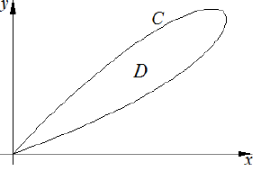
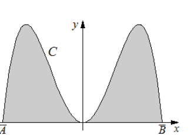
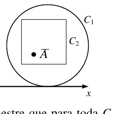
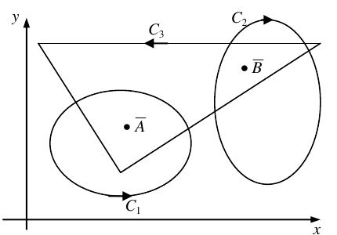

# Unidad 11 — Práctica: Teoremas integrales (Green, Gauss, Stokes)

Ejercicios del **T.P. N.º 11 de la Guía de Trabajos Prácticos** ([TP11-Teoremas-Integrales.pdf](../aula-virtual/11-Teoremas-Integrales/TP11-Teoremas-Integrales.pdf)). Las respuestas se controlaron con las [respuestas oficiales de la guía](../aula-virtual/00-Guia-TP/Guia-TP-2016-Respuestas.pdf).

Cada ejercicio tiene un botón **Solución**. Al abrirlo aparece la respuesta y, arriba de ella, un segundo botón **Solución paso a paso** con el desarrollo completo.

> **Nomenclatura y consideraciones básicas:**
>
> - $\nabla f \equiv \mathop{\mathrm{grad}}(f)$ simboliza al ***gradiente*** del campo escalar $f$.
> - Dado el campo vectorial $\bar f : D \subset \Re^3 \to \Re^3 \ /\ \bar f(x,y,z) = (P(x,y,z),\ Q(x,y,z),\ R(x,y,z))$:
>   - $\nabla\cdot\bar f \equiv \mathop{\mathrm{div}}(\bar f)$ simboliza a la ***divergencia*** de $\bar f$, $\ \mathop{\mathrm{div}}(\bar f) \doteq P'_x + Q'_y + R'_z$.
>   - $\nabla\wedge\bar f \equiv \mathop{\mathrm{rot}}(\bar f) = \begin{vmatrix} \breve\imath & \breve\jmath & \breve k \cr \frac{\partial}{\partial x} & \frac{\partial}{\partial y} & \frac{\partial}{\partial z} \cr P & Q & R \end{vmatrix} \doteq (R'_y - Q'_z,\ P'_z - R'_x,\ Q'_x - P'_y)$ es el ***rotor*** de $\bar f$.
> - Un campo es:
>   - ***solenoidal,*** si su divergencia es nula en todo punto.
>   - ***irrotacional,*** si su rotor es nulo en todo punto.
>   - ***armónico,*** si su *laplaciano* $\nabla^2 f \doteq \mathop{\mathrm{div}}(\mathop{\mathrm{grad}}(f))$ es nulo en todo punto.
>
> **Nota:** sea $f : D \subset \Re^n \to \Re^m$, $f \equiv a$ (constante) indica que $f(X) = a\ \ \forall X \in D$.

---

### 01) Área con integrales de línea

Sea $\bar f \in C^1 \ /\ \bar f(x,y) = (P(x,y),\ Q(x,y))$ con $Q'_ x - P'_ y \equiv k \ne 0$ ($k$ constante). Aplicando el teorema de Green demuestre que $\text{Área}(D) = \dfrac1k\displaystyle\oint_{\partial D^+}\bar f\cdot d\bar s$ con $\partial D$ frontera de $D \subset \Re^2$.

Proponga alguna fórmula para el cálculo del área de regiones planas mediante integrales de línea y aplíquela para calcular el área de las regiones definidas por:

- a) $\dfrac{x^2}{a^2} + \dfrac{y^2}{b^2} \le 1$, $a,b \in \Re^+$.
- b) $1 \le x^2 + y^2 \le 4$.
- c) $x^2 + y^2 \le 4$, $x^2 + y^2 \ge 2x$, $x \ge 0$.

<b>Solución</b>

Solución paso a paso

**Demostración.** Por Green:

$$\oint_{\partial D^+}\bar f\cdot d\bar s = \iint_D(Q'_x - P'_y)\thinspace dA = \iint_D k\thinspace dA = k\thinspace\text{Área}(D)$$

Despejando, $\text{Área}(D) = \dfrac1k\displaystyle\oint\bar f\cdot d\bar s$. $\blacksquare$

**Fórmulas posibles:** con $\bar f = (0, x)$ es $k = 1$, y con $\bar f = (-y, 0)$ también:

$$\text{Área}(D) = \oint_{\partial D^+}x\thinspace dy = -\oint_{\partial D^+}y\thinspace dx$$

**a)** Parametrizamos la elipse en sentido positivo: $x = a\cos t$, $y = b\mathop{\mathrm{sen}}t$, con $dy = b\cos t\thinspace dt$:

$$A = \int_0^{2\pi}a\cos t\cdot b\cos t\thinspace dt = ab\pi$$

**b)** La frontera positiva es la circunferencia de radio 2 en sentido antihorario más la de radio 1 en sentido **horario**. Para un círculo de radio $R$ recorrido en sentido antihorario, $\oint x\thinspace dy = \pi R^2$. Entonces:

$$A = 4\pi - \pi = 3\pi$$

**c)** Es el semidisco derecho de radio 2 sin el disco $(x-1)^2 + y^2 \le 1$. La frontera tiene tres partes:

- la semicircunferencia grande en sentido antihorario: $x = 2\cos t$, $y = 2\mathop{\mathrm{sen}}t$, $t\in[-\pi/2, \pi/2]$, que aporta $\displaystyle\oint x\thinspace dy = \int 4\cos^2t\thinspace dt = 2\pi$;
- el eje $y$, donde $x = 0$: aporta 0;
- la circunferencia chica en sentido horario: aporta $-\pi$.

$$A = 2\pi + 0 - \pi = \pi$$

**Respuesta:** Por ejemplo: $\text{Área}(D) = \displaystyle\oint_{\partial D^+}x\thinspace dy$; también, $\text{Área}(D) = -\displaystyle\oint_{\partial D^+}y\thinspace dx$.

- a) $ab\pi$.
- b) $3\pi$.
- c) $\pi$.

---

### 02) Área encerrada por una curva paramétrica

Calcule el área de la región plana $D$ de la figura, sabiendo que su curva frontera $C$ admite la ecuación vectorial: $\bar X = (u - u^2,\ u - u^4)$ con $0 \le u \le 1$.

<b>Solución</b>

Solución paso a paso

**Fórmula:** $A = \dfrac12\displaystyle\oint(x\thinspace dy - y\thinspace dx) = \dfrac12\int_0^1(x\thinspace y' - y\thinspace x')\thinspace du$. La curva es cerrada: en $u = 0$ y en $u = 1$ pasa por el origen.

**Derivadas:** $x = u - u^2$, $x' = 1 - 2u$; $y = u - u^4$, $y' = 1 - 4u^3$.

**Integrando:**

$$x\thinspace y' - y\thinspace x' = (u - u^2)(1 - 4u^3) - (u - u^4)(1 - 2u) = u^2 - 3u^4 + 2u^5$$

**Integral:**

$$A = \frac12\int_0^1(u^2 - 3u^4 + 2u^5)\thinspace du = \frac12\left(\frac13 - \frac35 + \frac13\right) = \frac12\cdot\frac{1}{15} = \frac{1}{30}$$

El resultado es positivo, lo que confirma que la parametrización recorre la curva en sentido positivo.

**Respuesta:** $1/30$.

---

### 03) Circulación con Green

Calcule la circulación de $\bar f(x,y) = (x^2 + y^2,\ 3xy + \ln(y^2 + 1))$ a lo largo de la frontera de la región definida por $4x^2 + (y - 1)^2 \le 1$ recorrida en sentido positivo.

<b>Solución</b>

Solución paso a paso

**Paso 1 — Integrando de Green.** $Q'_x - P'_y = 3y - 2y = y$.

**Paso 2 — Región.** $\dfrac{x^2}{1/4} + (y - 1)^2 \le 1$ es una elipse de centro $(0,1)$ y semiejes $\frac12$ y $1$, con área $\pi\cdot\frac12\cdot1 = \frac\pi2$.

**Paso 3 — Integral.** $\iint_D y\thinspace dA = \bar y\cdot\text{Área}$, con $\bar y = 1$ (el centroide es el centro de la elipse):

$$\oint\bar f\cdot d\bar s = 1\cdot\frac\pi2 = \frac\pi2$$

**Respuesta:** $\pi/2$.

---

### 04) Verificación de Green en una región con agujero

Verifique el teorema de Green con $\bar f(x,y) = (x^2y,\ y^2)$, en la región plana $D = D_1 - D_2$ donde $D_1 = [-2,2]\times[-2,2]$ y $D_2 = [-1,1]\times[-1,1]$.

<b>Solución</b>

Solución paso a paso

**Integral doble.** $Q'_x - P'_y = 0 - x^2 = -x^2$.

$$\iint_{D_1}-x^2 = -4\cdot\frac{16}{3} = -\frac{64}{3}, \qquad \iint_{D_2}-x^2 = -2\cdot\frac23 = -\frac43$$

$$\iint_D = -\frac{64}{3} + \frac43 = -20$$

**Integral de línea.** El cuadrado exterior se recorre en sentido antihorario y el interior en sentido horario.

- $\oint y^2\thinspace dy = 0$ sobre toda curva cerrada (es exacto).
- Para un cuadrado de semilado $a$ en sentido antihorario, $\oint x^2y\thinspace dx$ sólo tiene aporte de los lados horizontales:
  - abajo ($y = -a$, $x$ de $-a$ a $a$): $-a\dfrac{2a^3}{3}$;
  - arriba ($y = a$, $x$ de $a$ a $-a$): $-a\dfrac{2a^3}{3}$.

  En total: $-\dfrac{4a^4}{3}$.
- Exterior ($a = 2$): $-\dfrac{64}{3}$. Interior ($a = 1$, en sentido horario): $+\dfrac43$.

$$\oint_{\partial D^+} = -\frac{64}{3} + \frac43 = -20 \ ✓$$

**Respuesta:** $-20$ (ambos miembros del teorema).

---

### 05) Circulación sobre un arco usando Green

La región plana $D$ sombreada en la figura tiene como frontera el segmento $\overline{AB}$ y el arco de curva $C$ de ecuación $y = x^2 - x^4$. Dado $\bar f = (P,Q) \in C^1$ con matriz jacobiana $D\bar f(x,y) = \begin{pmatrix} P'_ x(x,y) & 3x - 1 \cr 3x + 2 & Q'_ y(x,y) \end{pmatrix}$, calcule la circulación de $\bar f$ desde $\bar A$ hasta $\bar B$ a lo largo de $C$ sabiendo que a lo largo del segmento resulta $\displaystyle\int_{\overline{AB}}\bar f\cdot d\bar s = 17$.

<b>Solución</b>

Solución paso a paso

**Paso 1 — Datos.** De la jacobiana: $P'_y = 3x - 1$ y $Q'_x = 3x + 2$ ⇒ $Q'_x - P'_y = 3$.

$y = x^2 - x^4 = x^2(1 - x^2)$ se anula en $x = \pm1$ ⇒ $A = (-1,0)$ y $B = (1,0)$.

**Paso 2 — Área de $D$.**

$$\int_{-1}^1(x^2 - x^4)\thinspace dx = 2\left(\frac13 - \frac15\right) = \frac{4}{15}$$

**Paso 3 — Green.** La frontera positiva es el segmento de $A$ a $B$ (abajo, hacia la derecha) y luego $C$ de $B$ a $A$ (arriba):

$$\int_{\overline{AB}} + \int_{C:\thinspace B\to A} = 3\cdot\frac{4}{15} = \frac45$$

**Paso 4 — Despejar.** $\displaystyle\int_{C:\thinspace B\to A} = \frac45 - 17$. El sentido pedido es el opuesto:

$$\int_{C:\thinspace A\to B} = 17 - \frac45 = \frac{81}{5}$$

**Respuesta:** $81/5$.

---

### 06) Circulación con funciones arbitrarias

Calcule la circulación en sentido positivo de $\bar f \in C^1$ a lo largo de la frontera de la región plana definida por $x + y \le 2$, $2x + y \ge 2$, 1° cuadrante, siendo:

- a) $\bar f(x,y) = (2y - g(x),\ 5x - h(y))$.
- b) $\bar f(x,y) = (2y + g(x - y),\ 2x - g(x - y))$.

<b>Solución</b>

Solución paso a paso

**Región:** el triángulo de vértices $(1,0)$, $(2,0)$ y $(0,2)$, entre las rectas $2x + y = 2$ y $x + y = 2$. Su área es $\frac12\cdot1\cdot2 = 1$.

**a)** $Q'_x - P'_y = 5 - 2 = 3$, porque $h(y)$ no depende de $x$ ni $g(x)$ de $y$. Circulación $= 3\cdot1 = 3$.

**b)** Por la regla de la cadena:

$$Q'_x = 2 - g'(x - y), \qquad P'_y = 2 - g'(x - y) \ \Rightarrow\ Q'_x - P'_y = 0$$

Circulación $= 0$.

**Respuesta:**

- a) $3$.
- b) $0$.

---

### 07) Circulación con $h$ par

Calcule $\displaystyle\oint_{\partial D^+}\bar f\cdot d\bar s$, con: $D = [-2,2]\times[-3,3]$, $\bar f(x,y) = (1 - y,\ h(x))$, $h$ par, $h'$ continua.

<b>Solución</b>

Solución paso a paso

**Paso 1 — Integrando.** $Q'_x - P'_y = h'(x) + 1$.

**Paso 2 — Green.**

$$\iint_D(h'(x) + 1)\thinspace dA = \int_{-3}^3\left[h(2) - h(-2)\right]dy + \text{Área}(D)$$

**Paso 3 — Paridad.** $h$ es par ⇒ $h(2) = h(-2)$ ⇒ el primer término es 0. El área es $4\cdot6 = 24$.

**Respuesta:** $24$.

---

### 08) Green entre dos curvas

Sea $\bar f = (P,Q) \in C^1$ en $\Re^2 - \lbrace\bar 0\rbrace$ tal que $Q'_ x - P'_ y \equiv 5$, dadas las curvas $C_1$: $x^2 + 9y^2 = 36$ y $C_2$: $x^2 + y^2 = 4$, calcule $\displaystyle\oint_{C_2^+}\bar f\cdot d\bar s$ sabiendo que $\displaystyle\oint_{C_1^+}\bar f\cdot d\bar s = 7\pi$.

<b>Solución</b>

Solución paso a paso

**Paso 1 — Geometría.**

- $C_1$ es la elipse $\frac{x^2}{36} + \frac{y^2}{4} = 1$, de área $\pi\cdot6\cdot2 = 12\pi$.
- $C_2$ es la circunferencia de radio 2, de área $4\pi$, y está dentro de $C_1$ (la toca en $(0, \pm2)$).
- Ambas rodean al origen, donde $\bar f$ no es $C^1$.

**Paso 2 — Green en la región entre ambas curvas** (no contiene al origen):

$$\oint_{C_1^+} - \oint_{C_2^+} = 5\thinspace(12\pi - 4\pi) = 40\pi$$

**Paso 3 — Despejar.** $\displaystyle\oint_{C_2^+} = 7\pi - 40\pi = -33\pi$.

**Respuesta:** $-33\pi$.

---

### 09) Green entre una circunferencia y un cuadrado

Dado $\bar f : \Re^2 - \lbrace\bar A\rbrace \to \Re^2 \ /\ \bar f = (P,Q)$; suponga matriz jacobiana continua con $Q'_x - P'_y \equiv 6$.

Calcule $\displaystyle\oint_{C_1^+}\bar f\cdot d\bar s$ sabiendo que $\displaystyle\oint_{C_2^+}\bar f\cdot d\bar s = 12$, $C_1$ es una circunferencia de radio 8, $C_2$ es un cuadrado de lado 5.

<b>Solución</b>

Solución paso a paso

Aplicamos Green en la región entre la circunferencia y el cuadrado, que no contiene a $\bar A$:

$$\oint_{C_1^+} - \oint_{C_2^+} = 6\thinspace(\pi\cdot8^2 - 5^2) = 384\pi - 150$$

$$\oint_{C_1^+} = 12 + 384\pi - 150 = 384\pi - 138$$

**Respuesta:** $384\pi - 138$.

---

### 10) Jacobiana simétrica en todo el plano

Sea $\bar f : \Re^2 \to \Re^2$ con matriz jacobiana continua y simétrica, demuestre que para toda $C$ en $\Re^2$ resulta $\displaystyle\oint_C\bar f\cdot d\bar s = 0$; indique hipótesis para $C$.

<b>Solución</b>

Solución paso a paso

**Hipótesis para $C$:** curva cerrada, simple y suave a trozos. Si no es simple, se descompone en finitas curvas simples.

**Demostración.** $C$ es la frontera de una región acotada $D$. Como $\bar f \in C^1$ en todo $\Re^2$, vale Green en $D$:

$$\oint_C\bar f\cdot d\bar s = \pm\iint_D(Q'_x - P'_y)\thinspace dA = \pm\iint_D 0\thinspace dA = 0$$

La simetría de $D\bar f$ es $P'_y = Q'_x$. $\blacksquare$

**Respuesta:** Se puede demostrar aplicando el teorema de Green, considerando las hipótesis adecuadas para la curva (cerrada, simple y suave a trozos).

---

### 11) Potencial y sus extremos

Dado $\bar f(x,y) = (9x^2 + 2y + y^2,\ 2x + 2xy)$, demuestre que $\bar f$ admite función potencial $\phi$ en $\Re^2$. Suponiendo $\phi(0,0) = 2$, analice la existencia de extremos locales de $\phi(x,y)$ clasificándolos y calculándolos.

<b>Solución</b>

Solución paso a paso

**Paso 1 — Simetría.** $P'_y = 2 + 2y = Q'_x$ ✓. Como el dominio es $\Re^2$, simplemente conexo, existe la potencial.

**Paso 2 — Potencial.**

- $\phi = \int(9x^2 + 2y + y^2)\thinspace dx = 3x^3 + 2xy + xy^2 + g(y)$.
- $\phi'_y = 2x + 2xy + g' = 2x + 2xy \Rightarrow g = c$.
- Con $\phi(0,0) = 2$: $\phi = 3x^3 + 2xy + xy^2 + 2$.

**Paso 3 — Puntos críticos** ($\nabla\phi = \bar f = \bar 0$):

$$9x^2 + 2y + y^2 = 0, \qquad 2x(1 + y) = 0$$

- $x = 0$ ⇒ $y(2 + y) = 0$ ⇒ $(0,0)$ y $(0,-2)$.
- $y = -1$ ⇒ $9x^2 - 1 = 0$ ⇒ $\left(\pm\frac13, -1\right)$.

**Paso 4 — Hessiano.** $\phi''_ {xx} = 18x$, $\phi''_ {xy} = 2 + 2y$ y $\phi''_ {yy} = 2x$.

- $(0,0)$: $H = 0 - 4 < 0$ ⇒ silla.
- $(0,-2)$: $H = 0 - 4 < 0$ ⇒ silla.
- $\left(\frac13, -1\right)$: $\phi''_ {xx} = 6$, $\phi''_ {xy} = 0$, $\phi''_ {yy} = \frac23$ ⇒ $H = 4 > 0$ con $\phi''_ {xx} > 0$ ⇒ **mínimo**:

$$\phi = \frac19 - \frac23 + \frac13 + 2 = \frac{16}{9}$$

- $\left(-\frac13, -1\right)$: $\phi''_ {xx} = -6$, $\phi''_ {yy} = -\frac23$ ⇒ $H = 4 > 0$ con $\phi''_ {xx} < 0$ ⇒ **máximo**:

$$\phi = -\frac19 + \frac23 - \frac13 + 2 = \frac{20}{9}$$

**Respuesta:** $\phi(-1/3,-1) = 20/9$ es máximo local, $\phi(1/3,-1) = 16/9$ es mínimo local.

---

### 12) Circulaciones alrededor de dos puntos singulares

Sea $\bar f$ con $D\bar f$ continua y simétrica en todo el plano salvo en los puntos $\bar A$ y $\bar B$.

Calcule $\displaystyle\oint_{C_3}\bar f\cdot d\bar s$ sabiendo que $\displaystyle\oint_{C_1}\bar f\cdot d\bar s = 12\pi$ y $\displaystyle\oint_{C_2}\bar f\cdot d\bar s = 16\pi$.

Se entiende que cada circulación se realiza con la orientación indicada en la figura, $C_3$ es la frontera del triángulo.

<b>Solución</b>

Solución paso a paso

**Idea:** como $Q'_x = P'_y$ fuera de $\bar A$ y $\bar B$, por Green la circulación alrededor de cada punto (una vuelta en sentido antihorario) **no depende de la curva**. Llamamos $c_A$ y $c_B$ a esos valores.

**Paso 1 — Leer las orientaciones de la figura.**

- $C_1$, con la flecha abajo hacia la derecha, va en sentido **antihorario** ⇒ $c_A = 12\pi$.
- $C_2$, con la flecha arriba hacia la derecha, va en sentido **horario** ⇒ $-c_B = 16\pi$ ⇒ $c_B = -16\pi$.
- $C_3$, con la flecha arriba hacia la izquierda, va en sentido **antihorario**, y el triángulo contiene a $\bar A$ y a $\bar B$.

**Paso 2 — Green en el triángulo menos dos disquitos** alrededor de $\bar A$ y $\bar B$ (donde el integrando es 0):

$$\oint_{C_3} = c_A + c_B = 12\pi - 16\pi = -4\pi$$

**Respuesta:** $-4\pi$.

---

### 13) Potencial en el plano con un punto singular

Sea $\bar f : \Re^2 - \lbrace\bar A\rbrace \to \Re^2$ con $D\bar f$ continua y simétrica en $D$. Demuestre que $\bar f$ es campo de gradientes en $D$ si, y sólo si, $\displaystyle\oint_C\bar f\cdot d\bar s = 0$ con $C$ cualquier curva simple y suave a trozos que rodea al punto $\bar A$.

<b>Solución</b>

Solución paso a paso

**(⇒)** Si $\bar f = \nabla\phi$, la circulación sobre **cualquier** curva cerrada es $\phi(\text{fin}) - \phi(\text{inicio}) = 0$. En particular, sobre las que rodean a $\bar A$.

**(⇐)** Sea $C$ una curva cerrada simple cualquiera en $D$.

- **Si no rodea a $\bar A$:** Green en la región que encierra (sin singularidades) da $\displaystyle\oint_C = \iint 0 = 0$.
- **Si rodea a $\bar A$:** por hipótesis $\oint_C = 0$. Además, Green en la región entre $C$ y otra curva $C_1$ que rodee a $\bar A$ muestra que $\oint_{C^+} = \oint_{C_1^+}$: el valor no depende de la curva.

Toda circulación cerrada es 0 ⇒ $\bar f$ es campo de gradientes. $\blacksquare$

**Respuesta:** Sugerencia: considere otra curva $C_1$ que rodee a $C$ y aplique Green en la región $D$ entre ambas curvas. De esta manera podrá demostrar que $\oint_{C^+}\bar f\cdot d\bar s = \oint_{C_1^+}\bar f\cdot d\bar s$; es decir, el resultado de la circulación rodeando $\bar A$ no depende de la curva. Así, si el cálculo con una $C$ cualquiera resulta 0, todas las circulaciones en camino cerrado serán nulas, entonces $\bar f$ es campo de gradientes. Si $C$ no rodea al punto y $\bar A \notin C$, aplicando Green puede demostrar que la circulación es nula. (Cuando $C$ rodea al punto no se puede aplicar Green, pues $\bar f \notin C^1$ en $\bar A$.)

---

### 14) ¿Admite potencial?

Analice si $\bar f : \Re^2 - \lbrace\bar 0\rbrace \to \Re^2 \ /\ \bar f(x,y) = (x,y) + (y,-x)/(4x^2 + y^2)$ admite función potencial en su dominio.

<b>Solución</b>

Solución paso a paso

**Paso 1 — Separar.** $(x, y) = \nabla\frac{x^2+y^2}{2}$ es conservativo. Basta analizar $\vec g = \dfrac{(y, -x)}{4x^2 + y^2}$.

**Paso 2 — Simetría.** Con $D = 4x^2 + y^2$:

$$P'_y = \frac{D - 2y^2}{D^2} = \frac{4x^2 - y^2}{D^2}, \qquad Q'_x = -\frac{D - 8x^2}{D^2} = \frac{4x^2 - y^2}{D^2} \ ✓$$

**Paso 3 — Circulación alrededor del origen** sobre $4x^2 + y^2 = 1$, con $x = \frac{\cos t}{2}$ e $y = \mathop{\mathrm{sen}}t$ (sentido antihorario):

- $\vec g = \left(\mathop{\mathrm{sen}}t,\ -\frac{\cos t}{2}\right)$ y $d\bar X = \left(-\frac{\mathop{\mathrm{sen}}t}{2},\ \cos t\right)dt$.
- $\vec g\cdot d\bar X = -\frac{\mathop{\mathrm{sen}}\nolimits^2t}{2} - \frac{\cos^2t}{2} = -\frac12$.

$$\oint = -\pi \ne 0$$

**Conclusión** (ejercicio 13): **no** admite potencial.

**Respuesta:** No admite función potencial. Sugerencia: calcule $\oint_{C^+}\bar f\cdot d\bar s$, por ejemplo con $C: 4x^2 + y^2 = 1$; da $-\pi \ne 0$.

---

### 15) Rotor nulo en $\Re^3 - \lbrace\bar A\rbrace$

Sea $\bar f : \Re^3 - \lbrace\bar A\rbrace \to \Re^3$ con $D\bar f$ continua y rotor nulo en su dominio, aplique el teorema del rotor para demostrar que $\bar f$ admite función potencial en dicha región del espacio.(&)

(&) Observe que $\Re^3 - \lbrace\bar A\rbrace$ es un conjunto simplemente conexo de $\Re^3$, pero $\Re^2 - \lbrace\bar A\rbrace$ no lo es en $\Re^2$.

<b>Solución</b>

Solución paso a paso

Sea $C$ una curva cerrada simple, suave a trozos, en $\Re^3 - \lbrace\bar A\rbrace$. Como el dominio es simplemente conexo, existe una superficie $S$ orientable, suave a trozos, con borde $C$, que **no pasa por $\bar A$** (si una superficie pasara por $\bar A$, se la deforma un poco para esquivarlo). Por Stokes:

$$\oint_C\bar f\cdot d\bar s = \iint_S\mathop{\mathrm{rot}}\bar f\cdot\breve n\thinspace d\sigma = \iint_S\vec 0\cdot\breve n\thinspace d\sigma = 0$$

Toda circulación cerrada es nula ⇒ $\bar f$ es campo de gradientes. $\blacksquare$

La diferencia con el plano: en $\Re^2 - \lbrace\bar A\rbrace$ una curva que rodea a $\bar A$ **no** es borde de ninguna región que lo excluya.

**Respuesta:** Tenga en cuenta las hipótesis del teorema, en especial respecto de la superficie: en $\Re^3 - \lbrace\bar A\rbrace$ toda curva cerrada es borde de una superficie que no contiene a $\bar A$, y Stokes da circulación 0.

---

### 16) Potencial electrostático en el plano

Demuestre que $\bar E(\bar r) = kq\thinspace\bar r/r^3$ con $\bar r = (x,y)$, $r = \Vert\bar r\Vert$, $k,q$ constantes(\*) admite función potencial en $\Re^2 - \lbrace\bar 0\rbrace$. Halle $U(x,y)$ tal que $\bar E = -\nabla U$ con $U(\infty,\infty) = 0$.

Nota: Se utiliza $U(\infty,\infty)$ para simbolizar el $\displaystyle\lim_{(x,y)\to(\infty,\infty)} U(x,y)$.

Esta es una nomenclatura que suele figurar en algunos libros de física y de electromagnetismo. Es más, es común hablar del "potencial en el infinito" sin dejar de entender que se trata de un límite.

(\*) Distribución plana de campo electrostático creado por una carga eléctrica $q$ puntual ubicada en $(0,0)$.

<b>Solución</b>

Solución paso a paso

**Paso 1 — Simetría.** $P = \dfrac{kqx}{r^3}$ y $Q = \dfrac{kqy}{r^3}$. Con $(r^{-3})'_y = -3r^{-5}y$:

$$P'_y = -\frac{3kqxy}{r^5} = Q'_x \ ✓$$

**Paso 2 — Circulación alrededor del origen.** Sobre una circunferencia de radio $R$, $\bar E$ es **radial** y $d\bar s$ es tangente ⇒ $\bar E\cdot d\bar s = 0$ ⇒ circulación $0$. Por el ejercicio 13, admite potencial.

**Paso 3 — Potencial.** Proponemos $U = \dfrac{kq}{r}$:

$$\nabla U = kq\left(-\frac{1}{r^2}\right)\nabla r = -\frac{kq}{r^2}\frac{\bar r}{r} = -\bar E \ ✓$$

Además $U \to 0$ cuando $r \to \infty$ ✓.

**Respuesta:** Sugerencia: analice la matriz jacobiana y circule a lo largo de una circunferencia con centro en $\bar 0$ y radio cualquiera. $U(x,y) = kq/r$ con $r = \sqrt{x^2 + y^2}$.

---

### 17) Potencial electrostático en el espacio

Resuelva el ítem anterior en $\Re^3 - \lbrace\bar 0\rbrace$: dado $\bar E(\bar r) = kq\thinspace\bar r/r^3$ con $\bar r = (x,y,z)$, $r = \Vert\bar r\Vert$ analice la existencia de función potencial; halle $U(x,y,z)$ tal que $\bar E = -\nabla U$ con $U(\infty,\infty,\infty) = 0$.

<b>Solución</b>

Solución paso a paso

- **Rotor nulo:** cada derivada cruzada es $-3kq\thinspace(\text{producto de dos coordenadas})/r^5$, simétrica, así que $\mathop{\mathrm{rot}}\bar E = \bar 0$.
- **Dominio:** $\Re^3 - \lbrace\bar 0\rbrace$ es simplemente conexo ⇒ por el ejercicio 15, **admite** potencial.
- **Potencial:** como en el plano, $U = \dfrac{kq}{r}$ cumple $-\nabla U = \bar E$ y tiende a 0 en el infinito.

**Respuesta:** $U(x,y,z) = kq/r$ con $r = \sqrt{x^2 + y^2 + z^2}$.

---

### 18) ¿Admiten potencial en su dominio natural?

Analice si $\bar f$ admite función potencial en su dominio natural; en "c" y "d" suponga $\varphi \in C^1$:

- a) $\bar f(x,y) = \left(\dfrac{y}{(x - 1)^2 + y^2},\ \dfrac{1 - x}{(x - 1)^2 + y^2}\right)$
- b) $\bar f(x,y) = \left(\dfrac{-6y}{4x^2 + 9y^2},\ \dfrac{6x}{4x^2 + 9y^2}\right)$
- c) $\bar f(x,y,z) = \left(\dfrac{y}{x^2 + y^2},\ \dfrac{-x}{x^2 + y^2},\ \varphi(z)\right)$
- d) $\bar f(x,y,z) = \left(\dfrac{x}{x^2 + y^2},\ \dfrac{y}{x^2 + y^2},\ \varphi(z)\right)$

<b>Solución</b>

Solución paso a paso

**a)** Con $u = x - 1$: $\bar f = \dfrac{(y,\ -u)}{u^2 + y^2}$, el "vórtice" centrado en $(1,0)$. La jacobiana es simétrica, pero sobre una circunferencia centrada en $(1,0)$ ($u = R\cos t$, $y = R\mathop{\mathrm{sen}}t$) el producto es $\bar f\cdot d\bar X = -1\thinspace dt$ ⇒ circulación $-2\pi \ne 0$ ⇒ **No**.

**b)** La jacobiana es simétrica: $P'_y = Q'_x = \dfrac{-6(4x^2 - 9y^2)}{(4x^2 + 9y^2)^2}$. Sobre $4x^2 + 9y^2 = 1$ ($x = \frac{\cos t}{2}$, $y = \frac{\mathop{\mathrm{sen}}t}{3}$):

- $\bar f = (-2\mathop{\mathrm{sen}}t,\ 3\cos t)$ y $d\bar X = \left(-\frac{\mathop{\mathrm{sen}}t}{2},\ \frac{\cos t}{3}\right)dt$.
- El producto es $\mathop{\mathrm{sen}}\nolimits^2t + \cos^2t = 1$ ⇒ circulación $2\pi \ne 0$ ⇒ **No**.

**c)** El dominio es $\Re^3$ menos el **eje $z$**, que **no** es simplemente conexo. Sobre la circunferencia $x^2 + y^2 = 1$, $z = 0$, la circulación es $-2\pi \ne 0$ (como en a) ⇒ **No**.

**d)** Se encuentra la potencial explícitamente:

$$\phi = \frac12\ln(x^2 + y^2) + \int\varphi(z)\thinspace dz$$

Cumple $\nabla\phi = \bar f$ en todo el dominio ⇒ **Sí**.

**Respuesta:**

- a) No.
- b) No.
- c) No.
- d) Sí.

---

### 19) Identidades vectoriales

En $\Re^3$, demuestre que:

- a) $\mathop{\mathrm{rot}}(\bar f) \equiv \bar 0 \iff D(\bar f)$ simétrica.
- b) $\bar f \in C^2 \Rightarrow \mathop{\mathrm{div}}(\mathop{\mathrm{rot}}(\bar f)) \equiv 0$.
- c) $\bar f = \nabla\phi \in C^1 \Rightarrow \mathop{\mathrm{rot}}(\bar f) \equiv \bar 0$.
- d) Con $a,b$ constantes: $\mathop{\mathrm{div}}(a\bar f + b\bar g) = a\mathop{\mathrm{div}}(\bar f) + b\mathop{\mathrm{div}}(\bar g)$, $\ \mathop{\mathrm{rot}}(a\bar f + b\bar g) = a\mathop{\mathrm{rot}}(\bar f) + b\mathop{\mathrm{rot}}(\bar g)$.
- e) Con $f$ escalar: $\mathop{\mathrm{div}}(f\bar g) = f\mathop{\mathrm{div}}(\bar g) + \nabla f\cdot\bar g$, $\ \mathop{\mathrm{rot}}(f\bar g) = f\mathop{\mathrm{rot}}(\bar g) + \nabla f \wedge \bar g$.
- f) $\mathop{\mathrm{div}}(\bar f \wedge \bar g) = \mathop{\mathrm{rot}}(\bar f)\cdot\bar g - \bar f\cdot\mathop{\mathrm{rot}}(\bar g)$.

<b>Solución</b>

Solución paso a paso

**a)** $\mathop{\mathrm{rot}}\bar f = (R'_y - Q'_z,\ P'_z - R'_x,\ Q'_x - P'_y) = \bar 0$ equivale a $R'_y = Q'_z$, $P'_z = R'_x$ y $Q'_x = P'_y$, que son exactamente las simetrías de la jacobiana $\begin{pmatrix} P'_x & P'_y & P'_z \cr Q'_x & Q'_y & Q'_z \cr R'_x & R'_y & R'_z \end{pmatrix}$.

**b)**

$$\mathop{\mathrm{div}}(\mathop{\mathrm{rot}}\bar f) = (R'_y - Q'_z)'_x + (P'_z - R'_x)'_y + (Q'_x - P'_y)'_z = R''_{yx} - Q''_{zx} + P''_{zy} - R''_{xy} + Q''_{xz} - P''_{yz} = 0$$

Por Schwarz ($C^2$), los términos se cancelan de a pares.

**c)** $D\bar f$ es el Hessiano de $\phi$. Para que sea simétrico por Schwarz hace falta $\phi \in C^2$, que vale porque $\bar f \in C^1$. Por a), el rotor es nulo.

**d)** La derivación es lineal: $(aP + bP')'_x = aP'_x + bP''_x$, y lo mismo en cada componente de div y de rot.

**e)** Con $\bar g = (g_1, g_2, g_3)$, por la regla del producto:

$$\mathop{\mathrm{div}}(f\bar g) = \sum_i(f\thinspace g_i)'_{x_i} = \sum_i(f'_{x_i}g_i + f\thinspace g'_{i,x_i}) = \nabla f\cdot\bar g + f\mathop{\mathrm{div}}\bar g$$

Para el rotor, la primera componente es:

$$(fg_3)'_y - (fg_2)'_z = f(g'_{3,y} - g'_{2,z}) + (f'_yg_3 - f'_zg_2)$$

que es la primera componente de $f\mathop{\mathrm{rot}}\bar g + \nabla f\wedge\bar g$. Las otras dos son análogas.

**f)** Con $\bar f\wedge\bar g = (f_2g_3 - f_3g_2,\ f_3g_1 - f_1g_3,\ f_1g_2 - f_2g_1)$, se deriva con la regla del producto y se agrupan los términos:

- los que tienen derivadas de $\bar f$ forman $\mathop{\mathrm{rot}}\bar f\cdot\bar g$;
- los que tienen derivadas de $\bar g$ forman $-\bar f\cdot\mathop{\mathrm{rot}}\bar g$.

**Respuesta:** Demostraciones a cargo del lector, aplicando definiciones y teoremas (ver el desarrollo en el paso a paso).

---

### 20) Stokes sobre un triángulo

Calcule la circulación de $\bar f(x,y,z) = (x - y,\ x + y,\ z - x - y)$ a lo largo de la curva intersección del plano $x + 2y + 3z = 6$ con los planos coordenados aplicando el teorema del rotor. Indique gráficamente la orientación que ha elegido para recorrer la curva.

<b>Solución</b>

Solución paso a paso

**Paso 1 — Curva.** Es el triángulo de vértices $(6,0,0)$, $(0,3,0)$ y $(0,0,2)$. Lo recorremos $(6,0,0)\to(0,3,0)\to(0,0,2)\to(6,0,0)$.

**Paso 2 — Rotor.**

$$\mathop{\mathrm{rot}}\bar f = (R'_y - Q'_z,\ P'_z - R'_x,\ Q'_x - P'_y) = (-1 - 0,\ 0 + 1,\ 1 + 1) = (-1,\ 1,\ 2)$$

**Paso 3 — Superficie y normal.** Elegimos el triángulo plano $z = \dfrac{6 - x - 2y}{3}$. Con ese sentido de recorrido, la regla de la mano derecha da la normal hacia el lado de $(1,2,3)$, que coincide con la normal hacia arriba $\vec N = \left(\frac13, \frac23, 1\right)$.

**Paso 4 — Flujo del rotor.** $\mathop{\mathrm{rot}}\bar f\cdot\vec N = -\frac13 + \frac23 + 2 = \frac73$, constante. La proyección es el triángulo de vértices $(0,0)$, $(6,0)$ y $(0,3)$, de área 9:

$$\oint = \frac73\cdot9 = 21$$

**Respuesta:** $21$, circulando en el sentido $(6,0,0)\to(0,3,0)\to(0,0,2)\to(6,0,0)$.

---

### 21) Stokes sobre una circunferencia

Calcule la circulación de $\bar f(x,y,z) = (xy,\ y - x,\ yz^2)$ a lo largo de la curva intersección de $x^2 + y^2 + z^2 = 8$ con $x = \sqrt{y^2 + z^2}$ aplicando el teorema del rotor. Indique gráficamente la orientación que ha elegido para recorrer la curva.

<b>Solución</b>

Solución paso a paso

**Paso 1 — Curva.** $x^2 + x^2 = 8 \Rightarrow x = 2$, con $y^2 + z^2 = 4$: una circunferencia de radio 2 en el plano $x = 2$.

**Paso 2 — Orientación.** Recorremos $(2,2,0)\to(2,0,2)\to(2,-2,0)\to(2,0,-2)$, que es antihorario en el plano $(y,z)$ ⇒ la normal compatible es $\breve n = (1,0,0)$.

**Paso 3 — Rotor.**

$$\mathop{\mathrm{rot}}\bar f = (R'_y - Q'_z,\ P'_z - R'_x,\ Q'_x - P'_y) = (z^2,\ 0,\ -1 - x)$$

**Paso 4 — Flujo a través del disco** $x = 2$, $y^2 + z^2 \le 4$: $\mathop{\mathrm{rot}}\bar f\cdot\breve n = z^2$.

$$\iint z^2\thinspace dA = \int_0^{2\pi}\negthinspace\negthinspace\int_0^2\rho^2\mathop{\mathrm{sen}}\nolimits^2\theta\thinspace\rho\thinspace d\rho\thinspace d\theta = \pi\cdot\frac{16}{4} = 4\pi$$

**Respuesta:** $4\pi$, circulando en el sentido $(2,2,0)\to(2,0,2)\to(2,-2,0)\to(2,0,-2)\to(2,2,0)$.

---

### 22) Circulación sobre un arco usando Stokes

Siendo $\bar f \in C^1$, $\mathop{\mathrm{rot}}(\bar f(x,y,z)) = (3,\ 1,\ 2y)$, calcule la circulación de $\bar f$ a lo largo del arco de curva de ecuación $\bar X = (0,\ 2\cos(u),\ 2\mathop{\mathrm{sen}}(u))$ con $u \in [0,\pi]$, sabiendo que la circulación de $\bar f$ por el segmento desde $(0,-2,0)$ hasta $(0,2,0)$ es igual a 16/3.

<b>Solución</b>

Solución paso a paso

**Paso 1 — Cerrar la curva.** El arco va de $(0,2,0)$ a $(0,-2,0)$ por $z > 0$, y el segmento lo cierra volviendo a $(0,2,0)$. Juntos forman la frontera del **semidisco** $x = 0$, $y^2 + z^2 \le 4$, $z \ge 0$.

**Paso 2 — Orientación.** En el plano $(y,z)$, el recorrido $(2,0)\to(0,2)\to(-2,0)\to(2,0)$ es antihorario ⇒ normal $\breve n = (1,0,0)$.

**Paso 3 — Stokes.** $\mathop{\mathrm{rot}}\bar f\cdot\breve n = 3$. El área del semidisco es $2\pi$:

$$\int_{\text{arco}} + \int_{\text{segmento}} = 3\cdot2\pi = 6\pi$$

**Paso 4 — Despejar.**

$$\int_{\text{arco}} = 6\pi - \frac{16}{3}$$

**Respuesta:** $6\pi - 16/3$.

---

### 23) Verificación del teorema de la divergencia

Verifique el teorema de la divergencia con el campo $\bar f(x,y,z) = (xy,\ yz,\ xz)$ y la superficie frontera del paralepípedo $[0,1]\times[0,2]\times[0,3]$.

<b>Solución</b>

Solución paso a paso

**Integral triple.** $\mathop{\mathrm{div}}\bar f = y + z + x$. Con volumen $V = 6$ y los promedios de cada variable ($\frac12$, $1$, $\frac32$):

$$\iiint(x + y + z)\thinspace dV = 6\cdot\frac12 + 6\cdot1 + 6\cdot\frac32 = 3 + 6 + 9 = 18$$

**Flujo cara por cara** (normal saliente):

- $x = 1$: $\bar f\cdot\breve\imath = y$ ⇒ $\int_0^3\negthinspace\int_0^2 y\thinspace dy\thinspace dz = 6$.
- $x = 0$: $-xy = 0$.
- $y = 2$: $\bar f\cdot\breve\jmath = 2z$ ⇒ $\int_0^1\negthinspace\int_0^3 2z\thinspace dz\thinspace dx = 9$.
- $y = 0$: $0$.
- $z = 3$: $\bar f\cdot\breve k = 3x$ ⇒ $\int_0^2\negthinspace\int_0^1 3x\thinspace dx\thinspace dy = 3$.
- $z = 0$: $0$.

Total: $6 + 9 + 3 = 18$ ✓.

**Respuesta:** $18$ (ambos miembros del teorema).

---

### 24) Flujo a través de un tetraedro

Calcule el flujo de $\bar f(x,y,z) = (x - y - z,\ y - x - z,\ g(x,y))$ a través de la superficie frontera del cuerpo definido por $2x + 3y + 4z \le 12$ en el 1° octante. Indique la orientación del versor normal que considera y las hipótesis que supone para el campo escalar $g$.

<b>Solución</b>

Solución paso a paso

- **Hipótesis:** $g \in C^1$, para que $\bar f \in C^1$ y valga el teorema de la divergencia.
- **Divergencia:** $1 + 1 + 0 = 2$, porque $g$ no depende de $z$.
- **Volumen:** es el tetraedro de intersecciones $6$, $4$ y $3$ con los ejes, de volumen $\frac{6\cdot4\cdot3}{6} = 12$.
- **Flujo saliente:** $2\cdot12 = 24$.

**Respuesta:** $24$, $\breve n$ saliente del cuerpo, $g \in C^1$.

---

### 25) Cerrar la superficie con una tapa

Calcule el flujo de $\bar f(x,y,z) = (x^2z^2,\ 1 + xyz^2,\ 1 - xz^3)$ a través del trozo $S$ de paraboloide de ecuación $y = x^2 + z^2$ con $y < 4$ aplicando convenientemente el teorema de la divergencia. Indique gráficamente la orientación que ha elegido para el versor normal a $S$.

<b>Solución</b>

Solución paso a paso

**Paso 1 — Divergencia.** $2xz^2 + xz^2 - 3xz^2 = 0$.

**Paso 2 — Cerrar.** Agregamos la tapa $T$: $y = 4$, $x^2 + z^2 \le 4$. El cuerpo $H$ es $x^2 + z^2 \le y \le 4$. Con normales salientes:

$$\Phi_S^{\text{sal}} + \Phi_T = \iiint_H 0 = 0$$

**Paso 3 — Flujo por la tapa.** $\breve n = (0,1,0)$ ⇒ $\bar f\cdot\breve n = 1 + 4xz^2$.

$$\Phi_T = \iint_{x^2+z^2\le4}(1 + 4xz^2)\thinspace dA = 4\pi + 0 = 4\pi$$

El término $4xz^2$ es impar en $x$.

**Paso 4 — Orientación pedida.** En $S$, la normal saliente del cuerpo apunta "hacia afuera del paraboloide", con componente $y$ **negativa**. Entonces $\Phi_S^{\text{sal}} = -4\pi$. Orientando $S$ con $\breve n\cdot(0,1,0) > 0$ se obtiene $4\pi$.

**Respuesta:** $4\pi$, considerando versor normal a $S$ tal que $\breve n\cdot(0,1,0) > 0$.

---

### 26) Flujo a través de una esfera

Suponga $\varphi : \Re \to \Re$, $\varphi \in C^1$, $\bar f(x,y,z) = (x\varphi(xz),\ y^2 + x\varphi(xz),\ y - z\varphi(xz))$; **calcule** el flujo de $\bar f$ a través de una superficie esférica $S$ de radio $R$ con centro en el origen aplicando el teorema de la divergencia, indique gráficamente la orientación del versor normal a $S$.

<b>Solución</b>

Solución paso a paso

**Paso 1 — Divergencia** (regla de la cadena):

- $P'_x = \varphi + xz\varphi'$;
- $Q'_y = 2y$;
- $R'_z = -\varphi - zx\varphi'$.

$$\mathop{\mathrm{div}}\bar f = 2y$$

**Paso 2 — Flujo** (normal saliente): $\iiint_{\text{bola}}2y\thinspace dV = 0$, porque $y$ es impar y la bola es simétrica.

**Respuesta:** $0$ (con normal saliente; con la entrante también da 0).

---

### 27) Flujo con datos parciales del campo

Calcule el flujo de $\bar f \in C^1$ a través de la superficie de ecuación $z = \sqrt{1 - x^2 - y^2}$ sabiendo que $\bar f(x,y,0) = (x,\ y,\ x^2)$, siendo $\mathop{\mathrm{div}}(\bar f(x,y,z)) = 2\thinspace(1 + z)$.

<b>Solución</b>

Solución paso a paso

**Paso 1 — Cerrar.** La semiesfera superior más el disco $z = 0$, $x^2+y^2 \le 1$, encierran la semibola $H$.

**Paso 2 — Integral triple.** Usamos $V = \frac{2\pi}{3}$ e $\iiint_H z\thinspace dV = \frac\pi4$ (en esféricas: $\int_0^{2\pi}\negthinspace\int_0^{\pi/2}\negthinspace\int_0^1 r\cos\theta\thinspace r^2\mathop{\mathrm{sen}}\theta\thinspace dr\thinspace d\theta\thinspace d\varphi = 2\pi\cdot\frac12\cdot\frac14$):

$$\iiint_H 2(1 + z)\thinspace dV = 2\left(\frac{2\pi}{3} + \frac\pi4\right) = \frac{11\pi}{6}$$

**Paso 3 — Disco** (normal saliente $(0,0,-1)$, y en $z = 0$ conocemos $\bar f$): $\bar f\cdot\breve n = -x^2$.

$$\Phi_{\text{disco}} = -\iint_{\rho\le1}x^2\thinspace dA = -\frac\pi4$$

**Paso 4 — Semiesfera** (normal saliente, con $\breve n\cdot\breve k > 0$):

$$\Phi = \frac{11\pi}{6} + \frac\pi4 = \frac{25\pi}{12}$$

**Respuesta:** $25\pi/12$, con $\breve n \ /\ \breve n\cdot(0,0,1) > 0$.

---

### 28) Campo solenoidal con una singularidad

Sea $\bar f : \Re^3 - \lbrace\bar A\rbrace \to \Re^3$ con derivadas continuas y divergencia nula en su dominio. Aplique el teorema de la divergencia para demostrar que el flujo de $\bar f$ a través de una superficie $S$ cerrada sólo depende de si $S$ encierra o no al punto $\bar A$. Se supone $\bar A \notin S$, $\breve n$ saliente.

<b>Solución</b>

Solución paso a paso

- **Si $S$ no encierra a $\bar A$:** el cuerpo $H$ que limita no contiene la singularidad. Por la divergencia, $\Phi_S = \iiint_H 0 = 0$.
- **Si $S$ encierra a $\bar A$:** tomamos una esferita $S_\varepsilon$ centrada en $\bar A$, dentro de $S$. El cuerpo $H$ entre $S$ y $S_\varepsilon$ no contiene a $\bar A$, y su frontera es $S$ (normal saliente) más $S_\varepsilon$ con normal **hacia adentro de la esferita**. Entonces:

$$\Phi_S - \Phi_{S_\varepsilon}^{\text{sal}} = \iiint_H 0 = 0 \ \Rightarrow\ \Phi_S = \Phi_{S_\varepsilon}^{\text{sal}}$$

El flujo es el mismo para toda superficie que encierre a $\bar A$. $\blacksquare$

**Respuesta:** Sugerencia: cuando $S$ no encierra a $\bar A$, aplicando el teorema el flujo resulta nulo; si $S$ encierra al punto $\bar A$, use una superficie auxiliar entre $S$ y el punto, y aplique el teorema al cuerpo $H$ que tiene como frontera los puntos de ambas superficies.

---

### 29) Ley de Gauss

Sea $\bar E(x,y,z) = kq\thinspace\bar r/r^3$ con $\bar r = (x,y,z)$, $r = \Vert\bar r\Vert$. Calcule el flujo de $\bar E$ a través de una superficie esférica de radio $R$ con centro en el origen. Aplique lo indicado en el ítem 28 y concluya sobre el valor de dicho flujo a través de otras superficies que encierren al origen.

<b>Solución</b>

Solución paso a paso

**Paso 1 — Sobre la esfera.** $\breve n = \dfrac{\bar r}{R}$ ⇒ $\bar E\cdot\breve n = \dfrac{kq}{R^3}\cdot\dfrac{R^2}{R} = \dfrac{kq}{R^2}$, constante.

$$\Phi = \frac{kq}{R^2}\cdot4\pi R^2 = 4\pi kq$$

No depende de $R$.

**Paso 2 — Divergencia nula fuera del origen.** Es el ejercicio 22 del TP4: $\mathop{\mathrm{div}}\bar E = kq\dfrac{3r^2 - 3r^2}{r^5} = 0$.

**Paso 3 — Conclusión** (ejercicio 28): **toda** superficie cerrada suave a trozos que encierre al origen tiene flujo $4\pi kq$, y las que no lo encierran tienen flujo 0. Es la ley de Gauss del electromagnetismo.

**Respuesta:** $4\pi kq$; el resultado no cambia para toda superficie suave a trozos que rodee al origen (se supone $\bar 0$ interior a un cuerpo $H$, la superficie es la frontera de $H$ y $\breve n$ es saliente de $H$).

---

### 30) Potencial vectorial

Si $\bar f = \mathop{\mathrm{rot}}(\bar g)$, se dice que $\bar g$ es el ***potencial vectorial*** de $\bar f$. Demuestre que es nulo el flujo a través de cualquier superficie cerrada $S$ de todo campo $C^1$ que admita potencial vectorial (se supone $S$ suave a trozos).

<b>Solución</b>

**Respuesta:** por el ejercicio 19 b), $\mathop{\mathrm{div}}\bar f = \mathop{\mathrm{div}}(\mathop{\mathrm{rot}}\bar g) = 0$ (suponiendo $\bar g \in C^2$). Por el teorema de la divergencia, con $H$ el cuerpo limitado por $S$:

$$\oint\negthinspace\negthinspace\negthinspace\oint_S\bar f\cdot\breve n\thinspace d\sigma = \iiint_H 0\thinspace dV = 0 \quad\blacksquare$$

---

### 31) Flujo de $\varphi\nabla\varphi$ con $\varphi$ armónica

Sean $\varphi \in C^2$ armónico, $\partial H$ suave a trozos la superficie frontera del cuerpo $H$ y el campo vectorial $\bar f = \varphi\nabla\varphi$. Demuestre que $\displaystyle\oint\negthinspace\negthinspace\negthinspace\oint_{\partial H}\bar f\cdot\breve n\thinspace d\sigma \ge 0$, siendo $\breve n$ saliente de $H$.

<b>Solución</b>

Solución paso a paso

**Paso 1 — Divergencia** (ejercicio 19 e, con $f = \varphi$ y $\bar g = \nabla\varphi$):

$$\mathop{\mathrm{div}}(\varphi\nabla\varphi) = \nabla\varphi\cdot\nabla\varphi + \varphi\thinspace\nabla^2\varphi = \lVert\nabla\varphi\rVert^2 + 0$$

**Paso 2 — Teorema de la divergencia.**

$$\oint\negthinspace\negthinspace\negthinspace\oint_{\partial H}\bar f\cdot\breve n\thinspace d\sigma = \iiint_H\lVert\nabla\varphi\rVert^2\thinspace dV \ge 0$$

El integrando es mayor o igual que 0. $\blacksquare$

**Respuesta:** Aplique el teorema de la divergencia y recuerde que si el integrando es mayor o igual a cero el resultado de la integral también lo es: $\mathop{\mathrm{div}}(\varphi\nabla\varphi) = \lVert\nabla\varphi\rVert^2 \ge 0$.

---

### 32) Flujo a través de un paraboloide abierto

Calcule el flujo de $\bar f(x,y,z) = (g(y,z),\ h(x,z),\ 3x^2)$ a través de la superficie $\Sigma$ abierta de ecuación $z = 5 - x^2 - y^2$ con $z \ge 1$; suponga $\bar f \in C^1$, indique la orientación que eligió para el $\breve n$ de $\Sigma$.

<b>Solución</b>

Solución paso a paso

**Paso 1 — Divergencia.** $g$ no depende de $x$, $h$ no depende de $y$ y $3x^2$ no depende de $z$ ⇒ $\mathop{\mathrm{div}}\bar f = 0$.

**Paso 2 — Cerrar con la tapa** $z = 1$, $\rho \le 2$, con normal saliente $(0,0,-1)$:

$$\Phi_{\text{tapa}} = \iint -3x^2\thinspace dA = -3\cdot\frac{\pi\cdot2^4}{4} = -12\pi$$

**Paso 3 — Teorema.** $\Phi_\Sigma + \Phi_{\text{tapa}} = 0 \Rightarrow \Phi_\Sigma = 12\pi$, con la normal saliente del cuerpo, que en $\Sigma$ apunta hacia $z^+$.

**Respuesta:** $12\pi$, con $\breve n \ /\ \breve n\cdot(0,0,1) > 0$.

---

### 33) Flujo con $\nabla g$ dado

Sea $\bar f(x,y,z) = (x + g(x,y),\ y + g(x,y),\ g(x,y) - 2z)$ calcule el flujo de $\bar f$ a través de la frontera del cuerpo definido por $x^2 + y^2 \le 4$ con $-1 \le z \le 1$, si $\nabla g(x,y) = (x + y,\ x - y)$.

<b>Solución</b>

Solución paso a paso

**Paso 1 — Divergencia.**

$$\mathop{\mathrm{div}}\bar f = (1 + g'_x) + (1 + g'_y) + (-2) = g'_x + g'_y = (x + y) + (x - y) = 2x$$

**Paso 2 — Integral.** El cilindro es simétrico respecto del plano $x = 0$ y $2x$ es impar ⇒ $\iiint 2x\thinspace dV = 0$.

**Respuesta:** $0$.

---

### 34) Campo solenoidal con una función a determinar

Sea $\bar f \in C^1 \ /\ \bar f(x,y,z) = (z + x\thinspace g(2xy),\ y\thinspace g(2xy),\ zxy - 2z\thinspace g(2xy))$, halle la expresión de $\bar f$ sabiendo que el campo es solenoidal y que $\bar f(1,1,1) = (3,2,-3)$.

<b>Solución</b>

Solución paso a paso

**Paso 1 — Divergencia** (con $t = 2xy$):

- $P'_x = g + x\thinspace g'(t)\cdot2y$;
- $Q'_y = g + y\thinspace g'(t)\cdot2x$;
- $R'_z = xy - 2g$.

$$\mathop{\mathrm{div}}\bar f = 4xy\thinspace g'(t) + xy = xy\thinspace(4g'(t) + 1)$$

**Paso 2 — Solenoidal:** $g'(t) = -\dfrac14$ ⇒ $g(t) = -\dfrac t4 + c$.

**Paso 3 — Condición** $\bar f(1,1,1) = (1 + g(2),\ g(2),\ 1 - 2g(2)) = (3,2,-3)$ ⇒ $g(2) = 2$ ⇒ $-\frac12 + c = 2$ ⇒ $c = \frac52$.

$$g(2xy) = \frac52 - \frac{xy}{2} = \frac{5 - xy}{2}$$

**Paso 4 — Reemplazar.**

$$\bar f = \left(z + \frac{5x - x^2y}{2},\ \frac{5y - xy^2}{2},\ xyz - z(5 - xy)\right) = \left(z + \frac{5x - yx^2}{2},\ \frac{5y - xy^2}{2},\ 2xyz - 5z\right)$$

**Respuesta:** $\bar f(x,y,z) = \left(z + (5x - yx^2)/2,\ (5y - xy^2)/2,\ 2xyz - 5z\right)$.

---

### 35) Flujo de un gradiente con laplaciano dado

Calcule el flujo de $\bar f = \nabla(g + h)$ a través de $x^2 + y^2 + z^2 = 9$, siendo $g$ armónico y $h$ una solución de la ecuación diferencial $\nabla^2 h = x^2 + y - z$. Suponga $\bar f \in C^1$.

<b>Solución</b>

Solución paso a paso

**Paso 1 — Divergencia.** $\mathop{\mathrm{div}}\bar f = \nabla^2g + \nabla^2h = 0 + x^2 + y - z$.

**Paso 2 — Simetría.** En la bola de radio 3, $\iiint y = \iiint z = 0$. Por simetría, $\iiint x^2 = \iiint y^2 = \iiint z^2 = \frac13\iiint r^2$.

**Paso 3 — Calcular.**

$$\Phi = \frac13\iiint r^2\thinspace dV = \frac13\cdot4\pi\int_0^3r^4\thinspace dr = \frac{4\pi}{3}\cdot\frac{243}{5} = \frac{324\pi}{5}$$

**Respuesta:** $324\pi/5$ (normal saliente).

---

### 36) Flujo como función de dos parámetros

Dados $\bar f(x,y,z) = (6a^3x,\ 6aby,\ b^2z)$ con $a$, $b$ constantes y la superficie $\Sigma$ frontera del cuerpo $D$ definido por $x^2 + y^2 \le 4$ con $1 \le z \le 4$. Halle $a$ y $b$ tales que el flujo de $\bar f$ a través de $\Sigma$ sea un extremo local; clasifique dicho extremo suponiendo $\Sigma$ orientada hacia el exterior de $D$.

<b>Solución</b>

Solución paso a paso

**Paso 1 — Flujo como función de $(a,b)$.** $\mathop{\mathrm{div}}\bar f = 6a^3 + 6ab + b^2$ es constante, y el volumen del cilindro es $\pi\cdot4\cdot3 = 12\pi$:

$$\Phi(a,b) = 12\pi\thinspace(6a^3 + 6ab + b^2)$$

**Paso 2 — Puntos críticos** de $F = 6a^3 + 6ab + b^2$:

$$F'_a = 18a^2 + 6b = 0, \qquad F'_b = 6a + 2b = 0 \Rightarrow b = -3a$$

Reemplazando: $18a^2 - 18a = 0 \Rightarrow a = 0$ o $a = 1$. Los puntos son $(0,0)$ y $(1,-3)$.

**Paso 3 — Hessiano.** $F''_ {aa} = 36a$, $F''_ {ab} = 6$ y $F''_ {bb} = 2$.

- $(0,0)$: $H = 0 - 36 < 0$ ⇒ silla.
- $(1,-3)$: $H = 72 - 36 = 36 > 0$ y $F''_{aa} = 36 > 0$ ⇒ **mínimo local**. El valor es $\Phi = 12\pi(6 - 18 + 9) = -36\pi$.

**Respuesta:** $a = 1$, $b = -3$; es un mínimo local.

---

[← Volver al menú principal](../README.md)
