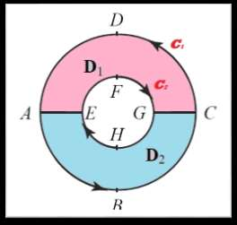
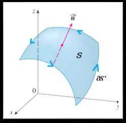

# Unidad 11 — Teoremas integrales: Green, Gauss (divergencia) y Stokes (rotor)

Resumen del material teórico de la unidad ([U11-Teoria-Teoremas-Integrales.pdf](../aula-virtual/11-Teoremas-Integrales/U11-Teoria-Teoremas-Integrales.pdf)), complementado con el resumen [Condiciones de existencia de la función potencial](../aula-virtual/08-Curvas-Integrales-Linea/Funcion-Potencial-Condiciones.pdf) y los [repasos del segundo parcial](../aula-virtual/Parciales/Segundo-Parcial/Repaso-Segundo-Parcial-Resuelto.pdf).

**Objetivos de la unidad:**

1. Conocer los operadores divergencia, rotor y laplaciano.
2. Aplicar el teorema de Green (circulación en el plano), el de la divergencia (flujo a través de superficies cerradas) y el del rotor (circulación en el espacio).
3. Usar los teoremas para decidir si un campo admite potencial.

---

## 1. Operadores diferenciales

Para $\vec f = (P, Q, R)$:

| Operador | Definición | Resultado |
|---|---|---|
| Gradiente | $\nabla\phi = (\phi'_x, \phi'_y, \phi'_z)$ | vector |
| Divergencia | $\operatorname{div}\vec f = \nabla\cdot\vec f = P'_x + Q'_y + R'_z$ | escalar |
| Rotor | $\operatorname{rot}\vec f = \nabla\wedge\vec f = (R'_y - Q'_z,\ P'_z - R'_x,\ Q'_x - P'_y)$ | vector |
| Laplaciano | $\nabla^2\phi = \operatorname{div}(\nabla\phi) = \phi''_{xx} + \phi''_{yy} + \phi''_{zz}$ | escalar |

El rotor se calcula con el "determinante":

$$\operatorname{rot}\vec f = \begin{vmatrix} \breve\imath & \breve\jmath & \breve k \\ \partial_x & \partial_y & \partial_z \\ P & Q & R \end{vmatrix}$$

**Clasificación de campos:**

- **Solenoidal:** $\operatorname{div}\vec f \equiv 0$ (no tiene "fuentes" ni "sumideros").
- **Irrotacional:** $\operatorname{rot}\vec f \equiv \vec 0$, que equivale a que $D\vec f$ sea simétrica.
- **Armónico** (para un campo escalar): $\nabla^2\phi \equiv 0$.

**Identidades:**

- $\operatorname{rot}(\nabla\phi) = \vec 0$ (con $\phi\in C^2$).
- $\operatorname{div}(\operatorname{rot}\vec g) = 0$ (con $\vec g\in C^2$).
- $\operatorname{div}(f\vec g) = f\operatorname{div}\vec g + \nabla f\cdot\vec g$.
- $\operatorname{rot}(f\vec g) = f\operatorname{rot}\vec g + \nabla f\wedge\vec g$.
- $\operatorname{div}(\vec f\wedge\vec g) = \operatorname{rot}\vec f\cdot\vec g - \vec f\cdot\operatorname{rot}\vec g$.

**Interpretación física:**

- la divergencia mide cuánto "sale" el campo por unidad de volumen alrededor de un punto;
- el rotor mide la tendencia a "girar" (como un molinito en un fluido).

---

## 2. Teorema de Green (en el plano)

**Hipótesis:**

- $D \subset \mathbb{R}^2$ es una región acotada cuya frontera $\partial D$ está formada por curvas cerradas simples, suaves a trozos.
- $\vec f = (P, Q) \in C^1$ en un abierto que contiene a $D$ y a su frontera.

**Tesis:**

$$\boxed{\oint_{\partial D^+}P\,dx + Q\,dy = \iint_D\left(Q'_x - P'_y\right)dx\,dy}$$

**Orientación positiva:** se recorre la frontera dejando la región **a la izquierda**. La curva exterior va en sentido antihorario y las curvas interiores (los "agujeros"), en sentido horario.

### Aplicaciones

- **Área con una integral de línea:** si $Q'_x - P'_y = 1$, entonces $A(D) = \oint_{\partial D^+}\vec f\cdot d\vec s$. Por ejemplo:

$$A = \oint x\,dy = -\oint y\,dx = \frac12\oint(x\,dy - y\,dx)$$

  En general, si $Q'_x - P'_y = k \ne 0$ es constante, $A = \frac1k\oint\vec f\cdot d\vec s$.
- **Circulación fácil:** si $Q'_x - P'_y$ es simple (constante, o lineal con una región simétrica), Green ahorra parametrizar curvas complicadas.
- **Curvas no cerradas:** se "cierra" la curva con un segmento, se aplica Green y se resta lo que aporta el segmento.

### Regiones con "agujeros" (puntos donde $\vec f$ no es $C^1$)

Si $\vec f$ no es $C^1$ en un punto $A$, **no** se puede aplicar Green a una región que lo contenga. Se aplica a la región **entre dos curvas** que rodean a $A$:

$$\oint_{C_1^+}\vec f\cdot d\vec s - \oint_{C_2^+}\vec f\cdot d\vec s = \iint_{\text{entre } C_1 \text{ y } C_2}(Q'_x - P'_y)\,dA$$

donde ambas curvas se recorren en sentido antihorario.

**Consecuencia:** si $Q'_x = P'_y$, todas las curvas que rodean a $A$ (una vez y en el mismo sentido) dan la **misma** circulación.

---

## 3. Green y la función potencial en el plano

Sea $\vec f\in C^1$ con $D\vec f$ simétrica ($Q'_x = P'_y$) en su dominio $D$.

| Dominio | ¿Admite potencial? |
|---|---|
| Simplemente conexo (sin agujeros), por ejemplo $\mathbb{R}^2$ | **Sí**: por Green toda circulación cerrada es 0 |
| $\mathbb{R}^2 - \{A\}$ | **Sí, si y sólo si** la circulación sobre **una** curva que rodee a $A$ es 0. Si da $\ne 0$, no admite |

**Ejemplo típico:** $\left(\dfrac{-y}{x^2+y^2}, \dfrac{x}{x^2+y^2}\right)$ tiene jacobiana simétrica y circulación $2\pi$ alrededor del origen ⇒ no admite potencial.

---

## 4. Teorema de la divergencia (Gauss-Ostrogradski)

**Hipótesis:**

- $H\subset\mathbb{R}^3$ es un cuerpo cuya frontera $\partial H$ es una superficie cerrada, suave a trozos, orientada con **normal saliente**.
- $\vec f\in C^1$ en un abierto que contiene a $H$.

**Tesis:**

$$\boxed{\oint\!\!\!\oint_{\partial H}\vec f\cdot\breve n\,d\sigma = \iiint_H\operatorname{div}\vec f\,dV}$$

### Usos típicos

- **Flujo a través de una superficie cerrada:** con una sola integral triple, en lugar de una integral por cada cara.
- **Flujo a través de una superficie abierta $S$** (por ejemplo, un paraboloide): se la **cierra** con una "tapa" $T$ simple, como un disco plano:

$$\Phi_S = \iiint_H\operatorname{div}\vec f\,dV - \Phi_T$$

  Hay que cuidar que las normales de $S$ y $T$ sean salientes, y ajustar el signo según la orientación pedida.
- **Campos solenoidales** ($\operatorname{div} = 0$): el flujo a través de cualquier superficie cerrada es 0, y el flujo a través de superficies con el **mismo borde** es el mismo.
- **Campos con una singularidad** en $A$ y $\operatorname{div} = 0$ fuera de $A$: el flujo a través de una superficie cerrada es 0 si no encierra a $A$, y es **siempre el mismo** si lo encierra (ley de Gauss: $4\pi kq$ para el campo de una carga puntual).
- **Simetrías:** si $\operatorname{div}\vec f$ es impar respecto de un plano de simetría del cuerpo, la integral triple es 0.

---

## 5. Teorema del rotor (Stokes)

**Hipótesis:**

- $S$ es una superficie orientable, suave a trozos, con borde $\partial S$: una curva cerrada, suave a trozos.
- $\vec f\in C^1$ en un abierto que contiene a $S$.

**Tesis:**

$$\boxed{\oint_{\partial S^+}\vec f\cdot d\vec s = \iint_S\operatorname{rot}\vec f\cdot\breve n\,d\sigma}$$

**Orientaciones compatibles (regla de la mano derecha):** si el pulgar apunta como $\breve n$, los dedos indican el sentido de recorrido de $\partial S$. Equivalentemente, caminando sobre el borde con la cabeza hacia $\breve n$, la superficie queda **a la izquierda**.

### Usos típicos

- **Circulación en el espacio** sobre una curva cerrada complicada (la intersección de dos superficies): se elige la superficie **más simple** cuyo borde sea esa curva (casi siempre un trozo de plano) y se calcula el flujo del rotor.
- **Green es el caso plano de Stokes:** $\breve n = \breve k$ y $\operatorname{rot}\vec f\cdot\breve k = Q'_x - P'_y$.
- **Potencial en el espacio:** si $\operatorname{rot}\vec f = \vec 0$ en un dominio **simplemente conexo** (por ejemplo $\mathbb{R}^3$, o $\mathbb{R}^3 - \{A\}$, que sí lo es), toda curva cerrada es borde de una superficie dentro del dominio, por Stokes la circulación es 0 y existe la potencial. $\mathbb{R}^3$ menos una **recta** (por ejemplo el eje $z$) **no** es simplemente conexo.

---

## 6. Estrategia para los ejercicios

1. **Circulación en el plano sobre una curva cerrada:** usar Green. Si hay un punto singular adentro, usar Green entre dos curvas. Si la curva es abierta, cerrarla.
2. **Circulación en el espacio sobre una curva cerrada:** usar Stokes, eligiendo una superficie simple y la normal compatible con el sentido de recorrido.
3. **Flujo a través de una superficie cerrada:** usar la divergencia.
4. **Flujo a través de una superficie abierta "difícil":** cerrarla con una tapa y usar la divergencia.
5. **¿Admite potencial?**
   1. ¿$D\vec f$ es simétrica (o el rotor es nulo)? Si no, **no** admite.
   2. Si lo es, ¿el dominio es simplemente conexo? Si sí, **sí** admite.
   3. Si no lo es, calcular la circulación alrededor del agujero: si es 0 admite, y si no, no.

---

## 7. Resumen de fórmulas

| Teorema | Fórmula |
|---|---|
| Green | $\oint_{\partial D^+}\vec f\cdot d\vec s = \iint_D(Q'_x - P'_y)\,dA$ |
| Área con Green | $A = \oint x\,dy = -\oint y\,dx = \frac12\oint(x\,dy - y\,dx)$ |
| Divergencia | $\oint\!\!\oint_{\partial H}\vec f\cdot\breve n\,d\sigma = \iiint_H\operatorname{div}\vec f\,dV$ |
| Rotor (Stokes) | $\oint_{\partial S}\vec f\cdot d\vec s = \iint_S\operatorname{rot}\vec f\cdot\breve n\,d\sigma$ |
| Identidades | $\operatorname{rot}\nabla\phi = \vec 0$, $\ \operatorname{div}\operatorname{rot}\vec g = 0$ |
| Ley de Gauss | $\oint\!\!\oint\frac{kq\,\vec r}{r^3}\cdot\breve n\,d\sigma = 4\pi kq$ (si encierra al origen) |

---

[← Volver al menú principal](../README.md)
