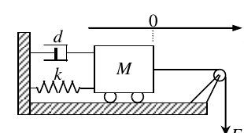
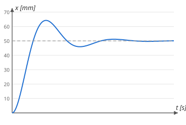
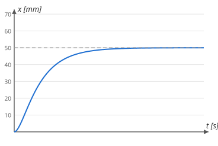
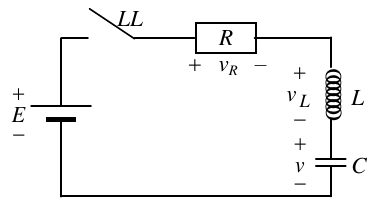
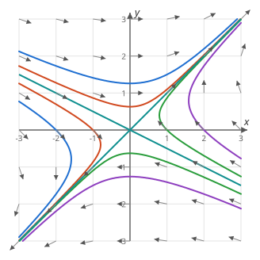
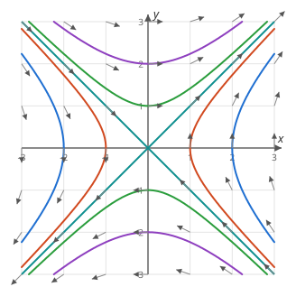
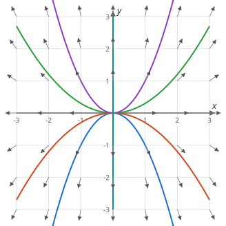

# Unidad 12 — Práctica: Ecuaciones diferenciales (2.ª parte)

Ejercicios del **T.P. N.º 12 de la Guía de Trabajos Prácticos** ([TP12-Ecuaciones-Diferenciales-2.pdf](../aula-virtual/12-Ecuaciones-Diferenciales-2/TP12-Ecuaciones-Diferenciales-2.pdf)). Las respuestas se controlaron con las [respuestas oficiales de la guía](../aula-virtual/00-Guia-TP/Guia-TP-2016-Respuestas.pdf) y con la [fe de erratas](../aula-virtual/00-Guia-TP/Guia-TP-2016-Fe-de-Erratas-2018-07-31.pdf).

Cada ejercicio tiene un botón **Solución**. Al abrirlo aparece la respuesta y, arriba de ella, un segundo botón **Solución paso a paso** con el desarrollo completo.

> **Nomenclatura y consideraciones básicas:**
>
> - S.G. simboliza ***solución general***, S.P. ***solución particular***, S.S. ***solución singular***.
> - Dada la ecuación diferencial ordinaria $F(y^{(n)}, \cdots, y', y, x) = 0$ de orden $n$, sus soluciones, de existir, no siempre admiten que se las exprese en forma explícita. Las soluciones son relaciones entre las variables que satisfacen a la ecuación diferencial; en especial, la S.G. debe contener $n$ constantes arbitrarias esenciales.

---

### 01) Ecuaciones homogéneas de 1.er orden

Resuelva las siguiente ecuaciones diferenciales homogéneas de 1° orden.

- a) $y' = \dfrac yx + \dfrac{y^2}{x^2}$ con $y(1) = 1$.
- b) $(x^2 + y^2)\thinspace dx - 2xy\thinspace dy = 0$.
- c) $\dfrac{dy}{dx} = \dfrac{y + x\cos^2(y/x)}{x}$ con $y(1) = \dfrac\pi4$.
- d) $y' = y/(x - y)$.

<b>Solución</b>

Solución paso a paso

**Método:** $z = \dfrac yx$, $y' = z + xz'$, y la ecuación queda separable en $z$ y $x$.

**a)** $z + xz' = z + z^2 \Rightarrow xz' = z^2$.

$$\frac{dz}{z^2} = \frac{dx}{x} \Rightarrow -\frac1z = \ln|x| + C \Rightarrow -\frac xy = \ln|x| + C$$

Con $y(1) = 1$: $-1 = 0 + C \Rightarrow C = -1$. Entonces $-x = y\ln|x| - y$, es decir:

$$y\ln|x| - y + x = 0$$

**b)** $y' = \dfrac{x^2 + y^2}{2xy} = \dfrac{1 + z^2}{2z}$ ⇒ $xz' = \dfrac{1 + z^2}{2z} - z = \dfrac{1 - z^2}{2z}$.

$$\frac{2z\thinspace dz}{1 - z^2} = \frac{dx}{x} \Rightarrow -\ln|1 - z^2| = \ln|x| + c \Rightarrow 1 - \frac{y^2}{x^2} = \frac Kx$$

Multiplicando por $x^2$: $x^2 - y^2 = Kx$, es decir $y^2 = x^2 + Cx$.

**c)** $y' = z + \cos^2z$ ⇒ $xz' = \cos^2z$.

$$\sec^2z\thinspace dz = \frac{dx}{x} \Rightarrow \tan z = \ln|x| + C$$

Con $y(1) = \frac\pi4$: $\tan\frac\pi4 = 1 = C$. Resultado: $\mathop{\mathrm{tg}}(y/x) = 1 + \ln|x|$.

**d)** $y' = \dfrac{z}{1 - z}$ ⇒ $xz' = \dfrac{z}{1-z} - z = \dfrac{z^2}{1 - z}$.

$$\frac{(1 - z)\thinspace dz}{z^2} = \frac{dx}{x} \Rightarrow -\frac1z - \ln|z| = \ln|x| + c$$

Volviendo a $y$: $-\dfrac xy - \ln|y| + \ln|x| = \ln|x| + c$, así que $-\dfrac xy - \ln|y| = c$. Multiplicando por $-y$:

$$y\ln|y| + Cy + x = 0$$

**Respuesta:**

- a) $y\ln|x| - y + x = 0$.
- b) $y^2 = x^2 + Cx$.
- c) $\mathop{\mathrm{tg}}(y/x) = 1 + \ln|x|$.
- d) $y\ln|y| + Cy + x = 0$.

---

### 02) Familia ortogonal

Halle la familia de curvas ortogonales a $x^2 + y^2 = 2ax$.

<b>Solución</b>

Solución paso a paso

**Paso 1 — EDO de la familia.** $2a = \dfrac{x^2+y^2}{x}$. Derivando: $2x + 2yy' = 2a = \dfrac{x^2+y^2}{x}$, así que:

$$y' = \frac{y^2 - x^2}{2xy}$$

**Paso 2 — Ortogonal** ($y' \to -1/y'$):

$$-\frac{1}{y'} = \frac{y^2 - x^2}{2xy} \Rightarrow y' = \frac{2xy}{x^2 - y^2}$$

Es homogénea.

**Paso 3 — Resolver** con $y = zx$:

$$xz' = \frac{2z}{1 - z^2} - z = \frac{z(1 + z^2)}{1 - z^2} \ \Rightarrow\ \frac{1 - z^2}{z(1 + z^2)}\thinspace dz = \frac{dx}{x}$$

Fracciones simples: $\dfrac{1 - z^2}{z(1+z^2)} = \dfrac1z - \dfrac{2z}{1 + z^2}$. Integrando:

$$\ln|z| - \ln(1 + z^2) = \ln|x| + c \Rightarrow \frac{z}{1 + z^2} = Kx$$

**Paso 4 — Volver a $x$, $y$.** $\dfrac{z}{1+z^2} = \dfrac{y/x}{(x^2+y^2)/x^2} = \dfrac{xy}{x^2 + y^2}$:

$$\frac{xy}{x^2 + y^2} = Kx \Rightarrow x^2 + y^2 = K'y$$

Son circunferencias tangentes al eje $x$ en el origen; las de la familia dada son tangentes al eje $y$.

**Respuesta:** $x^2 + y^2 = Ky$.

---

### 03) Ecuación reducible a homogénea

Resuelva $y' = (x - y - 1)/(x + y + 3)$ aplicando la transformación $(x,y) = (u - 1,\ v - 2)$.

<b>Solución</b>

Solución paso a paso

**Paso 1 — Cambio.** Con $x = u - 1$, $y = v - 2$:

- $x - y - 1 = u - v$;
- $x + y + 3 = u + v$;
- $dy/dx = dv/du$.

Queda $\dfrac{dv}{du} = \dfrac{u - v}{u + v}$, homogénea. El punto $(-1,-2)$ es donde se cortan las rectas del numerador y el denominador.

**Paso 2 — Resolver** con $v = zu$:

$$z + uz' = \frac{1 - z}{1 + z} \Rightarrow uz' = \frac{1 - 2z - z^2}{1 + z} \Rightarrow \frac{(1 + z)\thinspace dz}{1 - 2z - z^2} = \frac{du}{u}$$

$$-\frac12\ln|1 - 2z - z^2| = \ln|u| + c \Rightarrow (1 - 2z - z^2)\thinspace u^2 = K \Rightarrow u^2 - 2uv - v^2 = K$$

**Paso 3 — Volver a $x$, $y$** con $u = x + 1$ y $v = y + 2$:

$$(x+1)^2 - 2(x+1)(y+2) - (y+2)^2 = x^2 - 2xy - y^2 - 2x - 6y - 7 = K$$

Reordenando: $y^2 - x^2 + 2xy + 2x + 6y = C$, válido donde $x + y + 3 \ne 0$.

**Respuesta:** $y^2 - x^2 + 2xy + 2x + 6y = C$ con $x + y + 3 \ne 0$.

---

### 04) Ecuaciones totales exactas

Resuelva las siguiente ecuaciones diferenciales totales exactas o convertibles a este tipo.

- a) $2xy\thinspace dx + (x^2 + \cos y)\thinspace dy = 0$.
- b) $y' = \dfrac{xy^2 - 1}{1 - x^2y}$ con $y(-1) = 1$.
- c) $(6xy - y^3)\thinspace dx + (4y + 3x^2 - 3xy^2)\thinspace dy = 0$.
- d) $(y^2 - y)\thinspace dx + x\thinspace dy = 0$.(\*)
- e) $(x + y^2)\thinspace dx - 2yx\thinspace dy = 0$.
- f) $y^2\cos x\thinspace dx + (4 + 5y\mathop{\mathrm{sen}}x)\thinspace dy = 0$.

(\*) También es de variables separables, verifique que el método de resolución no cambia el tipo de solución obtenida.

<b>Solución</b>

Solución paso a paso

**Método:** con $M\thinspace dx + N\thinspace dy = 0$:

1. Verificar $M'_y = N'_x$.
2. Hallar $U$ con $U'_x = M$ y $U'_y = N$.
3. La solución es $U = C$.

Si no es exacta, se busca un factor integrante $\mu(x)$ o $\mu(y)$.

**a)** $M'_y = 2x = N'_x$ ✓.

- $U = x^2y + g(y)$.
- $U'_y = x^2 + g' = x^2 + \cos y \Rightarrow g = \mathop{\mathrm{sen}}y$.

Resultado: $x^2y + \mathop{\mathrm{sen}}y = C$.

**b)** Pasando a forma diferencial: $(xy^2 - 1)\thinspace dx + (x^2y - 1)\thinspace dy = 0$, con $M'_y = 2xy = N'_x$ ✓.

- $U = \dfrac{x^2y^2}{2} - x - y$.
- Con $y(-1) = 1$: $\frac12 + 1 - 1 = \frac12 = C$.
- $\dfrac{x^2y^2}{2} - x - y = \dfrac12$, es decir $2x + 2y - x^2y^2 + 1 = 0$.

**c)** $M'_y = 6x - 3y^2 = N'_x$ ✓.

- $U = 3x^2y - xy^3 + g(y)$.
- $U'_y = 3x^2 - 3xy^2 + g' = 4y + 3x^2 - 3xy^2 \Rightarrow g = 2y^2$.

Resultado: $3x^2y - xy^3 + 2y^2 = C$.

**d)** $M'_y = 2y - 1$ y $N'_x = 1$: no es exacta.

- $\dfrac{N'_x - M'_y}{M} = \dfrac{2 - 2y}{y(y-1)} = -\dfrac2y$ depende sólo de $y$ ⇒ $\mu(y) = e^{\int -2/y\thinspace dy} = y^{-2}$.
- Queda $\left(1 - \frac1y\right)dx + \frac{x}{y^2}dy = 0$, que ahora es exacta: $M'_y = \frac{1}{y^2} = N'_x$.
- $U = x - \dfrac xy = C$ ⇒ $\dfrac xy = x - C$ ⇒ $y = \dfrac{x}{x - C}$. Renombrando la constante, $y = \dfrac{x}{x + C}$.

*Como separable:* $\dfrac{dy}{y(1 - y)} = \dfrac{dx}{x}$ ⇒ $\ln\left|\dfrac{y}{1-y}\right| = \ln|x| + c$ ⇒ $y = \dfrac{Kx}{1 + Kx}$, la misma familia. En ambos métodos $y = 0$ aparece aparte: es solución, pero se pierde al dividir por $y$ (o al multiplicar por $y^{-2}$).

**e)** $M'_y = 2y$ y $N'_x = -2y$: no es exacta.

- $\dfrac{M'_y - N'_x}{N} = \dfrac{4y}{-2xy} = -\dfrac2x$ ⇒ $\mu(x) = x^{-2}$.
- Queda $\left(\frac1x + \frac{y^2}{x^2}\right)dx - \frac{2y}{x}dy = 0$, exacta: $M'_y = \frac{2y}{x^2} = N'_x$.
- $U = \ln|x| - \dfrac{y^2}{x} = C$, es decir $\ln|x| = C + \dfrac{y^2}{x}$.

**f)** $M'_y = 2y\cos x$ y $N'_x = 5y\cos x$: no es exacta.

- $\dfrac{N'_x - M'_y}{M} = \dfrac{3y\cos x}{y^2\cos x} = \dfrac3y$ ⇒ $\mu(y) = y^3$.
- Queda $y^5\cos x\thinspace dx + (4y^3 + 5y^4\mathop{\mathrm{sen}}x)\thinspace dy = 0$, exacta: $M'_y = 5y^4\cos x = N'_x$.
- $U = y^5\mathop{\mathrm{sen}}x + g(y)$ con $g' = 4y^3$, así que $g = y^4$.

Resultado: $y^4 + y^5\mathop{\mathrm{sen}}x = C$.

**Respuesta:**

- a) $x^2y + \mathop{\mathrm{sen}}(y) = C$.
- b) $2x + 2y - x^2y^2 + 1 = 0$.
- c) $3x^2y - xy^3 + 2y^2 = C$.
- d) $y = \dfrac{x}{x + C}$.
- e) $\ln|x| = C + \dfrac{y^2}{x}$.
- f) $y^4 + y^5\mathop{\mathrm{sen}}(x) = C$.

---

### 05) Cambio $y = x^2q(x)$

Resuelva la ecuación $x^2y' = y + x\thinspace e^{-1/x}$ mediante el reemplazo $y = x^2q(x)$.

<b>Solución</b>

Solución paso a paso

**Paso 1 — Reemplazo.** $y = x^2q$ ⇒ $y' = 2xq + x^2q'$:

$$x^2(2xq + x^2q') = x^2q + xe^{-1/x} \ \Rightarrow\ q' + \frac{2x - 1}{x^2}\thinspace q = \frac{e^{-1/x}}{x^3}$$

Queda una EDO **lineal** en $q$.

**Paso 2 — Factor integrante.** $e^{\int(2/x - 1/x^2)dx} = e^{2\ln x + 1/x} = x^2e^{1/x}$. Multiplicando:

$$\left(q\thinspace x^2e^{1/x}\right)' = x^2e^{1/x}\cdot\frac{e^{-1/x}}{x^3} = \frac1x$$

**Paso 3 — Integrar.** $q\thinspace x^2e^{1/x} = \ln x + C$.

**Paso 4 — Volver a $y$.** $y = x^2q = (C + \ln x)\thinspace e^{-1/x}$.

*Control:* como lineal directa, $y' - \frac{y}{x^2} = \frac{e^{-1/x}}{x}$, con $y_H = Ce^{-1/x}$ y $K' = 1/x$, se llega a lo mismo.

**Respuesta:** $y = (C + \ln(x))\thinspace e^{-1/x}$.

---

### 06) Lineales a coeficientes constantes

Halle la S.G. de las siguientes ecuaciones diferenciales.

- a) $y'' + 8y' + 25y = 0$.
- b) $y''' - 5y'' + 8y' - 4y = 2$.
- c) $y'' - 3y' + 2y = xe^x + 2x$.
- d) $y'' + y = \sec(x)$.
- e) $y'' - 2y' + y = x^{-1}e^x$.
- f) $y'' + y' = 2\mathop{\mathrm{sen}}(x)$.

<b>Solución</b>

Solución paso a paso

**Método:** $y = y_H + y_P$. $y_H$ sale de la ecuación característica; $y_P$, por coeficientes indeterminados o variación de parámetros.

**a)** $r^2 + 8r + 25 = 0 \Rightarrow r = \dfrac{-8 \pm \sqrt{64 - 100}}{2} = -4 \pm 3i$.

$$y = e^{-4x}(A\cos3x + B\mathop{\mathrm{sen}}3x)$$

**b)** $r^3 - 5r^2 + 8r - 4 = (r - 1)(r - 2)^2$, porque $r = 1$ es raíz. Entonces $y_H = C_1e^x + (C_2 + C_3x)e^{2x}$.

$y_P = A$ (constante): $-4A = 2 \Rightarrow A = -\frac12$.

**c)** $r^2 - 3r + 2 = 0 \Rightarrow r = 1, 2$.

- Para $2x$: $y_P = Ax + B$ ⇒ $-3A + 2Ax + 2B = 2x$ ⇒ $A = 1$, $B = \frac32$.
- Para $xe^x$: $r = 1$ es raíz simple ⇒ **resonancia**, se propone $y_P = (Cx^2 + Dx)e^x = p\thinspace e^x$. Al reemplazar queda $(p'' - p')e^x = xe^x$ ⇒ $2C - 2Cx - D = x$ ⇒ $C = -\frac12$, $D = -1$.

$$y = C_1e^x + C_2e^{2x} - \frac{x^2}{2}e^x - xe^x + x + \frac32$$

**d)** $y_1 = \cos x$, $y_2 = \mathop{\mathrm{sen}}x$ y $W = 1$. Con $f = \sec x$, que no admite coeficientes indeterminados, usamos **variación de parámetros**:

- $C_1' = -\mathop{\mathrm{sen}}x\sec x = -\tan x \Rightarrow C_1 = \ln|\cos x|$.
- $C_2' = \cos x\sec x = 1 \Rightarrow C_2 = x$.

$$y = C_1\mathop{\mathrm{sen}}x + C_2\cos x + x\mathop{\mathrm{sen}}x + \cos x\ln|\cos x|$$

**e)** $(r - 1)^2 = 0$ ⇒ $y_1 = e^x$, $y_2 = xe^x$ y $W = e^{2x}$. Con $f = \dfrac{e^x}{x}$:

- $C_1' = -\dfrac{xe^x\cdot e^x/x}{e^{2x}} = -1 \Rightarrow C_1 = -x$.
- $C_2' = \dfrac{e^x\cdot e^x/x}{e^{2x}} = \dfrac1x \Rightarrow C_2 = \ln|x|$.

$y_P = -xe^x + xe^x\ln|x|$, y el término $-xe^x$ se absorbe en $y_H$:

$$y = C_1e^x + C_2xe^x + xe^x\ln|x|$$

**f)** $r^2 + r = 0 \Rightarrow r = 0, -1$. Proponemos $y_P = A\cos x + B\mathop{\mathrm{sen}}x$:

- coeficiente de $\cos x$: $B - A = 0$;
- coeficiente de $\mathop{\mathrm{sen}}x$: $-A - B = 2$.

Entonces $A = B = -1$.

$$y = C_1e^{-x} + C_2 - \mathop{\mathrm{sen}}x - \cos x$$

**Respuesta:**

- a) $y = Ae^{-4x}\cos(3x) + Be^{-4x}\mathop{\mathrm{sen}}(3x)$.
- b) $y = C_1e^x + C_2e^{2x} + C_3xe^{2x} - 2^{-1}$.
- c) $y = C_1e^x + C_2e^{2x} - \dfrac{x^2}{2}e^x - xe^x + x + \dfrac32$.
- d) $y = C_1\mathop{\mathrm{sen}}(x) + C_2\cos(x) + x\mathop{\mathrm{sen}}(x) + \cos(x)\ln(|\cos(x)|)$.
- e) $y = C_1e^x + C_2xe^x + xe^x\ln(|x|)$.
- f) $y = C_1e^{-x} + C_2 - \mathop{\mathrm{sen}}(x) - \cos(x)$.

---

### 07) Función $g$ para que haya potencial

Halle $g$ de manera que $\bar f(x,y) = (y\thinspace g'(x),\ x^2 - g'(x))$ admita función potencial.

<b>Solución</b>

Solución paso a paso

**Paso 1 — Condición** (dominio $\mathbb{R}^2$): $P'_y = Q'_x \Rightarrow g'(x) = 2x - g''(x)$, es decir:

$$g'' + g' = 2x$$

**Paso 2 — Homogénea.** $r^2 + r = 0 \Rightarrow g_H = C_1 + C_2e^{-x}$.

**Paso 3 — Particular.** $r = 0$ es raíz ⇒ $g_P = x(ax + b) = ax^2 + bx$. Reemplazando: $2a + 2ax + b = 2x$ ⇒ $a = 1$, $b = -2$.

**Respuesta:** $g(x) = C_1 + C_2e^{-x} + x^2 - 2x$.

---

### 08) Soluciones particulares

Halle la solución particular (S.P.).

- a) S.P. de $y'' - y' - 2y = 4x^2$ tal que $y(0) = 1$, $y'(0) = 4$.
- b) S.P. de $y'' - y' - 2y = e^{3x}$ con recta tangente de ecuación $y = 2x + 1$ en $(0,y_0)$.
- c) S.P. de $y'' + 2y' + 2y = \mathop{\mathrm{sen}}(2x) + \cos(2x)$ tal que $y(0) = 0$, $y'(0) = 1$.
- d) S.P. de $y''' - 3y'' + 2y' = x^2 - x$ tal que $y(0) = 0$, $y'(0) = 2$, $y''(0) = 2$.
- e) S.P. de $y'' - y = 2x - 1$ con recta normal de ecuación $x + 3y = 6$ en $(0,y_0)$.

<b>Solución</b>

Solución paso a paso

**a)** *Homogénea:* $r^2 - r - 2 = (r-2)(r+1)$ ⇒ $y_H = c_1e^{2x} + c_2e^{-x}$.

*Particular:* $y_P = Ax^2 + Bx + C$. Igualando coeficientes:

- $x^2$: $-2A = 4 \Rightarrow A = -2$;
- $x$: $-2A - 2B = 0 \Rightarrow B = 2$;
- constante: $2A - B - 2C = 0 \Rightarrow C = -3$.

*Condiciones:*

- $y(0) = c_1 + c_2 - 3 = 1$;
- $y'(0) = 2c_1 - c_2 + 2 = 4$.

Entonces $c_1 = c_2 = 2$.

**b)** La tangente $y = 2x + 1$ en $x = 0$ da $y(0) = 1$ e $y'(0) = 2$.

- $y_P = Ae^{3x}$: $(9 - 3 - 2)A = 1 \Rightarrow A = \frac14$.
- $c_1 + c_2 + \frac14 = 1$ y $2c_1 - c_2 + \frac34 = 2$ ⇒ $c_1 = \frac23$, $c_2 = \frac{1}{12}$.

**c)** *Homogénea:* $r = -1 \pm i$ ⇒ $y_H = e^{-x}(c_1\cos x + c_2\mathop{\mathrm{sen}}x)$.

*Particular:* $y_P = A\cos2x + B\mathop{\mathrm{sen}}2x$:

- $\cos2x$: $-2A + 4B = 1$;
- $\mathop{\mathrm{sen}}2x$: $-4A - 2B = 1$.

Entonces $A = -\frac{3}{10}$ y $B = \frac{1}{10}$.

*Condiciones:*

- $y(0) = c_1 - \frac{3}{10} = 0 \Rightarrow c_1 = \frac{3}{10}$;
- $y'(0) = -c_1 + c_2 + 2B = 1 \Rightarrow c_2 = \frac{11}{10}$.

**d)** *Homogénea:* $r(r - 1)(r - 2)$ ⇒ $y_H = c_0 + c_1e^x + c_2e^{2x}$.

*Particular:* $r = 0$ es raíz ⇒ $y_P = Ax^3 + Bx^2 + Cx$. Al reemplazar:

$$6Ax^2 + (4B - 18A)x + (6A - 6B + 2C) = x^2 - x \Rightarrow A = \frac16,\ B = \frac12,\ C = 1$$

*Condiciones:*

- $c_0 + c_1 + c_2 = 0$;
- $c_1 + 2c_2 + 1 = 2$;
- $c_1 + 4c_2 + 1 = 2$.

Entonces $c_2 = 0$, $c_1 = 1$, $c_0 = -1$.

**e)** *Recta normal* $x + 3y = 6$ en $x = 0$: $y_0 = 2$. Su pendiente es $-\frac13$, así que la tangente tiene pendiente $3$ ⇒ $y'(0) = 3$.

- $y_H = c_1e^x + c_2e^{-x}$ e $y_P = -2x + 1$.
- $c_1 + c_2 + 1 = 2$ y $c_1 - c_2 - 2 = 3$ ⇒ $c_1 = 3$, $c_2 = -2$.

**Respuesta:**

- a) $y = 2e^{-x} + 2e^{2x} + 2x - 2x^2 - 3$.
- b) $y = \frac{1}{12}e^{-x} + \frac23e^{2x} + \frac14e^{3x}$.
- c) $y = \dfrac{e^{-x}}{10}(3\cos(x) + 11\mathop{\mathrm{sen}}(x)) + \dfrac{1}{10}\mathop{\mathrm{sen}}(2x) - \dfrac{3}{10}\cos(2x)$.
- d) $y = x - 1 + e^x + \dfrac{x^2}{2} + \dfrac{x^3}{6}$.
- e) $y = 1 - 2x - 2e^{-x} + 3e^x$.

---

### 09) S.G. a partir de una S.P.

Dada $y'' + y = f(x)$, halle su S.G. sabiendo que $y = 2x^2$ es una S.P.

<b>Solución</b>

**Respuesta:** $y = y_H + y_P$, con $y_H = C_1\cos x + C_2\mathop{\mathrm{sen}}x$ (raíces $\pm i$) e $y_P = 2x^2$. No hace falta conocer $f$:

$$y = C_1\cos(x) + C_2\mathop{\mathrm{sen}}(x) + 2x^2$$

---

### 10) Sistema masa-resorte-amortiguador

El cuerpo de masa $M$ puede desplazarse horizontalmente con rozamiento despreciable y está acoplado a la pared vertical mediante un resorte de constante $k$ y un amortiguador de constante $d$. En tiempo $t = 0$ está en reposo en la posición $x = 0$ y se le aplica una fuerza $F$ constante que lo lleva hacia $x^+$ partiendo con velocidad $x'(0) = 0$.

Siendo: $\underbrace{F - \underbrace{kx}_ {\text{resorte}} - \underbrace{dx'}_ {\text{amortig.}}}_ {\text{fuerza total}} = \underbrace{M}_ {\text{masa}}\cdot\underbrace{x''}_ {\text{aceleración}}$, resulta $\boxed{Mx'' + dx' + kx = F}$.

- a) Con $F = 4.35$, $M = 3$, $k = 87$ halle y grafique $x(t)$ para: a₁) $d = 12$, a₂) $d = 38$.
- b) Indique las unidades de medida de $x'$, $x''$, $M$, $k$, $d$ cuando el tiempo se mide en segundos ($[t] =$ s), $[F] =$ Newton (N) $=$ kgm/s² y $[x] =$ m.

<b>Solución</b>

Solución paso a paso

**Planteo general:**

- $x_P = F/k = 4{,}35/87 = 0{,}05$ m es el equilibrio.
- Condiciones: $x(0) = 0$ y $x'(0) = 0$.

**a₁) $d = 12$:** $3r^2 + 12r + 87 = 0 \Rightarrow r^2 + 4r + 29 = 0 \Rightarrow r = -2 \pm 5i$, raíces complejas ⇒ **oscila**.

$$x = 0{,}05 + e^{-2t}(A\cos5t + B\mathop{\mathrm{sen}}5t)$$

- $x(0) = 0 \Rightarrow A = -0{,}05$.
- $x'(0) = -2A + 5B = 0 \Rightarrow B = -0{,}02$.

$$x(t) = \frac{1}{100}\left[5 - 5e^{-2t}\cos(5t) - 2e^{-2t}\mathop{\mathrm{sen}}(5t)\right]$$

Como $5\cos5t + 2\mathop{\mathrm{sen}}5t = \sqrt{29}\mathop{\mathrm{sen}}(5t + \mathop{\mathrm{arctg}}(5/2))$, también se puede escribir:

$$x(t) = \frac{1}{100}\left[5 - \sqrt{29}\thinspace e^{-2t}\mathop{\mathrm{sen}}(5t + \mathop{\mathrm{arctg}}(5/2))\right]$$

**a₂) $d = 38$:** $3r^2 + 38r + 87 = 0 \Rightarrow r = \dfrac{-38 \pm 20}{6} \Rightarrow r = -3,\ -\dfrac{29}{3}$, reales ⇒ **no oscila**.

$$x = 0{,}05 + Ae^{-3t} + Be^{-29t/3}$$

- $A + B = -0{,}05$.
- $-3A - \frac{29}{3}B = 0$.

Entonces $B = \frac{9}{400}$ y $A = -\frac{29}{400}$:

$$x(t) = \frac{1}{100}\left(5 + \frac94e^{-29t/3} - \frac{29}{4}e^{-3t}\right)$$

*Control:* $x(0) = \frac{1}{100}\left(5 + \frac94 - \frac{29}{4}\right) = 0$ ✓.

> La respuesta oficial de la guía escribe $-\frac94e^{-29t/3}$, pero con ese signo $x(0) = \frac{1}{100}(5 - 9{,}5) \ne 0$. El signo correcto es $+$.

En ambos casos, $x(t) \to 0{,}05$ m $= 50$ mm.

**b) Unidades.**

- $[x'] =$ m/s y $[x''] =$ m/s².
- $[M] =$ kg.
- $kx$ es una fuerza ⇒ $[k] =$ N/m.
- $dx'$ es una fuerza ⇒ $[d] =$ N·s/m.

**Respuesta:**

- a₁) En metros: $x(t) = \frac{1}{100}[5 - 5e^{-2t}\cos(5t) - 2e^{-2t}\mathop{\mathrm{sen}}(5t)] = \frac{1}{100}[5 - \sqrt{29}\thinspace e^{-2t}\mathop{\mathrm{sen}}(5t + \mathop{\mathrm{arctg}}(5/2))]$; $x(t) \to 0.05$ m $= 50$ mm, oscilación amortiguada.
- a₂) En metros: $x(t) = \frac{1}{100}(5 + \frac94e^{-29t/3} - \frac{29}{4}e^{-3t})$; $x(t) \to 0.05$ m $= 50$ mm, sin oscilaciones.
- b) $[x'] =$ m/s, $[x''] =$ m/s², $[M] =$ kg, $[k] =$ N/m, $[d] =$ N s / m.

---

### 11) Circuito RLC

En el circuito se observa una llave $LL$, una fuente de tensión $E$ constante, un resistor de resistencia $R$, un inductor con inductancia $L$ y un capacitor con capacitancia $C$; se suponen componentes ideales. Se denotan $v_R$, $v_L$ y $v$ las tensiones entre terminales del resistor, inductor y capacitor respectivamente.

Con $LL$ cerrada se cumple que: $E = v_R + v_L + v \quad (1)$

Siendo(#) $i = C\thinspace v'$, resultan: $\begin{cases} v_R = R\thinspace i = RC\thinspace v' \cr v_L = L\thinspace i' = LC\thinspace v'' \end{cases}$

Reemplazando en (1) se obtiene: $\boxed{LC\thinspace v'' + RC\thinspace v' + v = E}$

En tiempo $t = 0$, con capacitor descargado ($v(0) = 0$) se cierra $LL$ y comienza a circular corriente ($i(0) = 0 \Rightarrow v'(0) = 0$). Halle y grafique $v(t)$ e $i(t)$ cuando el tiempo se mide en segundos (s), $E = 0.05$ Volt, $R/L = 4$ s⁻¹, $(LC)^{-1} = 29$ s⁻².

Nota: Observe que $v(t)$ permite simular $x(t)$ del ítem anterior para el caso caso "a₁)" (equivalente eléctrico del sistema mecánico).

(#) $i$ es la intensidad de corriente eléctrica en el circuito. Unidades de medida: [*tensión*] $=$ Volt, $[i] =$ Ampere, $[R] =$ Ohm, $[L] =$ Henry, $[C] =$ Faradio.

<b>Solución</b>

Solución paso a paso

**Paso 1 — Normalizar.** Dividiendo por $LC$:

$$v'' + \frac RL\thinspace v' + \frac{1}{LC}\thinspace v = \frac{E}{LC} \ \Rightarrow\ v'' + 4v' + 29v = 29\cdot0{,}05$$

Es **la misma ecuación** que 10 a₁ dividida por $M = 3$: $x'' + 4x' + 29x = 1{,}45$.

**Paso 2 — Solución.** Con las mismas condiciones iniciales:

$$v(t) = \frac{1}{100}\left[5 - 5e^{-2t}\cos(5t) - 2e^{-2t}\mathop{\mathrm{sen}}(5t)\right]\ \text{V}$$

Tiende a $0{,}05$ V $= 50$ mV, con oscilación amortiguada. El gráfico es el mismo que el de 10 a₁, en mV.

**Paso 3 — Corriente.** Derivando $v$:

$$v' = e^{-2t}\left[2(0{,}05\cos5t + 0{,}02\mathop{\mathrm{sen}}5t) - (-0{,}25\mathop{\mathrm{sen}}5t + 0{,}1\cos5t)\right] = 0{,}29\thinspace e^{-2t}\mathop{\mathrm{sen}}(5t)$$

$$i(t) = C\thinspace v' = 0{,}29\thinspace C\thinspace e^{-2t}\mathop{\mathrm{sen}}(5t)\ \text{A}$$

Con los datos dados sólo se conocen $R/L$ y $LC$, así que $C$ queda como parámetro. La corriente arranca en 0, oscila amortiguadamente y tiende a 0 (en régimen el capacitor está cargado y no circula corriente).

**Respuesta:** En volts: $v(t) = \frac{1}{100}[5 - 5e^{-2t}\cos(5t) - 2e^{-2t}\mathop{\mathrm{sen}}(5t)] = \frac{1}{100}[5 - \sqrt{29}\thinspace e^{-2t}\mathop{\mathrm{sen}}(5t + \mathop{\mathrm{arctg}}(5/2))]$; $v(t) \to 0.05$ V $= 50$ mV, con oscilación amortiguada. Además $i(t) = 0.29\thinspace C\thinspace e^{-2t}\mathop{\mathrm{sen}}(5t)$.

---

### 12) Oscilaciones amortiguadas

Sea $v'' + k\thinspace v' + 9\thinspace v = 0$ con $v(0) = 0$, $v'(0) = 1$; ¿para qué valores de $k$ la solución $v(t)$ presenta oscilaciones amortiguadas?.

<b>Solución</b>

Solución paso a paso

La característica $r^2 + kr + 9 = 0$ tiene raíces $r = \dfrac{-k \pm\sqrt{k^2 - 36}}{2}$.

- **Oscilación:** raíces complejas ⇒ $k^2 - 36 < 0 \Rightarrow |k| < 6$.
- **Amortiguada:** parte real negativa ⇒ $-\frac k2 < 0 \Rightarrow k > 0$. Con $k = 0$ oscila sin amortiguarse, y con $k < 0$ la amplitud crece.

Entonces $0 < k < 6$.

**Respuesta:** $0 < k < 6$.

---

### 13) Líneas de campo

Halle y grafique la familia de líneas de campo en los siguientes casos, al graficar recuerde orientar la líneas según el campo en cada punto.

- a) $\bar f(x,y) = (2y - x,\ x)$.
- b) $\bar f(x,y) = (y,\ x)$.
- c) $\bar f(x,y) = (x/2,\ y)$.
- d) $\bar f(x,y) = (kxy^2,\ x^2y)$, $k$ constante.
- e) $\bar E$ según TP 11 – ítem 16.
- f) $\bar E$ según TP 11 – ítem 17.
- g) $\bar f(x,y,z) = (y,\ z,\ x)$.
- h) $\bar f(x,y,z) = (2,1,3)$, campo constante.

<b>Solución</b>

Solución paso a paso

**Métodos:**

- cartesiano: $\dfrac{dy}{dx} = \dfrac QP$;
- paramétrico: $\bar X' = \bar f(\bar X)$, que para campos lineales se resuelve con autovalores.

**a)** *Paramétrico:* $x' = 2y - x$, $y' = x$, con matriz $\begin{pmatrix} -1 & 2 \cr 1 & 0 \end{pmatrix}$.

- Autovalores: $\lambda^2 + \lambda - 2 = 0 \Rightarrow \lambda = 1, -2$.
- Autovectores: $(1,1)$ y $(2,-1)$.

$$\bar X = (C_1e^t + 2C_2e^{-2t},\ C_1e^t - C_2e^{-2t})$$

*Cartesiano:* $x - y = 3C_2e^{-2t}$ y $x + 2y = 3C_1e^t$ ⇒ $(x - y)(x + 2y)^2 = K$.

**b)** $\dfrac{dy}{dx} = \dfrac xy \Rightarrow y^2 - x^2 = K$. *Paramétrico:* $(C_1e^t + C_2e^{-t},\ C_1e^t - C_2e^{-t})$.

**c)** $\dfrac{dy}{dx} = \dfrac{2y}{x} \Rightarrow y = Kx^2$, más el eje $y$. *Paramétrico:* $(C_1e^{t/2},\ C_2e^t)$.

**d)** $\dfrac{dy}{dx} = \dfrac{x^2y}{kxy^2} = \dfrac{x}{ky} \Rightarrow ky\thinspace dy = x\thinspace dx \Rightarrow ky^2 - x^2 = K$.

*Comentario:* para $k = 1$, las respuestas de b) y d) coinciden aunque los campos son distintos. La forma cartesiana de las líneas no permite deducir de qué campo provienen.

**e)** $\bar E = kq\thinspace\bar r/r^3$ es **radial**: las líneas son **semirrectas** que parten del origen (si $kq > 0$) o llegan a él (si $kq < 0$), excluido el origen.

**f)** Lo mismo en el espacio $xyz$.

**g)** $x' = y$, $y' = z$, $z' = x$ ⇒ $x''' = x$. Las raíces de $\lambda^3 = 1$ son $\lambda = 1$ y $\lambda = -\frac12 \pm \frac{\sqrt3}{2}i$:

$$x = C_1e^t + e^{-t/2}\left(C_2\cos\tfrac{\sqrt3}{2}t + C_3\mathop{\mathrm{sen}}\tfrac{\sqrt3}{2}t\right), \qquad y = x', \qquad z = x''$$

**h)** El campo es constante ⇒ las líneas son **rectas** paralelas a $(2,1,3)$: $\bar X = (C_1 + 2t,\ C_2 + t,\ C_3 + 3t)$. En forma cartesiana, $\dfrac{x - A}{2} = y = \dfrac{z - B}{3}$.

**Respuesta:** Respuestas en forma cartesiana, con líneas orientadas según $\bar f$ en cada punto:

- a) $(x - y)(x + 2y)^2 = K$.
- b) $y^2 - x^2 = K$.
- c) $y = Kx^2$.
- d) $ky^2 - x^2 = K$.
- e) Excluido el origen, familia de semirrectas que parten (si $kq > 0$) del origen o llegan (si $kq < 0$) al origen en el plano $xy$.
- f) Ídem "e" en el espacio $xyz$.
- g) Conviene el planteo paramétrico: $x = C_1e^t + e^{-t/2}(C_2\cos(\frac{\sqrt3}{2}t) + C_3\mathop{\mathrm{sen}}(\frac{\sqrt3}{2}t))$, $y = x'$, $z = x''$.
- h) $\dfrac{x - A}{2} = y = \dfrac{z - B}{3}$; todas las rectas de $\Re^3$ dirigidas y orientadas por $(2,1,3)$.

En forma paramétrica:

- a) $\bar X = (C_1e^t + 2C_2e^{-2t},\ C_1e^t - C_2e^{-2t})$.
- b) $\bar X = (C_1e^t + C_2e^{-t},\ C_1e^t - C_2e^{-t})$.
- c) $\bar X = (C_1e^{t/2},\ C_2e^t)$.
- h) $\bar X = (C_1 + 2t,\ C_2 + t,\ C_3 + 3t)$.

Comentario: observe que para $k = 1$ las respuestas "b" y "d" coinciden pero los campos son distintos; es decir, la forma cartesiana de las líneas de campo no permite deducir de qué campo vectorial son las líneas que se están describiendo.

---

### 14) Líneas de campo y equipotenciales

Demuestre que si $\bar f : D \subset \Re^2 \to \Re^2$ es un campo de gradientes, sus líneas de campo (que en cada punto tienen la dirección de $\bar f$) son ortogonales a sus líneas equipotenciales. ¿Cómo se enunciaría esta propiedad trabajando en $\Re^3$?.

> **Fe de erratas (31/07/18):** en la respuesta del ítem 14 (1.er renglón) dice $\bar f = \Delta\phi$, **debe decir** $\bar f = \nabla\phi$.

<b>Solución</b>

Solución paso a paso

**Paso 1 — Planteo.** $\bar f = \nabla\phi$ (suponemos $\phi \in C^1$ y $\nabla\phi \ne \bar 0$). Las equipotenciales son las curvas de nivel $\phi = c$.

**Paso 2 — Tangente a una equipotencial.** Si $\bar r(t)$ recorre una equipotencial, $\phi(\bar r(t)) = c$. Derivando: $\nabla\phi\cdot\bar r\thinspace' = 0$, así que **$\nabla\phi$ es normal** a la equipotencial.

**Paso 3 — Tangente a una línea de campo.** Por definición, la línea de campo tiene en cada punto la dirección de $\bar f = \nabla\phi$.

**Conclusión:** en cada punto, la tangente a la línea de campo es perpendicular a la tangente a la equipotencial ⇒ son **ortogonales**.

**En $\Re^3$:** las líneas de campo de $\bar f = \nabla\phi$ son ortogonales a las **superficies** equipotenciales $\phi = c$.

**Respuesta:** Recuerde que, bajo ciertas hipótesis, $\bar f = \nabla\phi$ es ortogonal en cada punto al conjunto de nivel de $\phi$ que pasa por ese punto. En $\Re^3$: las líneas de campo son ortogonales a las superficies equipotenciales.

---

### 15) Sistemas de ecuaciones diferenciales lineales

Resuelva los siguientes sistemas de ecuaciones diferenciales lineales de 1° orden.

- a) $\begin{cases} x' + y' = e^{-t} + y \cr 2x' + y' = \mathop{\mathrm{sen}}(t) - 2y \end{cases}$ con $x(0) = -2$, $y(0) = 1$.
- b) $m\thinspace(x'', y'', z'') = (0, 0, -mg)$ tiro libre de masa puntual $m$ desde $(0,0,0)$ en el instante $t = 0$ con velocidad inicial $\bar v(0) = (v_x, 0, v_z)$; $g$ constante (ac. de la gravedad).
- c) $\begin{cases} 4x' - y' + 3x = \mathop{\mathrm{sen}}(t) \cr x' + y = \cos(t) \end{cases}$ equivalente a $\begin{pmatrix} 4 & -1 \cr 1 & 0 \end{pmatrix}\begin{pmatrix} x' \cr y' \end{pmatrix} = \begin{pmatrix} -3 & 0 \cr 0 & -1 \end{pmatrix}\begin{pmatrix} x \cr y \end{pmatrix} + \begin{pmatrix} \mathop{\mathrm{sen}}(t) \cr \cos(t) \end{pmatrix}$.
- d) $(x',\ y',\ z') = (y + z,\ 3x + z,\ 3x + y)$.
- e) $\begin{pmatrix} 1 & 2 & 0 \cr 1 & 1 & 0 \cr 0 & -2 & 1 \end{pmatrix}\begin{pmatrix} y_1' \cr y_2' \cr y_3' \end{pmatrix} = \begin{pmatrix} -1 & -1 & -1 \cr -1 & 0 & -1 \cr 0 & 1 & 0 \end{pmatrix}\begin{pmatrix} y_1 \cr y_2 \cr y_3 \end{pmatrix}$ con $y_1(0) = y_2(0) = 1$, $y_3(0) = -2$.
- f) $(x',\ y') = (3x - y/2 - 3t^2 - t/2 + 3/2,\ 2y - 2t - 1)$ con $x(0) = 2$, $y(0) = 3$.

<b>Solución</b>

Solución paso a paso

**a)** *Restar las ecuaciones:* $x' = \mathop{\mathrm{sen}}t - e^{-t} - 3y$. Reemplazando en la primera:

$$y' = e^{-t} + y - x' = 4y + 2e^{-t} - \mathop{\mathrm{sen}}t$$

La ecuación de $y$ queda **desacoplada**.

*Resolver $y$:*

- $y_H = Ce^{4t}$.
- Para $2e^{-t}$: $Ae^{-t}$ con $-5A = 2 \Rightarrow A = -\frac25$.
- Para $-\mathop{\mathrm{sen}}t$: $B\cos t + D\mathop{\mathrm{sen}}t$ con $D - 4B = 0$ y $-B - 4D = -1$ ⇒ $B = \frac{1}{17}$, $D = \frac{4}{17}$.
- $y(0) = C - \frac25 + \frac{1}{17} = 1 \Rightarrow C = \frac{114}{85}$.

$$y = \frac{114}{85}e^{4t} - \frac25e^{-t} + \frac{1}{17}\cos t + \frac{4}{17}\mathop{\mathrm{sen}}t$$

*Resolver $x$:* integrando $x' = \mathop{\mathrm{sen}}t - e^{-t} - 3y$:

$$x = -\cos t + e^{-t} - 3\left(\frac{114}{340}e^{4t} + \frac25e^{-t} + \frac{1}{17}\mathop{\mathrm{sen}}t - \frac{4}{17}\cos t\right) + K$$

$$= -\frac{171}{170}e^{4t} - \frac15e^{-t} - \frac{5}{17}\cos t - \frac{3}{17}\mathop{\mathrm{sen}}t + K$$

Con $x(0) = -2$: $-\frac{171}{170} - \frac{34}{170} - \frac{50}{170} + K = -\frac{255}{170} + K = -2 \Rightarrow K = -\frac12$.

**b)** Las componentes se desacoplan:

- $x'' = 0 \Rightarrow x = v_xt$;
- $y'' = 0$ con $y(0) = y'(0) = 0 \Rightarrow y = 0$;
- $z'' = -g \Rightarrow z = v_zt - \frac12gt^2$.

**c)** De la segunda, $y = \cos t - x'$ ⇒ $y' = -\mathop{\mathrm{sen}}t - x''$. En la primera:

$$4x' + \mathop{\mathrm{sen}}t + x'' + 3x = \mathop{\mathrm{sen}}t \Rightarrow x'' + 4x' + 3x = 0 \Rightarrow x = C_1e^{-3t} + C_2e^{-t}$$

$$y = \cos t - x' = 3C_1e^{-3t} + C_2e^{-t} + \cos t$$

**d)** Matriz $A = \begin{pmatrix} 0 & 1 & 1 \cr 3 & 0 & 1 \cr 3 & 1 & 0 \end{pmatrix}$, con polinomio característico $-(\lambda^3 - 7\lambda - 6) = -(\lambda + 1)(\lambda + 2)(\lambda - 3)$:

| $\lambda$ | autovector |
|---|---|
| $-2$ | $(1, -1, -1)$ |
| $3$ | $(2/3,\ 1,\ 1)$ |
| $-1$ | $(0, 1, -1)$ |

$$\bar X = C_1e^{-2t}(1,-1,-1) + C_2e^{3t}(2/3, 1, 1) + C_3e^{-t}(0, 1, -1)$$

**e)** Las ecuaciones son:

1. $y_1' + 2y_2' = -y_1 - y_2 - y_3$;
2. $y_1' + y_2' = -y_1 - y_3$;
3. $-2y_2' + y_3' = y_2$.

- Restando 1. − 2.: $y_2' = -y_2 \Rightarrow y_2 = e^{-t}$.
- De 3.: $y_3' = y_2 + 2y_2' = -e^{-t} \Rightarrow y_3 = e^{-t} + K$. Con $y_3(0) = -2$: $y_3 = e^{-t} - 3$.
- De 2.: $y_1' + y_1 = -y_3 - y_2' = 3 \Rightarrow y_1 = 3 + De^{-t}$. Con $y_1(0) = 1$: $y_1 = 3 - 2e^{-t}$.

**f)** La ecuación de $y$ está desacoplada: $y' - 2y = -2t - 1$.

- $y_P = t + 1$ y $y = Ce^{2t} + t + 1$.
- $y(0) = 3 \Rightarrow C = 2$, así que $y = 2e^{2t} + t + 1$.

Reemplazando en la de $x$:

$$x' - 3x = -e^{2t} - 3t^2 - t + 1$$

- $x_P = e^{2t} + t^2 + t$ (verificable reemplazando).
- $x = Ke^{3t} + e^{2t} + t^2 + t$, y $x(0) = 2 \Rightarrow K = 1$.

**Respuesta:**

- a) $\begin{cases} x = -\frac15e^{-t} - \frac{171}{170}e^{4t} - \frac{5}{17}\cos(t) - \frac{3}{17}\mathop{\mathrm{sen}}(t) - \frac12 \cr y = -\frac25e^{-t} + \frac{114}{85}e^{4t} + \frac{1}{17}\cos(t) + \frac{4}{17}\mathop{\mathrm{sen}}(t) \end{cases}$
- b) $(x,y,z) = (v_xt,\ 0,\ v_zt - \frac12gt^2)$.
- c) $\begin{cases} x = C_1e^{-3t} + C_2e^{-t} \cr y = 3C_1e^{-3t} + C_2e^{-t} + \cos(t) \end{cases}$
- d) $\begin{cases} x = C_1e^{-2t} + (2/3)C_2e^{3t} \cr y = -C_1e^{-2t} + C_2e^{3t} + C_3e^{-t} \cr z = -C_1e^{-2t} + C_2e^{3t} - C_3e^{-t} \end{cases}$
- e) $\begin{cases} y_1 = 3 - 2e^{-t} \cr y_2 = e^{-t} \cr y_3 = e^{-t} - 3 \end{cases}$
- f) $\begin{cases} x = e^{2t} + e^{3t} + t + t^2 \cr y = 2e^{2t} + t + 1 \end{cases}$

---

## Cuestionario

### Cuestionario a)

Enuncie el teorema de existencia y unicidad de la solución de una ecuación diferencial ordinaria.

<b>Solución</b>

**Respuesta (primer orden):** si $f(x,y)$ y $\dfrac{\partial f}{\partial y}$ son continuas en un rectángulo que contiene a $(x_0, y_0)$ en su interior, entonces el problema $y' = f(x,y)$, $y(x_0) = y_0$ tiene **una única** solución definida en un entorno de $x_0$.

**Orden $n$:** si $y^{(n)} = f(x, y, y', \dots, y^{(n-1)})$, con $f$ y sus derivadas parciales respecto de $y, \dots, y^{(n-1)}$ continuas en un entorno del punto inicial, hay solución única con las $n$ condiciones $y(x_0), \dots, y^{(n-1)}(x_0)$.

---

### Cuestionario b)

Defina los tipos de soluciones de una ecuación diferencial ordinaria.

<b>Solución</b>

**Respuesta:**

- **S.G.:** familia de soluciones con $n$ constantes arbitrarias esenciales ($n$ = orden).
- **S.P.:** se obtiene de la S.G. dando valores a las constantes, por ejemplo con condiciones iniciales.
- **S.S.:** solución que no se obtiene de la S.G. para ningún valor de las constantes; suele ser una envolvente.

---

### Cuestionario c)

Si $y_{p_1}$ e $y_{p_2}$ son soluciones de la ec. diferencial $ay'' + by' + cy = f(x)$, demuestre que $y = y_{p_1} - y_{p_2}$ es solución de la homogénea.

<b>Solución</b>

**Respuesta:** por linealidad de la derivada:

$$a(y_{p_1} - y_{p_2})'' + b(y_{p_1} - y_{p_2})' + c(y_{p_1} - y_{p_2}) = (ay_{p_1}'' + by_{p_1}' + cy_{p_1}) - (ay_{p_2}'' + by_{p_2}' + cy_{p_2}) = f - f = 0 \quad\blacksquare$$

---

### Cuestionario d)

Si $y_{p_1}$ e $y_{p_2}$ son respectivamente S.P. de $ay'' + by' + cy = f_1(x)$ e $ay'' + by' + cy = f_2(x)$, demuestre que $y = y_{p_1} + y_{p_2}$ es S.P. de $ay'' + by' + cy = f_1(x) + f_2(x)$.

<b>Solución</b>

**Respuesta (principio de superposición):**

$$a(y_{p_1} + y_{p_2})'' + b(y_{p_1} + y_{p_2})' + c(y_{p_1} + y_{p_2}) = (ay_{p_1}'' + by_{p_1}' + cy_{p_1}) + (ay_{p_2}'' + by_{p_2}' + cy_{p_2}) = f_1 + f_2 \quad\blacksquare$$

---

### Cuestionario e)

Halle una transformación que convierta la ecuación $y' = y\thinspace x^{-1} + 1$ a una ecuación del tipo variables separables.

<b>Solución</b>

**Respuesta:** la ecuación es homogénea, porque $y/x + 1$ depende sólo de $y/x$. Con la transformación $y = z\thinspace x$ (es decir $z = y/x$):

$$z + xz' = z + 1 \Rightarrow z' = \frac1x$$

que es de **variables separables**. Su solución es $z = \ln|x| + C$, es decir $y = x(\ln|x| + C)$.

---

[← Volver al menú principal](../README.md)
